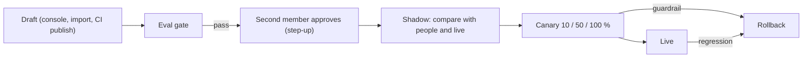

# AI agents that organizations build

Design: [RFC-135](../rfcs/RFC-135-custom-ai-agents.md). Principal and accountable owners: RFC-132. Harness, ai-worker
pool, own tool sandbox and DX ladder: RFC-133. Contract: [ai-analyze-contract.md](ai-analyze-contract.md).

Organizations change what their AI agents do through **agent revisions**. A revision is an immutable spec addressed by
its sha256: role, preset, instructions, playbooks, model policy, tool allowlist, thresholds, triggers, data-class
ceiling and, for an own agent, the image digest. Every revision passes the same lifecycle, whether it comes from
console settings (L0), a playbook (L1), an own agent image (L2) or an adapter to an external agent (L3).

## Shipped vs planned

| Part | State |
|---|---|
| AI agent principal as a service account with accountable owners (RFC-132) | in review |
| Harness, playbook format, eval harness, `openctem playbook init\|test` (RFC-133) | in review (sdk-go) |
| `ai_agents` with a role column (renamed from the analyst name before merge), permissions `ai_agents:read\|author\|manage` | planned (P0) |
| Revisions, diff, second-member approval, audit, kill switches | planned (P0) |
| Eval gate (platform baseline, injection corpus, the organization's golden set) and shadow for single-shot kinds | planned (P0) |
| AI agents pages, onboarding wizard with masked preview and try-on, owner digest | planned (P0) |
| Playbook editor, canary and automatic rollback, catalog `playbook` content with templates | planned (P1) |
| L2 on self-managed installs: `openctem aiagent` CLI, OIDC trusted publishers, image registration with signer, SBOM, provenance and vulnerability check, routing by digest, revocation | planned (P1) |
| Vetted MCP servers for AI agents with pinned tool schemas | planned (P1) |
| Isolated hosting of organization images, adapters, Python and TypeScript SDKs, publisher-scoped listings | planned (P2) |

## How a change reaches production

- **Tightening applies at once.** Lower budgets, pause, narrower scope, fewer tools or a lower data class take effect at
  the next run.
- **Widening needs the gate.** A higher preset, a new tool, a higher data class, a new trigger, another model family,
  new instructions or a new implementation needs a new revision, the eval gate and a second member.
- **Pause.** Any accountable owner can pause an agent. Resume needs `ai_agents:manage` with step-up.

## Security properties

- **No credentials.** The AI agent never holds a credential. Workers receive a signed grant per run, a run-bound job
  token and a sealed masked bundle. CI publishes drafts through an OIDC trusted publisher.
- **No organization code on shared workers.** Playbooks are data and run on the platform pool; organization images run
  on the organization's own ai-worker.
- **Gate contents.** Every eval gate includes the platform injection corpus, which must pass 100 %. The organization
  cannot edit it.
- **Golden sets.** They come from the organization's own past decisions, are masked and versioned, and are erased with
  the source finding.
- **MCP servers.** They are usable by AI agents only from vetted listings, with tool schemas pinned at approval.
- **Isolation.** Every route is tenant-scoped, in the route permission inventory and in the data-scope classification,
  with cross-tenant negative tests.

## Key places (when built)

| Concern | Where |
|---|---|
| Revisions, gates, rollout | `api/internal/app/aiagent/` |
| Tables | `ai_agents`, `ai_agent_revisions`, `ai_eval_reports`, `ai_golden_sets`, `ai_golden_cases`, `ai_trusted_publishers` |
| Golden baseline and injection corpus | `api/testdata/ai-eval/` |
| CLI | sdk-go `openctem aiagent`, `openctem playbook` |
| Console | `web/src/app/(dashboard)/ai-agents/` |
