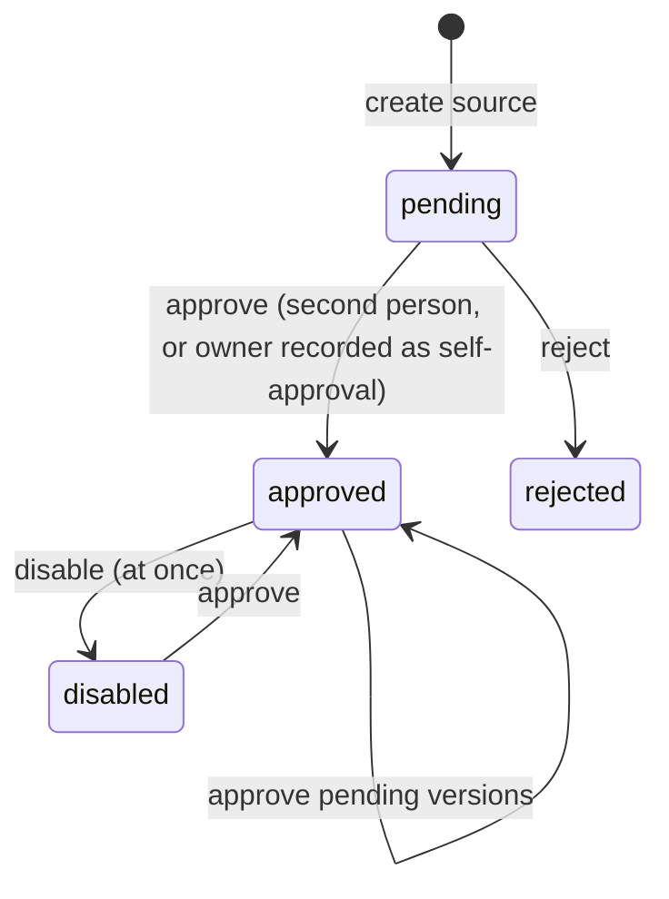

# Knowledge for AI agents

Design: [RFC-139](../rfcs/RFC-139-ai-knowledge-and-skills.md). AI agent principal: RFC-132. Bundle, masking and
contract: [ai-context-masking.md](ai-context-masking.md), [ai-analyze-contract.md](ai-analyze-contract.md).

An organization gives its AI agents prose that exists nowhere else in the platform: runbooks, conventions,
architecture notes. Facts the platform already models (assets, owners, criticality, SLAs, vulnerability intel) are
not knowledge; they reach the model through the bundle.

## Shipped vs planned

| Part | State |
|---|---|
| Sources, document versions, chunks; upload of text or Markdown | shipped |
| Credential refusal, prompt-injection quarantine, second-person approval, pending edits | shipped |
| Team visibility and data class, lexical retrieval as the AI agent | shipped |
| Retrieval in built-in single-shot runs, `kb:<n>` citations, retrieval record, `Sources:` line | shipped |
| Console: Settings > AI > Knowledge sources | shipped |
| Retrieval tools for AI workers, decision memory, skills, platform packs, URL and Git sources | planned |
| Vector retrieval | planned, only when measured |

## Data

```
ai_knowledge_sources        tenant, name, visibility (organization | teams), data_class (internal | restricted),
                            status (pending | approved | rejected | disabled), decided_by, self_approved
ai_knowledge_source_teams   the teams of a team source (trigger: same organization)
ai_knowledge_documents      one version per row: lineage_id, version, status (pending | approved | rejected |
                            superseded), quarantined + reason, content_sha256; one approved version per lineage
ai_knowledge_chunks         ordinal, title (heading path), body, search tsvector ('simple'), trigram on title
ai_run_knowledge            run, ordinal, chunk, document, source, version_digest, score, cited (no text)
ai_runs                     + retrieval_mode, retrieval_index
```

Migration `20261031065120_ai_knowledge`. Every table carries `tenant_id` with a cascade and the tenant RLS policy;
children reference parents by `(id, tenant_id)`.

## Lifecycle



A document version is added `pending`. Approving the source approves its pending versions and supersedes the versions
they replace. A quarantined version needs `acknowledge_quarantine`.

## Retrieval

`aiknowledge.Service.Retrieve(tenant, agent, query, limit)`; the repository query:

- `tenant_id` of the run only;
- approved source and version;
- `data_class = 'internal'`, or restricted when the agent's ceiling is restricted; nothing under `public`;
- `visibility = 'organization'`, or the agent is an active member of an active team of the source;
- rank `ts_rank_cd(search, websearch_to_tsquery('simple', terms joined with or), 32) + 0.3 × word_similarity(query,
  title)`.

The built-in executor builds the query from the finding (title, CVE, CWE, tool, rule, asset name, type,
environment), retrieves five excerpts, and hands them to the bundle builder, which masks them with the run's key,
drops any that carries a credential, fences them and labels them `kb:<n>`. The run records what it saw before the
model call and the cited flags after.

## Rules in code

- `aianalysis.ReviewKnowledgeOnly`: a suggestion whose only resolved evidence is `kb:` refs never changes the
  finding; it becomes a comment.
- `kb:` refs resolve only to the ordinals the bundle sent (`aidom.CheckEvidence` with the bundle's refs).
- AI agents never hold `ai_knowledge:*` (`aianalysis.Denied`).

## API

| Route | Permission |
|---|---|
| `GET /api/v1/ai/knowledge/sources`, `GET .../sources/{id}` | `ai_knowledge:read` |
| `POST .../sources`, `PATCH .../sources/{id}`, `POST .../sources/{id}/reject`, `.../disable`, `.../documents`, `DELETE .../documents/{id}`, `POST .../preview` | `ai_knowledge:manage` |
| `DELETE .../sources/{id}`, `POST .../sources/{id}/approve` | `ai_knowledge:manage` + recent sign-in |
| `GET /api/v1/ai/runs/{id}` | unchanged; adds `retrieval_mode` and `knowledge[]` |

All under the AI triage module gate. Audit actions `ai_knowledge.*`.
