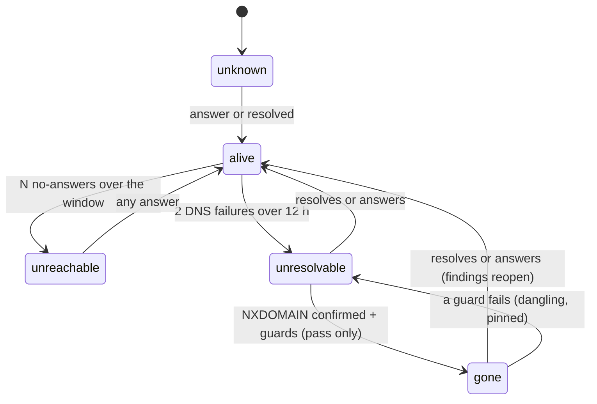

# Asset liveness

Liveness is what the platform observed about whether an asset is still there. It is read from the per-target
verdicts the [coverage loop](asset-coverage.md) already settles, and it decides one thing beyond a label: the open
findings of a **gone** asset may close as `obsolete_asset` (never counted as fixed), and they reopen when the asset is
seen again.

Liveness is a separate axis from:

- `assets.status` `stale` (the [lifecycle worker](../../internal/app/asset/lifecycle_worker.go): no source re-observed
  the asset within the stale threshold). Not seen is never gone.
- The disposition a person sets (out of scope, not ours, retired): a scope exclusion, handled by the scope effects
  reconciler (closure reason `out_of_scope`).

Code: `pkg/domain/liveness` (rules), `internal/app/liveness` (record, pass, dry run),
`internal/infra/postgres/asset_liveness_repository.go`, `internal/app/coverage/liveness.go` (verdict to observation),
migration `asset_liveness`.

## States

| State | Meaning | Findings |
|---|---|---|
| `unknown` | no active check has looked at the asset | unchanged |
| `alive` | an active check got an answer; an edge protection (CDN, WAF) that blocked or challenged the check counts as an answer | unchanged |
| `unreachable` | consecutive checks got no answer (timeout, refused, filtered) although the name resolves | stay open, labelled "cannot verify", SLA keeps running |
| `unresolvable` | the name has no address (NXDOMAIN) or the lookup failed (SERVFAIL) | stay open, labelled, SLA keeps running |
| `gone` | the name has had no address long enough, from enough observers, and it is not dangling | close as `resolved` / `obsolete_asset` when the organization turned it on |



## Evidence

Each settled coverage run hands its per-target verdicts to the recorder. Only these become observations:

| Verdict | Capability | Observation |
|---|---|---|
| covered | `probe.http`, `scan.ports`, `vuln.templates`, `crawl.web`, `dast.web` | answered |
| failed `edge_blocked` / `edge_challenged` | same | answered (something answered for the name) |
| failed `unreachable` / `timeout` | same | no answer |
| covered | `resolve.dns` | resolved |
| unresolved, no answer (sensor refusal `unresolvable` with `dns: name_gone`, or outcome `name_gone`) | any | NXDOMAIN |
| unresolved, `resolver_failed` | any | resolver failed |
| unresolved, DNS kind not stated (`dns_unknown`: a refusal `unresolvable` without `dns`, sent by sensors before sdk-go v0.38.0) | any | none: no evidence, neither advances nor resets a streak |

Everything else says nothing about the target: a tool or platform failure, a stalled run, a target no task carried,
an unfinished target, a policy block, a passive lookup, and a task whose every target failed the same target-side
way (the coverage settlement already treats that as the sensor's failure).

Per asset the row keeps the last check (when, which zone or sensor, capability, outcome), the last answer and
resolution, and three streaks with their first and last observation:

- reach: no-answers since the last answer, with up to 8 distinct observers;
- DNS: failed resolutions (NXDOMAIN or SERVFAIL) since the name last resolved;
- NXDOMAIN: "no address" answers since the name last resolved, with up to 8 distinct observers. A SERVFAIL in
  between neither grows nor breaks it.

An observer is the scan zone (`zone:<id>`) or, without one, the sensor (`sensor:<id>`) of the task. An unknown
observer never counts as a second one.

## Thresholds

| Rule | Default | Floor (tenant setting cannot go under) |
|---|---|---|
| unreachable: no-answers in a row, over at least | 3, 72 h | 2, 24 h |
| unresolvable: DNS failures in a row, over at least | 2, 12 h | fixed |
| gone: NXDOMAIN answers, over at least, seen by 2+ observers | 3, 72 h | 3, 24 h |
| gone with one observer: over at least | 7 days | 72 h, and never shorter than the 2-observer window |
| assets with open findings that may become gone per 24 h | 50 | 1 to 5000 |

With the coverage recheck schedule (1, 3, 7 days, then weekly for target-side and dead-name pairs), a name seen by
one sensor is gone at its fourth NXDOMAIN (day 11); seen by two zones, at its third (day 4).

## Gone needs the guards

A row becomes gone only in the liveness pass, which reads, beside the evidence:

- **Dangling:** an open `dangling_cname`, `dangling_ns` or `subdomain_takeover` exposure, or the `dangling_cname`
  tag, on the asset or its host name. A dangling name is the organization's asset with a takeover risk: it stays
  `unresolvable` with reason `dangling`, is never gone, and the takeover is its own finding
  ([easm.md](easm.md), "Dangling DNS lifecycle").
- **Dangling check ran clean:** the `dns.dangling` check of the name (or the service's host name) succeeded with
  outcome `ok` after the NXDOMAIN streak began. A name without that check is never gone.
- **Pinned:** a person set the asset's status by hand (`manual_status_override`) or snoozed its lifecycle.
- **Host gone:** a service (`https://name/...`) whose host name asset is gone is gone too, reason `host_gone`; a
  service nothing checked gets a row for this.

A failed lookup (SERVFAIL) and no answer (unreachable) never lead to gone: they may be the sensor's own DNS or
network. The settle path keeps gone while its evidence holds and ends it on any answer or resolution.

## Findings

The pass runs every 15 minutes per organization with rows to decide (`AssetLivenessController`):

1. Re-decide the rows that are not plainly alive, names before services, with the guards. Every change writes an
   `asset_state_history` row (`field = liveness`, the open finding count in its metadata).
2. When `close_findings_when_gone` is on: close up to 1000 open findings (`new`, `confirmed`, `in_progress`,
   `fix_applied`; pentest drafts are left alone) of gone assets as `resolved`, `resolution = closure_reason =
   obsolete_asset`, `verification = none`. Obsolete closes never count as remediated (`RemediatedSQL`).
   Version-match findings close the same way: they depend on an observed version of an asset that is gone; the
   matcher reopens only findings it closed as fixed itself.
3. Reopen the findings this pass closed whose asset is no longer gone, to the status they had (from the timeline,
   `confirmed` when it does not say). Not a regression (`openctem.person_move`), the SLA deadline is kept. A finding
   a person or a scan moved to resolved after the liveness close is not the pass's to reopen.
4. Each finding move has its timeline entry (source `asset_liveness`) and a `finding.status_changed` audit row
   (high for the critical tier). Linked tickets get the status sync jobs. The pass writes one
   `asset.liveness_applied` summary (high when it closed findings) and tells the owners and administrators in-app
   when it closed findings or held gone assets at the daily bound.

Unreachable and unresolvable findings stay open; the asset and the finding drawer show "Unreachable since <date>,
last checked by <zone or sensor>", from `liveness` on the asset response.

## Settings

`PUT /api/v1/tenants/{tenant}/settings/asset-lifecycle` carries `liveness`:

```json
{"liveness": {"close_findings_when_gone": true, "unreachable_attempts": 3, "unreachable_window_hours": 72,
  "gone_attempts": 3, "gone_window_hours": 72, "gone_single_observer_window_hours": 168, "max_gone_per_day": 50}}
```

Zero means the default; a request without `liveness` keeps the stored values. Turning closing on, fewer attempts,
shorter windows or a higher daily bound is a loosening: it needs a recent re-authentication, is audited at high
severity and the owners are told. Closing is off by default: gone is a label until the organization turns it on.

## Dry run

`POST /api/v1/tenants/{tenant}/settings/asset-lifecycle/dry-run` (owner or admin) returns, beside the stale counts,
`liveness`: assets per state after a pass, the findings it would close (and how many of the critical tier), would
reopen, and the open findings on unreachable and unresolvable assets. It writes nothing.

## Security

- Evidence comes only from command-bound sensor results of the tenant's own runs (the coverage settlement reads a
  run's own commands); a request body or an upload never writes liveness. The observer is the task's zone or
  sensor, recorded by the platform, never taken from the report.
- A sensor that lies "no such host" for every name can at most make names unresolvable; gone also needs the window,
  the dangling check (run separately, daily) and the daily bound, and every close is audited, notified and undone
  by the next resolution.
- Every statement is pinned to one tenant; the API view resolves zone and sensor names of the same tenant only.
  The asset response adds liveness only for assets the caller already passed the data scope for.
- Closing never counts as fixed and is reversible; a person's own close is never reopened.

## Seeding

The migration seeds the evidence from the coverage ledger (streak counts and last attempts). The start of a seeded
streak is estimated from the recheck schedule without jitter, so it is never earlier than the truth; seeded NXDOMAIN
streaks have no observers and need the one-observer window. The state starts `unknown` and the first pass decides.
