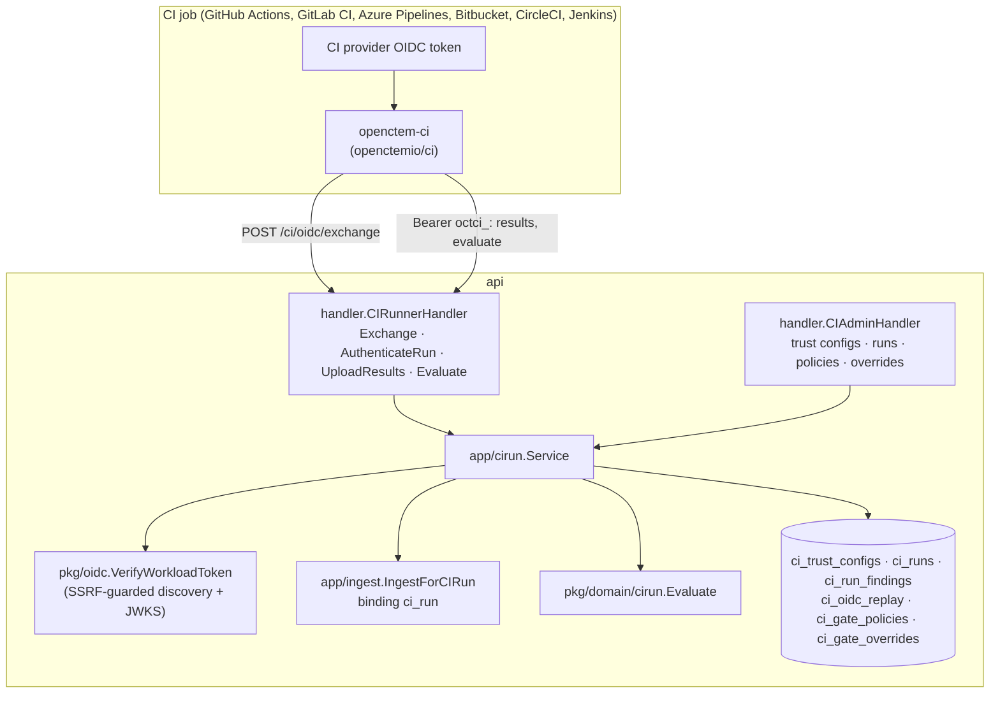

# CI runner identity and the CI gate

> Design: [RFC-051](../rfcs/RFC-051-ci-runner-identity-and-gate.md). How to
> connect a pipeline: [how-to/connect-ci-pipelines.md](../how-to/connect-ci-pipelines.md).
> The scanning path in CI itself: [shift-left-ci-scanning.md](shift-left-ci-scanning.md).
> Platform-enforced checks and pull request feedback (proposed): [RFC-077](../rfcs/RFC-077-ci-enforced-gate-and-pr-feedback.md).

## Components



| Piece | Where |
|---|---|
| Domain: trust rules, claims parsing, run, gate evaluation | `pkg/domain/cirun` |
| Per-provider issuers, audiences and claim mapping (RFC-051 section 3.1) | `pkg/domain/cirun/providers.go` |
| Trust preview (sample token against a draft) | `internal/app/cirun/preview.go` |
| Workload token verification | `pkg/oidc/workload.go` |
| Service: exchange, continuation, upload scoping, policy resolution, evaluate, administration | `internal/app/cirun` |
| Ingest entry point and the `ci_run` binding | `internal/app/ingest/ci_run.go`, `binding.go` |
| Repository | `internal/infra/postgres/ci_run_repository.go` |
| Routes and their chains | `internal/infra/http/routes/ci.go` |
| Console | `web/src/features/ci-runners`: CI/CD integration page `/ci-cd` (pipelines, runs, coverage; Trust and gate tab, `?tab=setup`; "Connect a pipeline" setup and "Recent refused pipelines" from `GET /api/v1/ci/trust-refusals`); `/ci-runners` and `/runners` redirect to `/ci-cd` |
| Pipelines: identity, status | `pkg/domain/cirun/pipeline.go`, `internal/app/cirun/pipelines.go`, `internal/infra/postgres/ci_pipeline_repository.go`, `handler/ci_pipeline_handler.go` |
| Coverage, expectations, retirement | `pkg/domain/cirun/coverage.go`, `internal/app/cirun/coverage.go`, `internal/infra/postgres/ci_coverage_repository.go`, `handler/ci_coverage_handler.go` |
| Alerts and stale sources (every 15 minutes, one replica) | `internal/app/cirun/alerts.go`, `internal/infra/controller/ci_alerts.go` |
| Migration | `001077_ci_runner_identity`, `001084_ci_pipelines`, `001099_ci_coverage_alerts`, `001144_ci_db_model`, `001145_ci_db_model_validate` |
| Retention (hourly, one replica) | `internal/app/cirun/retention.go`, `internal/infra/postgres/ci_retention_repository.go`, `internal/infra/controller/ci_retention.go` |
| Break-glass notices to administrators (in-app and `ci.break_glass`) | `internal/app/cirun/admin_alerts.go` |
| Migration | `001077_ci_runner_identity`, `001084_ci_pipelines`, `001099_ci_coverage_alerts` |

## Request chains

| Route | Chain |
|---|---|
| `POST /api/v1/ci/oidc/exchange` | per-address backstop (600/min) → per pipeline identity limit (60/min per organization + token issuer at one address; claims read unverified, only to pick the bucket) → handler (32 KB body, unknown fields refused). Both in the shared store; see "Exchange rate limit" below |
| `POST /api/v1/ci/trust-configs/preview` | session tenant chain → `scans` module → `scans:ci:write` → per-person limit (10/min) |
| `POST /api/v1/ci/runs/{id}/results` | per-IP limit → `AuthenticateRun` (token hash lookup, path id = run) → per-run limit → ingest per-tenant limit and concurrency cap → 50 MB body → decompression |
| `POST /api/v1/ci/runs/{id}/baseline-diff`, `/evaluate` | per-IP limit → `AuthenticateRun` → per-run limit |

### Exchange rate limit

Hosted CI runners put many customers behind one egress address, so one strict
budget per address let one busy fleet, or an attacker on the same runners,
throttle every other organization's jobs. The exchange counts instead:

- per address, 600 a minute, before the body is read: the flood backstop;
- per organization (`tenant_id`) and token issuer (`iss`, read without
  checking the signature) at that address, 60 a minute. The claims only pick
  a bucket and grant nothing; invented ids get fresh buckets but stay inside
  the address backstop. The address is part of the key so that someone who
  knows an organization's id (it appears in public pipeline files) cannot use
  up that organization's budget from elsewhere with junk tokens naming it.
  A request whose body or token cannot be read falls in one bucket per
  address.

Both need the real client address: behind the built-in gateway and a front
proxy, set the gateway's `OPENCTEM_TRUSTED_PROXIES` (and
`OPENCTEM_CLIENT_IP_HEADERS` behind a Cloudflare Tunnel).

Budgets beyond the chains: at most 200 reports per run (`cirun.MaxRunReports`,
`409`), at most 300 runs per pipeline per hour (`cirun.MaxPipelineRunsPerHour`,
refused at the exchange and audited `pipeline_rate`), 100,000 recorded
findings per run (`cirun.MaxRunFindings`). A run that sights more is marked
`ci_runs.findings_over_cap` and its gate fails with `too_many_findings`; it is
never judged on the first 100,000 only. Warn mode and a break-glass still apply
to it like any other blocking reason.
| `/api/v1/ci/{trust-configs,runs,pipelines,gate-policies,gate-overrides}` | session tenant chain → `scans` module → `scans:ci:*` |

## Data model

- `ci_trust_configs`: per tenant; `rules` JSONB (owners, repositories, refs,
  environments, events, fork and protected-ref switches).
- `ci_runs`: per tenant, composite FK to the tenant's repository asset
  (cascade) and to its trust configuration (`(tenant_id, trust_config_id)`,
  `SET NULL (trust_config_id)`: deleting a configuration keeps its runs as
  history). Token hash (unique) and expiry; verdict and its JSON detail; the
  provider's run id, attempt and job id (`external_job_id`, migration
  `001137`) from the verified claims.
- `ci_run_findings`: `(run_id, fingerprint)`; the gate joins it to `findings`
  of the run's asset.
- Aggregate runs (RFC-051 §4.1, migration `001220`): `ci_runs.aggregate`
  marks the run shared by the parallel capability jobs of one pipeline run:
  one per pipeline, external run id and commit, whatever the attempt
  (`evidence_union`, `idx_ci_runs_pipeline_run`, migration
  `ci_run_evidence_union`). A later attempt re-opens it and carries the
  verdict's failed capabilities (`carried_failed_capabilities`, each cleared
  only by a report of that capability) and its scanner failure count
  (`carried_scan_failures`, cleared by the next upload). A re-opened run
  keeps its verdict for the commit and pull request checks. Its upload tokens are in `ci_run_tokens`
  (`token_hash` primary key, composite FK `(tenant_id, run_id)` to the run,
  cascade; the job id; expiry), one per job exchange; it keeps none in
  `ci_runs.token_hash`. Token lookup reads `ci_runs.token_hash` first, then
  `ci_run_tokens`.
- `ci_oidc_replay`: `(issuer, jti)`, global. A provider that sends no `jti`
  (Bitbucket, CircleCI, Jenkins) is recorded under `sha256:<token hash>`.
  Each row keeps the organization, the token's SHA-256, the run it opened or
  joined and an exchange count (migration `002137`): the same token again
  (at most `cirun.MaxTokenExchanges` = 5 times) gets a token for that run,
  added to `ci_run_tokens` (`internal/app/cirun/reexchange.go`).
- `ci_runs.commit_verified` (migration `001261`): false when the provider
  signs no commit and the run's commit is the job's report; such a commit
  never matches a break-glass.
- Providers: `github`, `gitlab`, `azure_devops`, `bitbucket`, `circleci`,
  `jenkins` (the `ci_trust_configs` and `ci_pipelines` CHECKs, migration
  `001261`).
- `ci_gate_policies`: one per scope. A repository policy names
  `repository_asset_id`, a business-unit policy `business_unit_id`, each a
  composite FK (cascade); the repository's policy follows it on asset merge
  (the kept repository's own wins). The API keeps `scope_type` + `scope_id`.
- `ci_gate_baselines` and `ci_gate_baseline_findings`: one gate baseline per repository (tenant, repository
  asset), and the fingerprints it holds. Written only by `PUT /api/v1/ci/gate-baselines/{id}`
  (`scans:ci:policy`, step-up, audited high); a default-branch run is judged against it only (RFC-051 §6.2).
- `ci_gate_overrides`: per tenant, composite FK to the repository asset. The
  creator is `created_by` (a user id); its email is read from `users` when the
  override is read and is never stored, and the gate verdict (printed in CI
  logs) names no person.
- `ci_pipelines`: per tenant, unique `(tenant, provider, issuer,
  external_repo_id, workflow_path)`, composite FK to the repository asset
  (cascade; moved by asset merge). Holds the run summary the status is
  computed from (last run, fork run, default-branch and pull request
  verdicts, scanner failures, runner version, tools, median and schedule
  intervals, revocation, retirement). `ci_runs.scan_workflow_id` (composite FK)
  links each run.
- `ci_coverage_expectations`: one per `(tenant, repository asset)`, composite
  FK to the asset (cascade; moved by asset merge); the expected capabilities
  (empty = all four).
- `ci_alert_state`: one row per `(tenant, subject, kind)` while the alert's
  condition holds; the notification is sent when the row is created.
- `ci_pipelines.trust_config_id` carries the tenant like `ci_runs`
  (migrations `001144`, validated by `001145`).

### Retention

The CI retention job (`internal/app/cirun/retention.go`,
`controller/ci_retention.go`, hourly, one replica) walks the tenants with a
pipeline or a trust configuration and, per tenant, in bounded batches:

| Data | Kept | Rule |
|---|---|---|
| `ci_runs.token_hash` | until the token expired an hour ago | cleared; the run stays |
| `ci_run_tokens` | until the token expired an hour ago | deleted; the run stays |
| `ci_run_findings` | 90 days | the fingerprints of older runs are deleted |
| `ci_runs` | 400 days | older runs are deleted (their fingerprints cascade) |

Each pipeline's latest run and its latest default-branch run are always kept,
whatever their age: the pipeline summary and the gate's baseline read them.
Retention only makes the stale-source logic more conservative (it never
touches a finding it cannot attribute to a run).

### Naming rule

- `ci_*` tables hold facts that exist because a CI workload proved its
  identity with its provider's OIDC token: trust, pipelines, runs, the run
  gate, CI coverage and alerts. No `ci_*` table is renamed.
- Facts that more than one producer can report get plain domain names and are
  reserved, not built: `deployments`, `artifacts`, `artifact_attestations`
  (and `environments` once an environment carries its own attributes). They
  will reference a CI run as one possible source.
- A definition is `<x>`, its executions `<x>_runs` (`ci_pipelines`,
  `ci_runs`). A CI run is not a scan run: it is never dispatched, has its own
  credential and its own verdict, and lives in `ci_runs`, not `scan_runs`.

### Exchange and pipeline flow

```mermaid
sequenceDiagram
  participant J as CI job
  participant S as cirun.Service
  participant DB as Postgres
  J->>S: OIDC token
  S->>S: verify, admit (trust rules)
  S->>S: PipelineKeyFromClaims (repository id + workflow path)
  S->>DB: claim jti
  S->>DB: UpsertPipeline (advisory lock per tenant, caps, legacy adoption)
  S->>DB: CreateRun (scan_workflow_id, runner version)
  S->>DB: RefreshPipeline (summary from runs; fork runs excluded)
  S-->>J: run + octci_ token
```

### Inline ignore comments and scanner ignore files

An inline ignore comment (`nosemgrep`, `noopengrep`, `nosem`) or a scanner
ignore file (`.semgrepignore`) in the repository is the author's claim, not a
decision. The CI job runs the scanner with `--disable-nosem` and
`--x-ignore-semgrepignore-files`, so such results are still reported (CTIS
`suppression.kind = in_source`), and the gate counts them like any other.
From a verified default-branch run, with repository files allowed by the gate
policy, each claim becomes a pending suppression request on the repository
asset (`accepted_risk`, 90 days): the inline rule and path, or each
ignore-file pattern (`metadata.properties.ignore_file_paths`) as a path-only
rule. Requests name the CI identity in `suppression_rules.requested_by_actor`
(`ci:<provider>:<login>`; `.openctem.yml` exceptions do too), write a
`created` row in `suppression_rule_audit` and one
`ci_run.exceptions_requested` audit event. At most 20 of each per upload; an
open request for the same rule and path is not duplicated. Branch runs
request nothing.
### Known decisions

A decision made on the platform holds on the next run of the same repository:

- **Gate.** `cirun.Decision` leaves out of the verdict (counted as
  `accepted`) a finding marked false positive or duplicate, accepted until
  its acceptance expires, or covered by an approved, unexpired suppression
  rule. Rules are matched at evaluation time (`applyActiveRules`), so an
  exception approved after the finding was first seen (an `.openctem.yml`
  request) covers it; ingest only stamps findings created after approval. A
  pending request never counts. With the suppressions module off, rules do
  not apply.
- **Job output.** The response to `POST /ci/runs/{id}/results` (CTIS report)
  carries `known`: the indexes, in that report, of the results that carry such
  a decision, with the decision and the finding id. The job leaves them out of
  its console summary, SARIF and merge request report and says how many it
  hid. It learns nothing about findings it did not report, and nothing about
  another repository or tenant; a lookup failure returns an empty list, so
  the job shows everything. The response stays small whatever the report's
  size: `known` lists at most 10,000 results (`cirun.MaxKnownInResponse`,
  lowest indexes first, about 1 MB), `known_total` counts them all and
  `known_truncated` is true when some were left out. A job that reads only
  `known` shows the rest of its results, which is safe; the gate judges every
  finding on the platform either way.
- **Identity.** The finding is the same when its key is (RFC-043 §4.2): a SAST
  key is the rule, the path and the flagged code, so a line shift keeps the
  decision and a material change to the code is a new finding that is judged
  again. The job's claims (`suppressed` flags, inline ignore comments) are
  never decisions; only the platform's are.

## Invariants

- A run never creates a sensor row and has no heartbeat; offline alerts never
  see it. Its pipeline is listed on the CI/CD page (never with the sensors)
  and is never offline and never dispatched.
- A pipeline is created only at a verified, admitted exchange, keyed by signed
  immutable ids; branch, job and tool labels never create rows.
- Pipeline reads are tenant-scoped and follow the repository data scope.
- The run's branch, commit, pull request and pipeline URL come from the
  verified token; the report's own branch information is replaced.
- A pull or merge request run records its findings on its own scope:
  `pull/<n>` (GitHub, Azure Pipelines, Bitbucket, CircleCI, Jenkins) or
  `merge-requests/<n>` (GitLab), never on its head branch's name, which the
  author picks and may equal a real branch (a fork's `main`, `release/1.x`).
  A fork event records on `fork/pr-<n>`. Runs stored before this rule keep
  their rows; new uploads to such a run go to the pull request scope.
- A run's report changes only its repository asset; the baseline branch is
  decided server-side.
- A pull or merge request is compared with its base branch only when that
  base is verified and the branch may serve as a baseline; otherwise with the
  default branch. Verified: GitHub's signed `base_ref`; a GitLab merge
  request's target branch read from GitLab through the organization's GitLab
  connection (the token signs none); no other provider. A base branch the job
  reports (`base_ref` in the exchange) is ignored. A baseline branch is the
  default branch or a protected one; a name (`release/*`) never qualifies.
- A finding the run sees only on a non-counting branch is branch-only: left
  out of exposure views until a counting branch sees it
  (`branch-only-findings.md`).
- Neither the CI provider's token nor the run token is logged, stored (only the
  run token's SHA-256) or audited. The trust preview stores nothing and
  records no token id.
- A trust configuration is read only for the tenant the exchange names, by
  its exact issuer, and a token is read with that configuration's provider
  mapping only.
- Coverage lists only repositories in the caller's data scope; marking a
  repository or retiring a pipeline out of scope is a 404. The alert job lists
  tenants once and every later query is tenant-scoped.
- Stale marking and retirement touch only open findings on the pipeline's
  repository that this pipeline alone reported and nothing saw after its last
  run; findings from people (pentest, manual, bug bounty, red team) are never
  touched. A new sighting reopens a not-observed finding.
- A run token is renewed only for the job it was issued to (same run id,
  attempt and job id).
- Audited: exchange (`ci_run.token_issued`/`token_refused`), each upload
  (`ci_run.results_uploaded`), the verdict (`ci_run.evaluated`) and each
  break-glass create, revoke and use. The actor is `ci:<provider>:<login>`.
- With "OIDC required for CI" (`tenants.ci_require_oidc`, default on for new
  organizations), a one-shot sensor's key is refused on every sensor route
  (`cirun.RunnerKeyPolicy`, wired into both sensor authenticators); the
  setting is read only for one-shot sensors, and an unreadable setting
  refuses.
- A run token (`octci_`) authenticates only `/ci/runs/{its id}/{results,
  baseline-diff,evaluate}`: every session, API-key, console and MCP route
  refuses it, and the run routes refuse every other credential
  (`routes/ci_run_token_scope_db_test.go`). Another run's id answers 404.
- Refusals before a trust configuration admitted the token are uniform to the
  caller (`CI_TOKEN_NOT_TRUSTED`) and detailed in the audit log only after the
  token verified; refusals after admission tell the pipeline the reason
  (`CI_TOKEN_<reason>`, no other repository's or owner's data).
