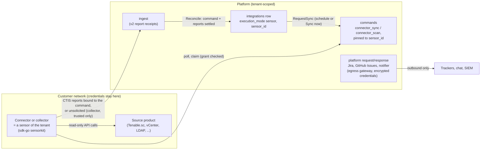
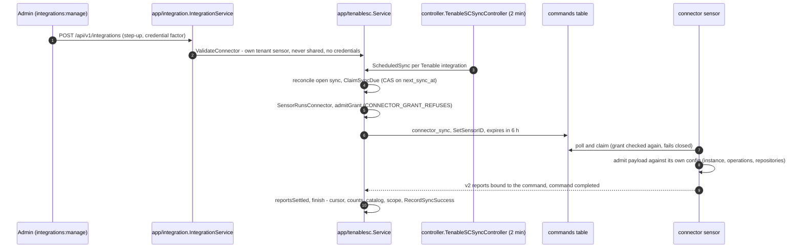

# Connector framework and run modes

Design: [RFC-146](../rfcs/RFC-146-connector-framework-and-run-modes.md). Status: **designed**; the pieces marked
shipped below exist today.

## Flow

What is built today, as of v0.19.1 (unchanged on develop since). The only
sensor-run pull connector with a platform side is Tenable.sc
([tenable-sc-connector.md](tenable-sc-connector.md)); the asset collector
pushes without commands ([sensors.md](sensors.md), "Collector sensors").
Third-party connectors, the connector kit and further run modes below are
designed, not built.

Isolation: every read is tenant-scoped (`GetByTenantAndID` for the
integration, the sensor and the command); the command is pinned to the
integration's sensor and routed only to it while it reports the tool; the
platform holds no credential of a sensor-run source. Failures are recorded on
the integration (`RecordSyncFailure`) and retried after 30 minutes
(`tenablesc.failureRetry`), or at the next interval for a refusal the owner
can fix.

## How integrations run

Three modes, no fourth.

| Mode | Direction | Credentials | Egress | Shipped |
|---|---|---|---|---|
| Sensor-run pull | upstream (sources) | on the sensor | the sensor | Tenable.sc connector, asset collector |
| Platform request/response | downstream (trackers, chat, SIEM, hooks) | platform, encrypted | the platform's egress gateway | Jira, GitHub Issues, notifier channels |
| Push in | upstream and inbound events | the caller's token | none | CTIS ingest, importers, CI, MCP |

A two-way system uses two modes: read by a sensor, write by the platform. No new pull connector runs in the API.

## The connector kit

`sdk-go/pkg/connector` gives every connector the same interface (`Describe`, `Check`, `Sync`), a host-pinned HTTP
client, pacing, retries, pagination, a persisted cursor, a durable outbox, secret providers with redaction, health in
the heartbeat, a field allow-list, and fixture-based tests. Built-in and third-party connectors use the same
contract. Status: designed.

## Matching and precedence

- Cloud resources use provider-native identifiers; hosts resolve on several identifiers; findings key on the
  canonical vulnerability id plus asset plus locus, with each source's own observation kept under the merged
  finding.
- Attribute precedence follows [asset attribute reconciliation](asset-attribute-reconciliation.md); severity stays
  per source and the platform score is computed.
- Full syncs mark a source's missing assets stale for that source; delta syncs and failed or truncated runs mark
  nothing. A finding does not close because one source stopped reporting it.

## Tickets

The platform owns finding state; the tracker owns ticket status, assignee and comments. A tracker's "done" is a
fix claim that triggers a retest. Inbound webhooks use a secret per integration with an HMAC and replay window.
Shipped for Jira and GitHub Issues; the engine is to be generalised for further trackers.

## Third-party connectors

Three trust levels: community (explicit tenant opt-in, own sensors only), verified (conformance suite, registered
publisher key), built-in (project key). Distributed as signed sensor tool packs through the content hub; third-party
code never runs in the platform. See [tool contract](tool-contract.md) and [content packs](content-packs.md).

## Shipped versus planned

Shipped: Tenable.sc connector, asset collector (vCenter, LDAP, Cloud DNS, PRTG, Splunk), file importers, CTIS
ingest, Jira, GitHub Issues, notifier channels, CI providers. Cloud provider inventory is **not** shipped:
`api/internal/app/connector` defines a `Connector` interface and a `Registry`
only, with no provider implementation and no caller (nothing imports the
package). Planned in order: cloud and Kubernetes
inventory, scanner API pulls, code-host alerts, exploit and advisory intelligence, endpoint and cloud-security
sources, declarative REST connector, further trackers, OCSF export, SIEM pack.

Key files: `api/internal/app/tenablesc/`, `api/internal/infra/controller/tenable_sc_sync.go`,
`api/internal/app/connector/connector.go` (unused), `api/internal/infra/jira/`, `api/internal/app/ticketing/`,
`api/internal/infra/notifier/`, `api/pkg/domain/integration/entity.go`.
