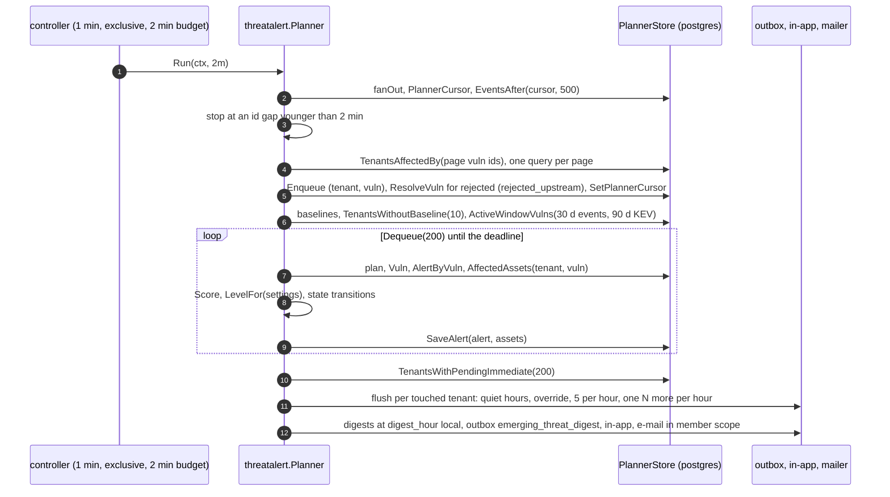
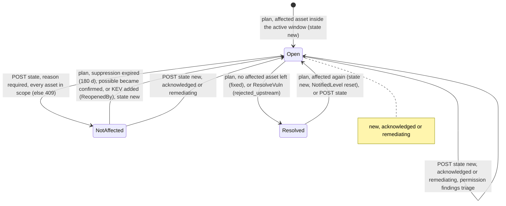
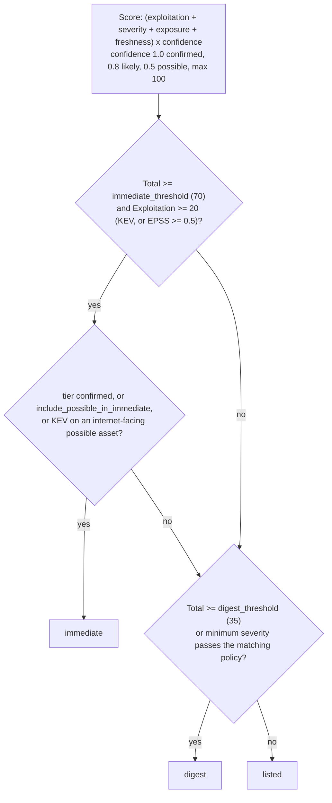

# Emerging-threat alerts

Design: [RFC-117](../rfcs/RFC-117-emerging-threat-alerts.md).

"Does this new vulnerability hit us?" answered per organization, with one
alert per vulnerability (never one message per asset) and a transparent
score that decides whether to interrupt someone.

## Pipeline

```
vulnerability bundle import (20 min) ─┐
KEV refresh (hourly, conditional)     ├─► vuln_events (global, public facts)
EPSS refresh (daily)                 ─┘          │ planner cursor (gap-safe)
                                                  ▼
matcher creates findings ──────────────► threat_alert_queue (tenant, vuln)
                                                  │ threat-alert-planner (1 min, exclusive)
                                                  ▼
                       threat_alerts + threat_alert_assets (per organization)
                                                  │ ETS, level, cap, quiet hours
              ┌───────────────────────────────────┼─────────────────────────┐
              ▼                                   ▼                         ▼
   immediate: outbox emerging_threat      daily digest 08:00 local     listed only
   + in-app (administrators)              outbox, in-app, e-mail       (the page)
```

## Flow

Verified against `develop` (2026-11-05); unchanged since v0.19.1.

### Planner pass (`threatalert.Planner.Run`, controller `threat-alert-planner`)



- A plan that fails is re-queued after the loop (not inside it), so a persistent failure cannot spin
  until the deadline. Items left when the budget ends are put back.
- `plan` skips a tenant whose module `threat_intel` is off or whose alerts are disabled, and a
  tenant not yet baselined (the baseline covers it).

### Alert lifecycle (`plan`, triage routes)



- `ValidateTransition` accepts `new`, `acknowledged`, `remediating` and `not_affected` from any
  state (no source-state check); `resolved` is set only by the planner. A `not_affected` decision
  on a KEV vulnerability is audited at high severity. The planner's `SaveAlert` refuses to
  overwrite a triage decision made after it read the alert (`ErrStale`) and plans it again.

### Level (`threatalert.LevelFor`)



## Vulnerability event log (shipped)

- Table `vuln_events`; emitter state `vuln_event_state`; cursors
  `vuln_event_cursors` (`corpus`, `kev`, `epss`, `planner`). No tenant column
  in any of them.
- `internal/app/vulnevent.Emitter`:
  - `EmitCorpus` after every import, in the import controller's run. It
    reads the CVE records whose `synced_at` passed the cursor (keyset
    `(synced_at, cve_id)`, pages of 1000), compares each with its stored
    state (`vulnevent.Diff`) and writes events, states and the cursor in one
    transaction. The first run only records the state.
  - `EmitKEV` after every KEV refresh: catalog CVEs not marked `in_kev` emit
    `kev_added`; removals are recorded without an event.
  - `EmitEPSS` after every EPSS refresh: tracked CVEs whose band (0.1, 0.5)
    rose emit `epss_crossed`.
  - `Prune`: events older than two years.
- The emitter compares stored state, so a sync an operator runs by hand is
  picked up by the next scheduled run, and a replay emits nothing.

## KEV refresh (shipped)

- `kev-refresh` controller, hourly, exclusive. The request repeats the last
  response's `ETag` / `Last-Modified` (kept per URL in the `kev` sync status
  metadata under `validators`). A 304 marks the sync successful and skips the
  upsert, the prune, the priority recompute and the escalation.
- `threat-intel-refresh` keeps the daily EPSS refresh.

## Alerts (shipped)

Tables (migration `threat_alerts`): `threat_alerts` (unique per organization
and vulnerability), `threat_alert_assets` (composite foreign keys to the
organization's alert and asset), `threat_alert_queue`,
`threat_alert_tenant_state` (baseline, last digest, last overflow message).

Planner (`internal/app/threatalert.Planner`, controller
`threat-alert-planner`, every minute, exclusive, 2-minute budget):

1. **Fan-out.** Events after the planner cursor, in id order; an id gap
   younger than two minutes is waited for (a transaction may still commit).
   Each event queues the organizations with an open finding for the
   vulnerability or a possibly affected asset (`asset_software` whose
   version did not parse or is unknown, on a product the CVE names). The
   organizations of a whole page of events (500) come from one query, so a
   large feed import costs one lookup per page, not one per event. A
   `rejected` event resolves every open alert of the CVE
   (`rejected_upstream`), after the events before it are queued.
2. **Baseline.** Organizations never planned (all of them when the feature
   ships, every new one later) get the alerts of the active window (an event
   in the last 30 days, a KEV addition in the last 90) with nothing sent at
   once, and one baseline digest. Organizations with alerts off are
   re-checked hourly.
3. **Plan** each queued (organization, vulnerability): the alert opens only
   inside the active window; affected assets are the open findings
   (confirmed, or likely below 80% match confidence) and the possibly
   affected assets; the score and the level follow RFC-117 §3.2; no
   affected asset left resolves the alert (`fixed`); a suppression is lifted
   when it expires, by a stronger match, or by a KEV addition when the
   reason allows it.
4. **Send** pending immediate alerts: quiet hours hold all but the override
   score and bundle at the end of the window; at most five messages an hour,
   then one "N more" message (at most one an hour).
5. **Digest** at the organization's digest hour in its time zone, once a
   day, when something is pending (or the baseline is due): outbox
   `emerging_threat_digest`, in-app to administrators, e-mail to members
   whose `email_digest` preference is `daily` (or `weekly`, Mondays, seven
   days), counted within each member's data scope (fail closed).

Matched findings: `vulnmatch.Service` queues the vulnerabilities of the
findings it inserts (`SetAlertQueue`); they are announced by the alert.
The per-finding priority-escalation message is skipped when an open,
announced alert of a CVE in KEV covers the finding
(`OutboxPriorityChangePublisher.SetAlertCoverage`).

Messages carry the vulnerability id, the catalog product (control
characters and channel markup stripped, length capped), why now (KEV,
ransomware use, EPSS, severity) and counts. Asset names only with
`asset_names_in_messages` (at most five). Each outbox entry lists the
affected asset ids for the delivery resolver (private program routing).

## API (shipped)

| Route | Gate | Data scope |
|---|---|---|
| `GET /api/v1/emerging-threats` | `findings:vulnerabilities:read` | alerts with an asset in scope; counts in scope |
| `GET /api/v1/emerging-threats/{id}` | `findings:vulnerabilities:read` | 404 without an asset in scope; assets in scope; `can_suppress` |
| `POST /api/v1/emerging-threats/{id}/state` | `findings:triage` | not affected needs every asset in scope (409) |
| `GET, PUT /api/v1/organization/settings/emerging-threats` | administrator | organization settings, audited |

Routes are behind the `threat_intel` module; the planner skips organizations
with the module off or alerts disabled. A remediation task from an alert
uses `POST /api/v1/remediation/tasks` with the alert's open findings that
are not in an active task (the one-active-task rule stays in the task
service).

Settings (`settings.emerging_threats`): `disabled`, `immediate_threshold`
(60-90, 70), `digest_threshold` (20-60, 35), `digest_hour` (0-23, 8),
`quiet_hours` (`enabled`, `start_hour`, `end_hour`), `quiet_override`
(70-100, 90), `include_possible_in_immediate`, `asset_names_in_messages`.
Audit: `tenant.emerging_threats_updated`, `emerging_threat.state_changed`
(high when a KEV CVE is marked not affected).

## Console (shipped)

- **Prioritization > Emerging threats** (`/emerging-threats`): summary cards,
  filters (level, state, tier, internet-facing, search), the list by level
  and score; the alert page shows the score breakdown, the recommended
  action, exploitation facts, what changed (the public events) and the
  affected assets by tier with their findings and tasks.
- Triage (`findings:triage`): acknowledge, remediating, reopen, not affected
  (reason required; hidden with a hint when assets are outside the viewer's
  scope). **Create remediation task** (`findings:remediation:write`) from the
  open findings not yet in a task; findings in a task are listed, not moved.
- **Settings > Emerging threats** (administrators): every setting above.
- Code: `web/src/features/emerging-threats/`, strings in
  `web/src/lib/i18n/dictionaries/{en,vi}/emergingThreats.json`.

## Key files

| File | What |
|---|---|
| `pkg/domain/vulnevent/event.go` | kinds, `Diff`, `EPSSBand`, the store interface |
| `internal/app/vulnevent/emitter.go` | the emitter |
| `internal/infra/postgres/vuln_event_repository.go` | persistence, KEV and EPSS comparison in SQL |
| `internal/infra/controller/threat_intel_refresh.go` | hourly KEV, daily EPSS |
| `internal/infra/controller/vuln_feed_import.go` | import, then corpus events |
| `pkg/domain/threatalert/` | alert, score, level, store interfaces |
| `internal/app/threatalert/planner.go`, `notify.go` | planner, delivery, digest |
| `internal/app/threatalert/service.go` | list, detail, triage |
| `internal/infra/postgres/threat_alert_repository.go`, `threat_alert_read.go` | persistence, scope-filtered reads |
| `internal/infra/http/handler/emerging_threat_handler.go`, `routes/emerging_threats.go` | API |
| `pkg/domain/tenant/emerging_threat_settings.go` | settings |
