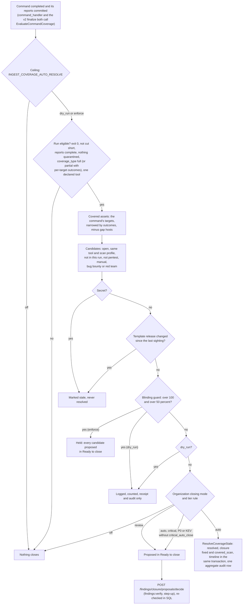

# Finding closure: when a finding closes by itself

Design: research note "finding closure policy" (local), RFC-040 (mutual
distrust), RFC-039 (continuous retest). Code: `internal/app/ingest/coverage_autoresolve.go`,
`internal/app/ingest/coverage_targets.go`, `internal/infra/postgres/finding_coverage_autoresolve.go`.

A finding closes by itself only on proof that **the same check looked again at
the same target over a healthy path and the issue is gone**. Everything weaker
(not seen, blocked, unreachable, another tool, a partial look) is an
observation that keeps the finding open.

## Coverage of one scan command

A completed scan command is evaluated once its reports are committed
(`EvaluateCommandCoverage`):

1. **The run.** The command completed with exit code 0, its result is not cut
   short, every report completed with nothing rejected, quarantined or in error,
   and every report names the same tool, which the reporting sensors declare.
   Reports must declare `coverage_type`; an absent value is never full.
2. **Per target.** When the command result carries `target_outcomes` (one
   outcome per target), coverage is decided per target: a target is covered
   only when its outcome is `done` and no coverage gap, unreached or refused
   entry of the result names its host. A run with `coverage_type` `partial`
   is accepted on these terms; `incremental` never is. A target without an
   outcome, a gap or unreached list shorter than its total, or unreadable
   metadata makes the target (or the run) not covered. A result without
   outcomes (an older sensor) proves coverage only when it is `full` and lists
   no gap, unreached or refused target.
3. **Covered assets.** Without per-target outcomes: the assets the reports
   touched, within the command's scope (unchanged). With outcomes: the touched
   assets within the scope of the covered targets, plus the assets with open
   findings of the same tool whose last sighting came from a command aimed at
   a covered target (same target string) **and** that are that target's own
   host (never a subdomain of a domain target or an address inside a range
   target the run did not name), minus every asset whose host or address the
   result names in a gap, unreached or refused entry. A scan that found
   nothing pushes an empty, command-bound report, so such a run is evaluated
   too. Repository runs keep their own rule (the touched repository within
   the command's scope).
4. **Candidates.** Open, non-repository findings of the tool on those assets,
   last seen by a report of the same tool under the same scan profile, not
   reported by this run (its receipt decides), not from a protected source
   (pentest, manual, bug bounty, red team). Secrets are marked not observed,
   never resolved. A candidate whose last sighting ran another template
   release, or recorded none while the run reports one, is marked stale, not
   resolved.
5. **Guard and mode.** The blinding guard holds a run that would close more
   than 100 findings and more than half of the tool's open findings on those
   assets. `INGEST_COVERAGE_AUTO_RESOLVE` decides what happens: `off`,
   `dry_run` (default: logged, receipt and audit only) or `enforce`. With
   `enforce`, the organization's closing mode and the tier rule decide per
   finding (`closuremode.Split`, `DecideClosure`): close, propose to a person
   (Ready to close), or keep.

## Flow

Checked against the code of v0.19.1 and develop on 2026-11-05. One clean
look is enough: there is no miss counter and no grace period.

- A held run closes nothing. Its candidates still pass the organization's
  closing mode: under `off` nothing is proposed; otherwise every candidate the
  mode would close or propose is proposed in Ready to close
  (`coverage_autoresolve.go`).
- A retest that confirms a fix with the organization's retest setting
  `auto_resolve` on also passes the closing mode (method `retest_verified`,
  `internal/app/retest/closing_mode.go`): `auto` resolves, `review` records a
  Ready to close proposal, `off` keeps the finding open and proposes nothing.
  Every status a retest moves writes a `finding.status_changed` audit row in
  the settle transaction (high when it closes a critical, P0 or KEV finding).
- A source's own "mitigated" state (`internal/app/ingest/source_resolve.go`,
  operator switch `INGEST_SOURCE_RESOLVE`) does not read the closing mode yet.
- A resolved finding that a later report sights again reopens to
  `confirmed` (to `new` if nobody had triaged it), unless it was closed as
  mitigated, a standing VEX statement says fixed, or the sighting is older
  than the close (`AutoReopenByFingerprintsBatch`). `POST
  /findings/{id}/reopen` reopens a platform close of the last 7 days.
- Every query is scoped by `tenant_id`; the closing mode is read from the
  organization that owns the command.

## What never counts as a clean look

| Outcome of a target | Why it proves nothing |
|---|---|
| `failed` unreachable, timeout, `stopped_answering` (host breaker) | the check did not run to the end against the target |
| `failed` edge blocked or challenged (gap `blocked`) | an edge answered in place of the service |
| `failed` rate limited (gap `rate_floor`) | the host pushed back; checks were skipped |
| `failed` sensor network fault (gap `proxy_unavailable`, control probe failed) | the sensor's own path failed; nothing is known about the target |
| `skipped` refused or excluded | the scanner never saw the target |
| `unfinished` | the job's time ended before the target finished |
