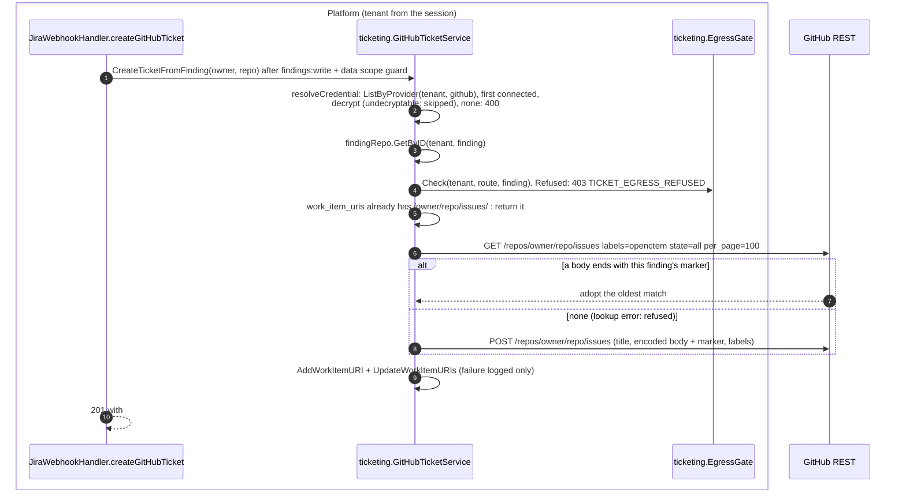
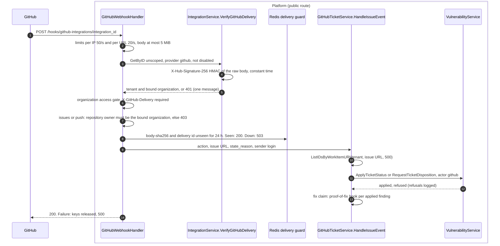

# GitHub Issues Ticketing

OpenCTEM can create a GitHub issue from a finding and link it back, alongside
the existing Jira integration. A closed or reopened issue moves the linked
findings through the same rules as a Jira status change (see
[Inbound issue events](#inbound-issue-events)).

## Flow

Same in v0.19.1 and on develop.

### Create



### Inbound issue event



### Outbound close and reopen

A status change on a finding with a linked GitHub issue queues a
`github_status_sync` durable job in the same transaction as the status write
(`ticketSyncCtx`, skipped for a move made by a ticket webhook). The handler
`GitHubTicketService.SyncFindingStatus` reads the finding, takes the first
GitHub issue URL in its `work_item_uris`, asks the outbound gate on the
status-sync route (refused: skipped and logged), and sends
`PATCH /repos/{owner}/{repo}/issues/{number}` with `state: closed` when the
finding is closed and `state: open` otherwise. Unlike Jira there is no opt-in
switch and no read of the current state first: every status change of a
linked finding is pushed. The credential is the first connected GitHub
integration of the tenant. Failures retry on the durable-job backoff (30 s
doubling to 1 h, 8 attempts).

A push comes back as an `issues` delivery when the state changes: a close
of a resolved finding arrives as `closed` (completed or no reason), whose fix claim the
closed finding refuses (logged); a reopen arrives as `reopened` and moves the
linked open findings to `in_progress`.

## Endpoint

The provider is selected on the existing create-ticket endpoint via a
`provider` field (default `jira`):

```
POST /api/v1/findings/{id}/create-ticket
Content-Type: application/json

{
  "provider": "github",
  "owner": "my-org",
  "repo": "my-service"
}
```

| Field      | Required (github) | Notes                                   |
|------------|-------------------|-----------------------------------------|
| `provider` | no                | `"jira"` (default) or `"github"`        |
| `owner`    | yes               | GitHub org/user that owns the repo      |
| `repo`     | yes               | Repository name                         |

Omitting `provider` (or sending `"jira"`) keeps the previous Jira behaviour
unchanged (uses `project_key` / `issue_type`).

**Response** (`201 Created`) — identical shape for both providers:

```json
{
  "finding_id": "…",
  "ticket_key": "#42",
  "ticket_url": "https://github.com/my-org/my-service/issues/42",
  "linked_at": "2026-06-13T10:00:00Z"
}
```

`ticket_key` is `#<issue-number>` for GitHub, the Jira issue key for Jira.

### Error mapping

| Condition                                              | HTTP |
|--------------------------------------------------------|------|
| missing `owner`/`repo`, invalid id, bad credentials    | 400  |
| outbound gate refusal (pentest, TLP)                   | 403 `TICKET_EGRESS_REFUSED` |
| no connected GitHub integration for the tenant         | 400  |
| `provider=github` but GitHub ticketing not wired       | 400  |
| finding not found                                      | 404  |
| GitHub API / internal error                            | 500  |

## Design

Parallel to Jira, intentionally:

- **Credential resolution is tenant-isolated.** The service lists the tenant's
  GitHub integrations via `integrationRepo.ListByProvider(ctx, tenantID,
  ProviderGitHub)`, picks the first `StatusConnected` one, and decrypts its
  stored credential (`CredentialsEncrypted()` → `encryptor.DecryptString`).
  A value that does not decrypt is never used: that integration is skipped
  (fail closed). Credentials are never read from the request.
- **Shared secret redaction.** Jira and GitHub route ticket text through one
  implementation, `safetext.RedactSecrets` (`pkg/safetext/redact.go`), so they
  cannot diverge. It removes whole private key blocks (header, base64 body and
  footer, also when the footer is cut off), JWTs, AWS access key ids
  (`AKIA`/`ASIA`/...), GitHub, Slack and Google tokens, `Authorization`/`Bearer`
  values and `password=`/`api_key:`-style assignments. The mobilization brief
  and the campaign epic description are written by people, but they get the
  same redaction, a length cap (`safetext.MaxBriefRunes`) and the same block
  encoding as finding text, so they cannot add links or mentions either. Secret
  findings additionally **omit the raw description and the masked preview**
  and surface only the location plus a pointer to the platform. Pentest,
  TLP and data-exposure rules come from the shared outbound gate
  (`ticketing-integration.md`, "Outbound gate"): the generic and workflow
  routes refuse pentest findings, and status pushes stop for a campaign above
  the organization's tracker TLP limit.
- **Output encoding** (RFC-040 §5.4). Finding text is attacker-influenced, and
  the issue body is GitHub-flavored markdown. After redaction:
  - One-line values (location) go into a code span
    (`safetext.MarkdownInline`).
  - The description goes into a fenced code block (`safetext.MarkdownBlock`).
  - Each fence is longer than any backtick run in the text, so the text cannot
    close it.
  - Inside code GitHub renders no links, images, HTML, `@mentions` or
    `#refs`, so scanner text cannot ping a team or close an issue.
  - The title is plain text: one line, cleaned of control, bidi and
    zero-width characters, at most 240 characters.
- **Idempotent.** If the finding's `work_item_uris` already contains an issue
  URL for the requested `owner/repo`, the existing link is returned and no new
  issue is created.
- **Duplicate-proof create.** The issue body ends with a hidden marker
  `<!-- openctem:k=finding;o=<finding id>;t=<tenant tag> -->` (the tenant tag
  is a hash, so the tenant id is not written into the repository). Before
  creating, the service lists the repository's 100 newest `openctem` issues
  (the issue list, not the search index, so an issue created a moment ago is
  in it) and adopts the oldest one whose body **ends** with exactly this
  marker. A create whose response was lost, or whose URL was not recorded, is
  therefore recovered by the next attempt instead of opening a second issue.
  A marker of another finding or tenant, or one quoted inside finding text,
  never matches; if the list cannot be read the create is refused.
- **Best-effort link persistence.** Once the issue is created, its URL is added
  to the finding's `work_item_uris`. A persistence failure is logged but does
  not fail the request (the issue already exists; the next attempt adopts it).
- **Labels.** Issues are tagged `openctem`, `security`, and the finding
  severity.

## Inbound issue events

Each GitHub integration has its own inbound webhook:

```
POST /hooks/github-integrations/{integration_id}
X-Hub-Signature-256: sha256=<hex HMAC-SHA256 of the raw body>
X-GitHub-Delivery: <GUID>
X-GitHub-Event: issues | push | ping
```

- **One integration, one secret.** The integration id in the URL names one
  integration and so one tenant. The delivery must be signed with that
  integration's own secret (stored encrypted in the integration metadata,
  shown once when generated, never returned). An unknown, disabled or
  non-GitHub integration, and a bad signature, all answer 401 with the same
  message. There is no tenant chosen by the sender and no search across the
  tenant's secrets.
- **Replays.** The signature covers the body only, so the body hash is a
  delivery key as well as `X-GitHub-Delivery`: both must be new (24 hours, in
  Redis, shared by every replica). A captured body sent again with a fresh
  delivery id is acknowledged and ignored. Without the store every delivery is
  refused (503). When processing fails the keys are released and the answer is
  500, so a redelivery from GitHub is processed.
- **Repository binding.** A `push` or `issues` event must name its
  repository; when the integration is bound to a GitHub organization, the
  repository's owner must be that organization (403 otherwise).
- **Limits.** Per client IP (50/s, burst 500) and per integration URL (20/s,
  burst 200).
- **Suspended organization.** Refused after the signature verified.

An `issues` delivery for an issue linked to findings (by its browse URL in
`work_item_uris`, every linked finding of the tenant, at most 500) goes through
`VulnerabilityService.ApplyTicketStatus` / `RequestTicketDisposition` with the
integration `github` as the recorded actor and the sender's login as the
tracker account:

| Event | Meaning for linked findings |
|---|---|
| `closed`, `state_reason: completed` (or no reason) | Fix claim: legal steps to `fix_applied`, then the proof of fix is requested per claimed finding. Never a close. |
| `closed`, `state_reason: not_planned` | A pending risk-acceptance request per finding (requested by the ticket actor; an approver decides). No fix claim. |
| `closed`, `state_reason: duplicate` | Nothing changes (the work lives in the other issue). |
| `reopened` | Back to `in_progress` (a claim not yet verified is withdrawn). |
| anything else | Ignored. |

The transition map, the pentest gate (a pentest finding is never moved by an
issue), the approval gate and tenant scope apply as for a person's bulk
change. Refusals are logged; they are not commented back on the issue.

Secret routes: `GET /api/v1/integrations/{id}/github-webhook` (URL and whether
a secret is set; `integrations:manage`) and
`POST /api/v1/integrations/{id}/github-webhook/secret/rotate` (`integrations:manage`,
`integrations:scm:write` and step-up; audited as a Critical
`integration.webhook_secret_rotated` entry without the secret).

## Layering

| Layer        | Component                                                        | Responsibility                                  |
|--------------|-----------------------------------------------------------------|-------------------------------------------------|
| HTTP handler | `internal/infra/http/handler/jira_webhook_handler.go`           | Parse request, select provider, map errors      |
| App service  | `internal/app/ticketing/github_ticket.go` (`GitHubTicketService`) | Resolve integration, idempotency, build body; inbound issue events |
| Inbound      | `internal/infra/http/handler/github_webhook_handler.go`          | Verify per integration, replay keys, repository binding |
| Inbound      | `internal/app/integration/github_webhook.go`                     | Per-integration secret, `VerifyGitHubDelivery`   |
| Shared       | `pkg/safetext/redact.go` (`RedactSecrets`)                      | Provider-agnostic secret scrubbing              |
| Shared       | `pkg/safetext` (`MarkdownInline`, `MarkdownBlock`, `Jira*`)      | Output encoding per ticket format (RFC-040)     |
| SCM client   | `internal/infra/scm/github.go` (`GitHubClient.CreateIssue`)     | `POST /repos/{owner}/{repo}/issues`             |
| Domain       | `pkg/domain/vulnerability`, `pkg/domain/integration`            | Finding + integration entities/repositories     |

The service depends on a small `issueCreator` interface (one `CreateIssue`
method) rather than the concrete SCM client, which keeps it unit-testable
without network access; `*scm.GitHubClient` satisfies it in production.

## Follow-ups

- Comment refusals and the outcome of a not-planned close back on the issue.
- Use the integration that received the issue's events (or created it) for
  the outbound push, instead of the first connected GitHub integration.
- A console control for the inbound webhook URL and secret (API only today).
- A provider-abstraction interface so Jira/GitHub share one orchestration
  service instead of two.
