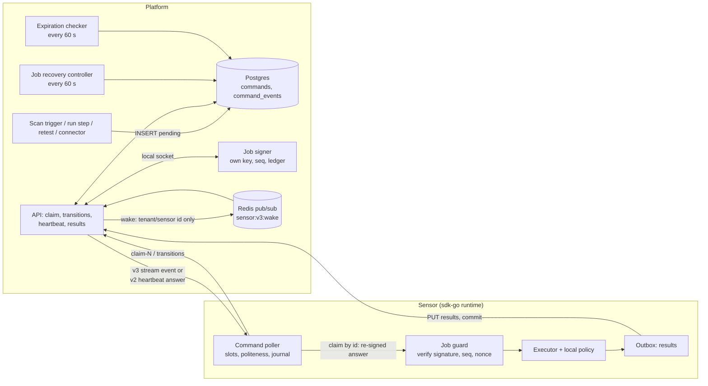
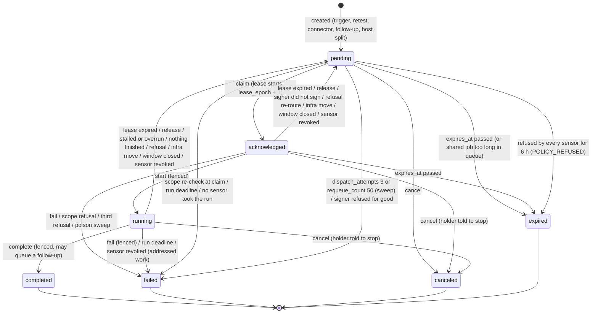
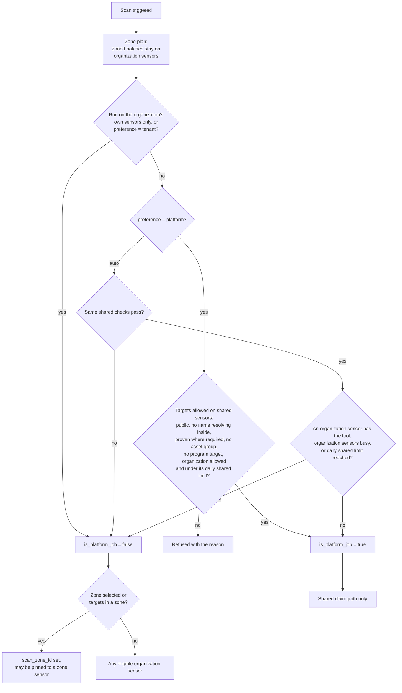
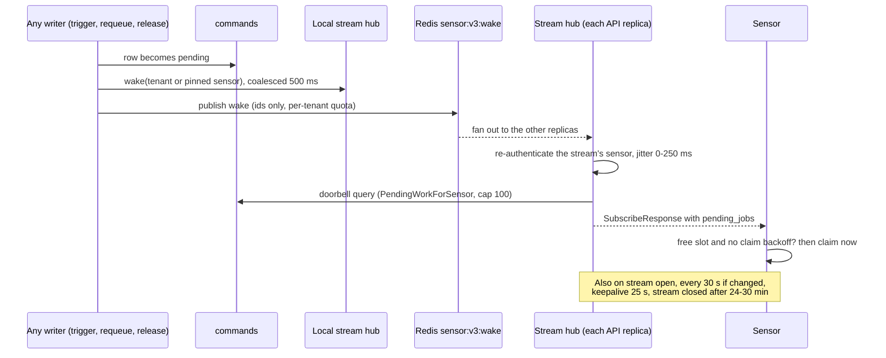
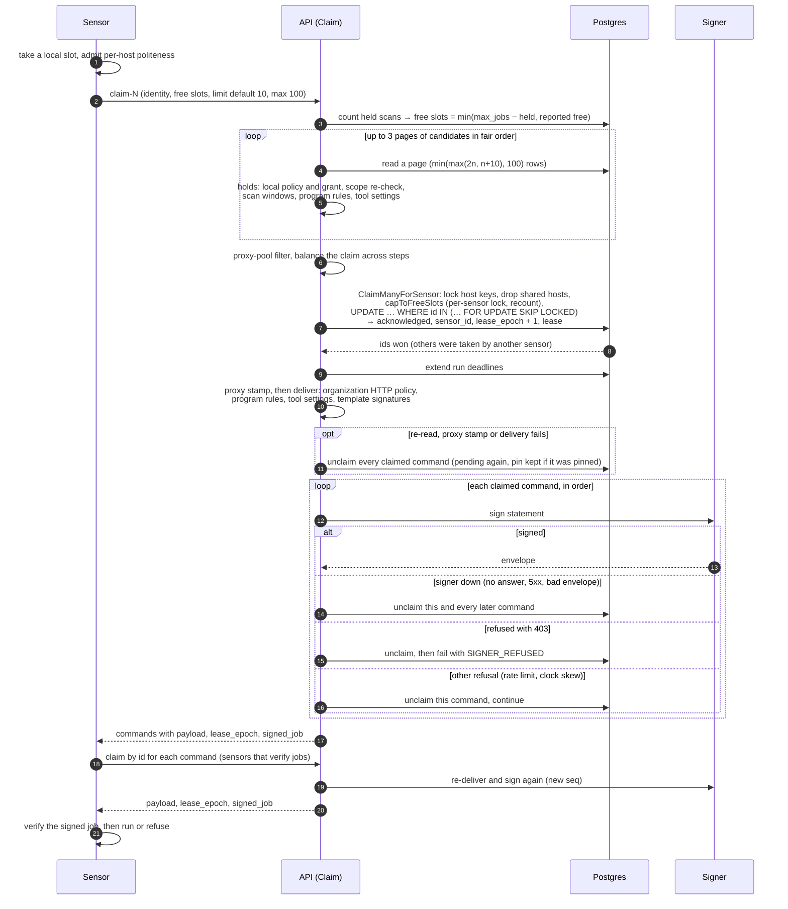
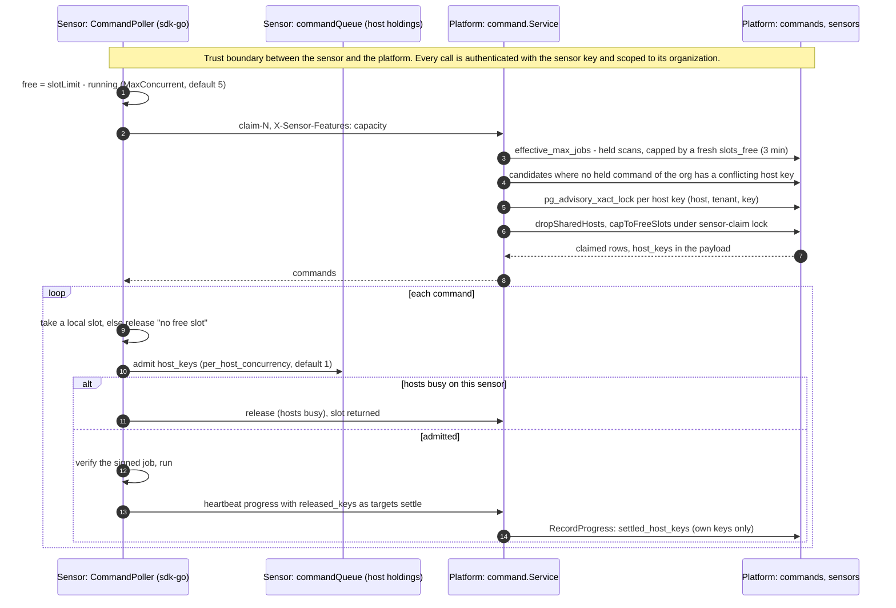
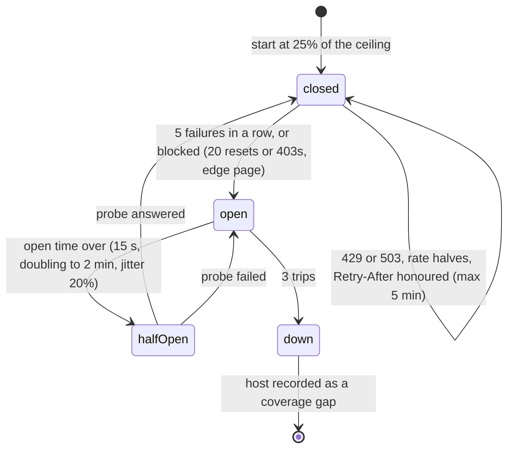
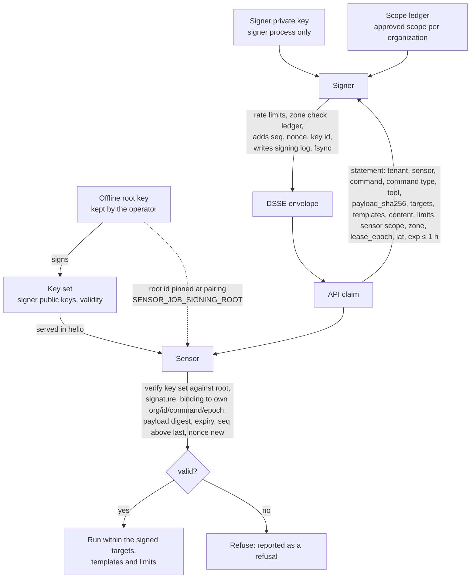
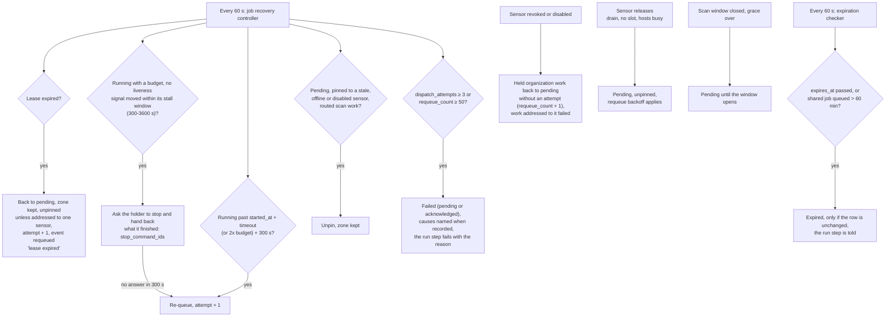
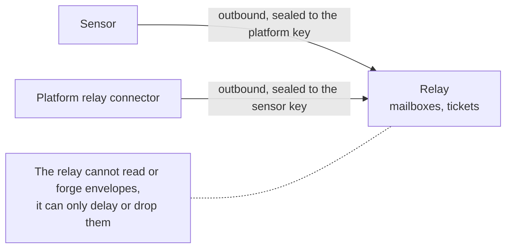

# Job dispatch: how a sensor receives, holds and finishes a job

Part of the [sensor and platform workflow](sensor-platform-workflow.md).

> One page for the whole path of a job, from the trigger that queues it to the
> result that settles it. Details live in the linked documents; this page
> says how they fit together, which table, log line or metric shows each
> step, and what each step guarantees. Diagrams checked against the code of
> v0.19.1 and develop on 2026-11-05 (signed jobs on by default).
>
> Designs: [RFC-030](../rfcs/RFC-030-scan-work-distribution.md) (chunks,
> leases, fair pull), [RFC-035](../rfcs/RFC-035-sensor-control-plane-under-load.md)
> (heartbeat, doorbell, leases), [RFC-040](../rfcs/RFC-040-platform-sensor-mutual-distrust.md)
> (mutual distrust, signed jobs), [RFC-046](../rfcs/RFC-046-scans-redesign.md)
> (fair order), [RFC-059](../rfcs/RFC-059-sensor-transport-v3.md) (transport v3),
> [RFC-100](../rfcs/RFC-100-shared-sensors.md) (shared sensors),
> [RFC-116](../rfcs/RFC-116-sensor-relay.md) (relay),
> [RFC-090](../rfcs/RFC-090-work-pool.md) (work pool, the planned successor of
> trigger-time chunking).

## Contents

- [Principles](#principles)
- [The pieces](#the-pieces)
- [Job creation and chunking](#job-creation-and-chunking)
- [The commands table and the status machine](#the-commands-table-and-the-status-machine)
- [Routing: organization sensors, shared sensors, zones, connectors](#routing-organization-sensors-shared-sensors-zones-connectors)
- [Waking the sensor (doorbell)](#waking-the-sensor-doorbell)
- [The claim](#the-claim)
- [Signed jobs end to end](#signed-jobs-end-to-end)
- [Holding a job: leases, heartbeat, progress](#holding-a-job-leases-heartbeat-progress)
- [Recovery: expiry, lease loss, stalls, poison](#recovery-expiry-lease-loss-stalls-poison)
- [Results and completion](#results-and-completion)
- [Relay](#relay)
- [Failure modes and how to diagnose them](#failure-modes-and-how-to-diagnose-them)
- [Security properties](#security-properties)
- [Known limits and planned changes](#known-limits-and-planned-changes)
- [Key files](#key-files)

## Principles

1. **The platform picks the job; the sensor never chooses.** A sensor sends
   its identity and how many slots it has free. Every eligibility rule is
   evaluated by the platform, and evaluated again inside the statement that
   claims the job.
2. **Postgres is the queue and the only source of truth.** A job is a row in
   `commands`. Redis only carries wake-ups that hold no data; a lost wake-up
   costs latency, never a job.
3. **Pull, outbound only.** The platform never dials a sensor
   ([sensor ↔ platform trust](sensor-platform-trust.md#outbound-only-invariant)).
   Work reaches a sensor because the sensor asks for it.
4. **A claim is a lease.** Whoever holds a job holds it for a short, renewed
   lease with an epoch. Every change a sensor makes to a job is fenced by
   (sensor, state, epoch), so a holder that lost the job can never finish it.
5. **Nothing leaves unsigned.** Each job handed to a sensor carries a
   statement signed by a separate signer that holds its own key and scope
   ledger; the sensor checks it against a root it pinned. The API sends scope
   widenings to the ledger with the approvals it recorded, and the signer
   checks them against the operator's approval floors
   (`internal/signer/ledger.go`); its periodic sync can only narrow the
   ledger. The signer down means claims wait, never that jobs leave unsigned.

## The pieces



| Piece | Where |
|---|---|
| Job row | `commands` (see [the table](#the-commands-table-and-the-status-machine)) |
| Timeline of a job | `command_events` (written by the trigger `trg_command_events`) |
| Claim, start, complete, fail, release | `internal/app/command/service.go`, `internal/infra/postgres/command_repository.go` |
| Shared claim | `internal/app/command/shared_claim.go`, `internal/infra/postgres/command_shared_claim.go` |
| Leases, re-queue | `internal/infra/postgres/command_lease.go`, `internal/infra/controller/job_recovery.go` |
| Signing at claim | `internal/app/command/job_signing.go`, `cmd/signer`, `internal/signer` |
| Doorbell | `internal/app/sensor/doorbell.go`, `internal/infra/sensortransport/subscribe.go` |
| Sensor side | sdk-go `pkg/core/command_poller.go`, `pkg/core/job_signing.go`, `pkg/jobsig` |

## Job creation and chunking

Jobs are created when work is triggered, not when a sensor asks:

- **Single-scanner scan** (continuous coverage runs included):
  `internal/app/scan/trigger.go` builds the payload (`scanner`, `config`,
  `targets`, run and step ids). A scanner that takes a target list gets one
  command per chunk of `targets_per_job` targets when that is 2 or more
  (coverage sets it to the capability's chunk size, e.g. 25 for template
  scans), so every eligible sensor slot takes a share; `targets_per_job` 1, the
  default of a new scan, keeps one command with every target. A scanner that
  reads one target gets one command per target (`unzonedJobPlan`,
  `internal/app/scan/zones.go`).
- **Workflow step:** `internal/app/scan/step_plan.go` and
  `internal/app/scanrun/run.go` queue a step's commands when the step starts
  ([scan stages](scan-stages.md), [scan orchestration](scan-orchestration.md#work-distribution-today-and-the-work-pool)).
  Chunks are cut on whole hosts (`internal/app/scanrun/host_chunks.go`), so
  the chunks of one step never compete for a host.
- **Zoned runs** are capped at 1000 jobs per run (`internal/app/scan/zones.go`).
- **Retests, validations, connector scans and syncs, configuration commands**
  are created by their own services with the same table and claim path.

Each command records at creation: `tenant_id`, `type`, `priority`
(`low`/`normal`/`high`/`critical`), `payload`, the routing decision
(`is_platform_job`, `sensor_id` when pinned, `scan_zone_id`), `host_keys` (the
per-host politeness keys from `github.com/openctemio/contract/politeness`; an empty
list for a passive tool that reaches no target host, such as DNS resolution,
subdomain discovery, RDAP and ASN lookups, whether it runs as a workflow
stage or as a single-scanner or coverage command, so it never waits behind
or holds back the active scans of the same names; custom resolvers make a
DNS tool active again),
`dispatch_gate` (what the target gate decided), optional `scheduled_at` (a
scan window not open yet) and `expires_at`.

Chunk sizes are fixed at creation. Two things adapt them later:

- **Host-busy split at claim** (`internal/app/command/host_split.go`): when a
  sensor has free slots and a pending command is blocked only by a few busy
  hosts, the free part is split off and claimed now.
- **Follow-up for unfinished targets** (`completeWithFollowUp`,
  `internal/app/command/service.go`): a completed scan whose result leaves
  targets unfinished queues, in the same transaction, a new command with only
  those targets.

## The commands table and the status machine



Columns that drive dispatch:

| Column | Meaning |
|---|---|
| `status` | `pending`, `acknowledged`, `running`, `completed`, `failed`, `canceled`, `expired` |
| `sensor_id` | Pinned target before a claim (NULL: any eligible sensor); the holder after a claim |
| `is_platform_job` | Queued for shared sensors; the routing decision is final |
| `scan_zone_id` | Only sensors assigned to this zone may take it |
| `lease_epoch`, `lease_expires_at` | The current claim's number and its lease |
| `dispatch_attempts` | Lease losses, refusals, infrastructure moves, stalls and overruns, stops with nothing finished, and the two older recovery functions; 3 makes it poison (the sweep fails pending and acknowledged commands). Release, unclaim, window deferral and revocation do not count |
| `requeue_count` | Every return to `pending` (unclaim while the signer is down, voluntary release, refusal re-route, lease expiry, stall, sensor withdrawn, scan window deferral); each return after the first delays the next offer (`scheduled_at`, 5 s doubling to 5 min, none for a refusal re-route); `command.MaxRequeues` (50) fails the command with "max re-queues exceeded" |
| `refused_by`, `refusals` | Sensors whose local policy refused it (never offered to them again) |
| `host_keys`, `settled_host_keys` | Politeness keys held while acknowledged or running; keys released as targets settle |
| `scheduled_at`, `window_hold` | Not due before its scan window opens |
| `progress_*`, `last_progress_at`, `stop_requested_at` | Progress the heartbeat reports; stall handling |
| `expires_at` | Must start before this time (set by connectors and some commands; most scan chunks have none) |

`command_events` records every transition with its sensor, attempt, code and
message: `queued`, `claimed`, `started`, `requeued`, `refused`, `completed`,
`failed`, `canceled`, `expired`. It is the first place to look for any single
job.

## Routing: organization sensors, shared sensors, zones, connectors

Routing is decided once, when the job is created, and then enforced by the
claim predicates.

Zones are decided first (`decideSensorRouting`, `internal/app/scan/trigger.go`):
zoned batches always stay on the organization's sensors, and only the unzoned
batches can go to shared sensors, so one run can be mixed (`zones.go`).



- **Internal targets on shared sensors**: targets inside one instance scan
  zone assigned to the organization pass the shared check
  (`sharedTargetRefusal`); a platform preference with a target inside an
  organization zone is refused.
- **Workflows** route per step (`internal/app/scanrun/run.go`,
  `routeToPlatform`, `stepTargetsMayGoShared`): a zoned run never goes shared.
  A workflow run with preference platform that cannot use shared sensors
  falls back to organization sensors with a log warning instead of being
  refused.
- **Organization sensors** claim only `is_platform_job = false` commands of
  their own organization; **shared sensors** claim only `is_platform_job =
  true` commands, of every organization, through the
  [shared claim path](sensors.md#the-shared-claim-path). No requeue path changes
  that flag. The scan setting "run on the organization's own sensors" is
  therefore enforced by the routing decision itself.
- **Scan zones** ([scan zones](scan-zones.md)): a zoned command is offered only
  to sensors assigned to its zone that have its tool, pinned or not. Shared
  sensors take unzoned shared jobs only; an instance scan zone travels in the
  signed statement, never in the payload.
- **Connector sensors** (for example the Tenable.sc runner,
  [tenable-sc-connector.md](tenable-sc-connector.md)): connector commands are
  pinned to the configured runner at creation and claimed like any other.
- **Placement explainer** ([placement](placement.md)): for a waiting task it
  evaluates the same predicates per sensor and names what blocks it.

## Waking the sensor (doorbell)

A sensor does not need to poll fast to start work quickly. Two channels tell
it there is claimable work:

- **Transport v3 control stream** (`Subscribe`,
  [transport v3](sensor-transport-v3.md)): a server stream that sends the
  doorbell on open, again on every wake for the sensor's organization or the
  sensor itself, on a 30-second re-check, and a keepalive every 25 seconds.
  Streams end after a jittered maximum age (24–30 minutes) and reconnect.
  Wakes are published on Redis (`sensor:v3:wake`) so every API replica's
  streams hear them, coalesced to one per 500 ms per key.
- **Protocol v2 heartbeat answer** ([heartbeat doorbell](sensors.md#heartbeat-doorbell)):
  `pending_jobs` and `next_heartbeat_seconds`: 5 seconds while work waits, the
  sensor has free slots and holds no v3 stream; otherwise the idle interval,
  which grows with the fleet size; a slow doorbell query (250 ms or more)
  advises the maximum, capped at `MaxIntervalBound` (`doorbell.go`). Values
  are jittered.

The pending count comes from `PendingWorkForSensor`, the same predicates as the
claim (without the suspended-organization check), capped at 100. From v0.20.0:
when the count is 0, it adds the commands a claim would split around busy
hosts (`doorbell.go`). The SDK polls when the doorbell rings or a slot frees; while the
server sends hints, the fixed poll interval is replaced by a 5-minute safety
poll.



## The claim

A claim (claim-N) is one request: `GET /api/v2/sensor/commands?limit=n` with
the `capacity` feature, or `ClaimCommands` on v3. The commands returned are
already acknowledged to the sensor.



**Predicates in the claim statement** (also in the candidate read, the
doorbell and the claim by id):

| Check | Rule |
|---|---|
| Tenant | `commands.tenant_id` = the authenticated sensor's organization; suspended organizations get nothing |
| Routing | not a shared job (shared path: only shared jobs) |
| Pin | unpinned, or pinned to this sensor |
| Due | `pending`, not expired, `scheduled_at` passed |
| Zone | unzoned, or the sensor is assigned to the zone and has the tool |
| Tool | the command's tool is one the sensor reported installed (`effective_tools`) |
| Capabilities | every `required_capabilities` is one the sensor has |
| Features | every `required_features` is one the sensor reported (never only declared) |
| Refusals | the sensor is not in `refused_by` |
| Failed on | the sensor is not in `failed_on` (it already failed the job for an infrastructure reason) |
| Cloned identity | a sensor whose identity is held as cloned gets nothing |
| Hosts | no other acknowledged or running command of the organization holds a conflicting host key (re-checked under advisory locks); a shared job also needs fewer than its limit (2, intrusive 1) of shared jobs of any organization holding one ([sensors.md](sensors.md#the-shared-claim-path)) |

**Fair order** (`fairPendingQuery`, `command_claim_lanes.go`):

1. Priority class: critical 1 … low 4, raised one class per 30 minutes
   waited, never into critical.
2. Short work before long work on the claiming sensor, while short work used
   no more than half of that sensor's time. A job is *short* when its targets
   at the sensor's measured speed for its tool (the fresh load report's
   `per_tool.throughput_targets_per_min`) take at most 5 minutes; otherwise,
   or with no fresh speed, it is *long*. The two lanes' time is the time their
   scan jobs held the sensor in the last hour (claim to end, or to now while
   held). While short work used no more than long work, a short job takes the
   highest class aging gives (2, never critical) and goes first in its class;
   once it used more, long jobs go first in each class. A discovery run's
   lookups therefore start at the sensor's next free slot however long the
   queue of long scans is, and long scans keep at least half of the sensor's
   time however much short work arrives. A sensor without a fresh load report
   sees one lane, the order below.
3. Round-robin across runs: the first pending command of every run before the
   second of any, where a run's commands already held by the organization's
   sensors count as served. A run with nothing running goes before one that
   has jobs running, also when a claim takes one command at a time (ranking
   pending commands alone made that first-come-first-served).
4. Age.

The ranking is computed over the first 1000 candidates in (class, lane, age)
order, across all classes (`fairCandidateWindow`). The order only ranks what
the sensor may claim: every predicate above, the holds after the query, the
slot cap and host politeness are unchanged. All reads are scoped to the
claiming sensor's organization and to that sensor: another organization's
jobs, runs or sensors never move the order. Measured case (2026-11-04): a
four-step discovery run queued behind 22 vulnerability-scan jobs of earlier
runs on a sensor with two slots waited 4 h 41 min for its first lookup; with
this order it waits for the next free slot.

**The claim-by-id replay.** A sensor that verifies signed jobs claims every
command of a claim-N answer again by id (sdk-go `CommandPoller.claim`). The
API re-delivers and signs that command again with a new sequence number
(`internal/app/command/transition.go`), and the sensor verifies the second
envelope. Each job is therefore signed twice, and the signer's per-sensor
rate limit (20 per second, burst 200) is spent twice. A permanent refusal
on the replay does not fail the command; it returns when its lease expires.

**Shared claim order** (`GetSharedPendingForSensor`): rounds of 5 jobs per
organization; organizations with a pending critical job first, then within a
round the organization with the fewest shared jobs in flight first (an
organization's first critical job jumps ahead), then class,
`queue_priority` and queue time; each organization's
`platform_scans_concurrent` is enforced inside the claim under a
per-organization lock. The read is bounded by the organizations with pending
shared work (at most 200 ranked, five jobs each per round, through
`idx_commands_shared_pending` and `idx_commands_shared_inflight`), never by
the depth of their queues or by finished jobs
([sensors.md](sensors.md#the-shared-claim-path)).

**Claim by id** (`POST /commands/{id}/claim`, `TransitionCommand`): the same
predicates and holds for one command (expiry is checked in Go); a replay by
the holder answers the command as it is, delivered and signed again. Used by
verifying sensors after every claim-N, for commands handed over before
claim-N, and by older clients. It does not apply the slot cap.

**Slots** are counted by the platform from the commands themselves, not from
the last heartbeat; the SDK also takes a local slot before it claims and
admits per-host politeness with the same key function, so it does not hold
more than it can run.

### Slots and host keys at a claim



- **Host keys** come from one function shared by both sides
  (`github.com/openctemio/contract/politeness`): a name is its lower-case host,
  an address is the address plus its /24 (IPv6 /120) bucket, a range is one key
  per bucket; at most 500 keys per job; private names and addresses carry the
  network id. An address conflicts with a range scan of its bucket. The API
  assigns them at creation (`AssignHostKeys`): keys the caller set, else the
  payload's `host_keys`, else computed from the targets. Passive stages get an
  empty list.
- **Settling**: as targets finish, the sensor reports the keys it no longer
  needs (`released_keys`); `RecordProgress` keeps only keys of the command
  itself and only for the sensor that holds it. A claim or re-queue clears
  `settled_host_keys`.
- **Shared fleet**: across organizations a host is held by at most 2 shared
  jobs, 1 when intrusive (`fleet_politeness.go`), under global `shost|` locks
  that never say which organization holds a host.
- **Effective job limit**: the lowest positive value of the sensor's reported
  limit, the administrator's limit (1 to 100) and the reported `slots_total`;
  an `overloaded` pressure report allows 0 (1 when idle), `elevated` allows 1.

### Per-host rate on the sensor (HostRate)

The platform decides which hosts a job may touch at the same time; the sensor
decides how fast. When the tool's network is confined, the egress forwarder of
each task paces every host with an adaptive controller and a per-host breaker
(sdk-go `pkg/adapt/hostrate.go`, bounds in `pkg/adapt/bounds.go`).



- The ceiling is the lowest of the scan's rate limit, the scan window, program
  rules, the sensor's local `rate.max_rps` and the sensor setting (default
  100, floor 1).
- A host the breaker refuses gets HTTP 503 from the forwarder; the task still
  completes, and the host is reported as a coverage gap (`breaker_open`,
  `rate_floor`, `blocked`, `proxy_unavailable`) in the result's
  `coverage_gaps`. The API treats those hosts as not covered, so no finding
  closes because of them (`internal/app/ingest/coverage_targets.go`).
- A reset from a host that already answered only halves the rate; 20 in a row
  count as blocked (sdk-go v0.46.3, sensor v0.37.0).

## Signed jobs end to end

Full reference: [signed jobs](job-signing.md).



- The API never holds the signer's key; the signer refuses statements outside
  its ledger (`out_of_ledger`, `tier_exceeds_ledger`, `target_excluded`,
  `template_not_in_ledger`) and the zone, shared and feed checks; any 403 makes
  the command fail with `SIGNER_REFUSED`.
- Production API refuses to start without `SIGNER_SOCKET` set unless
  `SIGNER_DANGEROUS_ALLOW_UNSIGNED_JOBS` is set; the check is on the variable,
  not on a live socket. Newly paired sensors require signed jobs.
- The signer numbers statements per sensor; the sensor keeps the last
  sequence per signer key id and refuses a number not above it, and a reused
  nonce.
- A sensor refuses an invalid job through the fail call as a `builtin`
  refusal (rule `job_signature` or `job_keyset`); the platform does not
  re-route it, the command fails closed.
- A shared job's statement names the organization and, for an instance scan
  zone, its ranges; the shared sensor binds results to that organization.

## Holding a job: leases, heartbeat, progress

Reference: [command leases](sensors.md#command-leases-rfc-035-d6).

- A claim sets `lease_expires_at = now + SENSOR_COMMAND_LEASE` (default 3
  minutes, clamped to 1–30 minutes) and increments `lease_epoch`.
- The heartbeat carries the ids the sensor runs and their progress; the
  platform renews those leases (`RenewLeases`), writing only when less than
  about half the lease is left, so a heartbeat does not always write.
- The advised heartbeat interval is capped below the lease
  (`MaxIntervalBound`), so one missed heartbeat does not lose a job.
- Start, complete and fail are fenced (`FencedUpdate`): they apply only if the
  command is still held by that sensor, in the state read, under the same
  epoch; the SDK echoes the epoch (`X-OpenCTEM-Lease-Epoch`) on complete and
  fail.
- The heartbeat answer and the v3 stream list commands the sensor must stop:
  canceled ones, and ones re-queued away from it.
- Code-scan source credentials are minted per call for the lease holder only.

## Recovery: expiry, lease loss, stalls, poison



- **Lease loss** is the main recovery path: a dead or partitioned sensor's work
  returns within one lease plus one controller tick.
- **Expiry** has one owner (the expiration checker), which also notifies the
  run; it never overwrites a row that moved since it was read.
- **Release** (`POST /commands/{id}/release`) hands work back at once (draining
  sensor, no free slot, hosts busy on the sensor). It counts in
  `requeue_count`, so the backoff applies from the second return, and it
  unpins every command, including one addressed to that sensor
  (`ReleaseForSensor`).
- **Lease expiry keeps the pin** of a command addressed to one sensor on
  purpose (`pinned_sensor_id`, recorded at the claim); other commands are
  unpinned with their zone kept (`RequeueExpiredLeases`). The requeue message
  is "re-queued: the sensor holding it stopped renewing its lease", event code
  `moved.sensor_offline` for routed work.
- **Refusal with no other sensor** does not fail at once: the command waits
  up to 6 hours (`RefusalWait`) for an eligible sensor, then expires with
  `POLICY_REFUSED`. It fails at once for a refusal of the signed scope, a
  built-in refusal, or the third refusal (`MaxRefusals`). A refusal is
  recorded as a `refused` event, not `requeued`.
- **A failure after the claim that is the platform's** (the claimed rows
  cannot be read back, the proxy stamp fails, or the delivery cannot read the
  organization's HTTP policy, program rules or tool settings) hands every
  claimed command back at once, on claim-N and on the shared claim, as an
  unsigned claim is: pending, the pin kept as it was, no lease. It never waits
  for the lease to expire, which would count an attempt, record the sensor as
  offline and exclude a healthy sensor (`command/service.go:Claim`,
  `shared_claim.go`).
- **Late results.** A report is accepted only for a command the sensor holds;
  when the sensor states its lease epoch, it must be the current one. The
  report records the epoch it was accepted under, and the ingest worker
  applies it only while the sensor still holds the command under that epoch
  ([result binding](sensor-result-binding.md#late-results)).
- **Refusal** by a sensor's local policy adds it to `refused_by`; routed work
  goes to another eligible sensor, otherwise it fails with the reason.
- **Infrastructure failure:** a sensor can fail a command for a reason that is
  not about the target (the tool crashed or is missing, out of memory or disk,
  the content pack cannot be read, its own network or resolver failed). Routed
  scan work then goes to another eligible sensor and the sensors that failed it
  are excluded (`commands.failed_on`; the claim, the placement explainer and
  the shared claim all read it). A lost lease adds the old holder to
  `failed_on` too, when another sensor could take the work (a tenant with one
  sensor keeps handing the work back to it). The sensor sends the class in the
  structured `failure` of the fail request (or an infrastructure `error_code`);
  a sensor that sends neither is read by its message text. The classes, the
  ones that move and the ones that never move (a fact about the target, the
  job's own limits, a proxy pool without an endpoint) are in
  `pkg/domain/command/infra_failure.go`; the decision is
  `internal/app/command/infra_failure.go`. A command pinned to a sensor by a
  person and a shared job fail as before. The move waits out the re-queue
  back-off (`command_requeue_backoff_secs`: 5 s doubling to 5 min), so an
  outage that hits the next sensor too does not spend the remaining attempts
  in seconds.
- **Offline holder waits:** a routed command whose lease is lost while its
  holder is offline (the health ladder convicted the sensor and ended its
  leases: a network or DNS outage, a host down) goes back to pending without
  using a dispatch attempt. The attempt is recorded with `counted: false`, the
  task reads "waiting for sensor <name> to come back …", and it runs again
  when an eligible sensor (that one, or another of its zone) is online. Up to
  `command.MaxOfflineWaits` (8) such waits per command; past them each lost
  lease counts again, so a task that takes its sensor offline every time
  still fails after 3 more. The re-queue back-off, `command.MaxRequeues` and
  the run's deadline bound the waits. A lost lease of a sensor that is still
  online (it crashed on the task and came back) counts as before.
- **One budget:** 3 attempts per command for any cause (a lost lease, a
  refusal, an infrastructure failure; `command.MaxDispatchAttempts`). When it
  is spent, or no other sensor can take the work, the command fails with every
  cause named (`commands.attempts`, `failure_class`), and the step carries the
  matching code (`TOOL_UNAVAILABLE`, `TOOL_CRASHED_ON_INPUT`,
  `RESOURCE_EXHAUSTED`, `CONTENT_UNAVAILABLE`, `SENSOR_LOST`). The causes are
  named only when `commands.attempts` has entries (infrastructure failures,
  lost leases of routed work; waits for an offline holder are not listed); a command whose attempts were spent by
  refusals, stalls or lost leases of shared or addressed work fails with the
  plain "Max dispatch attempts exceeded".
- **Fleet stop rule:** when the same tool and content version fails with a
  tool-scoped infrastructure class (`tool_unavailable`, `tool_crashed`,
  `content_unavailable`; not memory, disk or network) on 2 different sensors within 30 minutes
  (`failure_breakers`, per organization), the command is not moved again and
  fails with `FLEET_TOOL_FAILURE`; commands with that key fail at their first
  failure for the next 30 minutes. This caps the load of a bad tool or content
  release at 2 attempts instead of bouncing every job across the fleet.
- **Targets that failed on the sensor's side** (`sensor_network_fault`, a name
  that did not resolve because of the sensor's own resolver) are handed out
  again as a follow-up command on another sensor (the parent's sensor joins the
  follow-up's `failed_on`), when another sensor can take it and the budget has
  room. A fact about the target (unreachable, timeout, name gone), an answer
  of an edge protection (blocked, challenged), a rate limit, a tool error and
  the sensor's own egress refusal stay settled: they are never resent from
  another sensor in the same run. Findings a failed attempt already delivered
  are kept (they are upserted by fingerprint); a partial attempt never closes
  findings.
- Every move is a `requeued` event with the code `moved.<class>` (for example
  `moved.tool_crashed`, `moved.sensor_offline`); the run page renders a
  sentence from the code in English and Vietnamese.
- **Poison:** a command that keeps losing its holder fails after 3 attempts.
- Two older recovery functions still run on the same tick
  (`recover_stuck_platform_jobs`: shared jobs acknowledged for 30 minutes;
  `recover_stuck_tenant_commands`: acknowledged commands without a lease for
  10 minutes). Both add an attempt but no `requeue_count` or backoff, and the
  tenant one unpins addressed commands. See
  [planned changes](#known-limits-and-planned-changes).

## Results and completion

- The sensor uploads results bound to the command:
  `PUT /api/v2/sensor/commands/{command_id}/results/{report_id}` (or segments
  and `commit`; v3 `PutResult`/`CommitResult`), then completes the command.
  [Result binding](sensor-result-binding.md) decides what a report may change:
  a report naming a command assigned to the submitting sensor and open (or
  finished less than 15 minutes ago) is bound to that command's targets and
  tool; reports naming no command are limited or quarantined.
- `complete` with the lease epoch stores the result; a scan with unfinished
  targets queues its follow-up in the same transaction; the run step advances
  when its last command settles.
- `fail` stores a bounded message; a structured refusal re-routes routed work.

## Relay

Reference: [sensor relay](sensor-relay.md). A relay lets a sensor that cannot
reach the platform work through a broker both sides dial out to; it carries
sealed envelopes it cannot read.



Shipped: the relay, its wire contract, the platform's envelope code and
connector, operator tools. Not built yet: ticket issuing by the API, key
distribution in the signed hello, the sensor's relay mode, console pages,
store-and-forward. A relay adds latency to heartbeats, so lease timing must
leave room for it.

## Failure modes and how to diagnose them

| Symptom | Look at | Likely cause |
|---|---|---|
| Task waits, no sensor takes it | Placement explainer (`GET /api/v1/scan-runs/{id}/tasks/{task_id}/placement`); `command_claim_skipped_total{reason}` | Tool not reported, zone without that tool, local policy refusal (`refused_by`), host held by another task, scan window closed (`scheduled_at`), slots full |
| Task waits only on shared sensors | Shared fleet page; `platform_scans_concurrent`; expiration after 60 min in queue | Organization at its shared limit, no shared sensor with the tool or region |
| Claims return nothing while work waits | `sensor_job_signing_total{outcome="unavailable"}`; log `command not signed; not handed to the sensor` | Signer down or slow; claims wait (fail closed) |
| Commands fail with `SIGNER_REFUSED` | `openctem_signer_refusals_total{reason}`; signing log | Target or tier outside the scope ledger |
| Jobs bounce between sensors | `command_events` (`requeued`, code `moved.sensor_offline`, message "stopped renewing its lease"); `command_leases_expired_total`; log `re-queued command: its lease ran out` | Sensor heartbeats failing or late, network, relay delay |
| Running task stuck | `commands_stalled_total`; log `stalled command: asked its sensor to stop it`; `last_progress_at` | Tool hung; target unreachable |
| `failed: the command returned to the queue too many times` | `requeue_count` | A command handed back, unclaimed or re-queued 50 times (a loop no sensor can finish) |
| `Max dispatch attempts exceeded` | `command_events` attempts; `dispatch_attempts` | Three attempts spent by any mix of lease losses, stalls, overruns, refusals or stops with nothing finished (infrastructure failures name their causes instead) |
| Sensor refuses jobs with a signature reason | Sensor log `Refusing command`; `refusals` | Key set not trusted, wrong root pinned, expired statement |
| Slow claims | `command_claim_duration_seconds`, `command_claim_pages_total` | Deep pending queue for the organization (cost grows with pending rows) |

Useful queries (read-only, tenant-scoped):

```sql
-- one job's timeline
SELECT created_at, event, status, attempt, sensor_id, code, left(message, 120)
FROM command_events WHERE tenant_id = $1 AND command_id = $2 ORDER BY created_at;

-- what an organization is waiting on
SELECT priority, count(*), min(created_at) AS oldest
FROM commands WHERE tenant_id = $1 AND status = 'pending' GROUP BY priority;

-- leases about to run out
SELECT id, sensor_id, status, lease_epoch, lease_expires_at
FROM commands WHERE tenant_id = $1 AND status IN ('acknowledged','running')
ORDER BY lease_expires_at LIMIT 50;
```

## Security properties

| Threat | Property |
|---|---|
| A sensor takes another organization's job | Every claim and transition is scoped to the authenticated sensor's organization; a command id of another organization is answered as unknown |
| A sensor picks the jobs it wants | The platform picks; the claim by id applies the same predicates and holds as the claim-N |
| An organization's internal targets reach shared sensors | Routing refuses them at trigger time; the flag is final and the two claim paths are disjoint |
| A sensor that lost a job finishes it | Fenced by sensor, state and lease epoch |
| A compromised API aims sensors at new targets | The signer signs only what its ledger allows; sensors verify against an offline root and refuse replays (seq, nonce) and stale statements |
| A sensor injects results for work it does not hold | Result binding to an open command assigned to that sensor; unsolicited reports limited or quarantined |
| A sensor sits on jobs | Leases, stall detection and task budgets return the work |
| Platform dials into a sensor network | Never: outbound only |

## Known limits and planned changes

Measured or found in review (2026-10-20); each will be addressed in its own
change and this page updated when it lands:

- **Release and pinned commands.** A voluntary release unpins every command,
  including ones addressed to one sensor on purpose (configuration, connector
  scans); lease expiry and unclaim keep the pin. (The sensor-side ordering
  limit listed here before is fixed: sdk-go verifies in the order received
  since v0.38.0. Lease expiry keeps the pin since `pinned_sensor_id`.)
- **Double signing.** A verifying sensor claims each job of a claim-N answer
  again by id, so each job is delivered and signed twice. Planned: verify the
  claim-N envelope.
- **Poison sweep timing.** The claim does not read `dispatch_attempts`; the
  sweep runs once a minute, so a command that reached 3 attempts between
  ticks can be claimed once more.
- **Claim by id and slots.** The claim by id does not apply the slot cap
  (`capToFreeSlots`); today's SDK keeps its own local limit.
- **Platform outages.** After an outage longer than the lease, the controller
  re-queues running work whose sensors could not renew, and charges an
  attempt. Planned: extend leases after a platform-side gap instead of
  re-queuing, and charge attempts only for holder failures.
- **One recovery mechanism.** The two older recovery functions overlap the
  lease. Planned: remove them; renew only running commands the sensor lists, so
  an acknowledged command that never starts returns after one lease.
- **Shared sensors and the doorbell.** The doorbell does not compute pending
  work for shared sensors, so they rely on the 5-minute safety poll. Planned:
  wake shared streams and report shared pending work.
- **Claim cost.** The candidate read evaluates and sorts every pending row of
  the organization before taking the
  first 1000; measured about 5 ms at 1k, 45 ms at 10k and 370 ms at 100k
  pending rows. The round-robin across runs holds only inside that window.
  The shared candidate read is bounded already (per organization, through
  `idx_commands_shared_pending`). Planned: the
  [work pool](../rfcs/RFC-090-work-pool.md) (pending-only lanes and items with
  an index-ordered, bounded claim) and a queue version so a claim with nothing
  new skips the database.
- **Lease epoch** becomes mandatory on every request a holder makes (start,
  complete, fail, release, logs, results), and the unused per-job token
  columns are removed.
- **Signer availability.** While the signer is down every claim acknowledges
  and takes back its candidates; planned: a short circuit breaker. A
  multi-host API needs the signer reachable over an authenticated network
  socket.
- The non-claiming v2 poll, the per-tenant template-key fallback and the unused
  `routing_tags` payload field are to be removed.

## Key files

- `api/internal/app/scan/trigger.go`, `api/internal/app/scan/step_plan.go`,
  `api/internal/app/scanrun/run.go`, `api/internal/app/scanrun/host_chunks.go`
- `api/internal/app/command/service.go` (claim, transitions),
  `api/internal/app/command/job_signing.go`, `api/internal/app/command/host_split.go`,
  `api/internal/app/command/expiration_checker.go`, `api/internal/app/command/shared_claim.go`
- `api/internal/infra/postgres/command_repository.go` (predicates, fair order, claim),
  `command_shared_claim.go`, `command_lease.go`, `command_progress.go`, `command_notify.go`
- `api/internal/infra/controller/job_recovery.go`
- `api/internal/app/sensor/doorbell.go`, `api/internal/infra/sensortransport/subscribe.go`,
  `api/internal/infra/redis/sensor_wake.go`
- `api/internal/infra/http/handler/sensor_control_v2_handler.go`, `api/internal/infra/http/routes/sensor_v2.go`
- `api/pkg/domain/command/` (entity, lease, host keys, placement), `api/pkg/jobsign`, `api/cmd/signer`, `api/internal/signer`
- sdk-go: `pkg/core/command_poller.go`, `pkg/core/command_queue.go`, `pkg/core/doorbell.go`,
  `pkg/core/job_signing.go`, `pkg/jobsig`, `pkg/client/lease.go`
