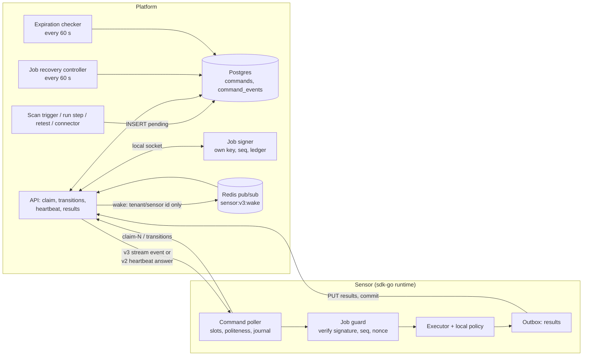
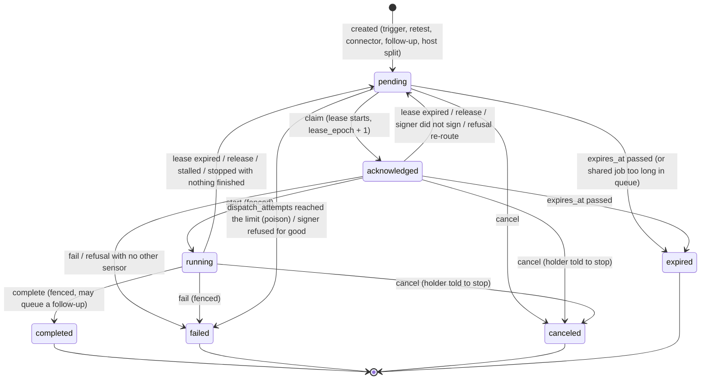
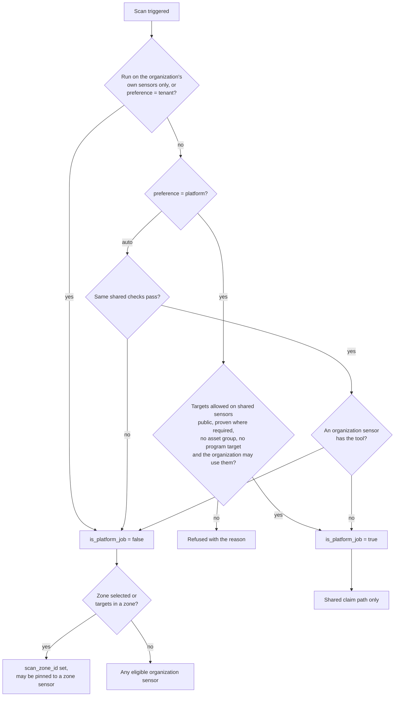
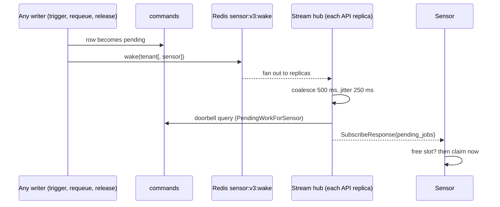
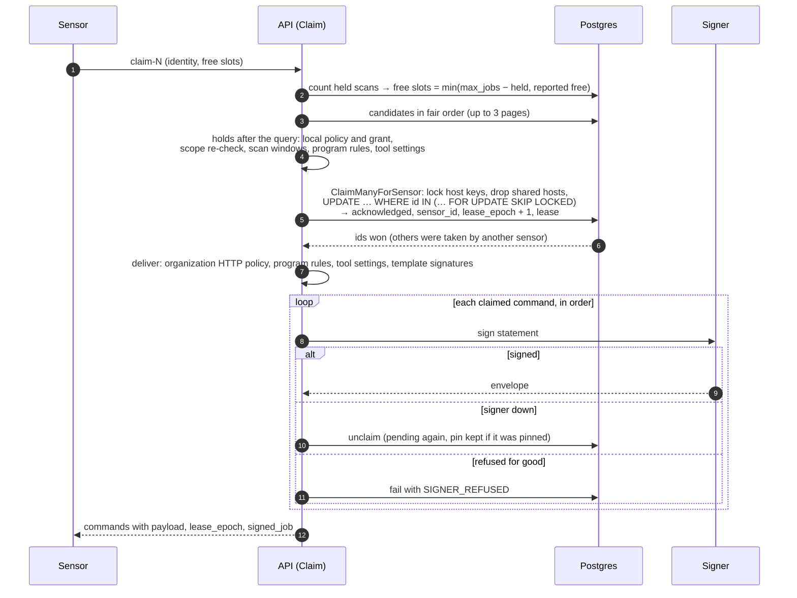
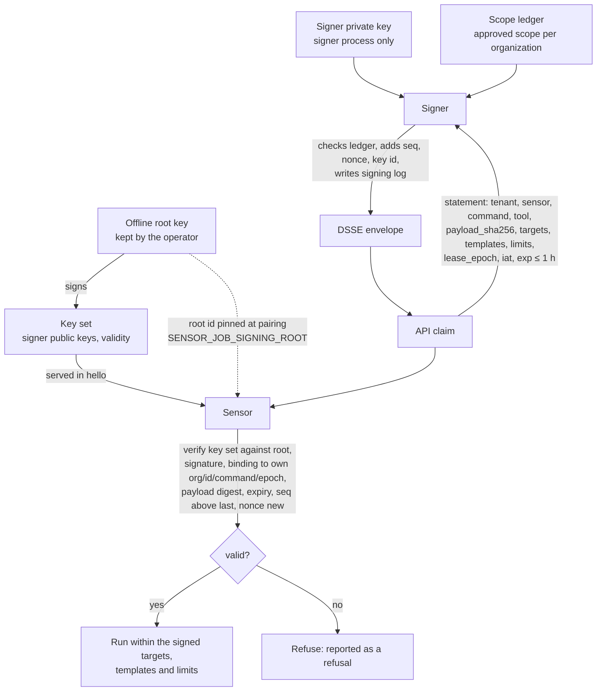
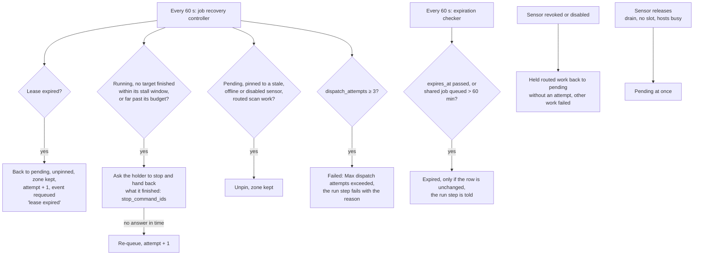
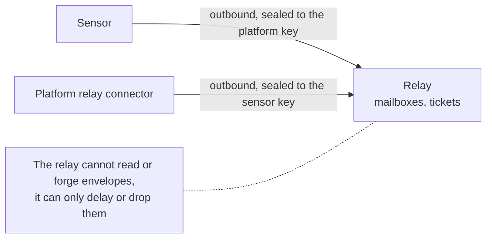

# Job dispatch: how a sensor receives, holds and finishes a job

> One page for the whole path of a job, from the trigger that queues it to the
> result that settles it. Details live in the linked documents; this page
> says how they fit together, which table, log line or metric shows each
> step, and what each step guarantees. Describes develop as of 2026-10-20
> (signed jobs on by default).
>
> Designs: [RFC-030](../rfcs/RFC-030-scan-work-distribution.md) (chunks,
> leases, fair pull), [RFC-035](../rfcs/RFC-035-sensor-control-plane-under-load.md)
> (heartbeat, doorbell, leases), [RFC-040](../rfcs/RFC-040-platform-sensor-mutual-distrust.md)
> (mutual distrust, signed jobs), [RFC-046](../rfcs/RFC-046-scans-redesign.md)
> (fair order), [RFC-059](../rfcs/RFC-059-sensor-transport-v3.md) (transport v3),
> [RFC-100](../rfcs/RFC-100-shared-sensors.md) (shared sensors),
> [RFC-116](../rfcs/RFC-116-sensor-relay.md) (relay),
> [RFC-090](../rfcs/RFC-090-work-pool.md) (work pool, the planned successor of
> trigger-time chunking).

## Contents

- [Principles](#principles)
- [The pieces](#the-pieces)
- [Job creation and chunking](#job-creation-and-chunking)
- [The commands table and the status machine](#the-commands-table-and-the-status-machine)
- [Routing: organization sensors, shared sensors, zones, connectors](#routing-organization-sensors-shared-sensors-zones-connectors)
- [Waking the sensor (doorbell)](#waking-the-sensor-doorbell)
- [The claim](#the-claim)
- [Signed jobs end to end](#signed-jobs-end-to-end)
- [Holding a job: leases, heartbeat, progress](#holding-a-job-leases-heartbeat-progress)
- [Recovery: expiry, lease loss, stalls, poison](#recovery-expiry-lease-loss-stalls-poison)
- [Results and completion](#results-and-completion)
- [Relay](#relay)
- [Failure modes and how to diagnose them](#failure-modes-and-how-to-diagnose-them)
- [Security properties](#security-properties)
- [Known limits and planned changes](#known-limits-and-planned-changes)
- [Key files](#key-files)

## Principles

1. **The platform picks the job; the sensor never chooses.** A sensor sends
   its identity and how many slots it has free. Every eligibility rule is
   evaluated by the platform, and evaluated again inside the statement that
   claims the job.
2. **Postgres is the queue and the only source of truth.** A job is a row in
   `commands`. Redis only carries wake-ups that hold no data; a lost wake-up
   costs latency, never a job.
3. **Pull, outbound only.** The platform never dials a sensor
   ([sensor ↔ platform trust](sensor-platform-trust.md#outbound-only-invariant)).
   Work reaches a sensor because the sensor asks for it.
4. **A claim is a lease.** Whoever holds a job holds it for a short, renewed
   lease with an epoch. Every change a sensor makes to a job is fenced by
   (sensor, state, epoch), so a holder that lost the job can never finish it.
5. **Nothing leaves unsigned.** Each job handed to a sensor carries a
   statement signed by a separate signer whose ledger the API cannot widen; the
   sensor checks it against a root it pinned. The signer down means claims
   wait, never that jobs leave unsigned.

## The pieces



| Piece | Where |
|---|---|
| Job row | `commands` (see [the table](#the-commands-table-and-the-status-machine)) |
| Timeline of a job | `command_events` (written by the trigger `trg_command_events`) |
| Claim, start, complete, fail, release | `internal/app/command/service.go`, `internal/infra/postgres/command_repository.go` |
| Shared claim | `internal/app/command/shared_claim.go`, `internal/infra/postgres/command_shared_claim.go` |
| Leases, re-queue | `internal/infra/postgres/command_lease.go`, `internal/infra/controller/job_recovery.go` |
| Signing at claim | `internal/app/command/job_signing.go`, `cmd/signer`, `internal/signer` |
| Doorbell | `internal/app/sensor/doorbell.go`, `internal/infra/sensortransport/subscribe.go` |
| Sensor side | sdk-go `pkg/core/command_poller.go`, `pkg/core/job_signing.go`, `pkg/jobsig` |

## Job creation and chunking

Jobs are created when work is triggered, not when a sensor asks:

- **Single-scanner scan:** `internal/app/scan/trigger.go` builds the payload
  (`scanner`, `config`, `targets`, run and step ids) and queues one command per
  chunk of `targets_per_job` targets.
- **Workflow step:** `internal/app/scan/step_plan.go` and
  `internal/app/scanrun/run.go` queue a step's commands when the step starts
  ([scan stages](scan-stages.md), [scan orchestration](scan-orchestration.md#work-distribution-today-and-the-work-pool)).
  Chunks are cut on whole hosts (`internal/app/scanrun/host_chunks.go`), so
  the chunks of one step never compete for a host.
- **Zoned runs** are capped at 1000 jobs per run (`internal/app/scan/zones.go`).
- **Retests, validations, connector scans and syncs, configuration commands**
  are created by their own services with the same table and claim path.

Each command records at creation: `tenant_id`, `type`, `priority`
(`low`/`normal`/`high`/`critical`), `payload`, the routing decision
(`is_platform_job`, `sensor_id` when pinned, `scan_zone_id`), `host_keys` (the
per-host politeness keys from `github.com/openctemio/ctis/politeness`),
`dispatch_gate` (what the target gate decided), optional `scheduled_at` (a
scan window not open yet) and `expires_at`.

Chunk sizes are fixed at creation. Two things adapt them later:

- **Host-busy split at claim** (`internal/app/command/host_split.go`): when a
  sensor has free slots and a pending command is blocked only by a few busy
  hosts, the free part is split off and claimed now.
- **Follow-up for unfinished targets** (`completeWithFollowUp`,
  `internal/app/command/service.go`): a completed scan whose result leaves
  targets unfinished queues, in the same transaction, a new command with only
  those targets.

## The commands table and the status machine



Columns that drive dispatch:

| Column | Meaning |
|---|---|
| `status` | `pending`, `acknowledged`, `running`, `completed`, `failed`, `canceled`, `expired` |
| `sensor_id` | Pinned target before a claim (NULL: any eligible sensor); the holder after a claim |
| `is_platform_job` | Queued for shared sensors; the routing decision is final |
| `scan_zone_id` | Only sensors assigned to this zone may take it |
| `lease_epoch`, `lease_expires_at` | The current claim's number and its lease |
| `dispatch_attempts` | Lease losses and recoveries; 3 makes it poison |
| `refused_by`, `refusals` | Sensors whose local policy refused it (never offered to them again) |
| `host_keys`, `settled_host_keys` | Politeness keys held while acknowledged or running; keys released as targets settle |
| `scheduled_at`, `window_hold` | Not due before its scan window opens |
| `progress_*`, `last_progress_at`, `stop_requested_at` | Progress the heartbeat reports; stall handling |
| `expires_at` | Must start before this time (set by connectors and some commands; most scan chunks have none) |

`command_events` records every transition with its sensor, attempt, code and
message: `queued`, `claimed`, `started`, `requeued`, `refused`, `completed`,
`failed`, `canceled`, `expired`. It is the first place to look for any single
job.

## Routing: organization sensors, shared sensors, zones, connectors

Routing is decided once, when the job is created, and then enforced by the
claim predicates.



- **Organization sensors** claim only `is_platform_job = false` commands of
  their own organization; **shared sensors** claim only `is_platform_job =
  true` commands, of every organization, through the
  [shared claim path](sensors.md#the-shared-claim-path). No requeue path changes
  that flag. The scan setting "run on the organization's own sensors" is
  therefore enforced by the routing decision itself.
- **Scan zones** ([scan zones](scan-zones.md)): a zoned command is offered only
  to sensors assigned to its zone that have its tool, pinned or not. Shared
  sensors take unzoned shared jobs only; an instance scan zone travels in the
  signed statement, never in the payload.
- **Connector sensors** (for example the Tenable.sc runner,
  [tenable-sc-connector.md](tenable-sc-connector.md)): connector commands are
  pinned to the configured runner at creation and claimed like any other.
- **Placement explainer** ([placement](placement.md)): for a waiting task it
  evaluates the same predicates per sensor and names what blocks it.

## Waking the sensor (doorbell)

A sensor does not need to poll fast to start work quickly. Two channels tell
it there is claimable work:

- **Transport v3 control stream** (`Subscribe`,
  [transport v3](sensor-transport-v3.md)): a server stream that sends the
  doorbell on open, again on every wake for the sensor's organization or the
  sensor itself, on a 30-second re-check, and a keepalive every 25 seconds.
  Streams end after a jittered maximum age (24–30 minutes) and reconnect.
  Wakes are published on Redis (`sensor:v3:wake`) so every API replica's
  streams hear them, coalesced to one per 500 ms per key.
- **Protocol v2 heartbeat answer** ([heartbeat doorbell](sensors.md#heartbeat-doorbell)):
  `pending_jobs` and `next_heartbeat_seconds` (5 seconds while work waits and
  the sensor has free slots, 30 seconds idle).

The pending count comes from `PendingWorkForSensor`, the same predicates as the
claim, capped. The SDK polls when the doorbell rings or a slot frees; while the
server sends hints, the fixed poll interval is replaced by a 5-minute safety
poll.



## The claim

A claim (claim-N) is one request: `GET /api/v2/sensor/commands?limit=n` with
the `capacity` feature, or `ClaimCommands` on v3. The commands returned are
already acknowledged to the sensor.



**Predicates in the claim statement** (also in the candidate read, the
doorbell and the claim by id):

| Check | Rule |
|---|---|
| Tenant | `commands.tenant_id` = the authenticated sensor's organization; suspended organizations get nothing |
| Routing | not a shared job (shared path: only shared jobs) |
| Pin | unpinned, or pinned to this sensor |
| Due | `pending`, not expired, `scheduled_at` passed |
| Zone | unzoned, or the sensor is assigned to the zone and has the tool |
| Tool | the command's tool is one the sensor reported installed (`effective_tools`) |
| Capabilities | every `required_capabilities` is one the sensor has |
| Features | every `required_features` is one the sensor reported (never only declared) |
| Refusals | the sensor is not in `refused_by` |
| Hosts | no other acknowledged or running command of the organization holds a conflicting host key (re-checked under advisory locks) |

**Fair order** (`fairPendingQuery`): priority class (critical 1 … low 4,
raised one class per 30 minutes waited, never into critical), then
round-robin across runs (the first pending command of every run before the
second of any), then age. The ranking is computed over the oldest 1000
candidates of each class.

**Shared claim order** (`GetSharedPendingForSensor`): rounds of 5 jobs per
organization; within a round the organization with the fewest shared jobs in
flight first, then class and age; each organization's
`platform_scans_concurrent` is enforced inside the claim under a
per-organization lock.

**Claim by id** (`POST /commands/{id}/claim`, `TransitionCommand`): the same
predicates and holds for one command; a replay by the holder answers the
command as it is. Used for commands handed over before claim-N and by older
clients.

**Slots** are counted by the platform from the commands themselves, not from
the last heartbeat; the SDK also takes a local slot before it claims and
admits per-host politeness with the same key function, so it does not hold
more than it can run.

## Signed jobs end to end

Full reference: [signed jobs](job-signing.md).



- The API never holds the signer's key; the signer refuses statements outside
  its ledger (`out_of_ledger`, `tier_exceeds_ledger`, `target_excluded`) and the
  command then fails with `SIGNER_REFUSED`.
- Production API refuses to start without `SIGNER_SOCKET` unless explicitly
  allowed; newly paired sensors require signed jobs.
- The sequence number is per sensor and per signer key; the sensor refuses a
  number not above the last it accepted from that key, and a reused nonce.
- A shared job's statement names the organization and, for an instance scan
  zone, its ranges; the shared sensor binds results to that organization.

## Holding a job: leases, heartbeat, progress

Reference: [command leases](sensors.md#command-leases-rfc-035-d6).

- A claim sets `lease_expires_at = now + SENSOR_COMMAND_LEASE` (default 3
  minutes, clamped to 1–30 minutes) and increments `lease_epoch`.
- The heartbeat carries the ids the sensor runs and their progress; the
  platform renews those leases (`RenewLeases`), writing only when less than
  about half the lease is left, so a heartbeat does not always write.
- The advised heartbeat interval is capped below the lease
  (`MaxIntervalBound`), so one missed heartbeat does not lose a job.
- Start, complete and fail are fenced (`FencedUpdate`): they apply only if the
  command is still held by that sensor, in the state read, under the same
  epoch; the SDK echoes the epoch (`X-OpenCTEM-Lease-Epoch`) on complete and
  fail.
- The heartbeat answer and the v3 stream list commands the sensor must stop:
  canceled ones, and ones re-queued away from it.
- Code-scan source credentials are minted per call for the lease holder only.

## Recovery: expiry, lease loss, stalls, poison



- **Lease loss** is the main recovery path: a dead or partitioned sensor's work
  returns within one lease plus one controller tick.
- **Expiry** has one owner (the expiration checker), which also notifies the
  run; it never overwrites a row that moved since it was read.
- **Release** (`POST /commands/{id}/release`) hands work back at once (draining
  sensor, no free slot, hosts busy on the sensor).
- **Refusal** by a sensor's local policy adds it to `refused_by`; routed work
  goes to another eligible sensor, otherwise it fails with the reason.
- **Poison:** a command that keeps losing its holder fails after 3 attempts.
- Two older recovery functions still run on the same tick
  (`recover_stuck_platform_jobs`: shared jobs acknowledged for 30 minutes;
  `recover_stuck_tenant_commands`: acknowledged commands without a lease). See
  [planned changes](#known-limits-and-planned-changes).

## Results and completion

- The sensor uploads results bound to the command:
  `PUT /api/v2/sensor/commands/{command_id}/results/{report_id}` (or segments
  and `commit`; v3 `PutResult`/`CommitResult`), then completes the command.
  [Result binding](sensor-result-binding.md) decides what a report may change:
  a report naming a command assigned to the submitting sensor and open (or
  finished less than 15 minutes ago) is bound to that command's targets and
  tool; reports naming no command are limited or quarantined.
- `complete` with the lease epoch stores the result; a scan with unfinished
  targets queues its follow-up in the same transaction; the run step advances
  when its last command settles.
- `fail` stores a bounded message; a structured refusal re-routes routed work.

## Relay

Reference: [sensor relay](sensor-relay.md). A relay lets a sensor that cannot
reach the platform work through a broker both sides dial out to; it carries
sealed envelopes it cannot read.



Shipped: the relay, its wire contract, the platform's envelope code and
connector, operator tools. Not built yet: ticket issuing by the API, key
distribution in the signed hello, the sensor's relay mode, console pages,
store-and-forward. A relay adds latency to heartbeats, so lease timing must
leave room for it.

## Failure modes and how to diagnose them

| Symptom | Look at | Likely cause |
|---|---|---|
| Task waits, no sensor takes it | Placement explainer (`GET /api/v1/scan-runs/{id}/tasks/{task_id}/placement`); `command_claim_skipped_total{reason}` | Tool not reported, zone without that tool, local policy refusal (`refused_by`), host held by another task, scan window closed (`scheduled_at`), slots full |
| Task waits only on shared sensors | Shared fleet page; `platform_scans_concurrent`; expiration after 60 min in queue | Organization at its shared limit, no shared sensor with the tool or region |
| Claims return nothing while work waits | `sensor_job_signing_total{outcome="unavailable"}`; log `command not signed; not handed to the sensor` | Signer down or slow; claims wait (fail closed) |
| Commands fail with `SIGNER_REFUSED` | `openctem_signer_refusals_total{reason}`; signing log | Target or tier outside the scope ledger |
| Jobs bounce between sensors | `command_events` (`requeued` with `lease expired`); `command_leases_expired_total`; log `re-queued command: its lease ran out` | Sensor heartbeats failing or late, network, relay delay |
| Running task stuck | `commands_stalled_total`; log `stalled command: asked its sensor to stop it`; `last_progress_at` | Tool hung; target unreachable |
| `Max dispatch attempts exceeded` | `command_events` attempts; `dispatch_attempts` | Three lease losses or stalls |
| Sensor refuses jobs with a signature reason | Sensor log `Refusing command`; `refusals` | Key set not trusted, wrong root pinned, expired statement |
| Slow claims | `command_claim_duration_seconds`, `command_claim_pages_total` | Deep pending queue for the organization (cost grows with pending rows) |

Useful queries (read-only, tenant-scoped):

```sql
-- one job's timeline
SELECT created_at, event, status, attempt, sensor_id, code, left(message, 120)
FROM command_events WHERE tenant_id = $1 AND command_id = $2 ORDER BY created_at;

-- what an organization is waiting on
SELECT priority, count(*), min(created_at) AS oldest
FROM commands WHERE tenant_id = $1 AND status = 'pending' GROUP BY priority;

-- leases about to run out
SELECT id, sensor_id, status, lease_epoch, lease_expires_at
FROM commands WHERE tenant_id = $1 AND status IN ('acknowledged','running')
ORDER BY lease_expires_at LIMIT 50;
```

## Security properties

| Threat | Property |
|---|---|
| A sensor takes another organization's job | Every claim and transition is scoped to the authenticated sensor's organization; a command id of another organization is answered as unknown |
| A sensor picks the jobs it wants | The platform picks; the claim by id applies the same predicates and holds as the claim-N |
| An organization's internal targets reach shared sensors | Routing refuses them at trigger time; the flag is final and the two claim paths are disjoint |
| A sensor that lost a job finishes it | Fenced by sensor, state and lease epoch |
| A compromised API aims sensors at new targets | The signer signs only what its ledger allows; sensors verify against an offline root and refuse replays (seq, nonce) and stale statements |
| A sensor injects results for work it does not hold | Result binding to an open command assigned to that sensor; unsolicited reports limited or quarantined |
| A sensor sits on jobs | Leases, stall detection and task budgets return the work |
| Platform dials into a sensor network | Never: outbound only |

## Known limits and planned changes

Measured or found in review (2026-10-20); each will be addressed in its own
change and this page updated when it lands:

- **Ordering on the sensor.** The sensor reorders a claimed batch by priority
  before checking signatures; after aging has moved an older lower-priority
  job ahead of a newer higher-priority one, the sequence check refuses the
  older job. Planned: verify in the order received; the platform owns the
  order.
- **Lease expiry and pinned commands.** A lease expiry unpins every command,
  including ones addressed to one sensor on purpose (configuration, connector
  scans). Planned: keep the pin for non-routed commands, as release already
  does.
- **Platform outages.** After an outage longer than the lease, the controller
  re-queues running work whose sensors could not renew, and charges an
  attempt. Planned: extend leases after a platform-side gap instead of
  re-queuing, and charge attempts only for holder failures.
- **One recovery mechanism.** The two older recovery functions overlap the
  lease. Planned: remove them; renew only running commands the sensor lists, so
  an acknowledged command that never starts returns after one lease.
- **Shared sensors and the doorbell.** The doorbell does not compute pending
  work for shared sensors, so they rely on the 5-minute safety poll. Planned:
  wake shared streams and report shared pending work.
- **Claim cost.** The candidate read evaluates and sorts every pending row of
  the organization (and every shared job on the shared path) before taking the
  first 1000; measured about 5 ms at 1k, 45 ms at 10k and 370 ms at 100k
  pending rows. The round-robin across runs holds only inside that window.
  Planned: the [work pool](../rfcs/RFC-090-work-pool.md) (pending-only lanes and
  items with an index-ordered, bounded claim), a queue version so a claim with
  nothing new skips the database, and a bound on the shared candidate read.
- **Lease epoch** becomes mandatory on every request a holder makes (start,
  complete, fail, release, logs, results), and the unused per-job token
  columns are removed.
- **Signer availability.** While the signer is down every claim acknowledges
  and takes back its candidates; planned: a short circuit breaker. A
  multi-host API needs the signer reachable over an authenticated network
  socket.
- The non-claiming v2 poll, the per-tenant template-key fallback and the unused
  `routing_tags` payload field are to be removed.

## Key files

- `api/internal/app/scan/trigger.go`, `api/internal/app/scan/step_plan.go`,
  `api/internal/app/scanrun/run.go`, `api/internal/app/scanrun/host_chunks.go`
- `api/internal/app/command/service.go` (claim, transitions),
  `api/internal/app/command/job_signing.go`, `api/internal/app/command/host_split.go`,
  `api/internal/app/command/expiration_checker.go`, `api/internal/app/command/shared_claim.go`
- `api/internal/infra/postgres/command_repository.go` (predicates, fair order, claim),
  `command_shared_claim.go`, `command_lease.go`, `command_progress.go`, `command_notify.go`
- `api/internal/infra/controller/job_recovery.go`
- `api/internal/app/sensor/doorbell.go`, `api/internal/infra/sensortransport/subscribe.go`,
  `api/internal/infra/redis/sensor_wake.go`
- `api/internal/infra/http/handler/sensor_control_v2_handler.go`, `api/internal/infra/http/routes/sensor_v2.go`
- `api/pkg/domain/command/` (entity, lease, host keys, placement), `api/pkg/jobsign`, `api/cmd/signer`, `api/internal/signer`
- sdk-go: `pkg/core/command_poller.go`, `pkg/core/command_queue.go`, `pkg/core/doorbell.go`,
  `pkg/core/job_signing.go`, `pkg/jobsig`, `pkg/client/lease.go`
