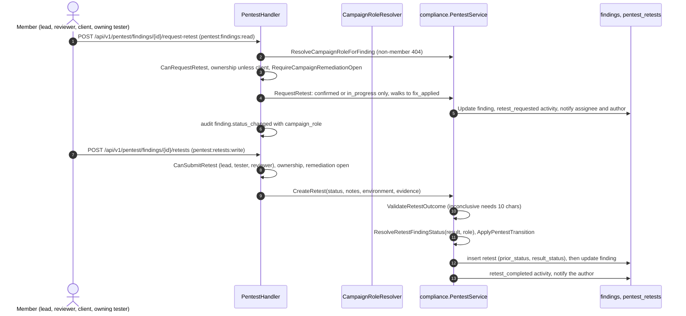

# Pentest remediation and retest

How a pentest finding is fixed, retested and closed, including after the
campaign's testing is complete. Design: [RFC-085](../rfcs/RFC-085-pentest-remediation-and-completion.md).

## Flow

```mermaid
stateDiagram-v2
  [*] --> draft: create or import (lead, tester while testing; lead, reviewer while reporting)
  draft --> in_review: lead, tester
  draft --> confirmed: lead
  in_review --> confirmed: lead, reviewer (proof_basis or proof_override_reason)
  draft --> duplicate: lead, reviewer (duplicate_of)
  in_review --> duplicate: lead, reviewer
  duplicate --> draft: lead, reviewer
  confirmed --> in_progress: lead, tester, reviewer
  in_progress --> fix_applied: lead, tester, reviewer, or request-retest
  confirmed --> fix_applied: request-retest (walks in_progress)
  fix_applied --> resolved: lead, reviewer, or a passed retest by lead or reviewer
  fix_applied --> in_progress: lead, reviewer, or a failed retest
  resolved --> in_progress: lead, reviewer (reopen)
  confirmed --> false_positive: lead, reviewer
  confirmed --> accepted: lead, reviewer
  false_positive --> confirmed: lead, reviewer
  accepted --> confirmed: lead, reviewer
  false_positive --> draft: lead, reviewer
  accepted --> draft: lead, reviewer
```

The edges and roles are `PentestStatusTransitionRoles` (`pkg/domain/pentest/campaign_rbac.go`); `in_review`,
`in_progress` and `fix_applied` also reach `false_positive` and `accepted` (lead, reviewer; `draft` lead only).
Testers act only on findings they created or are assigned (`RequireFindingOwnership`); reviewers on any.
Organization owners and admins skip the role, ownership and campaign-lock checks
(`PentestHandler.UpdateFindingStatus`); `Finding.ApplyPentestTransition` still refuses an edge the state machine
does not have. A move out of draft or in review to a published status sets the SLA deadline from now
(`applySLAOnPublish`).

## Campaign status and finding changes

| Campaign status | New findings (`RequireCanCreateFinding`) | Edits and authoring moves (`RequireCampaignWritable`) | Remediation (moves between published statuses, retests, retest requests) |
|---|---|---|---|
| planning | nobody | yes | yes |
| in progress (testing) | lead, testers | yes | yes |
| reporting | lead, reviewers | yes | yes |
| on hold | nobody | existing findings only | yes |
| completed (remediation) | nobody | no | **yes** |
| canceled, archived | nobody | no | no |

`IsRemediationTransition` decides which side a status move is on;
`RequireCampaignRemediationOpen` and `RequireCampaignWritable` apply the
table. Org owners and admins bypass both (not `RequireCanCreateFinding`).

Creating a finding follows the phase for everyone, organization admins included
(they act as the lead): see the table and
[pentest-campaign-completion.md](pentest-campaign-completion.md). The console
mirrors that rule (`web/src/features/pentest/lib/campaign-finding-rules.ts`):
on any other campaign the Findings tab shows the reason in place of "New
finding", the checklist hides "Create finding", and the new-finding form keeps
the campaign's name, shows the reason and saves nothing. The campaign's lead
and tenant admins also get the one status change that reopens it to findings
(completed or on hold to in progress, canceled to planning); an archived
campaign has none in one step.

## Retest request

`POST /api/v1/pentest/findings/{id}/request-retest` `{"note": "..."}`:
lead, reviewer, client, or the owning tester marks a published finding as
fixed (fix applied). The finding then appears in the retest queue. A
`retest_requested` activity (with the note) is recorded, the assignee and
author are notified, and an audit event names the caller's campaign role.

The retest queue and a campaign's Retests tab read
`GET /api/v1/pentest/findings` and `GET /api/v1/pentest/campaigns/{id}/findings`
with `status=in_progress,fix_applied` (pending) or
`status=resolved,false_positive,accepted` (history), plus optional `severity`
and `search`. The filters run in SQL before paging, so the totals count every
matching finding and every page is reachable; unknown values are refused
(400). The caller's visibility still applies first: a client never gets
drafts or findings in review whatever statuses it asks for, and a member who
is not an administrator sees the campaigns they belong to only.

## Retest results

`POST /api/v1/pentest/findings/{finding_id}/retests` with `status`
(passed, failed, partial, inconclusive, canceled; pending and in_progress are
accepted and change nothing), notes and evidence:

- passed by a lead or reviewer: the finding is resolved;
- passed by a tester: the finding stays in fix applied for a reviewer;
- failed: the finding goes back to in progress.

Each retest stores `prior_status` and `result_status` (migration
`002052_pentest_retest_status_change`); retests recorded earlier have
neither.

`environment` (optional: production, staging, development or qa; anything
else is 400) records where the fix was verified, in its own column
(migration `002073_pentest_retest_environment`). The console used to write it
at the top of the notes as `**Environment:** <value>`; the migration moved
those values to the column and removed the prefix, and left notes that did
not start with exactly that prefix unchanged. Reports show it in the retest
results and templates read it as `{environment}` inside `{#retests}`; the MCP
`list_retests` tool returns it.

Campaign stats (`GET /api/v1/pentest/campaigns/{id}/stats`) count the recorded
results as `retests_passed`, `retests_failed` and `retests_partial`. The retest
success rate is passed / (passed + failed + partial); a finding closed as false
positive or accepted risk was never retested and does not count.

## Retest evidence

Evidence attached with `context_type=retest` follows the right to submit a
retest, not to edit the finding (`CheckRetestEvidenceWrite`): lead, reviewer or
the owning tester, while remediation is open, so on a completed campaign too;
refused on a canceled or archived campaign and for observers and clients.
Finding evidence (`context_type=finding`) stays frozen once testing is complete.

## Importing tool results

`POST /api/v1/pentest/campaigns/{id}/findings/import` (campaign lead; multipart
`file`, optional `format=burp|csv`, detected from `.xml`/`.csv`) creates one
finding per Burp Suite issue or CSV row through the same path as the editor
(`ImportCampaignFindings` in `internal/app/compliance/pentest_import.go`): it
has its title, starts as `draft` (never visible to a client or in a report
before review), records the importer as creator, and is deduplicated per
campaign, title and affected target, so a re-import skips rows already there.
The campaign must accept new findings (planning or in progress). Each import is
audited as `campaign.findings_imported` with its counts. Migration
`002070_pentest_legacy_import_drafts` returned findings left in `new` by the
earlier import to draft.

## Key files

- `pkg/domain/pentest/campaign_rbac.go`: transition roles, lock rules.
- `pkg/domain/pentest/retest.go`, `internal/infra/postgres/pentest_retest_repository.go`.
- `internal/app/compliance/pentest.go`: `RequestRetest`, `CreateRetest`, `CheckRetestEvidenceWrite`.
- `internal/app/compliance/pentest_import.go`: campaign import.
- `internal/infra/http/handler/pentest_handler.go`: `RequestRetest`, `CreateRetest`, `UpdateFindingStatus`.

## Planned

Retest rounds with an attestation letter, approval for risk acceptance and
false positives, completion sign-off (RFC-085 §5).
