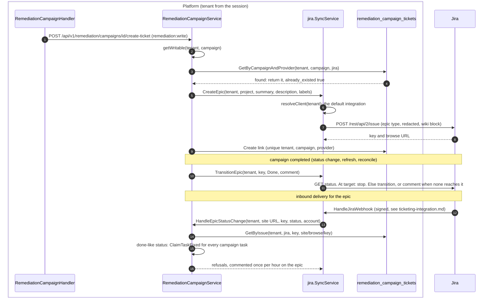

# Remediation Campaign → Jira Epic

> Turn a remediation campaign into a tracked **Jira epic** — the "create a task
> that syncs to Jira" half of the Mobilization story (RFC-006 Phase 3e
> `WorkItem` seam). Completes Tier-1 #2 alongside campaign progress tracking.

## Flow

Same in v0.19.1 and on develop.



## Endpoint

```
POST /api/v1/remediation/campaigns/{id}/create-ticket   (permission: remediation:write)
Body: { "project_key": "SEC" }
```

Creates a Jira **epic** for the campaign in the given project and links it.
Response:

```jsonc
{
  "campaign_id": "…",
  "provider": "jira",
  "issue_key": "SEC-42",
  "issue_url": "https://org.atlassian.net/browse/SEC-42",
  "already_existed": false   // true if the campaign was already linked (idempotent)
}
```

The epic body is rendered from the campaign: description + progress derived
from its tasks (task count, closed of all findings, percentage) + due date. Labels: `openctem`,
`remediation-campaign`.

## Design

The campaign service **owns the orchestration** (idempotency + link
persistence); the jira package stays campaign-agnostic and only knows "create an
epic for this tenant".

```
RemediationCampaignService.CreateTicket
  ├─ load campaign (tenant-scoped)                    [remediation repo]
  ├─ existing link for (campaign, "jira")?  → return it, already_existed=true
  ├─ epicCreator.CreateEpic(tenant, project, …)       [jira.SyncService]
  │     └─ resolve per-tenant Jira client → CreateIssue(IssueType="Epic")
  └─ persist remediation_campaign_tickets row         [campaign-ticket repo]
```

- **Decoupling**: the campaign service depends on jira only through the narrow
  `CampaignEpicCreator` interface (primitive params), so the `exposure` package
  imports nothing from `jira`. `*jira.SyncService.CreateEpic` satisfies it.
- **Idempotency**: the unique `(tenant_id, campaign_id, provider)` link row plus
  the pre-create lookup mean re-POSTing returns the existing epic rather than
  opening a duplicate. Unlike finding and task issues, an epic carries no
  marker: a create whose answer was lost, or whose link row failed to save
  (the call then answers 500), files a second epic on the next attempt.
- **Tenant isolation + creds**: `CreateEpic` resolves the per-tenant Jira client
  via the same `ClientResolver` as finding ticketing (the tenant's **default**
  integration; the request cannot name one, and the link row records no
  integration); secrets are redacted from the epic summary/description
  defensively. `TransitionEpic` also resolves the default integration, so in
  a tenant with several Jira integrations the push goes to whichever is the
  default at that time. The epic does not pass the outbound gate (it carries
  the campaign's own text, no finding content).
- **Degrades off**: with no ticketing wired (no Jira integration), `CreateTicket`
  returns `ErrTicketingNotConfigured` (HTTP 400) — the rest of the campaign
  service is unaffected.

## Storage

`remediation_campaign_tickets` (in the baseline migration) — a side table, not columns
on `remediation_campaigns`, so the campaign aggregate stays stable and more
providers/issues can compose later:

| column | note |
|--------|------|
| `tenant_id`, `campaign_id` | FK, `ON DELETE CASCADE` |
| `provider` | `jira` (default) |
| `issue_key`, `issue_url` | the epic |
| unique `(tenant_id, campaign_id, provider)` | one ticket per provider |

## Layering

| Layer | File |
|-------|------|
| Domain | `pkg/domain/remediation/campaign_ticket.go` |
| Repo | `internal/infra/postgres/remediation_campaign_ticket_repository.go` |
| Service | `internal/app/exposure/remediation_campaign.go` (`CreateTicket`) |
| Jira | `internal/app/jira/sync_service.go` (`CreateEpic`) |
| Handler/route | `remediation_campaign_handler.go`, `routes/remediation.go` |

## Outbound status sync (campaign → epic)

When a campaign reaches `completed` — whether by an explicit status change, the
manual progress `refresh`, or the background reconcile auto-complete — its
linked epic is transitioned to **Done** (best-effort):

- `RemediationCampaignService.syncEpicOnCompletion` looks up the campaign's Jira
  link and calls `CampaignEpicCreator.TransitionEpic`.
- `jira.SyncService.TransitionEpic` is echo-guarded (skips if the epic is
  already at the target) and falls back to a **comment** when the workflow
  offers no transition — the same pattern as finding-level outbound sync.
- Errors are logged, never propagated: a Jira hiccup must not fail campaign
  completion. The echo-guard makes it safe to fire from every completion path.

Target status is `Done` (Jira's default done state); a per-tenant override is a
follow-up.

## Inbound status sync (epic → campaign)

The reverse direction. A Jira webhook that moves a campaign's linked epic to a
done state (`Done`/`Resolved`/`Closed`/`Complete`/`Completed`) is a **fix
claim** for the campaign's live tasks, not a completion.

- `HandleJiraWebhook` asks `CampaignEpicSink.HandleEpicStatusChange` first; a
  campaign epic is handled there and never treated as a finding ticket.
- `RemediationCampaignService.HandleEpicStatusChange`: reverse lookup
  (`CampaignTicketRepository.GetByIssue`: the key and the browse URL built
  from the delivering integration's site, so an epic with the same key on
  another site does not match) → done-status guard (`isJiraDoneStatus`) →
  task-level mark fixed of every task of the campaign
  (`ClaimTaskFixed`: legal steps to `fix_applied`, proof of fix per
  finding), with the Jira account recorded. The campaign stays as it is: it completes when its
  tasks are done. Findings the rules refuse are commented back on the epic,
  once per window.
- Loop-safe: no campaign status changes, so no outbound epic transition fires.

Together with the outbound path, **campaign↔epic sync is now bidirectional** —
matching the finding↔ticket sync.

## Planned follow-ups

- **Per-tenant epic done-status mapping** (instead of the fixed `Done`).
- **Richer inbound mapping** (e.g. epic In Progress → campaign active).
- **GitHub Issues** as a second provider via the same `CampaignEpicCreator` seam.
