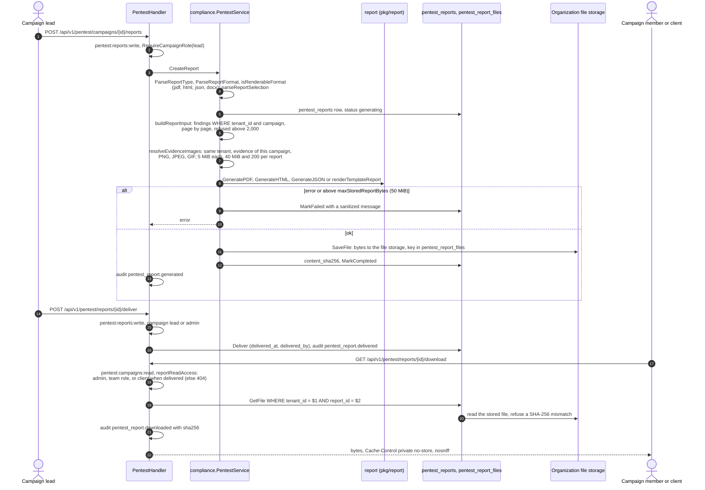
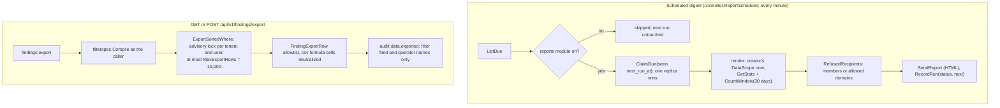

# Report PDF Export

> Server-side PDF generation for pentest reports, rendered **directly from the
> structured report data** with a pure-Go library — no headless browser, no
> external rendering service, no system dependency.

## Why pure-Go (not HTML→PDF)

Converting the existing HTML report to PDF would require a headless browser
(chromedp/wkhtmltopdf) bundled in the API image, or an external render service.
Instead, the PDF is built from the same `report.ReportInput` the HTML generator
consumes, using `github.com/go-pdf/fpdf` (BSD-3, pure Go, no cgo). Same data,
two renderers.

```
PentestService.buildReportInput(...)  ──►  report.ReportInput
                                              ├─► report.GenerateHTML(input)  → HTML
                                              └─► report.GeneratePDF(input)   → PDF (fpdf)
```

## Flow

Checked against the code of v0.19.1 and develop on 2026-11-05 (no change
between them in this area).

### Stored report: create, deliver, download



### Live download (not stored)

`GET /api/v1/pentest/campaigns/{id}/reports/download` renders current data
through `RenderReport` and stores nothing. The route admits lead, tester,
reviewer and observer (`RequireCampaignRole`); the handler also requires
`CanSeeUnpublished` (non-members and clients get 404). Every download is
audited as `pentest_report.downloaded` with the campaign as the resource.

## Endpoint

`GET /api/v1/pentest/campaigns/{id}/reports/download` (JWT, `pentest:campaigns:read`, campaign team role)

| Query param | Values | Default |
|-------------|--------|---------|
| `format` | `html` \| `pdf` \| `json` \| `docx` (`xlsx` is refused) | `html` |
| `template_id` | the organization report template for `docx` | — |
| `classification` | `public`/`internal`/`confidential`/`restricted`; anything else falls back to `internal` | empty |
| `watermark` | text, cut at 50 bytes | — |
| `report_type` | `executive_summary` \| `technical_report` \| `finding_report` \| `compliance_report` \| `remediation_report` \| `retest_report` | `technical_report` |
| `include_poc` | `true` \| `false` | `true` |
| `include_evidence` | `true` \| `false` | `true` |
| `include_unpublished` | `true` \| `false` | `false` |
| `statuses` | comma list of finding statuses | published statuses |
| `severities` | comma list of severities | all |

## What a report contains

The same options are stored on a report created with
`POST /api/v1/pentest/campaigns/{id}/reports` (`options` object, same keys)
and apply when it is downloaded.

- **Published findings only by default.** `draft`, `in_review`,
  `false_positive` and `duplicate` findings are left out: drafts and findings
  under peer review are not results yet, false positives and duplicates are
  not findings of the target. `include_unpublished=true` includes every
  status; `statuses` lists exactly which statuses to include.
- `severities` keeps only those severities. Unknown statuses or severities are
  refused (400), so a typo never produces a silently different report.
- Findings are ordered most severe first, then by CVSS score, then oldest
  first. The summary counts describe the findings in the report, never the
  campaign's unpublished ones.
- `include_poc=false` leaves proofs of concept out (for client-facing copies).
- Retest results are listed only for findings the report includes.
- A campaign above 2,000 findings is refused; narrow by severity or status.

`format=pdf` returns `application/pdf` (`Content-Disposition: attachment;
filename="pentest-report.pdf"`); `json` and `docx` likewise with their own
extension. The classification and watermark render in the
footer of every page.

## Layout

`pkg/report/pdf.go` renders: title block, engagement details, team, severity
summary (coloured badges + progress/CVSS), and a section per finding (severity
badge, title, CVSS/CWE/CVE/OWASP meta, description, numbered repro steps,
business/technical impact, remediation, PoC when `include_poc`, targets,
references). Pagination is automatic (`SetAutoPageBreak`).

Text is set in DejaVu Sans, embedded in the binary (`pkg/report/fonts`, license
`LICENSE-DejaVu.txt`) and subset into each PDF, so every language a finding is
written in renders, Vietnamese included. The core PDF fonts (cp1252 only) are
not used.

## Code map

| Piece | Where |
|-------|-------|
| PDF renderer | `pkg/report/pdf.go` (`GeneratePDF`) |
| Data builder (shared HTML/PDF) | `internal/app/compliance/pentest.go` (`buildReportInput`) |
| Service methods | `PentestService.CreateReport`, `RenderReport`, `ReportFile`, `DeliverReport` |
| Handlers | `internal/infra/http/handler/pentest_handler.go` (`CreateReport`, `DownloadReport`, `DownloadReportByID`, `DeliverReport`, `reportReadAccess`) |
| Stored files | `internal/infra/postgres/pentest_report_repository.go` (`SaveFile`, `GetFile`) |

## Markdown and evidence images

Finding fields are written in Markdown (description, impacts, remediation,
steps, campaign description). The HTML and PDF reports render it through
`pkg/report/markdown`: paragraphs, headings, lists, quotes, code blocks,
bold, italic, code and links. Every text is escaped, raw HTML stays text, and
links are kept only for http(s) and mailto.

Screenshots referenced as `` are embedded
(data URI in HTML, image in PDF) when the attachment is evidence of that
finding, of its retests or of the campaign, in the same tenant; when it is
PNG, JPEG or GIF and decodes as one; and within 5 MiB per image, 40 MiB and
200 images per report. Anything else renders as its alt text in brackets: a
report never fetches a URL. `include_evidence=false` leaves images out.

## Stored reports and delivery

A report created with `POST /api/v1/pentest/campaigns/{id}/reports` is
generated once and its bytes are stored, at most 50 MiB: in the
organization's file storage (the attachment store) with the key in
`pentest_report_files`, or in the row when no file store is wired (tests,
tools); `MoveContentToStore` moves older rows. `GetFile` refuses a stored
file whose SHA-256 differs from the report's `content_sha256`. Files are
erased with the report and the tenant.
`GET /api/v1/pentest/reports/{id}/download` returns those bytes, so a report
never changes when the campaign does; the report carries their SHA-256.
Reports created before reports were stored answer 409 (generate a new one).
The live download (`/campaigns/{id}/reports/download`) still renders current
data and stores nothing.

The campaign lead marks a stored report delivered
(`POST /api/v1/pentest/reports/{id}/deliver`, audited
`pentest_report.delivered`); a delivered report cannot be deleted.

## Other report and export paths

Every other way data leaves as a file, for one place to look. All are
tenant-scoped through the token's tenant and count the caller's data scope.



| Path | Route and gate | Limits and isolation |
|---|---|---|
| Scheduled digest | `/api/v1/reports/schedules` (`reports:read`, `reports:write`; pause, resume, delete by the creator or `reports:manage`), reports module gate | cron at least one hour apart, at most 50 recipients; rendered with the creator's data scope at run time; HTML e-mail only; audited with recipients |
| Findings export | `GET` and `POST /api/v1/findings/export` (`findings:export`) | the list's filter compiled as the caller; 10,000 rows (`X-Export-Max-Rows`, trailer `X-Export-Truncated`); one per tenant and user across replicas (`pg_advisory_xact_lock`, 429); audited |
| CVE exposures export | `GET /api/v1/vulnerability-exposures/export` (`vulnerabilities:read`, `findings:read`, `findings:export`, heavy reads) | the findings export over the exposure list's filter |
| Executive summary | `GET /api/v1/dashboard/executive-summary/export` (`dashboard:read`) | `days` 1 to 365; counts with the count scope, top risks with the caller's row scope; CSV cells sanitized |
| SBOM | `GET /api/v1/components/sbom` (`components:read`) | CycloneDX 1.6 or SPDX 2.3; one asset (`assertInScope`) or the caller's in-scope assets |
| Campaign findings | `GET /api/v1/pentest/campaigns/{id}/findings/export` (`pentest:findings:read`, lead, tester, reviewer, observer) | CSV, XLSX or JSON; read page by page up to 10,000, cut silently; not audited |
| Audit log | `GET /api/v1/audit-logs/export` (`audit:read`, full data, step-up, heavy reads) | 50,000 rows, newest first; audited |

Known gaps: the scheduler renders the same summary for every report type
(`executive_summary`, `summary`, `findings`) and ignores the stored
`format`; the campaign findings export is not audited and does not say when
it stopped at 10,000.
