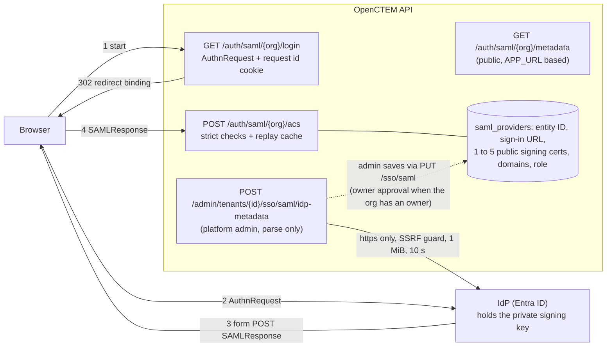
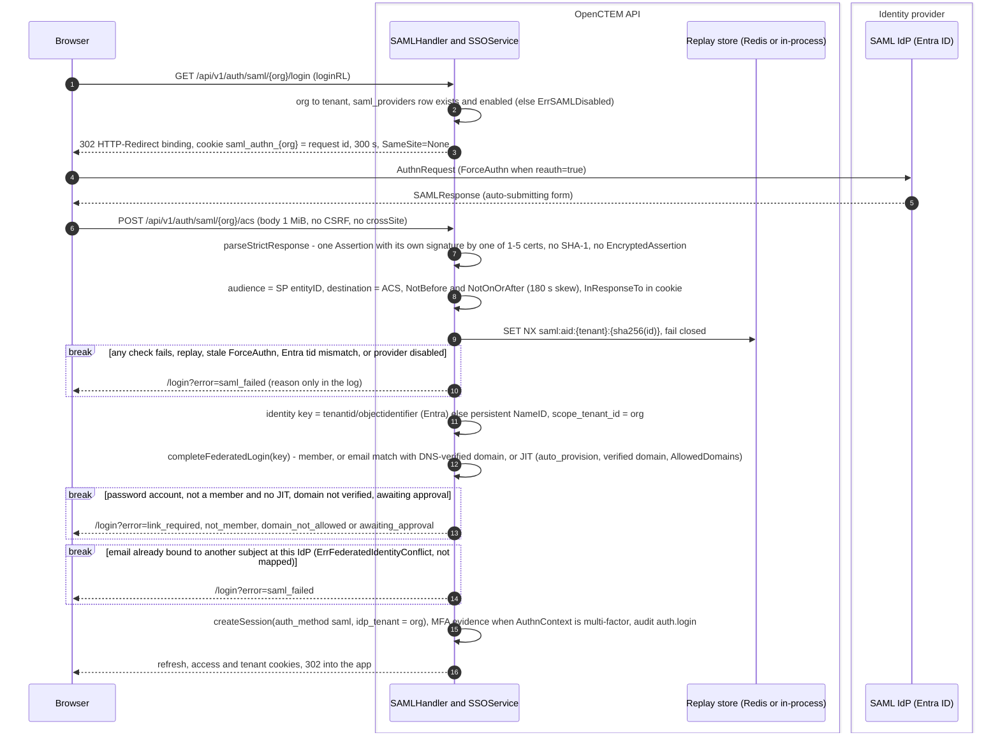

# SAML 2.0 SSO (Service Provider)

> Per-tenant SAML login, parallel to the OIDC SSO path. RFC-009 Phase 9d/9e.
> OpenCTEM acts as a SAML **Service Provider (SP)**; the tenant's IdP (Okta,
> Microsoft Entra ID, etc.) is the Identity Provider.

## Status

- **9d (shipped)** — per-tenant config + SP metadata + admin CRUD + the shared
  federated-login seam.
- **9e (shipped)** — SP-initiated login (`GET /api/v1/auth/saml/{org}/login`),
  Assertion Consumer Service (`POST /api/v1/auth/saml/{org}/acs`) and SP
  metadata (`GET /api/v1/auth/saml/{org}/metadata`): the IdP-side
  `ServiceProvider` is built from the stored certificate, the assertion
  signature, conditions and `InResponseTo` (replay) are validated, and a
  session is issued via `SSOService.CompleteFederatedLogin`.
- **Hardening (shipped)** — one signed assertion, SHA-1 refused, assertion-ID
  replay cache, certificate expiry alerts (see below).

Only a platform administrator configures an organization's SAML provider, in
the admin console; each change needs an organization owner's approval under
**Settings → SSO approvals**.

## Components and trust

The setup procedure (platform admin, Entra admin, organization owner) and the
OIDC variant are drawn in
[configure-entraid.md](../how-to/configure-entraid.md#how-it-fits-together).

OpenCTEM holds no IdP secret for SAML: only public certificates. The API never
calls the IdP during sign-in (no artifact binding); every protocol message
travels through the browser. There is no single logout: Entra sends none, and
access ends through SCIM, member removal or session expiry.

## Config (9d)

`saml_providers` (in the `001146_baseline` migration), one row per tenant, **disabled by
default** — an operator enables SAML only after validating it against their IdP:

| Field | Meaning |
|-------|---------|
| `idp_entity_id`, `idp_sso_url` | IdP issuer + SSO redirect endpoint |
| `idp_certificate` | IdP signing certificates (one to five concatenated PEM blocks) — the trust anchors for assertion signatures; any one verifies |
| `allowed_domains` | email-domain allow-list (empty = any) |
| `default_role` | role for auto-provisioned users: `member` or `viewer` (anything else is refused on save) |
| `auto_provision`, `enabled` | provision-on-login + master switch |

Admin API (platform admin console, RFC-022):
`GET`/`PUT`/`DELETE /api/v1/admin/tenants/{tenantId}/sso/saml`. The PUT
validates the certificates (every block a parseable PEM X.509 certificate, at
most five, at least one unexpired) and the role. Several certificates carry the
IdP's signing-key rollover: the current and the next key are both trusted, so
the IdP can switch keys without a sign-in outage. A signature must then name
its certificate in `KeyInfo` (every common IdP does); a signature without one
verifies only against a single configured certificate. On an
organization that has an owner, the PUT does **not** change the live config: it
stores a pending change (202) that an owner approves or rejects (RFC-022
revision 8; see `sso-authentication.md`). The organization owner sees the new signing
certificate's SHA-256 to compare with their IdP. An organization without an
owner yet gets it applied directly.

## SP metadata

`GET /api/v1/auth/saml/{org}/metadata` (public) returns the SP metadata XML the
admin registers with their IdP. The SP entity id / ACS URL are built on the
configured public origin (`APP_URL`); only without it on the forwarded headers
of a trusted proxy, then the request host — `…/api/v1/auth/saml/{org}/{metadata,acs}`.

The console downloads the same document from
`GET /api/v1/admin/tenants/{tenantId}/sso/saml/sp-metadata` (`TenantsRead`):
JSON `{filename, xml, base_url}`, built on `APP_URL` only (the console reaches
the API through its own site, so the request host is not where the IdP posts);
409 `SAML_PUBLIC_URL_UNSET` without it. The console form shows the SP URLs on
the same origin.

## Importing the IdP's federation metadata

`POST /api/v1/admin/tenants/{tenantId}/sso/saml/idp-metadata` (`TenantsSSOWrite`,
super admin with step-up, audited as `organization.saml_metadata_import`) takes
`{"metadata_url": "https://..."}` or `{"metadata_xml": "..."}` (exactly one) and
returns `{idp_entity_id, idp_sso_url, idp_sso_binding, idp_certificate,
certificates[]}`. **It stores nothing**: the console fills the form, and the
administrator saves through `PUT …/sso/saml`, which waits for an owner. There
is no second write path, and no automatic refresh from the URL (a refreshed
certificate would change who may sign in without an owner's approval).

| Threat | Control |
|--------|---------|
| SSRF through the URL | https only, no userinfo, length ≤ 2048; `httpsec.ValidateURL` on the URL and on every redirect hop; fetched with `httpsec.SafeHTTPClient` (resolve once, dial the vetted address); https→http redirects refused; 10 s timeout |
| Oversized or slow document | 1 MiB cap on the fetch (`io.LimitReader`) and the upload; the JSON body is capped too |
| XXE, entity expansion | every token is scanned before decoding; any `DOCTYPE` (or other directive) is refused, so no entity is ever declared; nesting depth ≤ 32; strict UTF-8 parser |
| Wrong document | root must be `md:EntityDescriptor`, or `md:EntitiesDescriptor` holding exactly one; an `IDPSSODescriptor` for the SAML 2.0 protocol is required |
| Wrong trust anchor | certificates come only from that `IDPSSODescriptor`'s `KeyDescriptor`s with `use="signing"` or no `use` (never encryption keys, never other role descriptors such as WS-Federation); each must parse as X.509; expired or not-yet-valid ones are dropped; at most five |
| Sign-in URL | the `HTTP-Redirect` endpoint, else `HTTP-POST`; https only |

A refusal answers 422 `SAML_METADATA_INVALID` (or 502 `SAML_METADATA_UNREACHABLE`)
with `details.reason` (`doctype`, `not_metadata`, `no_signing_certificate`,
`url_blocked`, …); the document and the URL are never echoed. A signature on
the metadata itself is not required: the platform administrator chose the
source, and the owner approves the resulting certificate (shown by SHA-256).

## Federated-login seam (shared with future SAML ACS)

`SSOService.CompleteFederatedLogin(tenant, email, name, defaultRole, autoProvision)`
is the shared tail for any externally-authenticated identity:

- find-or-create a **claimable passwordless** local user (same shape as an
  invite / SCIM-provisioned user, so it can later set a password or be claimed);
- **account-takeover guard** — a password-backed local account is **rejected**
  (a federated assertion must not log into someone's password account);
- the session is stamped `auth_method = saml` and `idp_tenant_id = <this
  organization>`: it counts as an SSO sign-in (exempt from SSO enforcement and
  the 2FA requirement) for this organization only. Exchanged for any other
  organization the account belongs to, it is handled like a password session —
  see [sso-authentication.md](sso-authentication.md#how-a-sessions-login-method-is-recorded);
- an **existing** account is admitted only when it is already a member of the
  organization **and** its email domain is DNS-verified for that organization.
  Membership alone is not enough: users are global, an organization can make
  someone a member (accepted invitation, SCIM, admin add) without owning their
  identity, and the session is exchangeable for every organization the account
  belongs to. Without the domain check, an organization holding its own IdP
  signing key could sign in as any passwordless member and pivot into their
  other organizations;
- a brand-new email is admitted only through just-in-time provisioning:
  `auto_provision` on, the email domain DNS-verified for the organization, and
  inside the organization's `Security.AllowedDomains` (RFC-025). Otherwise the
  login is refused before any account is created; the membership gets
  `default_role` (default `viewer`; `owner` is coerced to `viewer`);
- issue the OpenCTEM session (reuses the SSO `createSession`).

The SAML ACS (9e) calls this after validating the assertion. The ACS parses the
posted form itself (`r.ParseForm`, body capped at 1 MB): crewjam reads
`SAMLResponse` from `r.PostForm`, and before RFC-025 the form was never parsed,
so no SAML sign-in could succeed. The crypto
(XML-dsig signature verification) is handled by `github.com/crewjam/saml`, not
hand-rolled.

## Response hardening

Design: research/232 D7 (identity providers), threat-model rows T9, T10 and T12.
The library validates the signature, conditions, audience, destination and
`InResponseTo`; the ACS adds what it leaves optional, in
`internal/app/auth/saml_strict.go`, before and after the library runs:

| Check | Rule | Why |
|-------|------|-----|
| One assertion | the `samlp:Response` holds exactly one plaintext `saml:Assertion` and no `EncryptedAssertion` | the library returns the first of several, a signature-wrapping surface |
| Signed assertion | the assertion carries its own enveloped signature, verified against the configured certificate, even when the response is signed too | the library checks either the response or the assertion signature, not both |
| No SHA-1 | any `SignatureMethod` or `DigestMethod` based on SHA-1, anywhere in the document, refuses the response (also enforced in the library's signature hook) | SHA-1 collisions are practical |
| Replay cache | the assertion ID is recorded with `SET NX` under `saml:aid:{tenant}:{sha256(id)}` until the latest of `IssueInstant` + 90 s and every `NotOnOrAfter`, plus the 180 s clock skew and 2 min (capped at 24 h); a second sighting is refused | `InResponseTo` and the single-use cookie bind a response to one browser, the cache to one use |
| HTTP-POST only | a `SAMLart` artifact is refused | resolving one makes the server call out; no artifact endpoint is advertised |

The replay cache **fails closed**: if Redis returns an error, the sign-in is
refused. A deployment without a Redis client keeps the IDs in process (single
replica only) and logs a warning at start. Every refusal is logged with its
reason; the browser sees the same generic SAML error.

Signature-wrapping regression cases live in `TestSAMLXSWCorpus`
(`internal/app/auth/saml_strict_test.go`). A comment inside a signed NameID
(dropped by canonicalization, so the signature still verifies) never truncates
it: the whole signed value is read (`TestSAMLNameIDCommentInjectionReadsWholeValue`).

## Certificate expiry

Signature checks fail once the IdP certificate expires, so an unnoticed
expiry stops every SAML sign-in.

- `PUT …/sso/saml` refuses a certificate that has already expired.
- The admin read view returns `certificate_not_after` (RFC 3339): with several
  certificates, the soonest expiry among the unexpired ones (the alerts below
  use the same certificate).
- The `saml-cert-expiry` controller (every 6 h) reads every **enabled** config,
  500 organizations per page by tenant id, and
  alerts the organization's owners, in-app (system alert, High) and by email,
  when the certificate reaches 30, 7 or 1 day(s) before expiry and when it has
  expired. `saml_providers.cert_expiry_notice_days` (migration `003295`) keeps the
  tightest level sent, so each level is sent once; saving a different certificate
  resets it. Only the owners of the organization that owns the certificate are
  told.

## Code map

| Piece | Where |
|-------|-------|
| Config domain + repo | `pkg/domain/samlprovider/`, `internal/infra/postgres/saml_provider_repository.go` |
| Service (config + metadata) | `internal/app/auth/saml.go` (`SAMLService`) |
| Federated-login seam | `internal/app/auth/sso.go` (`SSOService.CompleteFederatedLogin`) |
| HTTP | `internal/infra/http/handler/saml_handler.go`, routes in `routes/auth.go` |
| Response hardening, replay cache | `internal/app/auth/saml_strict.go` |
| IdP metadata import | `internal/app/auth/saml_idp_metadata.go` |
| Certificate expiry alerts | `internal/app/auth/saml_cert_expiry.go`, `internal/infra/controller/saml_cert_expiry.go` |
| Migration | `001146_baseline` (table), `003295_saml_cert_expiry_notice` |

## Default role of just-in-time members

An SSO provider (OIDC or SAML) and the `SSO_ENTRA_DEFAULT_ROLE` fallback may
only provision **member** or **viewer** (decision B18). `admin` is
refused when the provider is saved, and a provider stored before this rule
with `admin` provisions viewers: an IdP misconfiguration must not mint
administrators. Admins are promoted explicitly.
