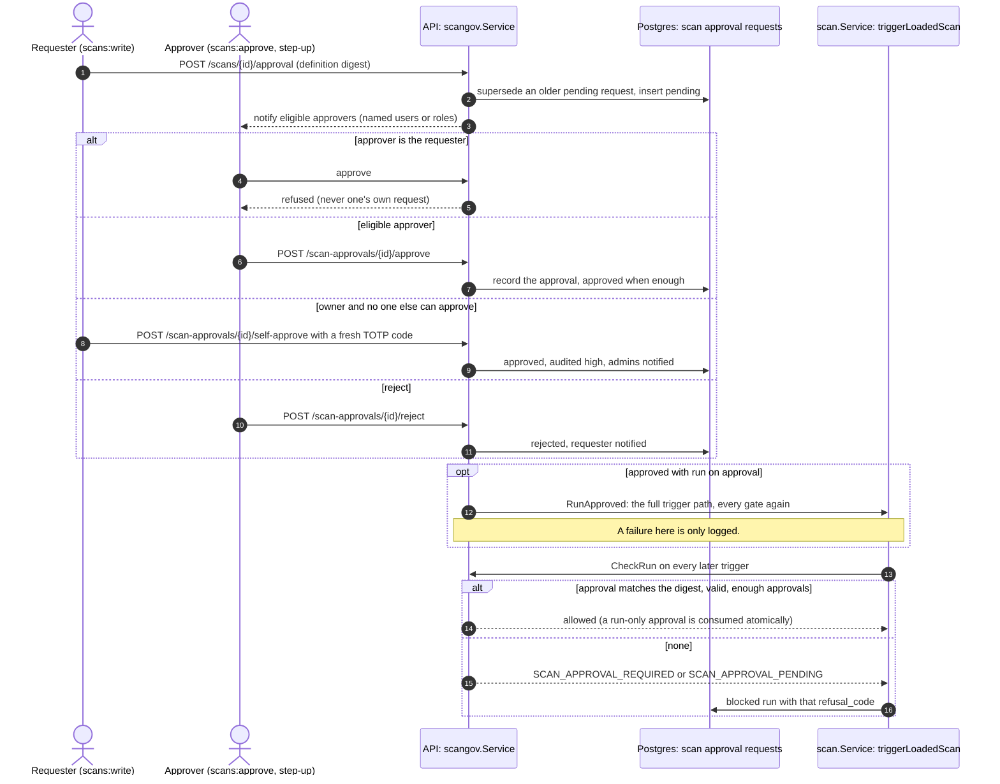

# Scan approval governance

Design: [RFC-073](../rfcs/RFC-073-scan-approval-governance.md).

An organization chooses how much human approval its scans need: **Off**
(default), **On** (its approval rules decide) or **Strict** (the rules
decide with two approvers and a justification, and scope entries keep
their approvals). A platform administrator can force the mode.

## Where things live

| Piece | Code |
|---|---|
| Modes, platform policy, rules, presets, evaluation | `pkg/domain/scangov` |
| Organization settings section `scan_governance` | `pkg/domain/tenant/scan_governance.go`, `internal/app/tenant/scan_governance.go` |
| Settings service (mode, rules) | `internal/app/scangov` |
| Platform policy and the mode in force | `internal/app/scanpolicy` (`EffectiveMode`, `ScanGovernanceMode`) |
| Routes | `GET/PUT /api/v1/organization/settings/scan-governance[/mode|/rules]`, `POST .../scan-governance/test` (rule tester, `internal/app/scangov/tester.go`), `GET/PUT /api/v1/admin/settings/scan-approval-policy`, `GET/PUT /api/v1/admin/tenants/{id}/scan-approval-policy` |
| Scope entries | `internal/app/scope/entries.go` (`loadPolicy`: approvals only in Strict) |
| Requests and run gate | `pkg/domain/scangov/request.go`, `definition.go`; `internal/app/scangov/requests.go`, `gate.go`; `internal/app/scan/governance.go` (definition, facts, gate call in `triggerLoadedScan`); `internal/infra/postgres/scan_approval_repository.go` |
| Signer floors | `SIGNER_LEDGER_MIN_APPROVALS`, `SIGNER_LEDGER_T2_MIN_APPROVALS` (`internal/signer/ledger.go`) |
| Tier ceilings (Strict only) | `scangov.TierCeilingsEnforced`; dispatch gate `internal/app/easm/active_gate.go` (`SetTierPolicy`); ledger `set_tier_ceilings` (`internal/app/scope/ledger.go` `CommitTierCeilings`, `internal/signer/ledger.go`) |

## Mode in force

```
platform override (tenants.scan_approval_policy)  ─┐
platform default (platform_settings)               ├─> policy ─┐
                                                               ├─> scangov.Effective -> off | on | strict
owner's choice (tenants.settings.scan_governance.mode) ───────┘
```

`tenant_controlled` takes the owner's choice; `off` and `strict` force it;
`on` raises Off to On. Any read error: scope entries count as Strict, a
run is refused.

## Rules

Conditions read the definition (intensity, tools, targets, schedule,
placement, zone), the inventory (tags, criticality, crown jewels) and the
caller: requester role and group, origin (`ui`, `api_key`,
`service_account`, `mcp`, `ci`, `system`, set by the authentication
middleware with `scangov.WithOrigin`), trusted service accounts, and
business hours in the organization's timezone
(`internal/app/scangov/requester.go`, directory
`ScanApprovalRepository.RequesterProfile`). Unknown caller or time is
caught (fail closed).

Conditions inside a rule are AND'ed, rules are OR'ed. Every matched rule
is listed; the matched rule with the most approvals decides the approvers;
evidence requirements add up; the shortest validity wins; Strict raises
approvals to two and asks a justification. Monitor rules never block.

## Scope entries and the signer

In Off and On a scope widening takes effect without a second person (any
caller with `attack_surface:scope:write`, with step-up; no member requests),
a new exclusion is in effect at once (its creator recorded as `approved_by`)
and taking one out of effect needs no second person; a scope entry is not a
tier ceiling (its targets may get any probe the scan's
intensity and rules allow); the change still goes to the signer ledger
(labelled `scan_approval:<mode>`, `policy_required_approvals: 0`, with
`set_tier_ceilings: false`). In Strict the RFC-054 §7 approvals and the
entries' `max_tier` apply and the signer checks both. Operators who want
recorded approvals for every organization set the signer floors and force
Strict.

Rows left pending from a time an organization was in Strict are put into
effect by the `scope-pending-settle` controller once its mode is Off or On
(`scope.Service.ActivateLeftoverPending`, hourly): each row goes through
`commitEntry` / `commitExclusion`, so the signer accepts the widening before
the database holds it, and each is audited with actor `system`. Strict
organizations keep theirs.

The ledger holds each organization's tier ceilings (on or off) so it is
never wider than the database and never refuses what the database allows:

```
owner / platform mode change crossing Strict
   leaving Strict ── signer accepts set_tier_ceilings:false ──> save mode   (refused: mode stays Strict)
   entering Strict ── save mode ──> set_tier_ceilings:true (best effort; sync narrows otherwise)
every scope widening ── carries set_tier_ceilings as the database has it
sync ── may turn ceilings on, never off (off in the snapshot only counts as diverged)
```

## Requests and the run gate

```
New Scan ── POST /scans/approval-preview ──> rules ──> "needs approval by ..."
save scan ── POST /scans/{id}/approval ──> request (digest of the definition)
approvers ── POST /scan-approvals/{id}/approve ──> approved (run now if asked)
every run ── triggerLoadedScan ── CheckRun: Off | not required | approved(digest, valid, enough approvals) ──> run
                                         else SCAN_APPROVAL_PENDING / SCAN_APPROVAL_REQUIRED (blocked run)
```

### Flow

Checked against the code of v0.19.1 and develop on 2026-11-05. There is no
run status that waits for an approval: a refused trigger, manual or
scheduled, is recorded as a `blocked` run with the refusal code (coverage
pauses the capability instead, `coverage_readiness.go`).



- Every request read is tenant-scoped (`repo.Get(tenant)` plus an equality
  check, `internal/app/scangov/requests.go`); eligibility is
  `ScanApprovalRequest.EligibleFor` (`pkg/domain/scangov/request.go`).
- Emergency run: `POST /scans/{id}/emergency-run` (`scans:approve` +
  `scans:execute` + step-up), owner or administrator, 1 to 24 hours, audited
  critical, then `RunApproved`.
- Approved scope entries reach the signer ledger the same way (see
  [job signing](job-signing.md#scope-reaches-the-ledger)).

A change to a field of the definition changes the digest: the next run
needs a new approval, and the request shows the diff from the last approved
definition. A run-only approval is consumed when the run starts.
