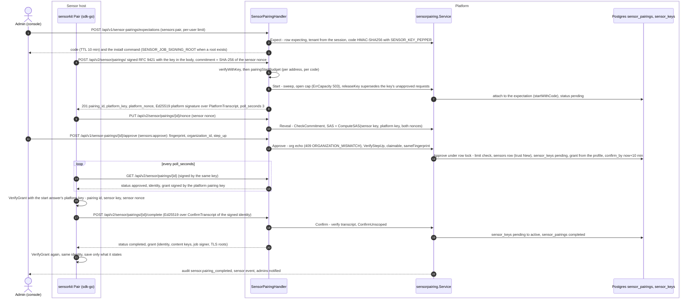
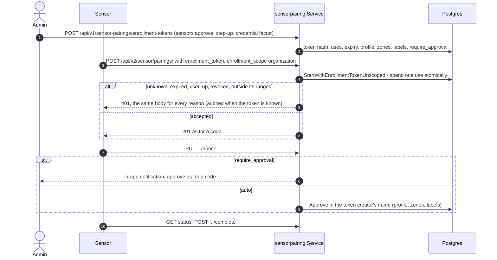
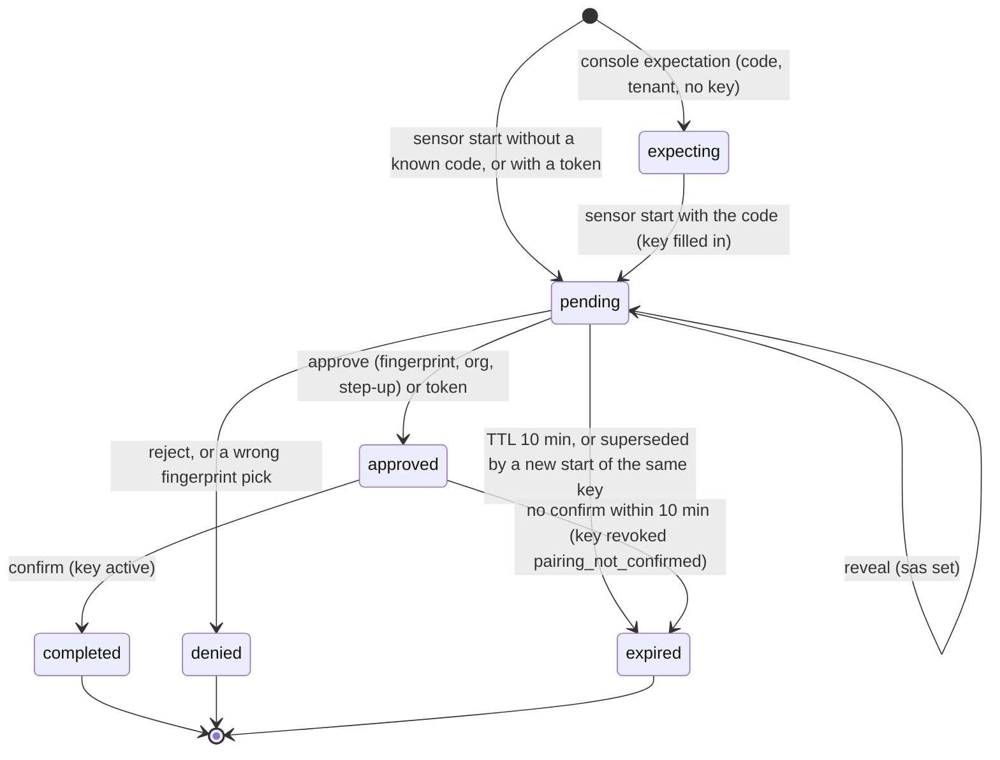

# Sensor pairing, key-bound identity and grants

Part of the [sensor and platform workflow](sensor-platform-workflow.md).

Design and decisions: [RFC-052](../rfcs/RFC-052-sensor-pairing-and-authorization.md).
Operator steps: [how-to: pair a sensor](../how-to/pair-a-sensor.md).
Trust boundaries and the remaining gaps: [sensor-platform-trust.md](sensor-platform-trust.md).

This page is the map of the code: where each part lives, what it checks and
which tests pin it. Status per part is in the table at the end.

## Flow

Code first (the console's **Add sensor**; the same sequence serves a code the
sensor printed, entered with `POST /api/v1/sensor-pairings/lookup`).



Code references: routes `internal/infra/http/routes/sensor_pairing.go`
(`registerSensorPairingRoutes`), handler
`internal/infra/http/handler/sensor_pairing_handler.go` (`Start`, `Reveal`,
`Status`, `Confirm`, `Approve`), service `internal/app/sensorpairing/service.go`
(`Start`, `Reveal`, `Status`, `Confirm`, `Approve`, `claimable`),
`fingerprint.go:fingerprintMismatch` (a wrong pick denies the request, audits
high and notifies the administrators), repository
`internal/infra/postgres/sensor_pairing_repository.go` (`Approve`,
`ConfirmUnscoped`). The approval and confirm answers carry the signed grant
(see [Signed grant](#signed-grant-what-the-sensor-pins)): the job signer's
keys and key set come from it, and a sensor given `SENSOR_JOB_SIGNING_ROOT`
by the install command also checks that key set against that root
([job signing](job-signing.md)).

Enrollment token (organization scope; an instance token takes the same path in
`instance.go` for a shared sensor):



States of a pairing row (`sensor_pairings.status`):



## Identity: one key per sensor, every request signed

A paired sensor holds an Ed25519 private key that never leaves its host. The
platform stores the public key in `sensor_keys` (one row per key, `pending`
until the sensor confirms its pairing, then `active`, `revoked` on re-pair or
revocation). Every request carries an RFC 9421 signature in the narrow profile
of RFC-052 §4.3:

| Piece | api | sdk-go |
|---|---|---|
| Profile (parse, signature base, verify, sign) | `pkg/sensorsig` | `pkg/sensorsig` (identical rules; shared vectors) |
| Verifier on the sensor routes | `internal/infra/http/handler/sensor_signature.go`, called by v1 `AuthenticateSource` and v2 `Authenticate` before the bearer path | — |
| Key lookup, status, sensor status | `SensorService.AuthenticateSigned` (`internal/app/sensor/keybound.go`) | — |
| Nonce store | Redis `SET NX` per keyid and nonce, TTL = window + skew; per-replica fallback | — |
| Signer on every request | — | `sensorsig.Transport` wrapping the API client's transport; removes any bearer header |

Order on a request: parse the headers (anything outside the profile, or a
window longer than 5 minutes, is `401` at once) → key by `keyid` (active key,
active sensor) → signature → clock window → nonce → body against
`Content-Digest`. A signature that verifies but lies outside the 2-minute
clock tolerance answers `401` with the `clock-skew` problem (`server_time`,
`clock_offset_seconds`) and a WARN log with the offset; every other refusal
stays the generic `401`. The nonce is not spent by a refused request. The body is read only after the
signature verified, so an unauthenticated caller cannot make the API buffer
it.

## Pairing

| Piece | Where |
|---|---|
| Wire types, SAS, commitment, transcripts, codes | `pkg/sensorproto/pairing` (api and sdk-go; `testdata/vectors.json` byte-identical) |
| Service: start, reveal, poll, confirm, lookup, expectations, approve, deny | `internal/app/sensorpairing` |
| Platform pairing key | HKDF-SHA256 of `APP_ENCRYPTION_KEY`, info `openctem/sensor-pairing/platform-key/v1` (Ed25519 seed) |
| Code storage | HMAC-SHA256 with the sensor-key pepper (`SENSOR_KEY_PEPPER`), never in clear |
| Repository | `internal/infra/postgres/sensor_pairing_repository.go` (`sensor_pairings`) |
| Sensor-plane routes | `internal/infra/http/routes/sensor_pairing.go`: `/api/v2/sensor/pairing*`, own group, signed by the pairing key, rate-limited: an entry budget per address for every start, then (only for a verified start) a budget per address for codeless starts or per code/token plus a wider per-address cap for starts with a code or token (`pairingStartBudget`; RFC-052 §4.4) |
| User-plane routes | `/api/v1/sensor-pairings/*` (`sensors:pair`, `sensors:approve`) |
| Step-up | `AuthService.VerifyStepUp` (`internal/app/auth/stepup.go`): TOTP if enrolled, else password, else a session younger than 10 minutes |
| Sensor side | `sdk-go/pkg/sensorkit` (`Pair`, identity store, auto-pair), `sensor` (`openctemio-sensor pair`) |

States of a pairing row: see the state diagram under [Flow](#flow).

Reverse mode starts as an `expecting` row with a tenant and a code but no
key; the sensor's start request fills in the key and turns it `pending`.

A key holds at most one open request. A new start by the same key (a sensor
restarted before approval, or given a new code) closes the key's `pending`
requests as `expired` and audits `sensor.pairing_superseded` for the ones with
an organization; with the same reverse-mode code the key's own request is
re-armed instead. A key already in `sensor_keys` is refused
`409 pairing-key-registered` (deleting a sensor removes its keys, so its
old key can pair again as a new sensor; revoke keeps them); a lost race for the key answers
`409 pairing-key-busy` (RFC-052 §4.4, threats 26-29). Enrollment-token starts
keep their own rule (a busy key spends nothing and is refused).

**Refusals reach the waiting step.** When a start that carries the code of
an open expectation is refused after its signature verified with the key in
its body, the expectation records the attempt (`last_refusal`,
`last_refusal_at`, `last_refusal_details`; migration `20261031121231`):
`clock_skew` (with the offset), `rate_limited` (its budget ran out),
`code_taken` (another key already holds the code; stored as `key_busy` when
the key is the holder's own or no key holds the request yet), `key_busy` and
`key_registered` (set by the start when the key is refused). The write is
one indexed update, at most once every 5 seconds per expectation
(`RecordRefusalUnscoped`), and a code that matches no open expectation
writes nothing, so the sensor's answer and the uniform answers of §4.4 are
unchanged. `GET /api/v1/sensor-pairings/expectations/{id}` returns it as
`last_refusal` to the expectation's organization only; the console's
waiting step (`PairingRefusalNotice`) says what happened and what to do.

**Unconfirmed approvals leave no sensor.** An approval creates the sensor
before the sensor confirms. When the confirmation window closes first, the
sweep revokes the pending key (`pairing_not_confirmed`) and then removes the
sensor if it never had another key, never called in and holds no command
(`RemoveUnconfirmedSensors`; audited `sensor.deleted`, low). A re-pair's
registration is never removed. The sweep also runs on expectation reads, so
stale rows do not wait for the next sensor start.

The review names the organization the approval binds the sensor to (the
session's) and the approval must send the same `organization_id`, or it is
refused `409 ORGANIZATION_MISMATCH` before step-up. The review also shows the
request's address with its class (private or public, and the edge or hosting
provider when known) next to the approver's own address, the product, the SDK
version and the request's age; the console warns on the path where the sensor
showed the code to approve only a sensor the approver's team started. The
approver picks the fingerprint the host shows out of three; the server checks
the pick and closes the request on a wrong one. A
request no organization claimed yet is rejected only with its code.

## Enrollment tokens (unattended installs)

For fleets (Kubernetes, Terraform, many hosts) an organization administrator
creates an enrollment token under **Sensors → Enrollment tokens**. A token is
a pre-approval: a sensor that starts pairing with it runs the same key-bound
exchange as every pairing (its own Ed25519 key, the platform's signed answer,
the nonce commitment, a signed confirmation), and once it reveals its nonce
the request is approved in the name of the token's creator with the token's
presets. With "approve each sensor" the request waits instead, listed under
**Waiting for approval**, and is approved with the fingerprint compare and
step-up like any other.

| Piece | Where |
|---|---|
| Table | `sensor_enrollment_tokens` (keyed hash, hint, max uses, use count, expiry, presets, allowed source CIDRs, revoked); `sensor_pairings.enrollment_token_id` |
| Service | `internal/app/sensorpairing/enrollment.go` |
| Repository | `internal/infra/postgres/enrollment_token_repository.go` |
| Routes | `GET /api/v1/sensor-pairings/enrollment-tokens` (`sensors:read`), `POST .../enrollment-tokens` (`sensors:approve` + step-up), `POST .../enrollment-tokens/{id}/revoke` (`sensors:approve`), `GET /api/v1/sensor-pairings/pending` (`sensors:pair`) |
| Sensor side | the start request's `enrollment_token` with `enrollment_scope: organization` (`SENSOR_ENROLLMENT_TOKEN` or `SENSOR_ENROLLMENT_TOKEN_FILE`, sdk-go sensorkit) |

Rules:

- **Shown once, hashed at rest.** `octe_` and 49 letters or digits (the
  shape of an instance token); stored as HMAC-SHA256 with the sensor-key
  pepper under its own label. The sensor says which kind it holds
  (`enrollment_scope`), so an organization token is never used as an
  instance token or the reverse, and a sensor configured for a shared
  sensor never ends up in an organization.
- **Bounded.** Expiry 1 hour to 30 days (default 24 hours); 1 to 1000 uses
  (default 10). A use is a distinct sensor key, counted under a row lock in
  the transaction that inserts the request, so concurrent starts never
  exceed the cap, and a sensor that asks again with the same key (its
  request expired while waiting) spends nothing.
- **Refused uniformly.** Unknown, expired, used up, revoked, outside the
  allowed source CIDRs, or created by someone who is no longer an active
  member: the sensor gets the same `401` as for a bad instance token; the
  reason is logged and, for a known token, audited in its organization
  (`sensor.enrollment_refused`).
- **Tenant from the token only.** The request's tenant comes from the token
  row, never from the sensor; every user-plane query is scoped by the
  session's tenant.
- **Least privilege.** Every enrolled sensor starts at trust level New
  (passive work only, no credentials, no push ingest) in the preset zones;
  promotion stays an administrator's action.
- **Audited and announced.** Created (`sensor.enrollment_token_created`,
  high), revoked, each enrollment (`sensor.enrolled`, high, with the token,
  fingerprint, host facts and source address), each refusal; every
  administrator is notified of creations and enrollments.

### Content keys

The identity an approved pairing returns carries `content_signing`: the
Ed25519 public keys the sensor pins to verify content packs
([Content packs](content-packs.md)). `platform` holds the platform content key
(every sensor); `tenant` holds the organization's own key and is present only
for a sensor of that organization. A shared sensor gets the platform key only,
so it can never accept an organization's pack. Each key is `{keyid,
algorithm: "ed25519", public_key}` in the form of the job-signing keys
(`keyid` is `SHA256:` + hex of the SHA-256 of the raw key, which the sensor
recomputes). The sensor pins them over the pairing connection and never takes
a key from a content route.

### Signed grant (what the sensor pins)

The fingerprint (SAS) the administrator compares covers the start answer
only: the platform key, both nonces and the sensor key. Someone in the
middle of the first pairing (DNS hijack plus a publicly trusted certificate,
a TLS-inspecting proxy) could relay the start untouched, so the
fingerprints match, and then swap what the sensor learned afterwards: the
identity and its content keys, the job signer (read from the unsigned
hello) and the TLS anchor (learned on first use). So every approved or
completed answer (`GET /api/v2/sensor/pairings/{id}`, `POST .../complete`)
carries `grant`: a statement the platform signs with the same pairing key as
the start answer (`sensorpairing.Service.grant`, `pkg/sensorproto/pairing/grant.go`).

| Member of the statement | Value |
|---|---|
| `protocol`, `pairing_id`, `sensor_key`, `sensor_nonce` | `openctem-pairing/v1`, this request, the sensor's public key and the nonce it revealed: a grant is valid for one request of one sensor |
| `identity` | sensor id, organization (none for a shared sensor), name, key id, scope, re-pair flag, `content_signing` |
| `signed_jobs` | the hello's `signed_jobs` block (payload type, signer keys, root-signed key set), from the job signer (`SetSignedJobs`); absent when the platform does not sign jobs |
| `tls_anchors` | `sha256:<hex>` of the SubjectPublicKeyInfo of each live root in `PLATFORM_CA_CERT_FILE` (`PlatformCA.TLSAnchors`); absent with a publicly trusted certificate |

Wire form: `{"payload": base64url(JSON), "signature": base64url(Ed25519 over
"openctem/sensor-pairing/grant/v1" ‖ 0 ‖ payload)}`. The payload is signed
as bytes, so no canonical JSON is needed; the sensor decodes the payload it
verified and uses nothing else. The shared vectors
(`pkg/sensorproto/pairing/testdata/vectors.json`, `grant_payload`,
`grant_signature`) pin the encoding in both repositories.

```mermaid
sequenceDiagram
    autonumber
    participant S as Sensor (sdk-go identity.Pair)
    participant M as Someone in the middle
    participant P as Platform
    S->>M: start (sensor key, commitment)
    M->>P: start, unchanged
    P-->>M: platform key, nonce, signature over PlatformTranscript
    M-->>S: unchanged, so the fingerprints the admin compares match
    Note over S,P: reveal, admin approves after comparing the fingerprint
    P-->>M: approved, grant signed by the platform key
    M-->>S: grant with the job keys, content keys or TLS roots swapped
    S->>S: VerifyGrant with the start answer's platform key fails
    S--xP: no confirm; nothing saved, error names "approval answer" and pairing_answer_unsigned
    Note over S,M: re-signing with the attacker's key fails the same way, and a valid grant of another sensor names another key and nonce
```

On the sensor (`sdk-go/pkg/sensorkit/identity/pair.go:confirm`):

- the approval answer's grant must verify before the sensor confirms, and
  the sensor confirms the identity it states;
- the confirm answer's grant must verify and state the same sensor,
  organization, key and scope;
- only that grant is saved: identity, content keys, job signer (the hello
  is not read during pairing), and with `tls_anchors` the anchor the pairing
  connections verified must be one of them (`ErrTLSAnchorMismatch`;
  `SENSOR_CA_FINGERPRINT` given out of band still wins).

Any failure stops pairing with an error naming the step and
`pairing_answer_unsigned`; `identity.json` is not written and
`pairing.json` is dropped. A sensor talking to a platform from before the
grant refuses with "upgrade the platform" and never falls back; a sensor
from before the grant ignores the new member and pairs as before (the
contract stays `openctem-pairing/v1`). A platform whose grant cannot be
signed logs an error and sends none, which a sensor refuses.

After pairing the job signer changes only through the pinned root: a new
signer key arrives in a key set signed by that root, a lower version is a
rollback and is refused (`jobsig.KeySetTrust`), keys pinned without a root
are never replaced, and content keys are never taken from a content route.
Replacing the root, the content keys or the TLS anchor takes a new pairing.

Tests: `internal/app/sensorpairing/grant_db_signed_test.go` (grant on the
approval and confirm answers, another sensor's grant and another nonce
refused, nothing claimed without a signer or roots),
`internal/app/sensor/ca_test.go:TestPlatformCA_TLSAnchors`,
`pkg/sensorproto/pairing/grant_test.go`; sdk-go
`pkg/sensorkit/identity/pair_grant_test.go` (a changed or re-signed grant,
a changed TLS anchor, an unsigned platform, another sensor's grant: refused,
nothing saved) and `conformance.RunPairingGrantSuite`.

### Onboarding: one install path

The console has one place to add a sensor: **Sensors → Add sensor** (inline
on the empty page), and one path through it (RFC-052 §4.9, research notes 280
and 356). Opening the dialog creates one expectation; `POST
/api/v1/sensors/install-templates` (`sensors:pair`,
`internal/infra/http/handler/sensor_install_handler.go`) renders the docker
run, Compose, Kubernetes and Linux (binary and systemd) commands from the
same templates as a sensor's own install
(`configs/sensor-products/sensor/*.tmpl`), with `SensorTemplateData.Auth =
pair`: no API key, the job-signing root as `SENSOR_JOB_SIGNING_ROOT`, the
expectation's code as `SENSOR_PAIRING_CODE`, the private CA when the
platform has one (installed, and its root pinned as `SENSOR_CA_SHA256`; the
panel names each CA certificate with its SHA-256 and links the public
`GET /api/v1/sensors/platform-ca`,
[how-to](../how-to/sensors-behind-a-private-ca.md)), no local
policy file, and a closing watch of the sensor's output that ends on
`Paired:`. The code travels in the request body, never in a URL; the route
renders text only and neither checks nor spends it. A fifth choice, several
sensors on one host, shows the multi-sensor kit's `sensors.sh add` line
(`multi`) with the same code and pin. The panel polls the
expectation (waiting, pick the fingerprint, approved) and the new sensor
(online). The inline empty state creates the expectation only on a click.

The panel asks first what the sensor will scan (research note 466):
internet-facing, internal networks or both, sent as `purpose` (`internet`,
the default, `internal`, `both`; `GET` takes it as a query parameter). For
`internal` and `both` every command sets `SENSOR_ALLOW_PRIVATE_TARGETS=1`,
with a one-line comment that says what it does, and the narrowing policy
prefill says `allow_private: true`; `internet` never sets it. The switch is
the host owner's consent to scan private networks, so it lives in the
command they run, never in a setting the console can turn on later. With
`internal` the person may also pin the host to the networks they listed
(`allowed_ranges`, private ranges only, parsed by
`scanzone.ParseLANRanges`, at most 64): the commands then set
`SENSOR_ALLOWED_RANGES` (docker, Compose, Linux) and the policy prefill lists
the same ranges (Kubernetes reads the policy file). A pin is refused with
`both` (it would refuse the public targets) and without `internal`. The
validation is `sensorapp.InstallIntent.Apply`; nothing is rendered for a
refused intent. Shared and platform sensors never install from this route.

A start with a code uses it as the request's own code (attached, or a
tenantless request under the same code when nothing expects it), and every
start without a token answers a `user_code` and, when `APP_URL` is set, the
links `verification_uri` and `verification_uri_complete`
(`<APP_URL>/activate?code=…`). The web page `/activate`
(`features/sensors/components/activate-sensor.tsx`, `sensors:pair`) reads
the code once, removes it from the address bar and shows the same review
component as the dialog (`PairingReview`). The review carries
`fingerprint_choices` (the SAS and two keyed decoys,
`internal/app/sensorpairing/fingerprint.go`); the approval sends the picked
`fingerprint`, and a wrong pick denies the request, audited high, every
administrator notified.

### Approve with trust and networks

The approval may also set up what an internal scan needs (research note
466, `internal/app/sensorpairing/approve_setup.go`). Each part is its own
decision with its own permission and audit, checked before anything is
written, so a refusal creates nothing:

- `trusted`: the new sensor starts Trusted. Only for a request that attached
  to a console expectation of the approver's organization
  (`TrustEligible`: reverse mode, created by a person, not an enrollment or
  instance token, not a re-pair; the view says `trust_eligible`), only for
  profiles whose grant has no credentials and no push ingest
  (`sensordom.TrustableAtApproval`: internal-network-scanner, easm-external,
  scan-connector), and only with `sensors:grant:widen` through
  `sensorgrant.AuthorizeTrust` and the widening approver. The approval's
  verified step-up proof is the recent re-authentication the approver asks
  for (`sensorgrant.Actor.StepUpVerified`). The grant is written Trusted in
  the approval transaction and audited after the commit as
  `sensor.grant_changed` (trust level widened, high, every administrator
  notified), as a promotion. A code the sensor printed (`/activate`) can be
  phished; those requests always start New.
- `ranges`: the private networks the sensor scans (`scanzone.ParseLANRanges`,
  RFC 1918 and ULA only), for profiles that scan zones, with
  `sensors:zones:write`. A non-default zone of the organization with exactly
  these ranges gets the sensor; otherwise a zone "<sensor> networks" is
  created with the sensor assigned (`ScanZoneRepository.CreateWithSensorTx`)
  in the approval transaction, and the zone limit of the grant includes it.
  Audited as `scan_zone.created` and `scan_zone.sensor_assigned`.
- Scope is never written by the approval. The console adds the ranges with
  `POST /api/v1/scope/targets/bulk` after it, so the scope service, its
  permission and its approvals decide as for any other entry.

### Re-pair (the sensor keeps its registration)

RFC-052 §4.6. **Sensors → sensor → Re-pair…** (`sensor-repair-dialog.tsx`):
reason, optional "Revoke the current key now" (key-bound sensors, `sensors:write`
or `sensors:revoke`; the console lists the keys and revokes the active ones),
a re-pair code (`Expect` with `RepairSensorID` and `RepairReason`; earlier
open re-pair codes of the sensor closed by `CloseOpenRepairs`), the install
command for the chosen platform, then the review with the before/now
comparison (`View.RepairBefore`, `RepairComparison`) and the approval
(`ApproveInput.RepairSensorID` must match, `ErrRepairNotAcknowledged`).

| Piece | Where |
|---|---|
| Target fixed by the code | `AttachToExpectationUnscoped` keeps the expectation's `repair_sensor_id`; `Service.Start` drops a sensor's `sensor_id` when it carries a code |
| Registration kept | `Service.Approve` uses the sensor's own name and no zones; `sensorgrant.Service.OnApproved` with `repair` only sets trust New (`SetTrustTx`) |
| Leases | `Service.onRepaired` → `CommandReleaser.ReleaseHeldBySensor` (`commands`, messages `SensorKeyReplaced*`); `SensorService.RevokeSigningKey` → `releaseIfKeyless` |
| Timeline | `repair_started`, `repaired` (`pkg/domain/sensor/event.go`) |
| Data | `sensor_pairings.repair_reason` (migration `20261031113852`, check: only with a target, known values) |
| Tests | `internal/app/sensorpairing/repair_console_db_test.go`, `grant_db_test.go`, `service_db_test.go` (`TestPairing_Repair_DB`) |

## Self-binding: a bearer-key sensor becomes key-bound

RFC-052 §4.8. A sensor that authenticates with an API key and sees the
`key_bind` feature on hello makes its own Ed25519 key, stores it in
`<state dir>/identity/`, and calls `POST /api/v2/sensor/identity/bind` with
the public key and a proof signed by it. The platform, in one transaction
(`SensorSigningKeyRepository.BindToBearerSensor`): sets the sensor row to
`key_bound` (compare-and-set), inserts the key `active`, retires every API
key of the sensor. The grant, tenant, zones and trust stay. Service:
`internal/app/sensor/keybind.go`; handler `SensorControlV2Handler.BindKey`;
audit `sensor.key_bound` / `sensor.key_bind_refused`; timeline `key_bound`.
The organization policy `key_bind_requires_approval`
(`tenants.sensor_key_bind_requires_approval`, identity-policy route and the
Organization settings switch) turns self-binding off; such sensors are
re-paired by an administrator.

## Grants

| Piece | Where |
|---|---|
| Model, profiles, admission, command tier, narrowing comparison, effective grant | `pkg/domain/sensor/grant.go` (tier: the stage catalog's lowest tier for the tool; custom templates and callbacks raise to T2; an unknown tool is T2; a retest takes the tier of the detection it repeats, the finding's tool's scan tier; profiles that may scan also list `validate` and `retest`, migration 001263) |
| Repository | `internal/infra/postgres/sensor_grant_repository.go` (`sensor_grants` keyed on `(tenant_id, sensor_id)`, and the trust level on `sensors.trust_level`; migration 001119: legacy-broad backfill, insert trigger for the narrow default) |
| Service (narrow/widen, compare-and-swap, audit, notifications, pairing hook) | `internal/app/sensorgrant/service.go` |
| Claim gate | `internal/app/command/local_policy.go` `dispatchGate.refusal` (poll, claim-N, claim by id). A refused claim by id answers like a lost claim (`command-claimed`) so deployed sensors drop the command; it is audited with the dimension. Claim by id also checks the command's required capabilities now (`ClaimForSensor`). |
| Push ingest | `internal/app/ingest/quarantine.go` `admitPush` (grant first, then role and tenant policy): the segment's items are rejected with item error `push_ingest_not_granted`; its detail and the error message name what is missing, the grant (`ErrPushIngestNotGranted`) or trust (`ErrPushIngestUntrusted`) |
| Remote actions | the heartbeat doorbell rings a gated action (`rotate_key`) only when the grant lists it (`internal/app/sensor/doorbell.go`) |
| Management API | `GET/PUT /api/v1/sensors/{id}/grant` (trust level included), `GET /api/v1/sensors/grant-profiles`, `GET /api/v1/sensors/grant-summaries` (list flags), `GET /api/v1/sensors/{id}/grant/suggestion`, `POST /api/v1/sensors/{id}/grant/suggestion/apply` |
| Suggestion | `pkg/domain/sensor/grant_suggest.go` (`SuggestGrant`), `internal/app/sensorgrant/suggest.go`, usage read `internal/infra/postgres/sensor_grant_usage.go` |

Every sensor has exactly one grant: sensors that existed before 001119 got
`legacy-broad` at trust level `trusted`; a sensor inserted later gets
`internal-network-scanner` (scan, validate, retest) at `new` from a trigger,
`collector` (collect, connector_sync, passive, push ingest) when its type
is `collector` (migration 002075), `easm-external` (scan, validate, retest
at T1, public targets only) when its type is `sensor` (EASM, migration
002084), and the pairing approval replaces it with
the chosen profile in its transaction (with none chosen,
`sensor.DefaultProfileFor` the sensor's type). Trust is never set
automatically: creating a collector with `"trusted": true` is a promotion
(`sensorgrant.Service.AuthorizeTrust` before the insert, then `Trust`), with
the same permission, step-up, audit and notification as on the Grant. A missing or
unreadable grant withholds every command and refuses push ingest (fail
closed). Known gap: the heartbeat's `pending_jobs` count does not apply the
grant, so a New sensor with only active work waiting polls at the busy
interval and gets nothing.

### Leaving the legacy grant

A sensor still on `legacy-broad` (or on any grant) can be moved to the
narrowest profile that would have admitted what it did in the last 30 days.
`SuggestGrant` reads the distinct jobs the sensor was given in the window
(type, payload, scan zone), whether it sent results without a job (v2
reports with no command, v1 queue reports, held unsolicited results) and its
assigned zones. It tries the profiles narrowest first (`collector`,
`ci-runner`, `endpoint-agent`, `scan-connector`, `easm-external`,
`internal-network-scanner`, `authenticated-scanner`) and returns the first that admits every job, at the
tier the sensor's tool contract gives it (the claim's own `AdmitContract`),
and push ingest when it was used. A zone-bound profile keeps to the zones the
jobs ran in and the assigned zones. The trust level and the remote actions
are kept. A candidate that widens the current grant on any dimension
(`Widened`) is skipped, so the suggestion is never wider than the current
grant. No suggestion is made when the window holds more than 5000 distinct
jobs (`usage_incomplete`), when no profile fits (`no_profile_fits`, for
example a T2 job), or when the current grant is already the suggestion
(`already_narrowest`). An idle sensor gets the default of its kind
(`no_activity`).

Applying (`POST .../grant/suggestion/apply` with the version and profile the
caller saw) needs `sensors:grant:narrow` (or widen) and a recent sign-in or
step-up (`STEP_UP_REQUIRED`; fail closed when step-up is not wired). The
server computes the suggestion again: a different profile or version answers
409 and writes nothing; `Widened` is checked once more before the
compare-and-swap write. The change is audited as `sensor.grant_changed` with
the diff, `source: suggestion` and the usage summary. The console shows the
suggestion as a card on the sensor's Grant section.

Jobs older than the window (a monthly schedule) are not seen: the card shows
the window and the usage it was based on, and a refused job names the grant
dimension in the sensor's timeline, from where the grant can be widened.

## Audit and timeline

Every event below is an audit entry and a sensor timeline event; the ones
marked ✉ notify every administrator of the organization in the app.

| Event | Severity |
|---|---|
| `sensor.pairing_approved` ✉ | high |
| `sensor.pairing_denied` | medium |
| `sensor.pairing_completed` | medium |
| `sensor.pairing_superseded` (a sensor started again with the same key; its unapproved request was closed; audit only) | low |
| `sensor.pairing_lookup_locked` (a user hit the failed code lookup limit; audit only) | high |
| `sensor.repaired` ✉ (a re-pair approved) | high |
| `sensor.pairing_expected` (a code created; for a re-pair: medium, with the sensor and the reason) | low |
| `sensor.key_revoked` | high |
| `sensor.grant_changed` (narrowed or demoted; the diff names each dimension) | medium |
| `sensor.grant_changed` ✉ (widened or promoted) | high |
| `sensor.claim_refused_grant` | high |
| `sensor.credential_refused` | high |
| `sensor.push_refused_grant` | medium |
| `sensor.identity_policy_changed` ✉ | high |

## Status

| Part | Status |
|---|---|
| RFC, docs | this PR series |
| Key-bound identity (verifier, `sensor_keys`) | in implementation (SP1b) |
| Pairing API, step-up, identity policy | in implementation (SP1c) |
| Grants and enforcement | implemented (SP2a) |
| SDK signer, pairing client, CA pin | in implementation (SP1d) |
| Sensor `pair` command, auto-pair | in implementation (SP1e) |
| Console | in implementation (SP1f/SP2b) |
| Trust Restricted/Quarantined, signals, kill switch | planned (SP3) |
| Two-person widening, time-boxed grants, purge-by-sensor | planned (SP4) |
