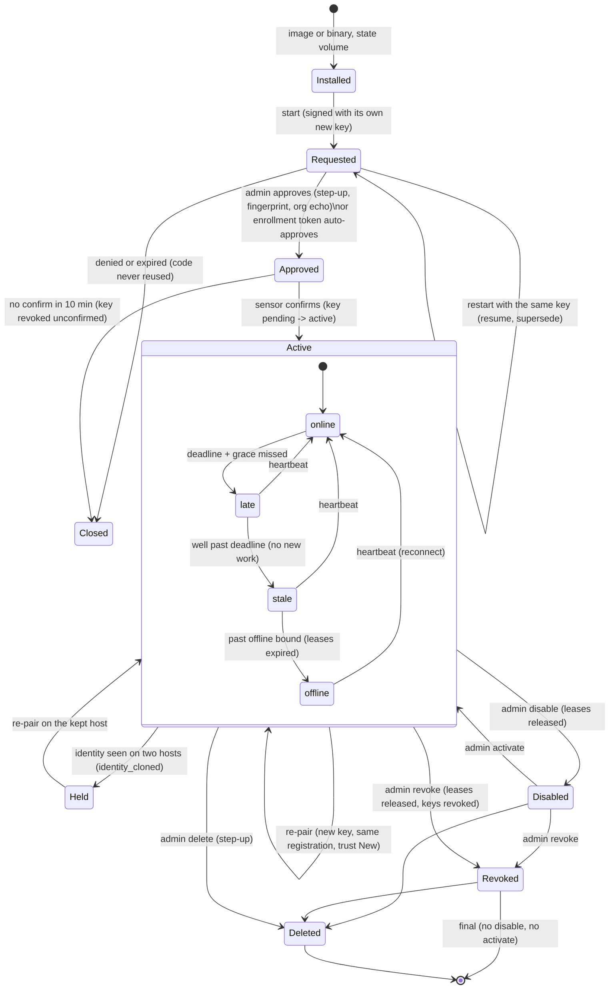
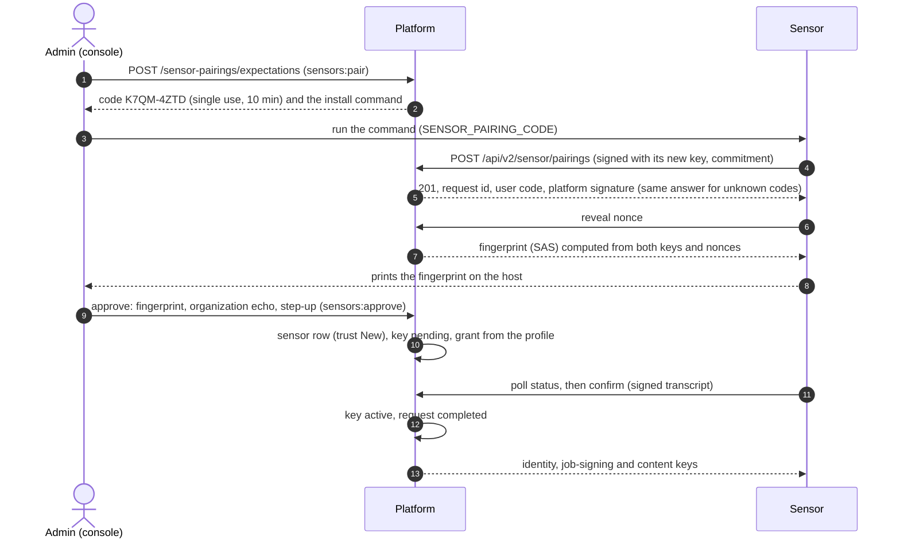
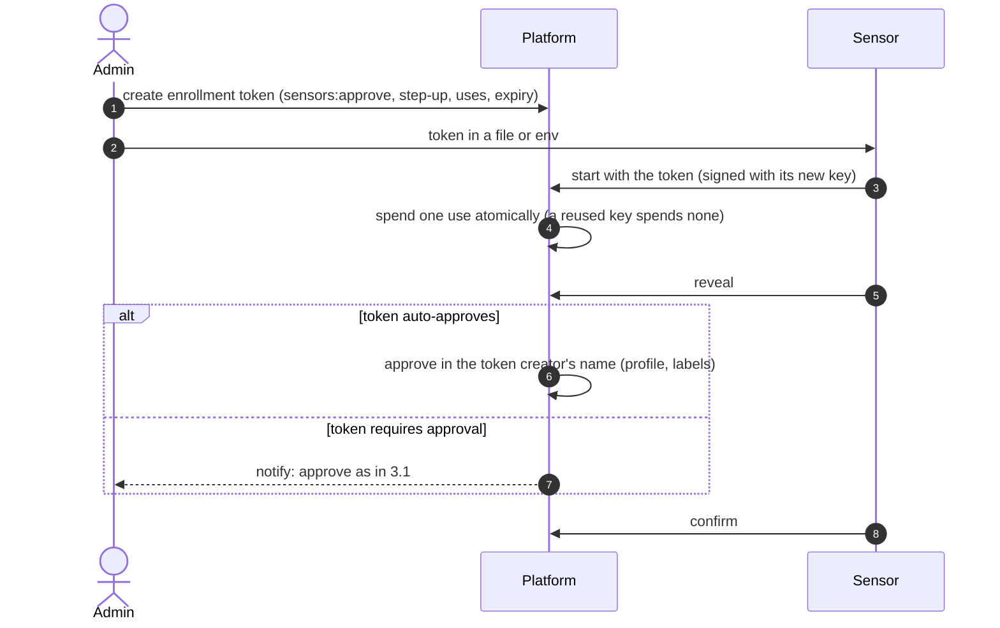
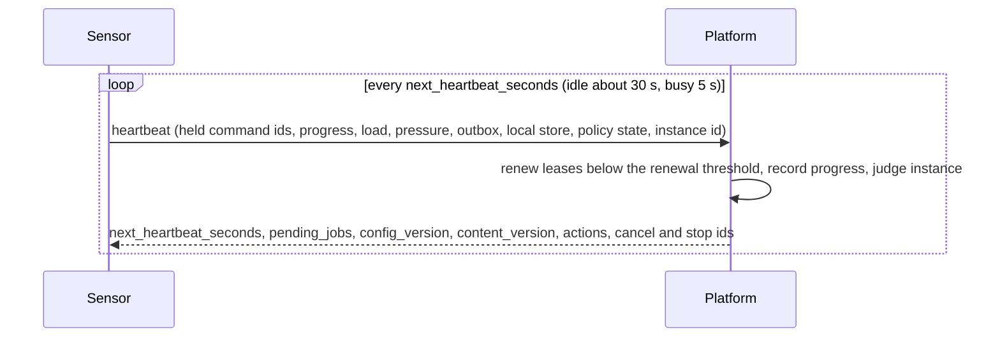
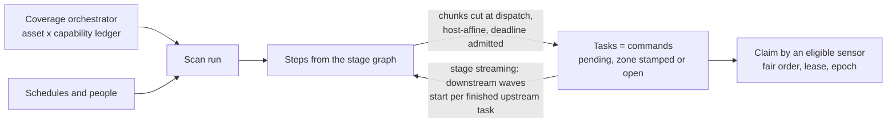
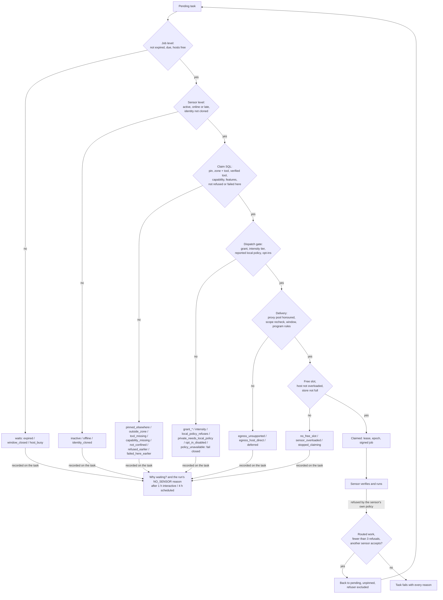
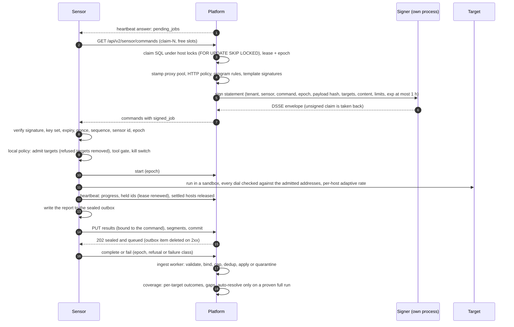

# Sensor and platform workflow

The single description of how a sensor and the platform work together, end to
end: install, pairing, identity, reporting, liveness, content, scheduling,
placement, signed jobs, execution, results, coverage, upgrade and
decommission, with every failure path we handle. Each step links to the
document that holds its detail; this page is the map and the place where the
steps meet.

Where this page and a detail document disagree, the code decides; fix both.
Code references are `path:Function` relative to `api/` (platform), or
`sdk-go/…` and `sensor/…` for the other repositories.

Related: [sensors](sensors.md) (vocabulary, protocol v2, the full reference),
[sensor pairing](sensor-pairing.md), [sensor identity](agent-identity.md),
[sensor and platform trust](sensor-platform-trust.md),
[signed jobs](job-signing.md), [job dispatch](job-dispatch.md),
[placement](placement.md), [result binding](sensor-result-binding.md),
[scan lifecycle](scan-lifecycle.md), [scan stages](scan-stages.md),
[asset coverage](asset-coverage.md), [finding closure](finding-closure.md),
[sensor compatibility](sensor-compatibility.md),
[transport v3](sensor-transport-v3.md), [proxies](sensor-proxies.md),
RFC-030, RFC-032, RFC-033, RFC-035, RFC-040, RFC-052, RFC-074, RFC-137.

## 1. Principles

1. **The platform decides, the sensor executes and reports.** Placement,
   chunking, budgets, retries, liveness and coverage are platform decisions
   made from what sensors report. A sensor's reports can only narrow what it
   is given, never widen it.
2. **Mutual distrust** (RFC-040). The platform signs every job; the sensor
   verifies it and applies its own local checks before any packet leaves.
   The sensor's results are hostile input: bound to the job that asked for
   them, size-capped, sanitized, never trusted to close anything on their own.
3. **Fail closed, say why.** Anything that cannot be verified (a signature, a
   policy read, a lease, an identity) withholds work, and the reason reaches
   the console (`withheld_reason`, placement reasons, health reasons,
   coverage gaps). A failure is never recorded as "clean".
4. **Tenant isolation.** A sensor's tenant comes from its key, never from the
   request. Every query of the claim, transition and ingest paths carries the
   tenant predicate. Shared sensors (scope `instance`) only ever claim shared
   jobs (`is_platform_job`), each in the job's own tenant.
5. **Reusable sensor mechanisms live in sdk-go** (pairing, signing, policy,
   scope guard, outbox, janitor, adaptive rates); the sensor wires them.

## 2. Lifecycle of a sensor

| State | Stored as | Gets new work | Code |
|---|---|---|---|
| Requested / Approved / Closed | `sensor_pairings.status` (`expecting`, `pending`, `approved`, `completed`, `denied`, `expired`) | no sensor row until approval | `internal/app/sensorpairing/service.go` |
| Active, online or late | `sensors.status = active`, `health IN (online, late)` | yes | `pkg/domain/sensor/liveness.go:IsDispatchable`, `infra/postgres/sensor_liveness.go` |
| Active, stale or offline | `health IN (stale, offline)` | no; pinned pending work is unpinned, an offline sensor's leases expire | `infra/controller/sensor_health.go:onOffline` |
| Held (cloned identity) | `identity_cloned_at IS NOT NULL` | no, on every claim path | `infra/postgres/command_cloned_identity.go:identityNotClonedPredicate` |
| Disabled | `status = disabled` | no; held commands released; heartbeat and hello still answered | `internal/app/sensor/service.go:DisableSensor` |
| Revoked | `status = revoked` | no; refused at authentication; final | `service.go:RevokeSensor`, `DisableSensor`, `ActivateSensor`, `UpdateSensor` |
| Deleted | row gone | — | `service.go:DeleteSensor` |

The sensor shows the state on the Sensors page with a computed display state
(`online`, `degraded`, `late`, `stale`, `offline`, `never_connected`,
`disabled`, `revoked`) and one health reason per problem
(`pkg/domain/sensor/fleet_health.go`).

## 3. Install and pairing

Install paths: the console's docker and Compose commands, `deploy/multi`
`sensors.sh`, Helm, and the Linux binary under systemd. All keep the
identity in a state volume (`/var/lib/openctem/state/identity`): losing the
volume loses the identity, and the way back is a re-pair (section 3.5).

The sensor always creates its own Ed25519 key; every sensor-plane request
is signed with it (RFC 9421, `Content-Digest` covered, ±2 minutes clock
skew, 5-minute validity, one-time nonce). Codes and tokens only say *which
organization and which approval* a key belongs to; they are never
credentials on their own.

### 3.1 Code first (the console makes the code)

### 3.2 The sensor shows a code

A start without a code opens a tenantless request with a fresh code that the
sensor prints. An admin enters it (or opens the printed link), sees the
request in the review, and approves exactly as above. A tenantless request is
reachable only by its code; org B can never read or approve a request that
org A's code attached (`internal/app/sensorpairing/service.go:claimable`).

### 3.3 Enrollment token

A refused token is a uniform 401 (audited when the token is known). Shared
sensors enroll with an instance token through the same path
(`enrollment.go`, `instance.go`).

### 3.4 Legacy API key and self-bind

A sensor started with a bearer key (`octs_…`) binds its own Ed25519 key with
a proof of possession and from then on signs requests; its bearer keys are
retired (`internal/app/sensor/keybind.go:BindSigningKey`). An organization
can require approval for the bind (`tenants.sensor_key_bind_requires_approval`,
default off).

### 3.5 Re-pair (lost volume, rebuilt host, suspected key)

Only the console decides a re-pair: a re-pair code names the registration it
replaces; an ordinary code never targets an existing sensor, whatever the
sensor sends. Approval keeps the registration (name, zones, grant, history),
revokes every earlier key (`repaired`), returns trust to New and clears the
cloned-identity flag (`sensor_pairing_repository.go:Approve`). The sensor
stages its new key and swaps it in only after confirm, so an interrupted
re-pair leaves the working identity untouched (sdk-go
`identity/store.go:RotateKey`, `SaveAndPromote`).

### 3.6 Pairing failure paths

| Case | Behaviour | Code | Test |
|---|---|---|---|
| Ctrl-C after attach, restart with a new code | the unapproved request of the same key is superseded; the sensor attaches to the new code | `sensorpairing/service.go:releaseKey` | `sensorpairing/repair_same_key_db_test.go:TestPairing_SameKeyNewCodeSupersedesUnapproved_DB` |
| Restart after approval, before confirm | the sensor resumes its saved request (`pairing.json`, 0600) and confirms | sdk-go `identity/pair.go:resumePending` | sdk-go `pair_resume_test.go:TestPairResumesAnApprovedRequestAfterARestart` |
| Key already registered to a sensor | `409 pairing-key-registered` | `service.go:keyConflict` | `repair_same_key_db_test.go:TestPairing_ApprovedKeyRefused_DB` |
| Spent or expired code | never resent; the sensor falls back to its own code | sdk-go `pair.go:Pair` | sdk-go `TestPairSpentCodeIsNeverResent` |
| Clock skew beyond 2 minutes | 401 `clock-skew` with the offset, only after the signature verified; the sensor explains and retries | `handler/sensor_pairing_handler.go:Start`, sdk-go `pair.go:clockSkewOf` | `handler/sensor_pairing_clock_test.go:TestPairingStart_ClockSkew`, sdk-go `TestPairClockSkewProblemIsExplained` |
| 429, 5xx, network errors | jittered backoff 5 s to 5 min, `Retry-After` honoured; any other 4xx waits 5 min instead of a restart storm | sdk-go `pair.go:classifyPairError` | sdk-go `pair_retry_test.go:TestPairStatusClasses` |
| Platform pinned key or TLS pin mismatch | pairing refuses a tampered or different platform signature | sdk-go `pair.go:pairOnce`, `keybound.go:applyTLSPin` | sdk-go `TestPairRefusesAnotherPlatformKeyThanThePinned` |
| Wrong organization, missing fingerprint, failed step-up | 409 `ORGANIZATION_MISMATCH` (before step-up), 400, 403 | `service.go:Approve` | `sensorpairing/approval_context_db_test.go:TestPairing_ReviewNamesAndBindsTheOrganization_DB` |
| Cross-tenant read, approve or deny | 404 | `service.go:claimable` | `sensorpairing/service_db_test.go:TestPairing_ForwardFlowAndRefusals_DB` |
| Too many open requests platform-wide | 503 with `Retry-After` | `service.go:createWithCode` (`ErrCapacity`) | `service_db_test.go:TestPairing_CapsDenyExpiry_DB` |
| Expired rows | swept when a start or expectation runs (at most once a minute); every read checks expiry, so a stale row never authenticates | `service.go:sweep` | `postgres/sensor_pairing_expire_db_test.go:TestSensorPairingRepository_ExpectationCloses` |

## 4. Identity and keys

| Topic | Behaviour | Code |
|---|---|---|
| Request authentication | keyid → active key → owning sensor; revoked refused, disabled reaches only heartbeat and hello; suspended organization refused; nonce spent after the signature verifies | `handler/sensor_signature.go:authenticateSigned`, `app/sensor/keybound.go:SigningIdentity` |
| Replay | nonce store in Redis, TTL 9 minutes; a per-replica memory store when Redis errors (bounded, fails closed when full) | `keybound.go:UseNonce` |
| Key rotation | key-bound sensors rotate by re-pair; bearer keys renew themselves (`POST /api/v2/sensor/keys`, doorbell `rotate_key` at half the TTL) | `service.go:RenewAPIKey` |
| Revoke one signing key | the key stops authenticating | `keybound.go:RevokeSigningKey` |
| Cloned identity | per-process `instance_id` on every heartbeat; instances that alternate three times in 15 minutes set `identity_cloned_at` (critical health reason, high audit) and **withhold new work** until re-pair | `service.go:observeInstance`, `postgres/sensor_repository.go:ObserveInstance`, `postgres/command_cloned_identity.go` |

## 5. Manifest, tools and capabilities

The sensor registers what it is once (`PUT /api/v2/sensor/manifest`): build,
SDK, resources, tools with versions, content and settings, capabilities, its
local policy summary, posture and network report. Heartbeats carry only the
manifest digest; the sensor re-sends the manifest when the digest changes or
the platform asks (`send_manifest`). Only tools and capabilities known to the
catalog are stored; dispatch reads the generated `effective_*` columns, so a
tool the sensor did not verify is never dispatched to it
(`internal/app/sensor/manifest.go:RegisterManifest`,
`declared_tools.go:projectDeclaredTools`).

When the catalog gains a tool a sensor had already reported (and the platform
had ignored), the platform asks that sensor for its manifest once after its
next start and re-projects it (`manifest.go:LoadManifestRechecks`,
`TakeManifestRecheck`; test
`routes/sensor_manifest_db_test.go:TestSensorManifest_CatalogGainsToolReprojects`).

## 6. Heartbeat, liveness and adaptive control

- **The platform sets the pace.** The answer's `next_heartbeat_seconds` is
  derived, not configured: busy (work waiting and a free slot) or idle,
  stretched by fleet size and replica count, never above a third of the lease
  or half the offline bound, jittered (`internal/app/sensor/doorbell.go:Ring`).
  The sensor clamps it to 5 s to 5 min. Concurrency is the sensor's own
  decision from its CPU, memory and tool costs; host pressure it reports only
  ever lowers what it is offered.
- **Liveness ladder** (`pkg/domain/sensor/liveness.go`): late at deadline +
  max(10 s, interval/5); stale at deadline + 2 intervals + grace; offline at
  deadline + max(3 intervals, 90 s). A late sensor still gets work; stale and
  offline do not, and an offline sensor's leases are expired so its work goes
  back to the queue (`infra/controller/sensor_health.go:onOffline`).
- **The platform protects itself before it convicts.** During the startup
  grace (4 minutes), after a stalled controller tick, or while heartbeat p95
  is above 2 s, offline convictions are held, so a platform restart or a slow
  database never turns the fleet offline at once
  (`internal/app/sensor/platform_health.go:HoldConvictions`).
- **Control plane limits.** Per-sensor and per-tenant buckets answer
  `429 rate-limited` with a jittered `Retry-After`
  (`middleware/ingest_v2.go:V2Throttle`).
- **Doorbell.** The answer says whether work waits; it never carries a job.
  Protocol v3 pushes the same signal over a control stream.

## 7. Content

Scanner content (template packs, wordlists, rule packs) is signed by the
platform or the organization and verified by the sensor before use (DSSE
statement naming digest and organization; revocations only grow). The
heartbeat carries `content_version`; the sensor fetches `/content/desired`
with `If-None-Match`, then packs and files by hash. A job pins the content it
needs by digest in its signed statement, and the sensor refuses a job whose
pinned content does not match (`internal/app/contentpin/pin.go:PinJobContent`,
sdk-go `core/content_job.go`). `refresh_content` commands are deduplicated
per sensor (`internal/app/sensor/content.go`). See
[content packs](content-packs.md) and [wordlists](wordlists.md).

## 8. Scheduling

- **Coverage orchestrator** (`internal/app/coverage/planner.go`, on by
  default, one replica): keeps an asset × capability ledger, batches due
  pairs, starts runs of a reused "Continuous coverage" scan with system
  authority through the full dispatch gate, never an intrusive capability.
  Runs that no sensor claims grow a streak; at the threshold the capability
  is held until the fleet changes, with an exponential probe
  (`countRunClaim`, `hold`). Gaps alert the organization's admins once per
  change (`coverage/alerts.go`).
- **Scan, run, task.** A step's tasks are created at dispatch, cut into
  host-affine chunks after the run deadline admits them
  (`internal/app/scanrun/run.go:dispatchStep`, `host_chunks.go`). With stage
  streaming (on by default) a chained step starts on each finished upstream
  task instead of waiting for the whole step; intrusive and endpoint-selection
  stages never stream (`scanrun/stream.go`, RFC-137).
- **Chunking happens at dispatch, not at claim.** At claim time the only
  change is a partial split of a task whose hosts are partly busy
  (`internal/app/command/host_split.go`). Claim-time chunking (RFC-030 phase
  2) is not built.
- **Fair order** (`infra/postgres/command_repository.go:fairPendingQuery`):
  priority class with aging (one class per 30 minutes, never into critical),
  then round-robin across runs, then age. Shared sensors take an
  organization-first fair share with a per-organization in-flight limit
  (`command_shared_claim.go`). Within an organization, fresh tasks go to the
  least-loaded eligible sensor for 10 seconds (`claim_balance.go`).
- **Leases.** A claim sets `acknowledged`, the holder, `lease_epoch + 1` and
  `lease_expires_at` (default 3 minutes, `SENSOR_COMMAND_LEASE`). Heartbeats
  renew it below the renewal threshold. The job recovery controller re-queues
  expired leases (attempt + 1, back-off, the old holder recorded in
  `failed_on` for routed work), and fails a task after 3 dispatch attempts or
  50 re-queues (`postgres/command_lease.go:RequeueExpiredLeases`,
  `FailExhaustedCommandsReturning`).

## 9. Placement: who may take a task

The same predicates serve the poll, claim-N, claim by id and the heartbeat
doorbell, and the placement explainer evaluates them read-only for every
sensor (`internal/app/command/placement.go:ExplainPlacement`; test
`postgres/command_placement_db_test.go:TestPlacement_AgreesWithTheClaim`).
Grant, intensity and reported local policy are checked in Go after the SQL;
a withheld task records its reason (`internal/app/command/withheld.go`).
Reason codes and their meaning: [placement](placement.md).

**Sensor-local policy** (owner decision 2026-10-31): the platform's signed
scope is the default; a host owner may add a local allow list that only
narrows it, and the platform never writes it; the kill switch stays. Today a
newly paired sensor without a policy refuses jobs with network targets (sdk-go
`ResolveRequireLocalPolicy`), and a refused routed task is re-queued for
another sensor whose reported policy accepts it
(`internal/app/command/refusal.go:handleRefusal`). The move to an optional,
narrow-only policy and policy-aware routing is in progress; this section
changes with it.

## 10. The job loop

### 10.1 Execution safety on the sensor

| Control | Behaviour | Code (sdk-go) |
|---|---|---|
| Signed jobs | refused before start on any mismatch; once anything is pinned, unsigned jobs are refused | `core/job_signing.go:JobGuard.Check`, `jobsig/verify.go:checkStatement` |
| Scope before dial | names resolved and checked at admission; every dial goes to the checked addresses only, never re-resolved (DNS rebinding); metadata and link-local refused | `core/local_policy_enforce.go:CheckDial`, `sensorkit/egress/egress.go` |
| Confinement | per-task network namespace with a relay on 127.0.0.1:1080 and DNS on :53, Landlock, seccomp, cgroup envelope | `sensorkit/executor` |
| Rate | per-host AIMD with a breaker, `Retry-After` honoured; floors, blocks and breaker trips become coverage gaps | `adapt/hostrate.go:HostRate` |
| Kill switch | policy flag or file, checked every 2 s; running jobs canceled and failed `kill_switch` | `core/command_poller.go:checkKillSwitch` |
| Disk | outbox capped (1 GiB or half the free space), room kept for command results; a full store stops claiming and says so on the heartbeat | `outbox/outbox.go`, `sensorkit/store.go:acceptsWork` |
| Cancel and stop | `cancel_command_ids` stops and hands back; `stop_command_ids` stops and delivers what finished | `core/command_poller.go:CancelCommands`, `StopCommands` |

## 11. Results, binding and ingest

- **Binding.** A result names its command. It is accepted as bound only when
  the command is in the sensor's tenant, held by this sensor, and open (or
  finished less than 15 minutes ago), and the tool matches; a lease epoch
  the sensor states must be the current one. Anything else is
  `command-not-found`; unsolicited results are allowed only for collectors
  and otherwise quarantined (`internal/app/ingest/quarantine.go:OpenCommand`,
  `admitUnsolicited`).
- **Durability.** 202 means sealed and queued (`ingest_jobs`), not applied.
  The report id is the idempotency key: the same segment replays as 200, a
  different digest is `report-conflict`. Segments may arrive in any order;
  finalize (auto-resolve, coverage) runs once after the commit
  (`ingest/v2_receiver.go`, `v2_jobs.go`).
- **Hostile input.** Strict JSON, item and size caps, text caps with markers,
  secrets redacted, tool must be one the sensor declared and the command's
  tool; for address-chunk scans, assets outside the chunk are dropped with
  their findings (`ingest/strictjson.go`, `text_caps.go`, `binding.go`). For
  a scan or retest whose targets name a host, a located asset that is not at
  or under a target name, at a target address or range, or at an address an
  in-bound asset of the report states, is dropped with its findings, counted
  and audited (`ingest/job_bound.go`, RFC-040 §5.3.1).
- **Dedup.** The server computes the fingerprint base; a report's own
  fingerprint is a sighting hint only, never the base
  (`ingest/processor_findings.go:generateFindingFingerprint`).
- **Provenance.** Findings record the sensor, tool and version, the template
  digest, and the command and step as evidence; a shared sensor appears as
  `platform` (`ingest/scan_attribution.go`, `template_provenance.go`). The
  channel (`findings.ingest_channel`) is the platform's: `collector` for a
  collector sensor, `scanner` for any other; the report's
  `metadata.source_type` is ignored (`ingest/channel.go`).
- **Revoked or disabled after upload.** A queued report of a sensor revoked
  or disabled since is dropped and audited when processed
  (`ingest/queued_sensor.go:QueuedWorkSensor`).
- **Run taken back after upload.** Each report records its command's lease
  epoch at accept; a queued report is processed only while the sensor still
  holds the command under that epoch (`QueuedWorkSensor`, `heldRun`).

## 12. Coverage: what a run proves

- Per target: `done` with no failure class and not named in a coverage gap.
  Edge blocks, challenges, rate limits, unreachable and refused targets are
  coverage gaps with a reason, never "clean"
  (`ingest/coverage_targets.go:coveredTargets`).
- A finding is auto-resolved only by a completed command with exit 0, no gaps,
  no unreached or refused targets, a result not cut short, every report
  complete with intact integrity, no quarantined items and an explicit full
  coverage type; the blinding guard stops a mass close; the default mode is
  dry run (`ingest/coverage_autoresolve.go:decideRunCoverage`). An
  infrastructure failure, a cancel or a stall never closes anything.
- The asset coverage ledger settles per target from the same outcomes; a
  truncated result covers nothing (`pkg/domain/coverage/settle.go:Verdicts`).
  Blocked targets are rechecked after 6 hours.
- Completion: a step is partial when it has gaps, skipped or unfinished
  targets; unfinished targets of a stopped task become a follow-up task;
  failures that are not the target's move to another sensor (3 attempts,
  fleet stop after two sensors fail the same tool and content version)
  (`internal/app/command/infra_failure.go`, `service.go:completeWithFollowUp`).

## 13. Upgrade and version skew

The platform owns compatibility ranges; a sensor release never requires a
platform change ([sensor compatibility](sensor-compatibility.md)). Features
are negotiated through hello (`protov2` features) and the manifest. The
sensor's version is classified latest, update available, unsupported or
unknown, and an unsupported version is a critical health reason
(`pkg/domain/sensor/version.go:ClassifyVersion`); it still authenticates and
takes jobs, and `hello.deprecations` is not filled yet. A new requirement is
expressed as a capability or feature the claim checks (`required_features`),
so an older sensor simply is not offered that work and the task says why.
`sensors.sh upgrade` verifies the image signature before it pulls.

## 14. Decommission

| Action | Effect | Code |
|---|---|---|
| Disable | paused: no new work, held commands released (routed work re-queued, the rest failed, late writes fenced), heartbeat still answered | `service.go:DisableSensor`, `postgres/command_lease.go:ReleaseHeldBySensor` |
| Revoke | final: authentication refused, held commands released, signing keys revoked; disable and activate refuse a revoked sensor | `service.go:RevokeSensor` |
| Delete | row removed (step-up); keys, grants and events cascade; commands keep their history with no holder | `service.go:DeleteSensor` |
| Host side | `sensors.sh remove [--purge]` removes the container; revoke in the console | sensor `deploy/multi/sensors.sh` |

## 15. Failure and edge-case matrix

| # | Situation | Exact behaviour | Code | Test |
|---|---|---|---|---|
| E1 | Network loss, sensor side | heartbeat retried once, then about 10 s; outbox keeps results (sealed, fsync) and drains with backoff and jitter when the link returns; nothing is lost | sdk-go `client/control_v2.go`, `outbox/outbox.go` | sdk-go `outage_test.go:TestOneHourOutageDeliversEachResultExactlyOnce` |
| E2 | Network loss longer than the lease | the platform expires the lease and re-queues the task for another sensor; the old holder's start, complete and fail are fenced by the epoch; its late results are refused at accept when they state an old epoch and dropped by the ingest worker when the run was taken back, for organization and shared sensors; the sensor stops the job past its lease plus a grace and sends nothing of it (sdk-go lease watchdog) | `postgres/command_lease.go:RequeueExpiredLeases`, `FencedUpdate`, `ingest/quarantine.go:OpenCommand`, `ingest/queued_sensor.go:heldRun`, sdk-go `core/lease_watchdog.go` | `postgres/command_lease_db_test.go:TestCommandLease_NoCompletionAfterRequeue`, `routes/sensor_lease_fencing_db_test.go:TestOrgResults_StatedEpochMustBeCurrent`, `TestOrgResults_QueuedReportOfATakenBackRunIsDropped`, sdk-go `TestCommandPoller_LeaseWatchdog` |
| E3 | Platform restart | leases, queue and pairing state live in Postgres; offline convictions are held for the startup grace; the first answered heartbeat wakes the outbox | `app/sensor/platform_health.go:HoldConvictions` | `platform_health_test.go:TestPlatformHealth_StartupGrace`, `tests/unit/sensor_liveness_store_controller_test.go:TestLivenessStore_ColdStartNoMassOffline` |
| E4 | Slow database or overloaded controller | offline convictions held while heartbeat p95 ≥ 2 s or after a stalled tick | `platform_health.go:HoldConvictions` | `TestPlatformHealth_SlowHeartbeats`, `TestPlatformHealth_Stall` |
| E5 | 429 on the control plane or results | jittered `Retry-After`; the sensor honours it (pairing, heartbeat, outbox, poll) | `middleware/ingest_v2.go:V2Throttle` | `middleware/retry_after_test.go:TestV2Throttle_RetryAfterFollowsTheBucket` |
| E6 | Results queue full | 429 `queue-full`; a segment of an admitted report may use twice the limit; an unreadable depth is 503 | `ingest/v2_receiver.go:admit` | `routes/sensor_v2_routes_db_test.go:TestSensorV2_QueueFullAdmitsByReport` |
| E7 | Clock skew | 401 `clock-skew` with the offset, only after a valid signature; the sensor explains and never corrects its own clock | `handler/sensor_signature.go:authenticateSigned` | `handler/sensor_signature_test.go:TestAuthenticateSigned_ClockSkewOnlyForValidSignatures` |
| E8 | TLS interception, wrong CA | the pinned CA fingerprint or the trust anchor recorded at pairing refuses the connection | sdk-go `keybound.go:applyTLSPin` | sdk-go `sensorkit/tls_pin_test.go` |
| E9 | Disk full on the sensor | outbox refuses new items but keeps room for command results; the store stops claiming and the task says `stopped_claiming` | sdk-go `outbox/outbox.go`, `sensorkit/store.go` | sdk-go `TestFullOutboxKeepsRoomForCommandResults`, `postgres/command_placement_db_test.go:TestPlacement_NamesASensorThatStoppedClaiming` |
| E10 | Partial results (stall) | the platform asks the holder to stop; finished targets are delivered, unfinished ones become a follow-up task; no answer in 5 minutes re-queues the whole task | `app/command/service.go:completeWithFollowUp` | `postgres/command_follow_up_db_test.go:TestCompleteWithFollowUp_FenceAndTenant`, `app/command/stop_requeue_test.go:TestFail_StopRequestedIsRequeued` |
| E11 | Duplicate identity (cloned volume) | flagged after three alternations in 15 minutes; new work withheld on every claim path; placement says `identity_cloned`; re-pair clears it | `postgres/command_cloned_identity.go` | `postgres/command_cloned_identity_db_test.go:TestClaim_ClonedIdentityGetsNoNewWork`, `app/sensor/identity_db_test.go:TestSensorCloneDetection_Heartbeats_DB` |
| E12 | Local policy tightened mid-run | running jobs keep the policy they were admitted under; new jobs use the new one; the kill switch stops running jobs within 2 s; reload on SIGHUP | sdk-go `sensorkit/kit.go:SetLocalPolicy`, `core/command_poller.go:checkKillSwitch` | sdk-go `local_policy_reload_unix_test.go:TestKit_ReloadLocalPolicyOnSIGHUP`, `TestCommandPoller_KillSwitch` |
| E13 | Sensor refuses a job | routed work re-queued for another sensor that accepts it (up to 3 refusals), the refuser excluded; otherwise failed with every reason | `app/command/refusal.go:handleRefusal` | `postgres/command_refusal_db_test.go:TestRefusal_RequeuedToAnotherSensorThenFails` |
| E14 | Double claim | `status = pending` guard, `FOR UPDATE SKIP LOCKED`, host advisory locks; the loser gets nothing | `postgres/command_repository.go:ClaimManyForSensor` | `postgres/command_host_keys_db_test.go:TestCommandHostKeys_RacingSensorsNeverShareAHost`, `command_claim_balance_db_test.go:TestClaim_ConcurrentClaimsNeverExceedTheSlots` |
| E15 | Out-of-order or duplicated result segments | any order; finalize after the commit; replay is idempotent, a changed digest conflicts | `ingest/v2_receiver.go:Commit`, `replay` | `postgres/ingest_report_repository_db_test.go:TestIngestReportRepository_CommitRacesLateSegment`, `routes/sensor_v2_routes_db_test.go:TestSensorV2_WholeReportReplayConflict` |
| E16 | Signer down or refusing, or delivery fails after the claim | an unsigned claim is taken back; nothing unsigned leaves. A failure after the claim (re-read, proxy stamp, an unreadable HTTP policy, program rules or tool settings) hands every claimed command back at once: no attempt, no `failed_on` | `app/command/job_signing.go:signClaimed`, `unclaim`, `service.go:Claim`, `shared_claim.go` | `routes/sensor_signed_jobs_db_test.go:TestSignedJobs_SignerFailureHandsOutNothing`, `routes/sensor_lease_fencing_db_test.go:TestClaimN_DeliveryFailureHandsTheClaimBack` |
| E17 | Replayed or tampered job | refused before start (nonce, rising sequence persisted across restarts, statement fields) | sdk-go `jobsig/verify.go` | sdk-go `TestReplayRefused`, `TestSeqSurvivesRestart`, `TestVerifyAcceptsAndRefusesEachTamper` |
| E18 | No eligible sensor | the task waits and records why; the run ends `NO_SENSOR` with that reason after 1 h (interactive) or 4 h (scheduled); the coverage orchestrator holds the capability | `postgres/scan_run_repository.go:AbortUnclaimedRunsReporting`, `coverage/planner.go:hold` | `postgres/command_withheld_db_test.go:TestAbortUnclaimedRuns_NamesWithheldReason`, `tests/integration/asset_coverage_not_claimed_test.go:TestAssetCoverage_NotClaimedPausesAndResumes` |
| E19 | Target behind edge protection | blocked or challenged targets are coverage gaps with the edge reason; never covered, never auto-close; rechecked later | `ingest/coverage_targets.go`, `coverage_autoresolve.go:resultLeftTargetsUncovered` | `ingest/coverage_autoresolve_test.go:TestDecideCoverage` |
| E20 | Tool crash, missing tool, OOM, sensor resolver failure | moved to another eligible sensor, failed sensors excluded, 3 attempts; the same tool and content failing on two sensors stops the task (`FLEET_TOOL_FAILURE`) | `app/command/infra_failure.go:handleInfraFailure` | `postgres/command_infra_db_test.go:TestInfra_MovedToAnotherSensorExcludesFailedOne`, `TestInfra_FleetStopRuleAfterTwoSensors` |
| E21 | Revoked or disabled while holding work | held commands released at once; late writes fenced; queued reports dropped and audited | `service.go:releaseHeldCommands`, `ingest/queued_sensor.go` | `app/sensor/revoke_release_db_test.go:TestRevokeSensor_ReleasesLeasedCommands_DB`, `routes/sensor_v2_routes_db_test.go:TestSensorV2_QueuedReportOfRevokedSensorIsDropped` |
| E22 | Revoked sensor disabled then activated | refused: revoked is final | `service.go:DisableSensor`, `ActivateSensor` | `tests/unit/sensor_service_test.go:TestSensorService_DisableSensor_RevokedStaysRevoked` |
| E23 | Cancel while running | the holder learns on its next heartbeat (or the v3 stream), stops and hands back; nothing from it is delivered | `postgres/command_lease.go:CommandsToCancel` | sdk-go `TestQueue_CancelFromHeartbeat` |
| E24 | Scan window closes mid-run | after a grace the task is re-queued, then canceled | `app/command/window_closing.go:EnforceClosedWindows` | `tests/unit/command_window_hold_test.go:TestEnforceClosedWindows_GraceThenRequeue` |
| E25 | Catalog gains a tool a sensor already reported | the sensor is asked for its manifest after the next platform start and re-projected | `app/sensor/manifest.go:LoadManifestRechecks` | `routes/sensor_manifest_db_test.go:TestSensorManifest_CatalogGainsToolReprojects` |
| E27 | Bound result names hosts outside the job | located assets outside the targets (and their findings) are dropped, counted (`sensor_results_outside_job_total`) and audited (`sensor.results_outside_job`); never created | `ingest/job_bound.go` | `ingest/job_bound_test.go`, `routes/sensor_results_job_bound_db_test.go` |
| E29 | Host completes the TLS handshake, then resets every HTTP request (often with an expired certificate, or another site's default certificate) | nuclei's host breaker skips it; the sensor rechecks each skipped host once (one handshake and one `HEAD /` through the task's egress proxy, at most 32 hosts and 90 s per run) and the gap carries `cause` (`http_reset`, `tls_failed`, `reset`, `refused`, `no_answer`, `answered`) and `cert` (`expired`, `not_yet_valid`, `name_mismatch`, `self_signed`); a host that opened the connection counts as reached, not unreachable. httpx's failed https URL whose host answered gets a live host with status 0 and the certificate the sensor read itself, so the certificate is recorded and judged. The host stays a coverage gap (never covered, findings never auto-closed); the console words the cause, the certificate and the fix (scanner addresses to allow, rescan) | sensor `internal/tlscheck`, `internal/recon/httpx/tls_only.go`, sdk-go `tlsprobe/tlsprobe.go`; `pkg/domain/scanrun/coverage_gaps.go:ParseCoverageGaps`, `web/src/features/scans/lib/placement-help.ts:gapReasonHelp` | sensor `TestSkippedHostThatResetsIsRecheckedNotUnreachable`, `TestFailedHTTPSKeepsTheCertificate`; `scanrun/coverage_gaps_test.go:TestParseCoverageGapsCauseAndCert`, `ingest/coverage_autoresolve_test.go:TestDecideCoverage` |
| E28 | Sensor labels its findings `manual` or `integration` | ignored: the channel comes from the sensor's role | `ingest/channel.go` | `ingest/job_bound_test.go:TestPrincipalSourceType`, `routes/sensor_results_job_bound_db_test.go` |
| E26 | Sensor key lost (volume wiped) | the sensor cannot authenticate; console re-pair keeps the registration; outbox items are not identity-bound and are sent under the new key | `sensorpairing/service.go:Approve` | `sensorpairing/service_db_test.go:TestPairing_Repair_DB` |

## 16. Known limits

Open items, each with its owner where one exists. They are listed so that
nobody reads the matrix above as complete where it is not.

- **The sensor's lease watchdog needs sdk-go with it** (sdk-go #410):
  older sensors keep a job running past a lost lease; their late results
  are still refused or dropped by the platform.
- **Bound results trust the sensor's statement of what a target name
  resolves to**: an address an in-bound asset states is accepted; the
  platform does not resolve names itself (RFC-040 §5.3.1).
- **Revoking one signing key or deleting a sensor does not release held
  commands**; they wait for the lease. Re-pair and revoke-key lease release
  are being added with the console re-pair work.
- **The manifest recheck runs only at platform start** and per replica.
- **Unsupported sensor versions are flagged, not refused**, and
  `hello.deprecations` is empty.
- **Key-bound sensors have no scheduled key rotation**; content and
  job-signing keys pinned at pairing change only by re-pair.
- **The pairing sweep runs only on a start or expectation**; reads check
  expiry, so this is housekeeping, not a security gap (a periodic sweep is
  being added with the pairing refusal work).
- **Older reports** (accepted before migration
  `ingest_reports_command_lease_epoch`) are checked against the holder only,
  not the epoch.
