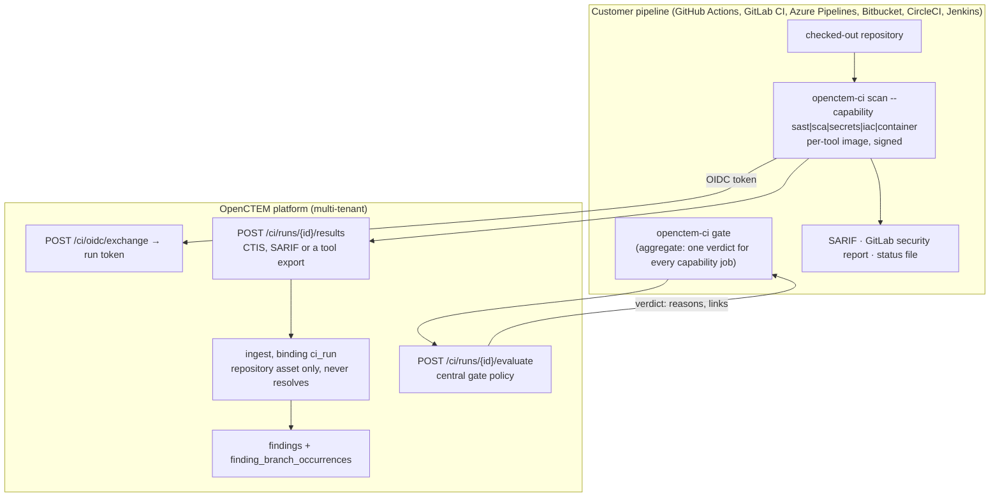
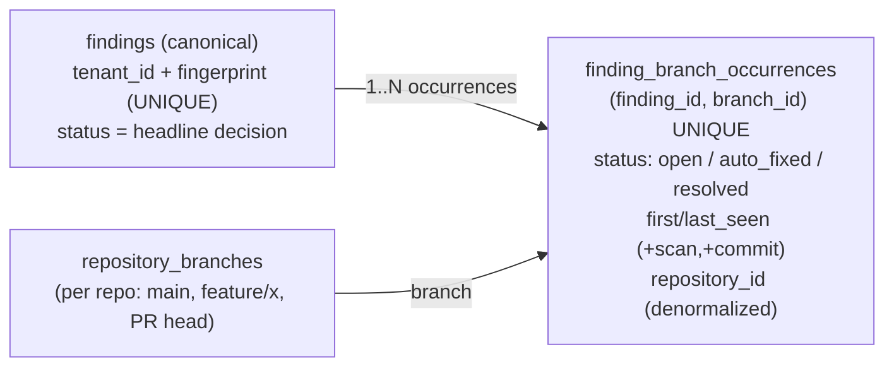

# Shift-Left CI/CD Code Scanning

> Code scanning in customers' CI pipelines: the `openctem-ci` runner
> (repository openctemio/ci) scans the checked-out code, uploads to a CI run
> with the job's OIDC identity and asks the central gate. Identity, runs,
> pipelines and the gate: [ci-runner-identity.md](ci-runner-identity.md)
> ([RFC-051](../rfcs/RFC-051-ci-runner-identity-and-gate.md)). Platform-enforced
> checks, pull request comments and diff-aware runs (proposed):
> [RFC-077](../rfcs/RFC-077-ci-enforced-gate-and-pr-feedback.md). The former
> sensor CI mode ([RFC-008](../rfcs/RFC-008-native-shift-left-ci-scanning.md))
> was removed in sensor v0.11.0.

## 1. Component structure



## 2. End-to-end data flow (one pull request)

```mermaid
sequenceDiagram
  participant CI as CI job
  participant RUN as openctem-ci
  participant API as OpenCTEM API
  CI->>RUN: scan (capability)
  RUN->>RUN: read CI env (repository, branch, commit, PR, fork)
  RUN->>RUN: run the tool (fixed argv, filtered env), convert to CTIS, mask secrets
  RUN->>API: exchange the job's OIDC token (trust configuration)
  API-->>RUN: run token (15 min, one run, one repository)
  RUN->>API: upload results (branch/commit come from the token)
  API->>API: dedup by fingerprint; branch occurrences; branch-only findings
  RUN->>API: evaluate (scan failures)
  API->>API: new vs default branch, accepted risk, KEV/EPSS/severity, break-glass
  API-->>RUN: pass | fail + reasons + links
  RUN-->>CI: exit 0 / 1 / 2 (scan not trustworthy)
```

## 3. Finding storage: repo vs branch

A finding has **branch-independent identity** (`findings`, unique
`tenant_id + fingerprint`); per-branch presence lives in
`finding_branch_occurrences`. One finding on `main` **and** a feature branch =
**one** `findings` row + **two** occurrence rows — cross-branch correlation
preserved, per-branch lifecycle enabled.



**Invariants**
- Canonical `findings.status` changes **only** from a **default-branch, full-coverage** scan bound to a command that completed cleanly (feature/PR scans write occurrences only). Protects against a feature branch, a failed run or an unbound upload mass-resolving real findings.
- Default-branch flag is never silently re-pointed on ingest (anti-abuse).
- Auto-resolve is scoped (tool × scan × assets/branch) — a partial/PR scan never resolves findings outside its scope.

### Which findings auto-resolve (decision, 2026-10)

Auto-resolve closes a finding because a scan **did not report it**. That is
only evidence of a fix when the scan provably covered the same code, so the
scope is deliberately narrow:

| Finding sits on | Auto-resolves? | Why |
|---|---|---|
| A repository asset, on its **default branch** (`findings.branch_id` → `repository_branches.is_default`) | Yes — only by a protocol v2 run **bound to a command** that completed with exit 0 and nothing rejected, an explicitly full scan of that branch, same tool and same scan profile as the finding's last sighting (see `sensors.md`). A CI upload without a command, a tenant upload or a v1 report never closes (decision O11). | A clean full scan of the default branch with the same ruleset sees the whole codebase; absence means the code is gone. A failed run, a narrower ruleset or an unbound report proves nothing. |
| A repository asset, on a feature branch | No (its occurrence on that branch is marked `auto_fixed` instead) | A feature branch is not the source of truth. |
| A domain, host, IP, service, cloud or any other non-repository asset | **No** | Absence from a network or external scan is not evidence of a fix: hosts go down, ports get filtered, rate limits and template sets vary between runs. These findings close through retest/validation, a human, or the scanner reporting them fixed. `resolveBranches` only tracks branches for repository assets, and the auto-resolve query joins to the default branch, so this holds for every ingest path. |

`findings.branch_id` is what puts a finding in the first row. It is set when a
finding is created from a report that carries branch info, and — since this
decision — **backfilled** when an existing finding is reported again
(`FindingRepository.BackfillFindingBranches`, ingest Step 6):

- a finding with **no branch** (first ingested without branch info, or before
  branch tracking worked; see migration 000174) takes the scanned branch;
- a finding on another branch **moves to the default branch** when the scan is
  of the repository's default branch, as recorded in `repository_branches`
  (never as claimed by the report — same anti-abuse rule as above);
- a feature-branch scan never moves a finding that already has a branch, and a
  branch is only ever attached to findings of its own repository.

Without the backfill a finding first seen without a branch, or first seen on a
PR branch (the common path for a newly introduced issue), could never be
auto-resolved however many default-branch scans later stopped reporting it.

Known gap: the Tenable `.nessus` findings import was designed to auto-resolve
host findings per batch (RFC-007) and emits a synthetic default branch for it,
but host findings have no branch, so it does not auto-resolve today. Enabling
absence-based resolution for that one server-side, batch-scoped path is a
product decision tracked separately; see `scan-coverage.md`.

## 4. Component responsibilities

| Component | Responsibility |
|---|---|
| openctemio/ci `cmd/openctem-ci` | Run one capability, convert to CTIS (ctis importers), mask secrets, write SARIF / GitLab report / status, upload, ask the gate |
| openctemio/ci `action.yml`, reusable workflow, `gitlab/templates` | CI packaging: image signature check, caches, SARIF upload to the code host (opt-in) |
| api `internal/app/cirun` | Exchange, runs, pipelines, gate, coverage, alerts |
| api ingest (`IngestForCIRun`) | Dedup, branch-aware occurrence write; a CI run never resolves |
| api prioritization | EPSS/KEV enrichment used by the gate |

## 5. Status

| Item | Status |
|---|---|
| OIDC identity, runs, gate, aggregate runs, six CI providers | Implemented (RFC-051) |
| Branch-aware findings, branch-only findings | Implemented |
| SARIF and tool-export upload into a run | Implemented |
| Pull request feedback: GitLab security report (merge request widget), SARIF to the code host (opt-in), job summary | Implemented in openctemio/ci |
| Platform check, pull request comments, diff-aware runs, policy modes | Proposed (RFC-077) |

The sensor protocol still serves `POST /api/v2/sensor/fingerprints/baseline-diff`
and the CI run API `POST /api/v1/ci/runs/{id}/baseline-diff`; no released runner
calls either today (RFC-077 decides their client).

## 6. Code map
```
openctemio/ci cmd/openctem-ci/{scan,gate}.go       runner commands
openctemio/ci internal/platform/run.go              OIDC exchange, upload, evaluate client
openctemio/ci internal/{scanner,redact,sarif,gitlab} tools, secret masking, outputs
api internal/app/cirun/                             exchange, gate, pipelines, coverage
api internal/app/ingest/ci_run.go                   ci_run binding
api internal/app/ingest/processor_findings.go       occurrence write (Step 6)
api internal/app/ingest/service.go                  default-branch + full-coverage auto-resolve gate
migrations/000173_finding_branch_occurrences.up.sql per-branch occurrence model
```
