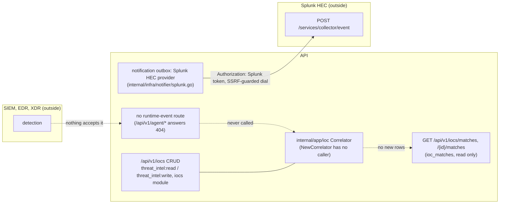

# SIEM ingest → CTEM Detect/Respond

> **Retired 2026-10-05.** The inbound route was part of sensor protocol v1
> (`/api/v1/agent/telemetry-events`), which was removed
> ([RFC-029](../rfcs/RFC-029-sensor-protocol-v2-and-sdk-stability.md)).
> Protocol v2 has no telemetry route yet, so SIEM inbound is unavailable
> until one ships. Stored events and the IOC catalogue are kept.

## Flow (current state)

Checked against the code of v0.19.1 and develop on 2026-11-05 (no change
between them).



- `cmd/server/services.go` keeps only `s.IOCRepo = repos.IOC`; the
  correlator and its `FindingReopener` adapter (`ioc.NewFindingReopener`) are
  built in tests only, so `ReopenForIOCMatch` never runs.
- The web console still shows **Threat intel > Detections**, whose empty
  state says detections appear "when a collector sensor forwards a runtime
  event"; no sensor can today.
- The outbound direction is a notification provider: [notification-system.md](notification-system.md).

## Historical design (protocol v1, removed)

The rest of this page describes the removed v1 path, for whoever builds the
protocol v2 successor. Routes and setup steps below no longer work.

How a SIEM, EDR or XDR pushed detections **into**
OpenCTEM so they close the CTEM Stage-4 Detect/Respond loop: a runtime detection
that matches a known indicator auto-reopens the finding it came from.

This is the **inbound** direction. For the **outbound** direction (OpenCTEM
findings → Splunk HEC) see the Splunk notification provider.

## Design: the SIEM is a collector, not a new endpoint

OpenCTEM already has a proven, tenant-isolated runtime-telemetry ingest path:

```
POST /api/v1/telemetry-events   (agent API-key auth, per-tenant rate limited)
        │  batch of runtime events
        ▼
runtime_telemetry_events  ──►  IOC Correlator  ──►  auto-reopen source finding
        (migration 000155)      (matches indicator     (ReopenForIOCMatch,
                                 values in properties)   audit-logged)
```

Rather than build a second, separate ingest endpoint (more attack surface, a new
auth path, duplicated tenant-scoping), a SIEM forwarder authenticates as a
**collector agent** — an agent whose capability is `collect` — and posts to the
same endpoint. An external data source is then just another authenticated
collector, and it reuses the security controls that path already enforces:

- tenant is taken from the agent's identity, **never** from the request body — a
  compromised forwarder cannot write into another tenant;
- per-tenant rate limiting;
- the same IOC correlation + auto-reopen the agent EDR/XDR stream uses.

## Setup

1. Register a platform agent for the SIEM forwarder (a bootstrap token, or an
   API key). Give it a recognizable name, e.g. `splunk-forwarder`.
2. Configure the SIEM's alert action / webhook to `POST /api/v1/telemetry-events`
   with header `X-API-Key: <agent key>` and the JSON body below.

## Payload

```json
{
  "events": [
    {
      "event_type": "siem_detection",
      "severity": "high",
      "observed_at": "2026-08-30T12:00:00Z",
      "correlation_id": "<optional: the validation command id this reacts to>",
      "properties": {
        "remote_ip": "203.0.113.10",
        "remote_domain": "malicious.example.com",
        "file_hash": "e3b0c44298fc1c149afbf4c8996fb924...",
        "rule": "Splunk: Known-bad C2 beacon",
        "raw_ref": "https://splunk/app/search/…"
      }
    }
  ]
}
```

`event_type` accepts `siem_detection`, `edr_alert`, `ioc_match` (added in
migration 000216) alongside the endpoint-agent types; up to 100 events per POST.

### Indicator mapping (this is what drives auto-reopen)

The correlator extracts candidate indicator values from **specific property
keys** and matches them against the tenant's active IOC catalogue. Map the SIEM's
detection fields onto these keys or correlation will not fire:

| Indicator | property key(s) |
|-----------|-----------------|
| IP        | `remote_ip`, `source_ip` |
| Domain    | `remote_domain`, `query_name` |
| URL       | `remote_url`, `url` |
| File hash | `file_hash`, `image_hash` |

Any other fields (`rule`, `raw_ref`, …) are stored on the event for context but
are not correlated.

## What happens on a match

For each indicator hit, the correlator records an `ioc_matches` row and, if the
indicator carries a `source_finding_id`, calls `ReopenForIOCMatch` — the finding
is reopened with reason `ioc auto-reopen: runtime match on <type>=<value>` and an
audit event is written, so an analyst can answer "why did this reopen?".

## Notes / limits

- Events without an `endpoint_asset_id` still correlate (matching keys on values,
  not asset), but are invisible to per-asset dashboards. A forwarder reports on
  many hosts, so this is expected for SIEM data.
- Populate the tenant IOC catalogue (with `source_finding_id` where known) for
  the loop to have anything to match against.
