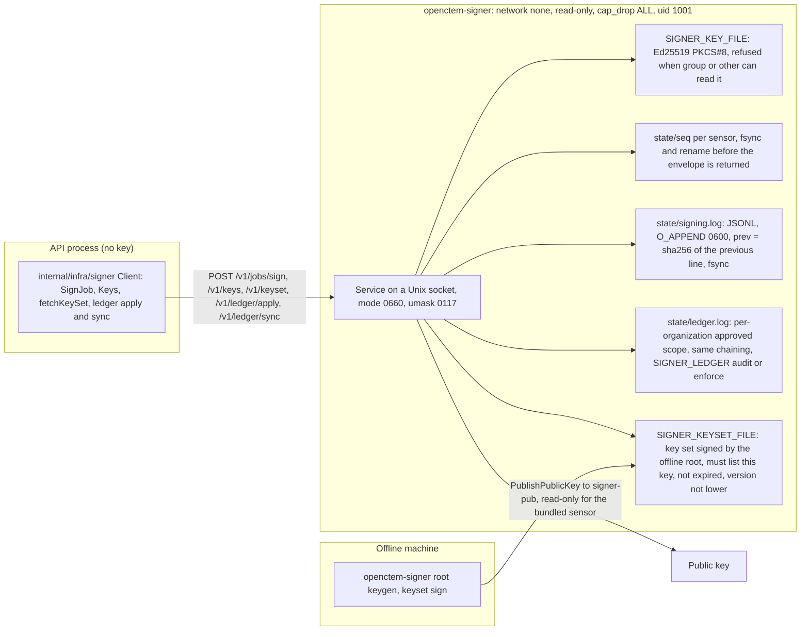

# Signing keys

Two things OpenCTEM publishes are signed so an instance can trust them
without trusting the host that serves them: the **release feed** (the
version check, [version-check.md](version-check.md)) and the **content
catalog** ([content-catalog.md](content-catalog.md)). Instances only verify;
every key below lives with the maintainers.

## What each key does

| Key | Where it lives | What it signs | What the instance pins |
|---|---|---|---|
| **Release feed signer** | no key: the `release-feed` workflow signs keyless (Sigstore, GitHub OIDC); nothing to store or back up | only the release feed | the signer identity (this repository's `release-feed.yml` on `main` or a `v*` tag, GitHub Actions issuer) and the Sigstore trusted root embedded in the release |
| **Catalog online key** | the GitHub secret `CONTENT_CATALOG_SIGNING_KEY` of the `content-catalog` environment (restricted to `main` and `v*` tags like `release-feed`); one encrypted backup | the content catalog's index, statements and revocations | its public key, through the catalog key set, in the catalog trust |
| **Catalog root key** | offline (encrypted stick or password manager attachment, two copies); never in CI | only the catalog **key set**: the list of catalog online keys the catalog accepts, valid at most 365 days | its key id in `contentpkg.PinnedRoots` |

The release feed has no key at all: it is display-only (bounded fields,
links under our own hosts, nothing downloaded or run because of it), and its
keyless signature names the one workflow allowed to publish it (see
[version-check.md](version-check.md#publishing-the-feed)). The catalog can install content, so it
keeps the second tier: a stolen online key is revoked by signing a new key set
without it, and the root never touches CI.

The release feed signer holds no key the catalog could trust, and the catalog
key set never lists anything the feed uses: what signs information must not be
able to ship code, and the reverse. Catalog signatures cover a DSSE payload
type (`...catalog-keyset+json`, `...package-index+json` and so on), so a
signature made for one document type is never valid as another.

Key set validity is per feed: the content catalog's is at most 365 days; the
program feed's and the vulnerability bundle's are at most 180 days.

## First setup (once, by the owner, on the owner's own machine)

```bash
scripts/signing/init-keys.sh            # or: scripts/signing/init-keys.sh /path/to/keys
```

It creates the root key, the catalog online key and the signed key set (which lists the catalog online key only) in a directory
(default `./openctem-signing-keys`, mode 0700, keys 0600), refuses to
overwrite existing keys, and prints only public material: the key ids, the
catalog online public key, the file to commit (`keyset.dsse.json`) and the exact
`gh secret set` command (`CONTENT_CATALOG_SIGNING_KEY` in `content-catalog`),
which reads the key from its file and never prints it. Then:

1. Pin the root key id in `contentpkg.PinnedRoots` and commit the key set, in
   one reviewed pull request.
2. Create the `content-catalog` GitHub environment (restricted to `main`
   and `v*` tags) and run the printed `gh secret set` command.
3. Move `catalog-root.key` offline (two copies) and remove it from the
   machine.

Until the root is pinned, the catalog import is inert. The release feed needs no setup.

## Yearly task: re-sign the catalog key set

The catalog key set expires after 365 days. About a month before:

```bash
scripts/signing/rotate-keyset.sh /path/to/keys    # root key mounted for the moment
```

It signs a new key set with the next version and a new 365 days, keeps the old
one as `keyset.dsse.json.prev`, and prints the file to commit and publish. The
release feed needs nothing: its freshness is the weekly re-sign (feeds expire
after 45 days).

## Rotating the catalog online key

Without compromise, with an overlap so no instance is left behind: create the
new key (`init-keys.sh` in a fresh directory, or `content-bundle keygen`),
re-sign the catalog key set listing both online keys
(`ONLINE_PUBS=<old>,<new> scripts/signing/rotate-keyset.sh`), switch the
`CONTENT_CATALOG_SIGNING_KEY` secret to the new key once instances have the new
key set, then re-sign the key set with the new key only.

## If the catalog online key is compromised

1. Rotate the secret to a new key at once.
2. Sign a new key set without the stolen key
   (`ONLINE_PUBS=<new> scripts/signing/rotate-keyset.sh`), publish it, and
   publish a revocation list for anything the stolen key signed. Instances
   refuse a key set below the version they applied, so the revoked key cannot
   come back.

## Release feed signer: refresh and compromise

The feed has no key to rotate. Two things are maintained:

- **The Sigstore trusted root** embedded in the release
  (`api/pkg/contentpkg/sigstore/trusted_root.json`, shared with the content
  catalog's publisher signatures): refresh it for every release with
  `make -C api sigstore-root-refresh` (and commit the file). A test fails when
  the embedded root has no certificate authority or transparency log valid for
  the next 30 days. Instances may point `CONTENT_SIGSTORE_TRUSTED_ROOT` at a
  newer file.
- **The accepted signer** (`releasefeed.SignerIdentityPattern`): changed only
  by a reviewed commit, for instance when the workflow file is renamed.

If the workflow or the repository is compromised, a forged feed can only say
what the bounded fields allow (display only, links under our own hosts). Fix the
repository, publish a good feed (higher sequence), and if the signer identity
must change, ship a release with the new pattern.

## If the root key is lost or compromised

Lost: the current key set stays valid until it expires; make a new root with
`init-keys.sh` in a fresh directory, and ship a release pinning the new root
alongside the old one before the old key set expires. Compromised: ship a
release that pins only a new root, immediately; treat everything signed under
the old root after the compromise as untrusted and revoke it.

## The installation's job signer service

The keys above live with the maintainers. Each installation also holds one
key of its own: the job-signing key that signs every sensor job. It lives in a
separate process, `openctem-signer` (`cmd/signer`, `internal/signer`), never
in the API. How a job is signed at claim is in
[job-signing.md](job-signing.md) and [job-dispatch.md](job-dispatch.md); this
section covers the service and the custody of its key.



- **Custody.** The key is a file. It is created on first start only when
  `SIGNER_GENERATE_KEY=true` and none exists, and is never replaced. Compose
  mounts the `signer-keys` volume in the signer only; the API gets the socket
  volume. Helm runs the signer as a sidecar with the key in a PVC or installed
  from a Secret by the `signer-key-install` init container; the all-in-one
  image runs it as a second process with `/data/signer` mode 0700. There is no
  KMS or HSM support.
- **Access.** The socket is the only interface; there is no other
  authentication, so its group is the trust boundary.
- **Ledger.** The "signing ledger" is two hash-chained files in the state
  directory, not a database table. A broken or torn `signing.log` stops the
  signer from starting; `openctem-signer verify-log` and
  `openctem-signer ledger verify` check them offline. Widening an
  organization's approved scope needs approvals by people other than the
  requester (`SIGNER_LEDGER_MIN_APPROVALS`); `sync` can only narrow.
- **Production gate.** The API refuses to start in production without
  `SIGNER_SOCKET` unless `SIGNER_DANGEROUS_ALLOW_UNSIGNED_JOBS` is set.
- **Backup.** Back up the key and the state together: a lost state lets
  sequence numbers repeat.
