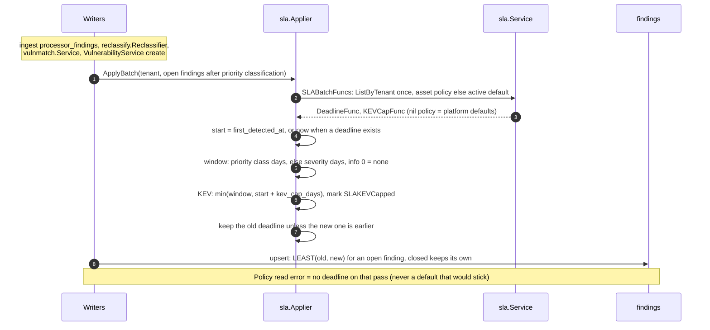
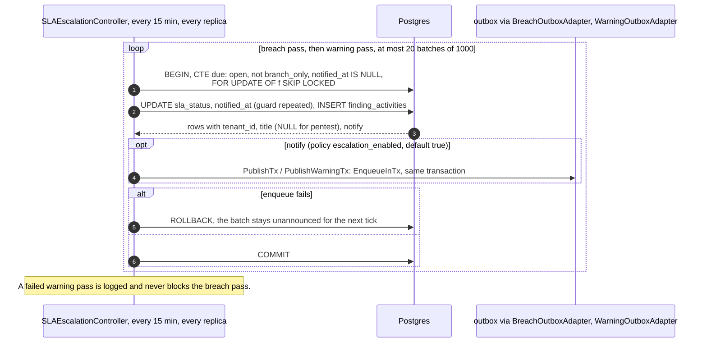

# SLA clock and escalation

How a finding's SLA clock starts, and how the escalation job announces an
at-risk deadline and a breach. Deadlines themselves (priority class first,
severity as fallback, tighten-only) are in
[scoring versions](scoring-versions.md#sla-on-a-priority-change); the SLA
status a finding shows is in
[finding status lifecycle](finding-status-lifecycle.md#sla-status-follows-the-status).

## Flow

### Who writes a deadline

Other writers, each with its own clock start:

| Writer | Code | Deadline |
|---|---|---|
| Regression (scan or retest reopens a resolved finding) | `sla.RegressionRestarter.RestartForRegression`, from `retest.ScanRegressions.HandleRegressions` (trigger `scan`, not for a `ReopenSeenAgain` flap) and `retest.Service` (trigger `retest`) | policy window from now; `RestartSLA` writes it, `sla_status = on_track` and an `sla_restarted` activity in one transaction, only while open |
| Pentest publication (draft or in review to a published status) | `compliance.PentestService.applySLAOnPublish` | policy window from now, only when the finding has none |
| Approved severity downgrade | `sla.Applier.RelaxForDecision` | may move later, counted from first detection, still bounded by the KEV cap |
| End of a risk acceptance, withdrawn false positive, branch promotion | see the clock table below | new clock |

The "why this date" block on `GET /api/v1/findings/{id}` comes from `sla.Service.ExplainDeadline` with the same
policy choice (`internal/infra/http/handler/finding_sla_basis.go`). Policies: `GET/POST /api/v1/sla-policies`,
`GET/PUT /api/v1/sla-policies/{id}`, `GET /api/v1/sla-policies/default` (`settings:sla:read`, `settings:sla:write`,
`DELETE` `settings:sla:delete`), `GET /api/v1/assets/{assetId}/sla-policy` (`assets:read`); no module gate.

Platform defaults (no policy): P0 2, P1 5, P2 15, P3 30 days; by severity critical 2, high 15, medium 30, low 60,
info none; KEV cap 14 days; warning threshold 80 %. A policy window is 1 to 365 days.

### Escalation pass

## The clock: `findings.sla_started_at`

`sla_started_at` is when the current clock started. It is written with every
deadline, in the database, so no writer can forget it
(`trg_findings_sla_episode`, migration `finding_sla_episode`):

| Event | `sla_started_at` |
|---|---|
| First deadline | `first_detected_at` (`finding_sla_first_start`) |
| First deadline of a pentest finding (on publication) | now |
| Regression restart (scan or retest) | now, once per reopen: a restart for a reopen that already has a newer clock is skipped |
| End of a risk acceptance | now |
| Withdrawal of an approved false positive (material change) | now |
| Promotion of a branch-only finding | now |
| Tightened deadline, severity change | unchanged |

A writer that starts a new clock sets the column itself; the trigger fills it
for a first deadline and a branch promotion.

## Announcements: once per episode

An **episode** is one clock of one finding while it is open. The escalation
job (`internal/infra/controller/sla_escalation.go`, every 15 minutes on every
replica) announces each episode at most once per kind:

| Kind | Selected when | Writes |
|---|---|---|
| At risk | open, not yet announced at risk or breached, deadline in the future, `now ≥ sla_started_at + threshold % × (deadline − sla_started_at)` (policy `warning_threshold_percent`, default 80) | `sla_status = warning` (when `on_track`), `sla_at_risk_notified_at`, one `sla_warning` timeline row, the `sla_warning` notification |
| Breach | open, not yet announced as breached, deadline passed | `sla_status = overdue`, `sla_breach_notified_at` (and `sla_at_risk_notified_at` when unset, so no warning follows), one `sla_breach` timeline row, the `sla_breach` notification (severity max(high, finding)) |

Findings that exist only on a branch (`branch_only`) are left out of both passes. The job selects on the notified-at columns, not on `sla_status`, so a breach is
announced whoever set the status: a reopen after the deadline, an
un-suppression, any status change past the deadline (the status trigger sets
`overdue` on its own). A new clock or a reopen of a closed finding clears both
columns, which starts a new episode; closing a finding keeps them.

The state change, the timeline rows and the outbox notifications commit in one
transaction per batch of 1,000 findings (at most 20 batches per tick).
`FOR UPDATE SKIP LOCKED` and the repeated guard in the `UPDATE` make two
replicas announce each episode once. The partial index
`idx_findings_sla_breach_due` holds only open findings with an unannounced
deadline, so a tick reads the newly due rows. Notifications name the finding by
its title (at most 200 characters) and carry its id in the metadata. A pentest
finding is named by its id only: notices go to the tenant's channels, and a
pentest finding is visible only to its campaign members. The
governing policy's `escalation_enabled` decides whether a notification is
sent; the status and the timeline row are written either way.

## Security

- The job runs across tenants as a system job; every row, timeline entry and
  outbox notification it writes carries the finding's own `tenant_id`, and
  notification delivery filters by that tenant's integrations.
- Announcements cannot be suppressed by moving a status: the notified-at
  columns are written only by the job and cleared only by a new clock or a
  reopen.
- Tests: `tests/integration/sla_episode_test.go` (status set outside the job,
  reopen, two replicas, timeline rows per tenant, warning from the clock start,
  restart once per reopen, pentest clock).

## Upgrade

Migration `finding_sla_episode` adds the three columns and backfills `sla_started_at`
(`last_reopened_at`, else `first_detected_at`); findings already `warning` or
`overdue` count as announced, so a deploy sends nothing. `findings_sla_breach_due_index` creates the
partial index concurrently and `drop_findings_sla_overdue_index` drops `idx_findings_sla_overdue`,
which filtered on retired values and served no query.
