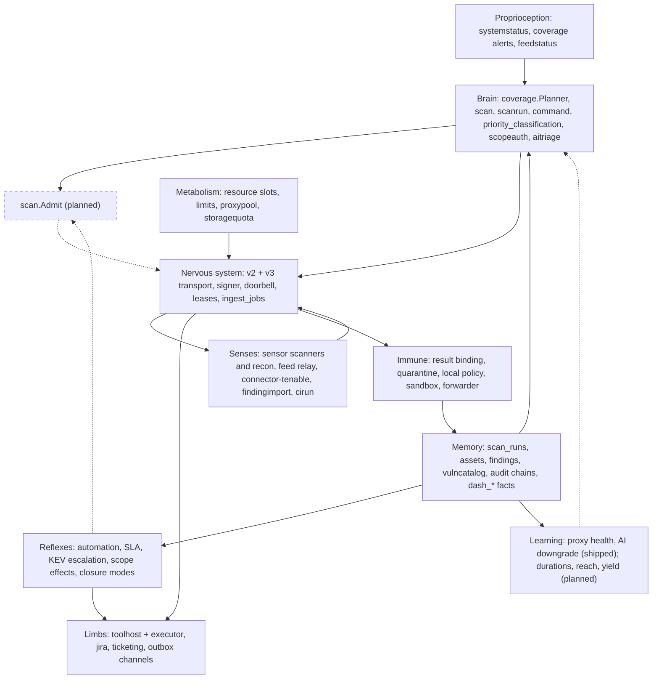
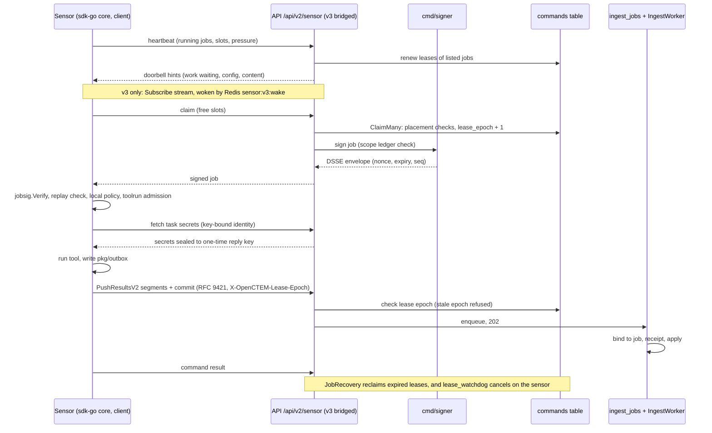
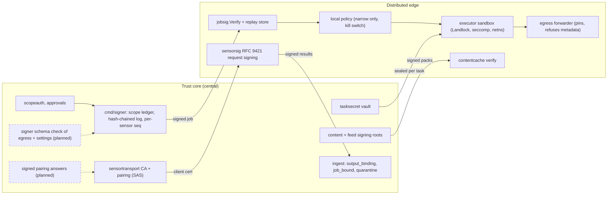
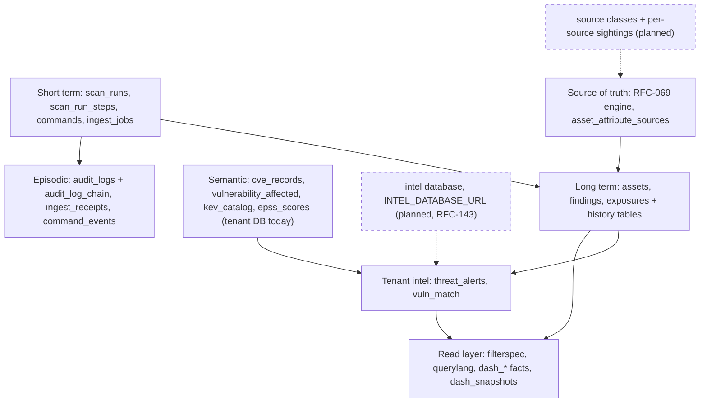
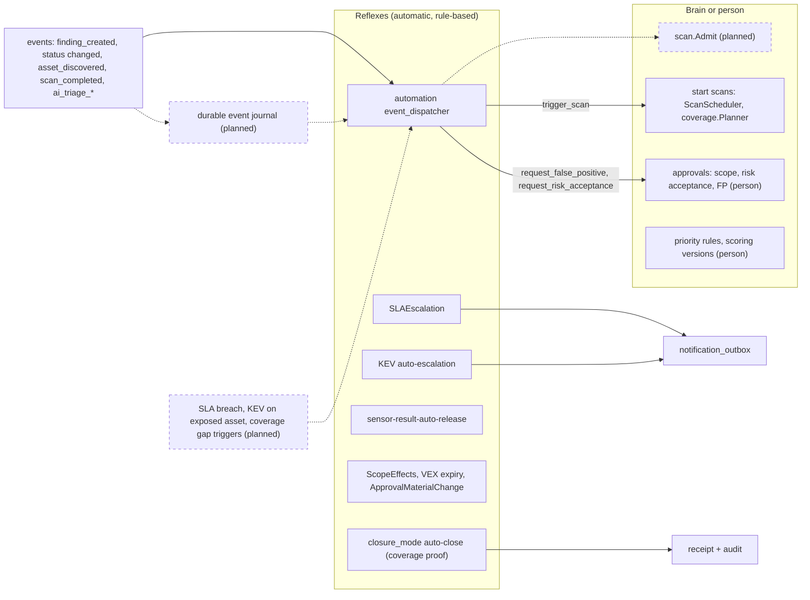
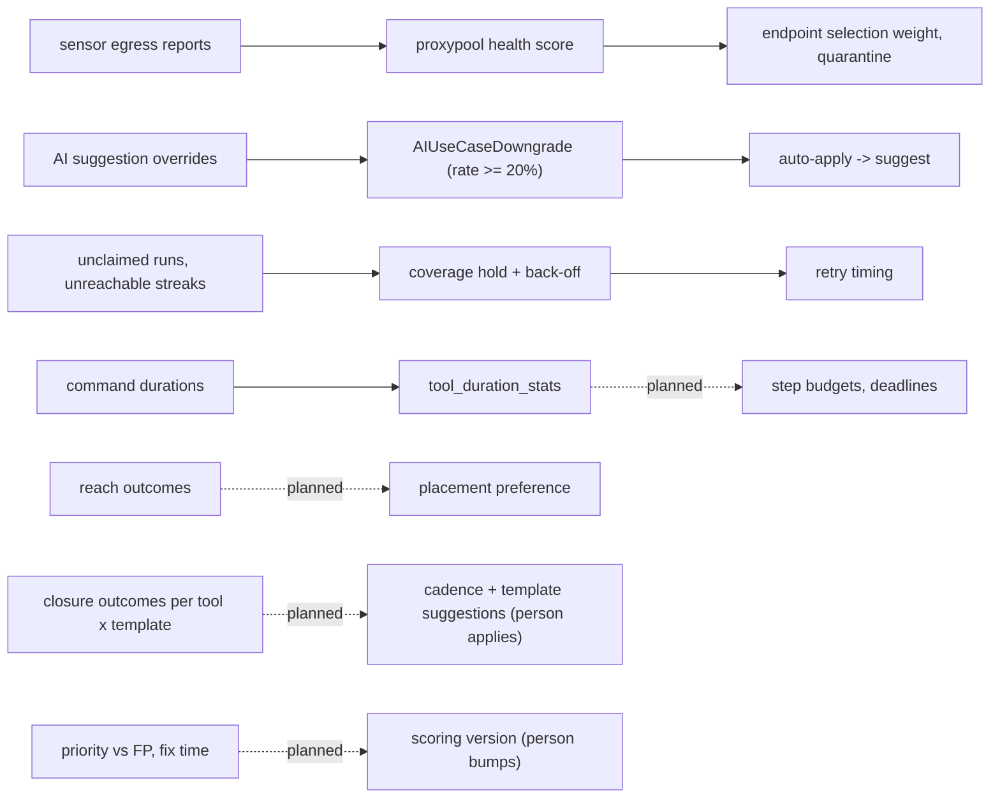
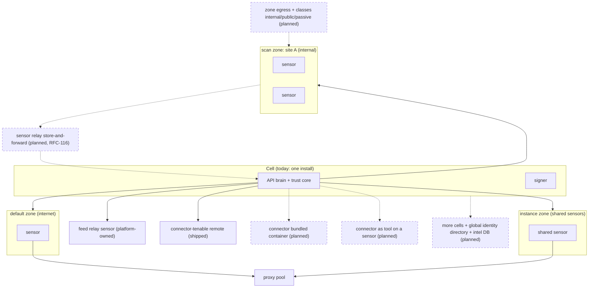

# OpenCTEM as one machine

Status: Informational. Last reviewed 2026-11-06.

This page draws the platform as one body, so that a new reader can picture how the parts work together. Each part is an organ with one job: the **brain** plans and decides, the **senses** observe, the **limbs** act, the **nervous system** carries signed jobs out and results back, **memory** keeps what happened, **reflexes** react to events, the **immune system** checks everything that crosses the sensor boundary, and **metabolism** bounds how much work can run.

The model is a reading aid, not a design. Names in the diagrams are the names in the code. Every organ links to the page that describes it in detail.

## Legend: shipped and planned

- A solid box or a solid arrow is **shipped**: built, wired and in use.
- A box with a **dashed border**, a **dashed arrow**, or a label ending in "(planned)" is **planned**: it is not built yet and may change.
- Planned items are listed so the picture is honest about the gaps. Do not rely on them.

## Organ map

| Organ | What it does | Main parts | Status | Read more |
|---|---|---|---|---|
| Brain: coverage | Finds assets that are due for a capability and starts runs | coverage planner, ledger, gap detection | Shipped (arbitration across the scan starters is planned) | [Asset coverage](asset-coverage.md), [scan coverage](scan-coverage.md) |
| Brain: scans | Definitions, gates, step plan, run state machine, command queue | `scan`, `scanrun`, `command` | Shipped | [Scan orchestration](scan-orchestration.md), [scan lifecycle](scan-lifecycle.md) |
| Brain: placement | Decides which sensor may claim which job, with reason codes | claim SQL, local policy, explainer | Shipped | [Placement](placement.md), [job dispatch](job-dispatch.md) |
| Brain: priority | Ranks findings from EPSS, KEV, context and reachability | priority classification, scoring versions | Shipped (no outcome feedback yet) | [Priority explainability](priority-explainability.md), [scoring versions](scoring-versions.md) |
| Brain: scope | One answer to "may this be probed" | scope authorization, approvals | Shipped | [Scoping overview](scoping-overview.md), [active-probe gate](active-probe-gate.md) |
| Brain: AI triage | AI agents suggest or apply triage under organization consent | triage, analysis, AI use cases | Partly shipped | [AI triage](ai-triage.md), [AI use cases](ai-use-cases.md) |
| Senses | Sensors run scanners and recon; connectors and importers bring in outside data; the feed relay brings intelligence feeds | sensor tools, connectors, finding import, CI runs, feed relay | Shipped | [Sensors](sensors.md), [finding import](finding-import.md), [Tenable.sc connector](tenable-sc-connector.md), [feed transfer](feed-transfer.md) |
| Limbs | Tools run on sensors; tickets and notifications go out | tool host and executor, Jira, GitHub Issues, notification outbox | Shipped | [Tool contract](tool-contract.md), [ticketing](ticketing-integration.md), [notification system](notification-system.md) |
| Nervous system | Signed jobs out, signed results back, leases, doorbell | v2 and v3 transport, signer, ingest queue | Shipped | [Sensor and platform workflow](sensor-platform-workflow.md), [signed jobs](job-signing.md), [transport v3](sensor-transport-v3.md) |
| Memory | Run state, inventory, findings and history, catalog, audit trail, read layer | `scan_runs`, assets, findings, audit chains, dashboard facts | Shipped (per-source sightings and the intel database are planned) | [Asset freshness](asset-freshness.md), [attribute reconciliation](asset-attribute-reconciliation.md), [audit hash chain](audit-hash-chain.md), [ingest receipts](ingest-receipts.md), [query language](query-language.md) |
| Reflexes | Act on events without the planner | automations, SLA escalation, KEV escalation, closure modes | Partly shipped (durable event journal and new triggers are planned) | [Automations](automations.md), [SLA escalation](sla-escalation.md), [finding closure](finding-closure.md) |
| Immune system | Checks every message that crosses the sensor boundary | result binding, quarantine, local policy, sandbox, forwarder | Shipped (hardening items are planned) | [Result binding](sensor-result-binding.md), [sensor and platform trust](sensor-platform-trust.md), [task secrets](task-secrets.md) |
| Metabolism | Bounds how much work can run | resource slots, limits, proxy pools, storage quota | Partly shipped | [Limits](limits.md), [sensor proxies](sensor-proxies.md) |
| Learning | Changes later decisions from outcomes | proxy health, AI downgrade (shipped); durations, reach, yield (planned) | Mostly planned | [Sensor proxies](sensor-proxies.md), [AI use cases](ai-use-cases.md) |
| Self-awareness | Shows host and coverage health | system status, coverage alerts, feed status | Partly shipped (one body-wide view is planned) | [Operations](operations.md), [asset coverage](asset-coverage.md) |
| Distribution | Where work runs and who decides | scan zones, shared sensors, feed relay, sensor relay | Partly shipped (cells and zone egress are planned) | [Scan zones](scan-zones.md), [sensor relay](sensor-relay.md) |

Principle for distribution: the edge does more of the work, never more of the deciding. Sensors execute, pace themselves, refuse, buffer and may compress what they send. They never conclude (close, deduplicate away, widen scope or rank). Signing, pairing, scope, secrets and closure decisions stay central.

## Diagrams

### 1. The organ map

The platform as one body. The brain (API controllers and services) plans and decides. Senses (sensors, connectors, importers, the feed relay) observe. Limbs (tools on sensors, ticketing, notifications) act. The nervous system carries signed jobs out and results back. Memory keeps run state, inventory, the catalog and the audit trail. Reflexes act on events without the planner. The immune system checks every message that crosses the sensor boundary. Metabolism bounds how much work can run. Learning is the weakest organ: two loops are closed, the rest are planned.

### 2. The main loop: one scan cycle end to end

Sense, plan, act, verify, learn as one cycle. The coverage planner finds a due asset x capability and starts a run. The step is cut into commands. A sensor claims one, and the claim is signed by the separate signer. The sensor verifies the signature, checks its local policy, runs the tool in the sandbox with all traffic through the forwarder, writes the result to its outbox and uploads it in segments with the lease epoch. Ingest binds the result to the job, writes a receipt, updates assets and findings, settles coverage and recomputes priority. Notifications and reflexes fire, and retests verify fixes. Durations are recorded today; reading them back into planning is planned.

```mermaid
flowchart LR
  classDef planned stroke-dasharray: 5 5
  P["coverage.Planner (due asset x capability)"] --> SR["scan.Scan -> scanrun run + step_plan"]
  SR --> CMD["commands (pending, host_keys)"]
  CMD --> CL["ClaimMany (pendingForSensorWhere, local_policy gate)"]
  CL --> SG["job_signing.go -> cmd/signer (scope ledger)"]
  SG --> SN["sensor: jobsig.Verify, local policy, toolrun admission"]
  SN --> FW["sensorkit/egress forwarder"] --> TL["tool in sensorkit/executor sandbox"]
  TL --> OB["pkg/outbox (sealed, delete on 2xx)"]
  OB --> UP["PushResultsV2: segments + commit, lease epoch"]
  UP --> IJ["ingest_jobs -> IngestWorker"]
  IJ --> BIND["output_binding, job_bound, quarantine"]
  BIND --> RC["ingest_receipts"]
  BIND --> AF["assets, findings, observation_state"]
  AF --> COVS["coverage settle (asset_coverage)"]
  AF --> PRI["FindingPriority controller"]
  PRI --> NT["notification_outbox"]
  AF --> RT["RetestScheduler -> validation"]
  RT --> SR
  COVS --> P
  CMD --> DL["learnDuration -> tool_duration_stats"]
  DL -.->|"read back (planned)"| SR
  BIND -.->|"reach outcomes -> placement (planned)"| CL
```

### 3. The nervous system: dispatch and claim

Job dispatch is pull-based. The heartbeat carries the running jobs (which renews their leases) and returns doorbell hints; v3 sensors also hold a `Subscribe` stream woken through Redis. A claim takes a command with a new lease epoch, and the API asks the signer to sign it. The sensor verifies the signature and nonce, checks local policy, and pulls task secrets sealed to a one-time reply key. Results go up in segments, each request signed (RFC 9421) and carrying the lease epoch; a lost lease makes the sensor drop its results. The API answers 202 and ingest runs from the durable queue. `JobRecovery` reclaims expired leases.

### 4. Trust core and distributed edge

What is signed and verified where. The central side signs jobs (a separate signer with its own scope ledger and log), issues sensor certificates after pairing, and holds scope, secrets and the content and feed roots. The edge verifies every job, enforces its own narrow-only policy, confines every tool and forces all traffic through the forwarder, which pins addresses and refuses metadata and private destinations outside the job scope. Results come back signed per request and are bound to the job they answer. Dashed parts are planned hardening.

### 5. The memory layers

Short-term memory is run state, kept for days to weeks by retention controllers. Long-term memory is the inventory and findings with their history. The source-of-truth layer decides each attribute from ranked sources; today it covers four business attributes, and per-source sightings are planned. Semantic memory is the public catalog (CVE, KEV, EPSS); today it lives in the tenant database and a separate intel database is planned ([RFC-143](../rfcs/RFC-143-vulnerability-catalog.md)). Tenant intel (threat alerts, matches) stays in the tenant database. Episodic memory is the audit chains and receipts. The read layer is the query plan layer and the precomputed dashboard facts; it is the only place that injects tenant and data scope.

### 6. Reflexes and brain decisions

Reflexes fire on events or timers and follow fixed rules: escalate, notify, release held results, reopen on VEX expiry, auto-close only where the closure mode and coverage proof allow it. Brain decisions need the planner or a person: starting scans, widening scope, accepting risk, marking false positives, changing priority rules. Today the automation dispatch is in-process and lossy except for `finding_created`; a durable journal and new triggers are planned. Reflexes may ask the brain for a scan but, once `scan.Admit` exists, never start one around admission.

### 7. The learning loops

Closed loops change later decisions. Proxy endpoint health from sensor reports sets the selection weight and quarantine. The AI override rate turns auto-apply back into suggest. Coverage streaks change retry timing. The duration learner records per-tool timings that nothing reads yet. Reach routing, tool and template yield, and priority calibration are planned; operational values will adjust automatically within bounds, while anything that touches risk stays a suggestion.

### 8. Distribution

Sensors are grouped by scan zone. Shared sensors serve many organizations through instance zones and the shared claim. Traffic leaves through the forwarder, direct or through a proxy pool; zone egress settings and three traffic classes (internal, public, passive) are planned. Connectors run remote near the system they read (shipped), or are planned to run bundled with the platform as a separate container or as a tool on an existing sensor; never inside the API. Feeds come through a platform-owned relay sensor. Cells are the planned scale unit for SaaS: each cell has a full brain, and only identity and the intel catalog are global. The [sensor relay](sensor-relay.md) ([RFC-116](../rfcs/RFC-116-sensor-relay.md)) is planned for client use.

## Related pages

[Architecture overview](overview.md), [documentation index](../README.md).
