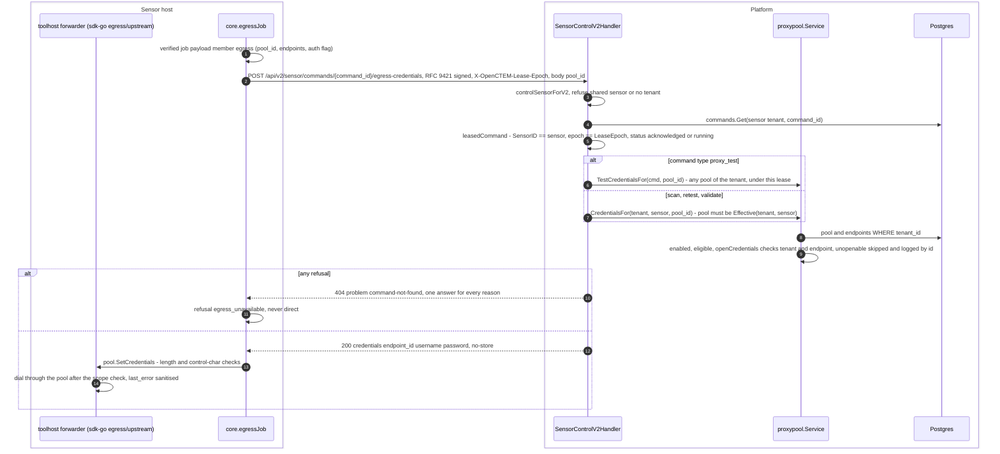
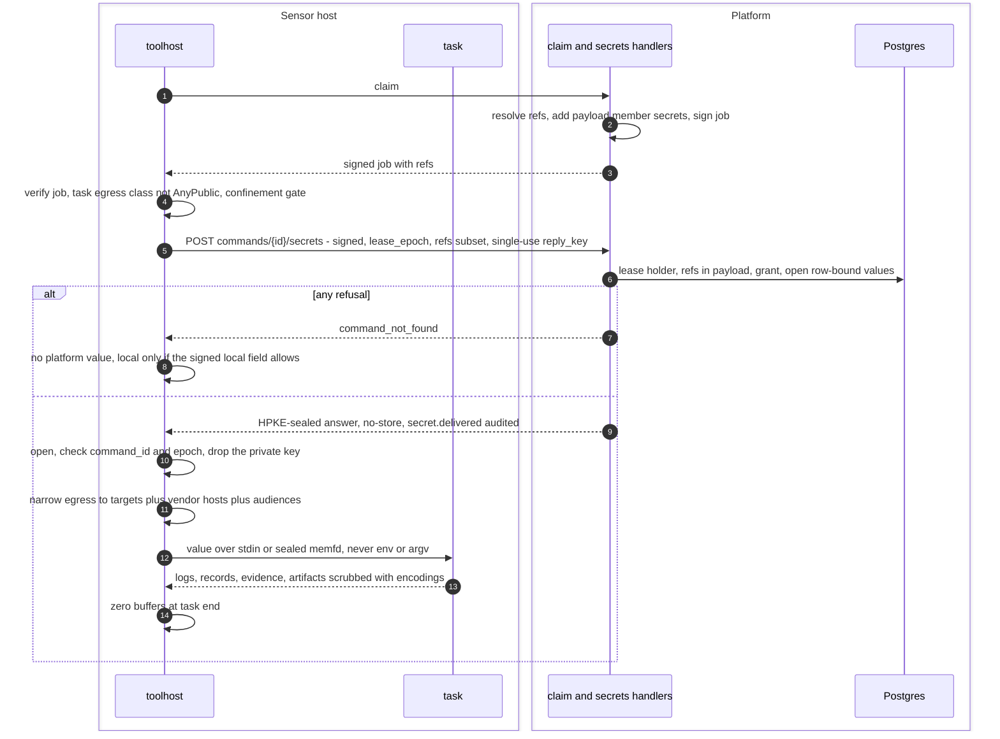

# Secrets for sensor tasks

> Related: [sensor proxies](sensor-proxies.md), [rule sources](content-sources.md),
> [signed jobs](job-signing.md), [job dispatch](job-dispatch.md).

This page maps every path by which a credential that a scan needs reaches
the place it is used today, and then the target design that replaces the
sensor-bound paths. The target design is not built.

## Today

| Secret | Entered | Stored | Reaches | Transport to the sensor |
|---|---|---|---|---|
| Proxy pool logins | `PUT /api/v1/proxy-pools/{id}/endpoints` (Settings > Scanning > Proxies) | `proxy_endpoints.credentials_encrypted`, AES-256-GCM, `APP_ENCRYPTION_KEY`, plaintext bound to `{t: tenant, e: endpoint}` (`proxypool.Service.sealCredentials`, `openCredentials`) | the sensor's per-task forwarder | `POST /api/v2/sensor/commands/{command_id}/egress-credentials`, plain JSON inside TLS, `Cache-Control: no-store` |
| Rule source token | `PUT /api/v1/content-sources/{id}/credential` (API only, step-up) | `content_sources.credential_encrypted`, same cipher, bound to `{v, sid, tid, host}` (`contentsource.Service.seal`, `unseal`) | the platform's git fetcher only | never: sensors get signed packs by digest |
| Tool provider keys (passive sources, vendor clouds) | on the sensor host | host env (vendor prefix passed only to its tool, sdk-go `core.ScannerEnvironFor`) or the tool's own config file | the tool | never leaves the host |
| Secret-looking `scanner_config` values | scan create or edit | `scans.scanner_config` in plaintext; `scan.DetectConfigSecrets` warns, `RedactConfigSecrets` masks for readers without `scans:write` | the tool, via `commands.payload` | inside the signed job, plaintext in TLS |

### Proxy logins

Code: `internal/infra/http/routes/sensor_v2.go` (routes, registered only when
`HasEgress()`), `internal/infra/http/handler/sensor_egress_v2_handler.go`
(`leasedCommand`, `EgressCredentials`), `internal/app/proxypool/service.go`
(`CredentialsFor`, `openCredentials`), `internal/app/proxypool/test.go`;
sdk-go `pkg/core/egress_job.go`, `pkg/client/egress.go`,
`pkg/sensorkit/egress/upstream/pool.go`. Credentials are not part of the
signed payload; v3 transport does not carry them (HTTPS v2 only).

Known gaps (fixed by the target design):

- `leasedCommand` checks no sensor grant or trust level: an organization
  sensor at trust "New" without the credentials grant dimension receives the
  pool logins of a job it holds.
- `CredentialsFor` answers for the pool the sensor uses **now**
  (`Effective`), not the pool stamped into the job. A pool reassignment
  between claim and fetch makes the running job's fetch fail with 404, and
  the job is refused as `egress_unavailable`.
- The answer is not sealed to the sensor: a TLS-inspecting device on the
  sensor's control path reads it.
- Secret-looking `scanner_config` values travel in `commands.payload`
  ("Sensors are not affected: the command they claim carries the stored
  config", `pkg/domain/scan/config_redact.go`).

### Unserved client route

sdk-go `main` (not in any tag; the sensor pins v0.46.3) has
`client.ToolCredentials`, which calls
`POST /api/v2/sensor/commands/{id}/tool-credentials`. The platform does not
serve that route (no route, handler or table on develop). A sensor built with
it gets 404 and `routeUnknown` maps a 404 without a problem document to
`ErrToolCredentialsUnsupported`, after which the tool host uses operator-local
keys. The target design drops this route; it never ships. sdk-go also has
`POST /commands/{id}/source-credential` (`pkg/sensorproto/v2/control.go`),
which the platform does not serve either.

## Target design, not built

Status: decided, not implemented. Nothing below exists in the code yet.

**One sealed endpoint.** Every secret a task uses comes from
`POST /api/v2/sensor/commands/{command_id}/secrets`. `egress-credentials` is
folded into it as kind `egress_proxy` and removed in the same release, with no
alias. `tool-credentials` never ships.

**Refs in the signed job.** At claim, next to `settings_layers` and before
signing, the platform adds a payload member `secrets`:
`{"v": 1, "refs": [{id, kind, ref, slot, audience, required, local}]}`
(at most 64 refs, ids `^[a-z0-9]{1,8}$`). The job signature covers which
secrets the task may ask for. Refs are names, not versions: a re-claim or
retest re-resolves them.

**Two classes of secret.** The class is decided by what the value opens:

| | target | provider |
|---|---|---|
| Opens | the organization's own systems (web login, API, SSH, registry, SCM, cloud) | a third-party data service a tool consults |
| Kinds | `http_auth` first; `client_cert`, `host_login`, `registry_auth`, `scm_token`, `federated_token` deferred | `provider_key` |
| Chosen by | a person, per scan, step or asset | automatically, from the tool manifest's provider slots |
| Allowed destinations | only the task's exact targets that are also in the credential's asset binding | only the provider registry's hosts |
| Shared sensors | refused unless the organization allows a named shared sensor | allowed, sealed, never an operator-local fallback |
| Storage | secret store `credentials`, row-bound | `tool_source_keys`, row-bound |

`egress_proxy` is consumed by the forwarder, never by a tool.

**Fetch.** The sensor sends an RFC 9421-signed request with `lease_epoch`,
`task`, the subset of `refs` this task needs and a `reply_key`: the public
half of a single-use HPKE (RFC 9180) key pair made for this request. The
answer is `application/vnd.openctem.secrets+sealed`, `Cache-Control:
no-store`, sealed to that key with
`info = "openctem-task-secrets/v1" 0x00 || sensor_id || command_id || u32 lease_epoch || sha256(request body)`.
The plaintext repeats `command_id` and `lease_epoch` and lists `secrets` and
`missing` (with reasons). Every refusal is `command_not_found`: not
key-bound, not the lease holder or wrong epoch, not running, a ref not in the
payload, untrusted grant, shared sensor without confinement, or too many
fetches for this command and epoch. Each 200 is audited as
`secret.delivered` (refs, kinds, sensor, command, task, never values).

**On the sensor.** Refs come only from the verified job. Values are merged
per slot: platform value, else local if `local=allow`; `local=only` never
asks the platform; `never` ignores local, and a shared identity enforces
`never` regardless. A required slot that ends empty fails the task, naming
the slot. Delivery prefers the run message over stdin, then a sealed memfd,
then an O_EXCL 0600 file on tmpfs; never env or argv.

**At rest.** Every secret table stores
`{"v":1,"tid":<tenant>,"id":<row>,(host),"value":…}` encrypted, so a value
opens only for its own row; this survives rekey unchanged. Per-tenant keys,
KMS and crypto-shredding are deferred.

**Fixed with it.** The egress trust check, inline `scanner_config` secrets out
of `commands.payload`, and the lease epoch inside the signed request body.
