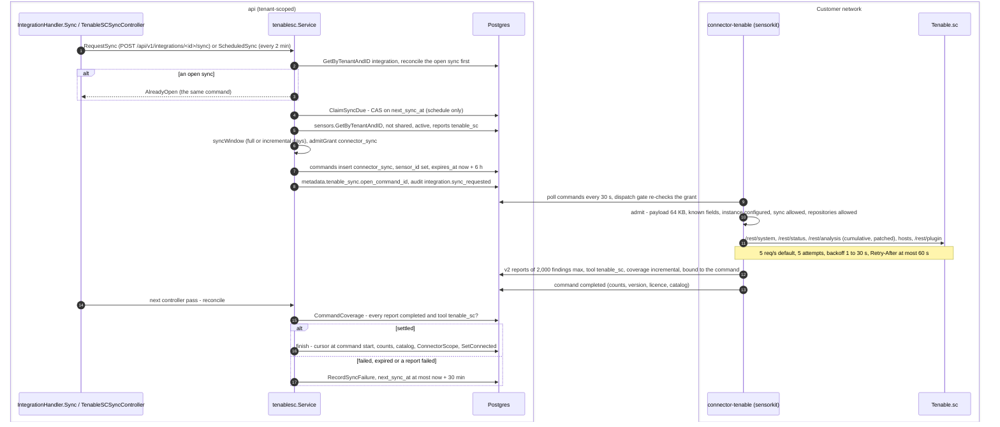

# Tenable.sc sensor connector

Design: [RFC-047](../rfcs/RFC-047-tenable-sc-sensor-connector.md). This page
describes what is built and where it lives.

## Switch

On, as **Beta**: `integration.TenableConnectorEnabled` (decision D-14;
`TENABLE_CONNECTOR_ENABLED` in the web) is true. The connector runs as its own
image (`ghcr.io/openctemio/connector-tenable`, from v0.1.0). Turning the switch
off refuses new Tenable integrations (the connector validator is not wired),
stops registering the sync and coverage controllers and hides the page;
stored rows are kept. It stays Beta until a run against a real Tenable.sc has
confirmed the API details only the documentation states (RFC-047 §12.6), in
particular the unit of `maxScanTime` and the data removal steps of license
rotation (purge and recycle are unverified).

**`maxScanTime`.** The connector (from the release after v0.2.0) sends the
scan's maximum duration in whole hours, rounded up, at least 1: the API
reference states a default of 3600 without a unit, and the user guide names
the setting "Max scan duration (hours)". The connector does not rely on it:
it stops the scan itself at `max_scan_seconds` plus 30 minutes for the import
and reports it partial. When a scan reaches Tenable.sc's own limit,
Tenable.sc creates a rollover scan; the connector deletes the rollover scans
of its own scan.

## Flow

As of v0.19.1 (unchanged on develop since) and openctemio/connector-tenable
v0.2.0. Scheduled or manual sync (`tenablesc.Service.requestSync`,
`internal/app/tenablesc/service.go`) and the connector's side
(`internal/tenablesc/sync.go` in openctemio/connector-tenable):



Manual sync answers `409` with the domain code for
`CONNECTOR_SENSOR_UNAVAILABLE`, a disabled integration and a grant refusal
(`IntegrationHandler.syncConnector`); a scheduled sync records a refusal the
owner can fix on the integration and tries again at the next interval. The
window: full when there was no successful or full sync yet, every
`full_sync_days` (default 7, 1 to 90) or after a gap of more than 365 days;
otherwise the days since the last successful sync plus one. The sync interval
is `sync_interval_minutes` (default 360, at least 60).

## Shape

```
integration (provider tenable, engine tenable_sc, execution_mode sensor,
             sensor_id, instance, min_severity, full_sync_days, repositories)
   │  "Sync now" (POST /api/v1/integrations/{id}/sync, integrations:manage)
   │  or the tenable-sc-sync controller (every 2 min; due by sync_interval_minutes)
   ▼
tenablesc.Service.RequestSync ── connector_sync command, pinned to sensor_id
   │                              (payload: scanner=tenable_sc, instance, integration_id,
   │                               mode, window_days, include, min_severity, repositories)
   ▼
connector image ghcr.io/openctemio/connector-tenable (openctemio/connector-tenable):
a sensor that runs nothing but the connector; keys and URL only there
   │  Tenable.sc /rest/system, /rest/status, /rest/analysis, /rest/plugin, /rest/repository
   ▼
CTIS reports, tool tenable_sc, coverage incremental, bound to the command
   ▼
ingest: RFC-043 network VA identity; mitigated rows → source-asserted resolve
   ▼
tenablesc.Service.Reconcile: command completed + its v2 reports completed →
integration metadata.tenable_sync (cursor, counts, license), status connected
```

## Platform pieces

| Piece | Where |
|---|---|
| Connector config, sync request, cursor, reconcile, schedule | `internal/app/tenablesc/` |
| Schedule controller | `internal/infra/controller/tenable_sc_sync.go` |
| Scheduled-sync claim (compare-and-set on `next_sync_at`) | `IntegrationRepository.ClaimSyncDue` |
| Create/update validation (own sensor, no platform sensor, no credentials, engine `tenable_sc` + mode `sensor` only) | `IntegrationService` + `tenablesc.Service.ValidateConnector` |
| Command types `connector_sync`, `connector_scan` | `pkg/domain/command` (migration `000496`, now in `001146_baseline`) |
| Tool catalog row `tenable_sc` (kind `connector`, never scannable) | migration `000495` (now in `001146_baseline`), `tool.Tool.IsConnector` |
| Source-asserted resolve | `internal/app/ingest/source_resolve.go`, `FindingRepository.ResolveSourceMitigated` |

## Install and grant

The connector is the image `ghcr.io/openctemio/connector-tenable`, run next to
Tenable.sc and paired like any sensor (README of openctemio/connector-tenable;
the connector dialog shows the run command). Approve it with the grant profile
`scan-connector` (or `scan-connector:tenable_sc` to limit it to that tool):
job types `connector_sync` and `connector_scan`, tier ceiling T1, no
credentials, no push ingest, zone-bound like the internal scanner. A sensor at
trust level New only receives syncs (T0); an administrator trusts it before
scans (T1). The narrower `collector:tenable_sc` profile allows syncs only.

## Security rules (enforced and tested)

- The platform never stores or sends Tenable credentials or the Tenable URL;
  the command names an instance label only.
- The command is pinned to the integration's sensor; routing hands it only to
  that sensor, and only while it reports the `tenable_sc` tool.
- The sensor's grant must allow the command (`connector_sync` for syncs;
  `connector_scan`, tool `tenable_sc`, trust "trusted" and tier T1, and the
  targets for scans). The default profile of a paired scanning sensor allows
  neither type, and the collector profile allows syncs only. A sync request,
  scan run or coverage batch the grant refuses is refused before a command is
  queued (`CONNECTOR_GRANT_REFUSES`, `tenablesc.Service.admitGrant`); the
  claim checks the grant again and fails closed.
- The sensor must be one of the tenant's own sensors (tenant-scoped lookup);
  shared platform sensors are refused.
- Another tenant's integration id is not found (sync, update, claim).
- Results are bound to the command and its tool (RFC-040 §5.3); a sync has no
  targets, so it never changes existing assets' flags and never reopens a
  finding a person resolved.
- A mitigated row is never stored as a sighting. It resolves an open finding
  only from a command-bound report, of the same tool, on the same asset and
  identity, last seen no later than the mitigation, never `false_positive`,
  `accepted`, already resolved or from a human source.
  `INGEST_SOURCE_RESOLVE=off|dry_run|enforce` (default `dry_run`).
- Absence never resolves: sync reports are `incremental` and their command type
  is not `scan`.

## Scan launch (P1)

A scan whose `scanner_name` is `tenable_sc` is an ordinary OpenCTEM scan
(Scan → Run, schedules, retries, run history), with `scanner_config`
`{integration_id, policy_id, repository_id, zone_id?, max_scan_seconds?}`.

- **Create/update** (`scan.Service` + `tenablesc.Service.ValidateScanConfig`):
  the integration must be the tenant's own enabled connector on one of the
  tenant's own sensors; when the sensor reported a catalog (the
  `connector_sync` result), the policy, scan repository and zone must be in
  it. The sensor's allow-list is enforced again on the sensor.
- **Run** (`scan.Service.triggerConnectorScan`): targets are resolved as for
  any scan (group members, exclusions, attribution, the actor's act scope;
  a scheduled run acts as the scan's creator), then pass the active-probe
  gate once more (`ResolveDispatchTargets`, act scope on). One
  `connector_scan` command, pinned to the connector's sensor, carries the
  allowed targets and the run's pipeline keys, so the run completes or fails
  with the command like any single scan. Expiry: `max_scan_seconds` + 2 h.
- **Results**: bound to the command and its targets; `coverage_type: full`
  only when the Tenable.sc scan completed and imported. The result carries a
  per-target outcome (ctis `target_outcomes`: done, failed unreachable for a
  host that did not reply to a completed scan, unfinished) and reach
  observations; a refused import (licence `Blocked`, import error) fails the
  command with the reason (`IMPORT_BLOCKED ... scan_result_id=<id>` for a
  Blocked import, which imported nothing). A connector scan is never split into follow-ups:
  its unfinished targets (normalized against the command's own targets,
  `command.ConnectorUnfinishedTargets`) end the step partial and are
  recorded on the run (`scan_runs.unfinished_targets`), which the next
  scheduled run plans first and the coverage ledger settles from. Coverage-scoped
  auto-resolve treats a completed full `connector_scan` like a scan command
  (same tool, covered assets only); a `connector_sync` never resolves by
  absence.
- **Sensor**: the connector in the sensor creates the scan definition, launches it,
  polls `scanResult`, stops it on cancel or timeout, pulls the individual
  result and deletes the definition it created.

## Synced assets are in scope

The organization's own scanner is an ownership source: after a successful
sync, the public names and addresses its reports wrote get their exact scope
entries (`easm.ConnectorScope`, called from `tenablesc.Service.finish`):

- Setting `assets_in_scope` in the connector config, default **on**; the
  connector dialog has the switch. Off stops new entries; entries already added
  stay and are listed on the Scope page with origin `connector`.
- **One notice first.** The first successful sync of a connector (existing
  ones included) only tells the administrators that its assets will be added
  from the next sync and where to turn it off (`SyncState.scope_notice_at`);
  later syncs add them. A failed sync adds nothing.
- The assets are the live, tenant-scoped assets the sync command's completed
  reports touched (`IngestReportRepository.TouchedAssetsByCommand`). Only a
  domain, subdomain or public address gets an entry, for exactly its name
  (never a wildcard or range, never a private name, a service, a certificate
  or a host); a name an active entry covers is skipped.
- Entries go through `scope.Service.CreateTargets` as the system (guardrails,
  deny list and signer ledger per item, 200 per batch), with origin
  `connector`; each is audited `scope_target.created` (actor system) and one
  notice per sync names them. Strict scan approval adds nothing.

## Audit

Source-asserted resolve writes one audit entry per report:
`ingest.source_resolved` (enforce) or `ingest.source_resolve_dry_run`
(dry run), with the command id, the count and up to 200 finding ids.

## Rolling coverage and license rotation

The coverage scheduler (`scancoverage`, claim-once across replicas, the target
gate) drives the connector from the asset coverage ledger (RFC-093,
capability `network_va.connector`). Decided: rotation is off by default and
needs an acknowledgement; aging is the recommended mode; purge and recycle
are opt-in and unverified against a real Tenable.sc, and recycle needs a
Tenable.sc Administrator key, configured only on the connector.

- **Opt-in per connector**: `coverage_enabled: true` with
  `coverage_policy_id` and `coverage_repository_id` (optional
  `coverage_zone_id`, `coverage_max_scan_seconds`), plus `batch_size`,
  `license_cap` (optional lower cap) and `safety_margin`.
- **Rotation** (`coverage_rotation`): `off` (default), `aging`, `purge` or
  `recycle`. Anything but `off` needs `coverage_rotation_acknowledged: true`:
  an administrator (`integrations:manage`, audited with the integration
  update) confirms that the customer's Tenable license terms allow rotating
  more assets than licensed.

  | Mode | What frees the license | Needs | Pace | Risk |
  |---|---|---|---|---|
  | `off` | nothing | | what the license holds | none |
  | `aging` (recommended) | 1-day lifetimes, applied at Tenable.sc's nightly cleanup | a dedicated universal rotation repository as the coverage repository | about one batch a day | none: Tenable.sc removes only aged data |
  | `purge` | an imported empty `.nessus` whose `TARGET` lists the previous batch's hosts | operation `purge` and a purge repository on the connector; user keys | one batch after another | unverified; removes every asset sharing an address in a universal repository |
  | `recycle` | a verified replacement repository, then the old one deleted | operation `recycle`, two repository names and an Administrator key on the connector | one batch after another | unverified; repository id changes |

  - `off`: no data is removed. Assets the connector assessed before are
    rescanned without using headroom; new ones only while the license has
    room; the rest stay due (counted as left out by the license).
  - `aging`: the customer's administrator creates a universal repository
    with an IP range covering the coverage targets, every vulnerability
    lifetime 1 day and group access for the connector user, and picks it as
    the coverage repository. Lifetimes are whole days and apply only at the
    nightly cleanup, so `coverage_rotation_wait_hours` is 24-72 (default 26);
    the license guard confirms the capacity before each batch.
  - `purge`: each batch scans into the connector's purge repository (found
    by name on the connector). After the previous batch was ingested, the
    next batch carries `purge {previous_command_id, targets}` (the previous
    command is read tenant-scoped): the connector removes the hosts that
    batch imported, refuses hosts outside its targets and agent
    repositories, and confirms by an analysis query and a lower license
    count. A purge it cannot confirm fails with `purge_unverified` and
    stalls rotation.
  - `recycle`: each batch scans into the connector's current rotation
    repository; after the previous batch was ingested, the next batch asks
    the connector to create the other repository from it, verify it, and
    only then delete the old one. A failed check deletes nothing.
  - With `purge` or `recycle`, a batch that failed after it launched may
    have imported results that were never ingested: rotation stalls
    (`rotation_stalled`) until an administrator resumes it (`POST
    /api/v1/integrations/{id}/coverage/reactivate`, `integrations:manage`,
    audited). A refusal before launch (the sensor created nothing, error
    "tenable.sc connector refused the job") keeps the pending purge or
    recycle for the next batch and does not stall.
  - A `Blocked` import (`IMPORT_BLOCKED`) imported nothing: it never stalls
    and its targets stay due. The state keeps the result id and the
    batch's targets (`reimport`); the next batch carries
    `reimport_scan_result_id` with those targets, recycles and purges
    nothing, and the connector imports that result again once the license
    guard sees capacity.
- **Sizing and verification**: every batch carries the license guard
  (`licence_guard {new_addresses, headroom}`, the connector's wire key): the
  connector launches only when the license status is `Valid` (it reads
  `/rest/v1/license` on 6.9 and later, else `/rest/status`) and the free
  capacity covers the batch, otherwise it refuses with `LICENCE_CAPACITY`
  before creating anything and the batch's targets stay due (retry after an
  hour). The platform sizes the batch from the license numbers the previous
  batch reported after its import (`active_ips`, `active_ips_before`): with
  rotation, the previous batch's addresses leave the count; the guard stays
  the authority (a host also counted in another repository may not leave
  it).
- **One batch at a time per connector**: the next batch waits until the
  previous `connector_scan` finished and its reports were ingested.
- **Per-target settlement**: dispatch leaves the batch's ledger rows `queued`;
  the batch's outcomes settle them (`SettleConnectorBatch`): assessed →
  `covered`, no reply → `failed` (`unreachable`), unfinished → `due`, a failed
  batch → `failed` with the reason. A license refusal leaves them `due`.
- **Cycle**: the first batch starts cycle 1; after each batch the connector's
  state holds the eligible and assessed counts of the cycle and an ETA; when
  every eligible asset was assessed the next cycle starts
  (`metadata.tenable_sync.cycle*`).
- **Results** auto-resolve by coverage only for the batch's covered assets,
  only from a completed, `full` scan.

## Scan now and rescan after a fix

A member scans chosen inventory assets through a connector now: "Scan with
Tenable.sc" on an IP address or host, and "Rescan with Tenable.sc" on a
finding the connector reported (its asset), for example after a fix.

- **Route**: `POST /api/v1/integrations/{id}/scans/run` with
  `{"asset_ids": [...]}` (1-50), `scans:write` and the scans module
  (`scan.Service.StartConnectorScan`, `tenablesc.Service.OnDemandScanConfig`).
- **Assets**: read tenant-scoped and through the caller's act scope; an asset
  of another organization, a deleted one or one outside the caller's data
  scope answers 404 (one answer for all, so nothing is confirmed). Each asset
  is scanned by its inventory name.
- **Scan settings**: the connector's coverage policy, repository and zone
  (`coverage_policy_id`, `coverage_repository_id`, optional
  `coverage_zone_id`, `coverage_max_scan_seconds`); without the policy and
  repository the request is refused (400) and asks to set them. Another
  organization's integration, or one that is not a connector, is 404.
- **Run**: one hidden ad-hoc scan per connector, `Tenable.sc on demand:
  <integration name>` (tag `tenable-on-demand`, reused by every request),
  run as a manual run by the caller, so the act scope, the active-probe gate,
  scan windows and scan approval apply exactly as for any scan. The targets
  go to that run only (the stored scan keeps none): two members scanning at
  once never trade targets. The connector's own refusals (sensor not running
  the connector, integration disabled, grant) answer 409 with their codes.
- **Closing the finding**: nothing closes a finding directly. A completed,
  `full` rescan closes the findings it no longer reports through coverage
  auto-resolve, governed by `INGEST_COVERAGE_AUTO_RESOLVE` (default
  `dry_run`: it only logs and audits what it would close; `enforce` closes
  them). Its candidate rules apply (same tool, covered assets, findings last
  seen by a scan run of the same scan profile), so a finding only an import
  or a `connector_sync` reported is not closed by a rescan.

## Web

Behind `TENABLE_CONNECTOR_ENABLED` (`web/src/features/integrations/config/feature-gates.ts`):

- **Settings > Integrations > Vulnerability scanners**
  (`features/integrations/components/scanners/tenable-connector-*`): connect a
  connector on one of the tenant's own active sensors (platform sensors are not
  offered; sensors not reporting `tenable_sc` are marked), instance name,
  minimum severity, full-sync interval, rolling coverage with policy and
  repository picked from the sensor's catalog. Each connector shows its sync
  state and cursor, counts, Tenable.sc version, the allow-list the sensor
  reported, the sync error, and Sync now / Edit / Remove for
  `integrations:manage` only. Older Tenable rows are listed as paused.
- **Coverage panel**: license used / limit (`Meter`), the current batch, the
  next batch's headroom computed as the API does (with rotation, the last
  batch's addresses leave the count), the coverage cycle (number, assessed /
  eligible, ETA), the rotation mode and when and why the next batch waits,
  scan freshness; numbers that need a sync say "Not enough data". A stalled
  rotation shows its reason and Resume rotation (`integrations:manage`, after
  a confirmation).
- **Connector dialog**: license rotation (off, aging (recommended), purge
  and recycle (Beta, unverified), each explained with what it needs; recycle
  says it needs an Administrator key on the connector), the acknowledgement
  it requires, and the aging wait (24-72 h, default 26).
- **Scan now**: "Scan with Tenable.sc" in the asset's Scope and scanning
  section (IP address and host assets) and "Rescan with Tenable.sc" next to
  the retest section of a finding whose tool is `tenable_sc`
  (`TenableScanNowButton`): shown with `scans:write` and `integrations:read`
  when an enabled connector exists; with several the user picks one.
- **Scan wizard**: `tenable_sc` is offered as a scanner only in New/Edit scan
  while the flag is on (`scannerOptions(..., allowConnectors)`), with the
  connector, policy, repository and zone pickers (`TenableScanFields`,
  `CatalogSelect`); Quick scan never offers it.
