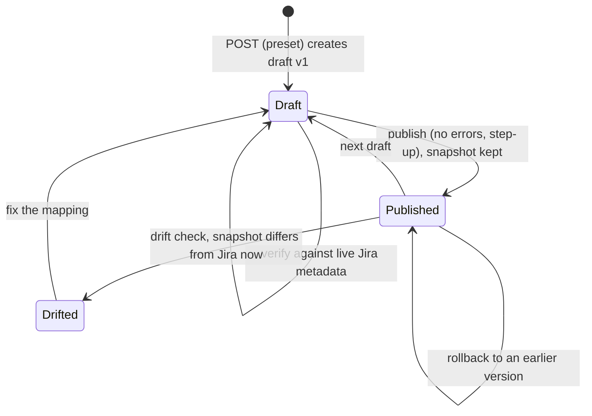
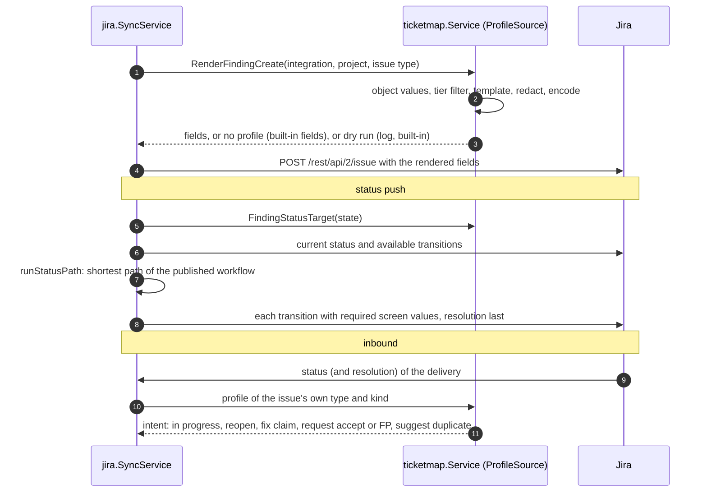

# Ticket field and status mapping

Design: [RFC-097](../rfcs/RFC-097-ticket-field-mapping.md). Related: [ticketing integration](ticketing-integration.md).

## Where things live

| Layer | Path | Role |
|---|---|---|
| Domain | `pkg/domain/ticketmap/` | spec, attribute catalog, template language, validation, drift, rendering, workflow paths, inbound intents and decisions, presets, import/export, diff |
| Application | `internal/app/ticketmap/` | profiles and versions, live metadata, preview, simulator, copy, suggest; object values (`values.go`) |
| Tracker | `internal/infra/jira/metadata.go`, `mapping_tracker.go` | create metadata, project statuses, resolutions, workflow transitions, issue snapshot; per-integration client |
| Storage | `internal/infra/postgres/ticket_mapping_repository.go` | `ticket_mapping_profiles`, `ticket_mapping_versions` |
| HTTP | `internal/infra/http/handler/ticket_mapping_handler.go`, routes in `routes/misc.go` | API under `/api/v1/integrations/ticket-mappings` |

## Flow

Authoring (all routes under `/api/v1/integrations/ticket-mappings`, reads
`integrations:read`, changes `integrations:manage`; publish, delete and dry run
also need step-up):

Runtime (findings and tasks):

## Invariants

- One profile per (tenant, integration, object kind, project, issue type); one open draft and one published
  version per profile (partial unique indexes).
- Inbound capability is a property of the attribute in code; the stored spec cannot widen it.
- Redaction and encoding run on every rendered value and cannot be disabled by a profile.
- An unreachable target status or a missing required transition value is an error, never a guessed status.
- A tracker never closes a finding: intents are claims and requests.

## Engine (outbound, findings)

- `SyncService.CreateTicketFromFinding` asks `ProfileSource.RenderFindingCreate` (the mapping service) for the
  published profile of the destination (the client's own integration, project, issue type). With one, the issue
  is created from the rendered fields (`CreateIssueFields`, issue type by id); in dry run the profile's fields are
  logged and the built-in fields are sent. The issue type is matched by id (preferred) or name; when the caller
  names no type and the project has more than one published profile of the kind, none is chosen and the built-in
  mapping applies, rather than the first profile in list order.
- `SyncFindingStatusToTicket` asks `FindingStatusTarget` first. A published profile for the issue's project is
  its own opt-in: the state's target status is reached by `runStatusPath` (`internal/app/jira/profile_engine.go`):
  read the current status and the transitions available now, follow the shortest path of the published workflow
  (or only a direct transition when the site exposes no workflow), fill required screen fields (the resolution on
  the final step), comment on the final step. A path that does not exist is an error, never a guess.
- Tracker 4xx (`PermanentError`) and impossible paths (`pathError`) report `Permanent()`: the durable-job
  runner (`internal/infra/controller/durable_jobs.go`) buries the status-sync job without a retry. A 429
  surfaces as `RateLimitedError` with the `Retry-After` value, but the runner ignores it and retries on its own
  backoff (30 s doubling to 1 h, 8 attempts).
