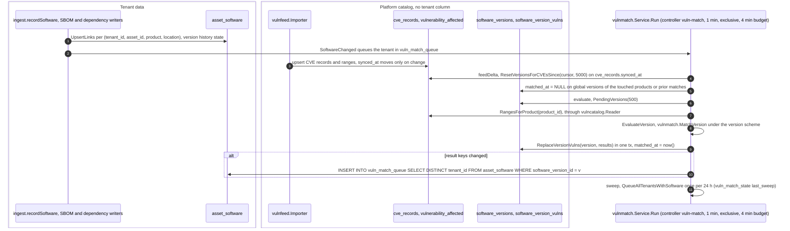
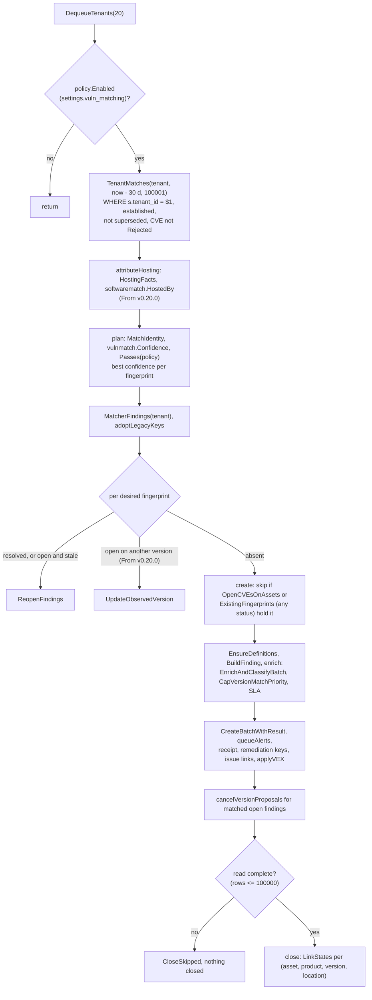
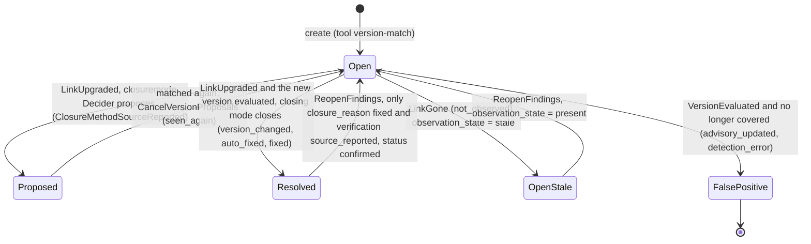

# Vulnerability matching: software catalog × CVE corpus

Design: [RFC-066](../rfcs/RFC-066-inventory-vulnerability-matching.md). Storage: [RFC-143](../rfcs/RFC-143-vulnerability-catalog.md)
designs the move of the vulnerability catalog (schema `vuln`) into the intel database
(`INTEL_DATABASE_URL`, not built yet). From v0.20.0 the matcher already reads product ranges only
through `vulncatalog.Reader` (the Postgres reader over today's tables, global rows only).

## Flow

Verified against `develop` (2026-11-05). v0.19.1 is the same except where a
"From v0.20.0" line says otherwise.

### Versions: matched once, platform-wide

### One tenant: `ReconcileTenant`

### Matcher finding lifecycle (`close`, `CloseFindings`, `ReopenFindings`)

- Every `CloseFindings` / `ReopenFindings` statement is `WHERE f.tenant_id = $1 AND f.id = ANY($2)`
  plus `matcherOwnedSQL` (`tool_name` and `COALESCE(last_seen_tool, tool_name)` are `version-match`), so
  a finding a scanner reported since is never touched; closes run only from
  `AutoCloseFromStatuses` (new, confirmed, in_progress, fix_applied) and are skipped while a
  finding re-key run of the tenant is in progress (`autoResolvePaused`).
- From v0.20.0: `LinkUpgraded` closes only when `info.Now.Evaluated` (the displacing version has
  `matched_at`); otherwise the finding stays open. An open finding whose product moved to another
  matching version records it (`UpdateObservedVersion`). An unreadable catalog
  (`vulncatalog.ErrUnavailable`) fails the pass before `ReplaceVersionVulns` or any reconcile.
- An `advisory_updated` false positive is never reopened: `ReopenFindings` takes only matcher closes
  as fixed, and `create` skips any identity that exists in any status.

## Finding identity

A match on a package link (`asset_software.source = 'package'` with a
package URL on the version) is keyed like a scanner's report of the same
package: `SCAIdentity(asset, package URL without version, CVE)`, the package
URL taken from `software_versions.purl` with the distro of the version's
build qualifier for deb, rpm and apk packages. Consequences:

- a scanner report and a version match for one package and CVE are one
  finding; a scanner sighting adopts the matcher's finding;
- a finding of that identity in any status (a scanner finding closed as a
  false positive, accepted, or closed by a VEX statement) stops the matcher
  from creating it again;
- the matched version is the finding's `component_id`: the finding counts on
  the package in Components, and the organization's VEX statements are
  applied to it when it is created (the sticky path ingest uses);
- the matcher's findings stored under the earlier network key move to the
  package key in place on the next pass (same finding and status, the old key
  kept as an alias); when another finding already holds the package key the
  old finding keeps its key, and the two are never merged automatically.

A match on a technology, service or OS product (named by CPE) keeps the
network identity `(asset, CVE, port)` that network scanners use.

## Locations

One web server often answers on several origins of one host (`http:80`,
`https:443`, `http:8080`), and the inventory stores each origin as its own
service asset. The matcher keeps **one finding per (tenant, host, product,
version, CVE)** and one **location** per service it sees the software on
(`finding_locations`, migration `20261105145035`; code
`api/pkg/domain/softwarematch/locations.go`, `api/internal/app/vulnmatch/locations.go`).

- **Which matches.** A match on a service asset (`service`, `http_service`,
  `open_port`) whose name names a host (`asset.HostOf`), keyed on the network
  identity. Package matches and matches on hosts keep one finding per asset.
- **Where the finding lives.** On the oldest service of the group, which never
  changes. The finding's key stays that service's network identity; each
  location's key (`location_key`, unique per tenant) is the network identity
  of its own service, so a location belongs to one finding.
- **Grouping is scope-safe.** Services are grouped only when every user sees
  them alike: the same `user_accessible_assets` rows, the same program-only
  flag and the same private program links (`ScopeSignatures`). Otherwise each
  keeps its own finding, so nobody loses a finding they could see and nobody
  gains a service they could not see.
- **Joining.** A new service of a host joins the open finding of the same
  product, version and CVE. A closed finding is never joined: the service gets
  its own finding. A location keeps its finding while its version changes (the
  finding records the version observed now, as before); another version seen
  on another service is another backend, so it is another finding.
- **State per location.** `affected` (the vulnerable version is observed
  there), `fixed` (another, evaluated version displaced it there),
  `not_affected` (the advisory no longer covers the version seen there). A
  service not seen lately stays `affected` (not seen is not fixed). The
  rules of the lifecycle above apply per location: a displacing version that
  is not evaluated yet leaves the location affected.
- **The finding.** It stays open while any location is affected. When none is,
  it closes as `version_changed` through the organization's closing mode if a
  location was fixed, or as `advisory_updated` otherwise; it is only marked
  stale when every affected location is not seen. A matched-again location
  reopens a finding the matcher closed as fixed.
- **Timeline and audit.** A service added to a finding and every state move
  writes a `location_changed` timeline entry (the service named by scheme and
  port only, never the asset) and a `finding.location_changed` audit row
  (with the asset id). The location the finding was created on is the finding
  itself and adds no entry.
- **Reading.** `GET /api/v1/findings/{id}` returns `locations`, filtered to
  the finding's own asset and the assets inside the caller's data scope
  (`VulnerabilityService.GetFindingLocations`); a hidden one is left out
  without a trace. The finding page says "Affected on 2 services: http:80,
  https:443". Metrics count the finding once: a location is not a finding.
- **Merges.** A finding merge moves the loser's locations to the survivor; an
  asset merge moves locations to the kept asset.

### Folding the duplicates stored before locations

`cmd/vulnmatch-locations` folds the matcher findings stored once per service
before locations existed. Per tenant (`-tenant <id>[,<id>]` or
`-all-tenants`), dry run by default on a read-only connection, `-apply` to
write, `-json` for the report.

- Groups are matcher-owned findings on service assets with the same host,
  product, version and CVE. The oldest survives with its history,
  comments, tickets and assignee; it takes the strongest open triage status of
  the affected rows (in progress or fix applied over confirmed over new; never
  a downgrade, and a closed or false-positive row never counts), and the earlier SLA deadline of an
  affected service (deadlines only tighten). Each other one becomes a
  location of it, with the state its status stood for (open: affected; closed
  as fixed by the matcher: fixed; false positive after an advisory change: not
  affected), and a tombstone (`duplicate`, `duplicate_of`) whose comments,
  timeline, tickets, evidence and other references move to the survivor
  (`findingMergeRefs`, except its key history: a scanner report on that service
  keeps landing on that service's own asset).
- A survivor the matcher closed as fixed reopens when another service is still
  affected, as the matcher would.
- A group is skipped and reported when a person's decision would be lost
  (accepted, a person's false positive or fix, review states), when the
  services are seen differently by some user, when the findings have other
  assignees, or when a loser has a pending status request or retest.
- Every fold is one transaction, audited per loser (`finding.duplicate_marked`)
  and per run (`finding.location_changed`, counts), and journaled in
  `finding_location_merges`.
- `-down` (with `-run <id>` for one run) reverts the journaled folds newest
  first: the loser gets back its status and key and every row that moved,
  dropped rows are put back, the locations the fold built are removed, and each
  survivor column the fold changed goes back unless it changed again since
  (listed in the report). A loser changed since the fold, or whose key another
  finding took, is skipped and reported. Revert before rolling the migration
  back: its down drops the journal.

## Where each piece lives

| Piece | Code | Tables |
|---|---|---|
| CPE names, version comparison, ranges | `api/pkg/domain/vulnmatch` | — |
| Catalog resolution, curated products, confidence | `api/pkg/domain/software` | `software_products`, `software_product_aliases`, `software_versions` |
| Capture at ingest | `api/internal/app/ingest/software.go` | `asset_software` |
| Vulnerability bundle | collector: [openctemio/vulnfeed](https://github.com/openctemio/vulnfeed), feed: [openctemio/vulnfeed-bundles](https://github.com/openctemio/vulnfeed-bundles); importer: `api/internal/app/vulnfeed` + controller | `cve_records`, `vulnerability_affected`, `threat_intel_sync_status` (`vulnfeed`) |
| Matcher, findings, closing | `api/internal/app/vulnmatch` + controller | `software_version_vulns` |

## Operating it

- **Bundles**: the `vuln-feed-import` controller (every 20 minutes,
  exclusive lease) verifies and applies the signed bundles of
  openctemio/vulnfeed-bundles (built by the openctemio/vulnfeed collector, RFC-066 §5.5), published hourly. It downloads only
  the part it applies: the delta when the platform applied its base, the
  snapshot otherwise. Progress and corpus size are in the `vulnfeed` row of
  `threat_intel_sync_status`.
- **Matcher**: the `vuln-match` controller runs every minute (exclusive
  lease): corpus changes reset the affected versions, pending versions are
  evaluated, every organization with software is swept once a day, queued
  organizations are reconciled (`vuln_match_queue`, cursors in
  `vuln_match_state`). An organization is queued when ingest records a
  technology observation, when a dependency report or an SBOM upload links,
  removes or supersedes packages, and when a feed change touches a version it
  runs.
- **Policy**: `GET/PUT /api/v1/organization/settings/vuln-matching`.
- **Asset software**: `GET /api/v1/assets/{id}/software`.
- **Reserved tool name**: ingest refuses findings of a report whose tool is
  `version-match`.

## Rules worth remembering

- A version change closes a finding only once the new version is established
  in the location's version history (strong evidence or 3 consecutive
  readings over 12 hours); one weak sighting never does
  ([software-version-history.md](software-version-history.md)).

- A catalog row is global only when its identity is public (the feed, the
  curated list). Everything a tenant observes that is not public is a
  tenant-private row. No API lists the catalog; a tenant sees catalog rows
  only through its own `asset_software` links.
- The platform never calls a CVE source: it verifies (pinned
  root, key set, sequence, expiry, hashes) and imports signed bundles. KEV
  and EPSS may also be fetched directly from CISA and FIRST
  ([intelligence-feeds.md](intelligence-feeds.md)).
- Shared tables are written only by the bundle importer and the curated list; ingest
  may add a version to a global product, never a product or alias.
- The feed's alias dictionary (RFC-066 §5.6) maps CNA vendor/product
  strings, deprecated CPEs and package identities to the canonical product
  and merges feed-created duplicates into it (`ApplyFeedAliases`,
  `internal/infra/postgres/software_alias_repository.go`). Curated aliases
  and products always win; tenant-private products are never merged; an
  entry that is not reviewed folds only a product whose ranges all come from
  CNA names (others are held for the operator); purl aliases must be
  reviewed; a dictionary over the merge limit is refused whole; every fold
  is journaled in `software_product_merges`. The importer reads it
  from the release's signed `aliases.manifest.dsse.json` (bound to the
  applied sequence, applied once per version; `internal/app/vulnfeed/aliases.go`);
  the feed status shows `aliases_version`, `aliases_coverage`,
  `aliases_held` and `aliases_error`.
- The release may also carry a signed vulnerability id alias map
  (`vulnids.manifest.dsse.json` + `vulnids.jsonl.gz`, optional): each entry
  ties a GHSA or OSV ecosystem id to the one CVE it aliases (an advisory
  that names two CVEs is never listed; distro advisories never are). The
  importer verifies it like the alias dictionary (key set, applied sequence,
  validity, SHA-256), drops an id listed with two CVEs, and replaces
  `vuln_id_aliases` with the snapshot, refusing one that would remove more
  than 5 % (or 500) of the entries (`internal/app/vulnfeed/vulnids.go`,
  `internal/infra/postgres/vuln_id_alias_repository.go`). Ingest keys a
  finding that names only such an id on the CVE (deduplication.md,
  "Canonical vulnerability ids"). The feed status shows `vulnids_version`,
  `vulnids_entries`, `vulnids_conflicting`, `vulnids_invalid` and
  `vulnids_error`.
- Matching runs once per version. Cost grows with distinct versions, not assets.
- A matcher finding is closed only by the matcher, and only while no scanner
  has reported it.
- Not seen is not fixed: software that disappears marks its findings stale
  (`observation_state`; the status stays), never `resolved`.
- A version that does not parse is never guessed at; a distribution build is
  a potential match and excluded by default.
- A CVE whose applicability names the product without a version range (`*`
  with no bounds) matches every version: `all_versions`, confidence at most
  40, never a finding. A CPE with version `-` is dropped at import.
- Shared third-party hosting: a match on a host a provider's shared front end
  serves (a CDN or WAF edge, SaaS or site-builder hosting: the edge labels'
  dataset `pkg/domain/edgeaddr`) is the provider's software. The finding is
  still created but carries `version_match.hosted_by` (the provider),
  `attributed_to: provider` and the reason `shared_hosting`, and its priority
  is capped at P3 (`CapSharedHostingPriority`) unless a scan confirmed it. An
  address counts as the provider's when it lies in a published edge range or
  its record names a CDN, or when at least one of the tenant's names resolves
  to it and every one does so through the same provider's host suffix
  (`softwarematch.HostedBy`, facts from `SoftwareMatchRepository.HostingFacts`,
  tenant-scoped). An address nothing knows stays the organization's.

## Version schemes

Every catalog version carries the scheme of its ecosystem
(`software.SchemeForType` for package URLs, `generic` otherwise), and
`vulnmatch.ParseSchemeVersion` compares it the ecosystem's way
(`api/pkg/domain/vulnmatch/scheme.go`, `pep440.go`, `maven.go`, `distro.go`):

| Scheme | Ordering |
|---|---|
| `generic` | dotted numbers, pre-release tags, patch letters |
| `semver`, `npm`, `go` | SemVer 2.0.0: pre-releases before the release, build metadata ignored (`+incompatible`), a leading `v` or `=` accepted, one to four core parts (missing parts are 0); a Go pseudo-version is a pre-release of its base |
| `pep440` | PEP 440, with its normalisation (`1.0-RC1` = `1.0rc1`, `1.0-1` = `1.0.post1`): epoch, release, pre, post, dev, local |
| `maven` | Maven ComparableVersion: alpha < beta < milestone < rc = cr < snapshot < release = ga = final < sp < other qualifiers |
| `deb` | dpkg: `[epoch:]upstream[-revision]`, `~` before the end of the string |
| `rpm` | rpmvercmp: `[epoch:]version[-release]` with `~` and `^`; a side without a release matches every release |
| `apk` | `number{.number}[letter]{_suffix[n]}[-rN]`; `_alpha/_beta/_pre/_rc` before the release, `_cvs/_svn/_git/_hg/_p` after |

- A range applies when its scheme equals the version's, or when it is
  `generic` (the corpus ranges today): its bounds are then read under the
  version's scheme. A range of another specific scheme never applies.
- A version or a bound that does not parse under the scheme gives no match,
  never a guessed one. Showing such products as "potentially affected" is a
  later query, not a stored match.
- Version strings above 128 bytes are refused; every comparator is linear in
  its input.
- **Distribution backports.** A `deb`, `rpm` or `apk` version matched by a
  range that is not of its own scheme carries `backport_possible` and −30, so
  it is never "likely" on its own: the distribution may have shipped the fix
  without changing the upstream version. The corpus has no per-distribution
  ranges yet; when it does, they decide alone for their distribution.

