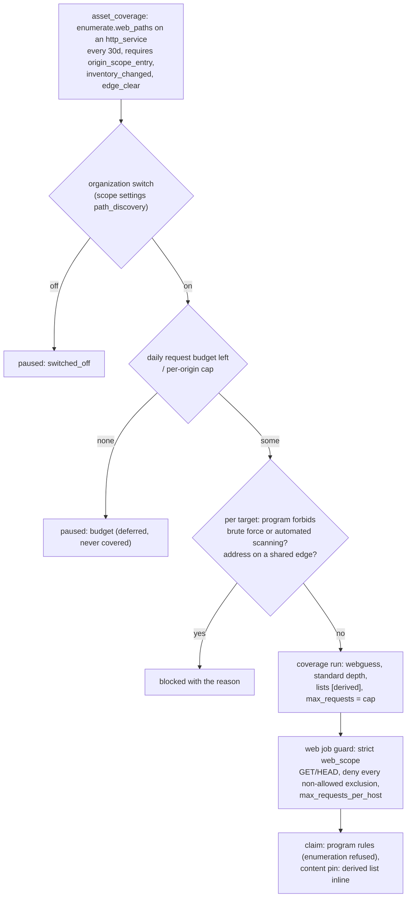

# Web path discovery

Design and decisions: [RFC-150](../rfcs/RFC-150-web-path-discovery.md). The
store side (source `guess`, response evidence) is
[RFC-056 §9](../rfcs/RFC-056-web-attack-surface.md) and
[web-surface.md](web-surface.md).

Path discovery requests paths a web origin never links, chosen by the
platform from the organization's own inventory, with GET and HEAD only, and
records the ones that answer differently from the origin's not-found answer
as endpoints with source `guess`.

## Shipped vs planned

| Part | State |
|---|---|
| Capability `enumerate.web_paths@1` in the stage catalog (tool `webguess`, T1, one origin per task, heavy: 30 days) | shipped |
| Derived candidate list at claim (`internal/app/contentpin/webpaths.go`, `pkg/domain/webendpoint/derived.go`) | shipped |
| Strict web scope with per-host cap (`scope.BuildDiscoveryWebScope`, `WebJobGuard`) | shipped |
| Coverage planning: rule, predicates, switch, budgets, refusals (`internal/app/coverage/path_discovery.go`) | shipped |
| Bug bounty `bruteforce` / `automated_scanning` enforcement for every enumeration job | shipped |
| Coverage gap reasons of discovery and their settlement | shipped |
| `paths` step in Standard recon, Web and Deep recon (optional, Standard depth), through the same gate as the planner | shipped |
| One gate for every caller, with the per-origin last-run ledger (`web_path_discovery_runs`) | shipped |
| Verification of guessed backup, archive and dump files (`openctem-backup-file-signature`, requested by id) | shipped |
| Verification of guessed source and config files | planned |
| Pack lists, recursion, parameter discovery, authenticated discovery | planned |

## How a run is planned



### Coverage predicates (`internal/infra/postgres/asset_coverage_repository.go`)

| Predicate | Holds when |
|---|---|
| `origin_scope_entry` | an active scope entry names the origin's host: a domain or subdomain entry for a host name, an exact `ip_address` entry for an address |
| `inventory_changed` | the origin has active endpoints first seen since path discovery last succeeded on it (not counting rows it found itself) |
| `edge_clear` | the origin's last `probe.http` or `vuln.templates` outcome is not `edge_challenged` / `edge_blocked` |

A pair whose predicate fails is `not_applicable` with the predicate as the
reason, and becomes due again when it holds.

### Budgets and switches

| Setting | Where | Default |
|---|---|---|
| Organization switch | `PUT /api/v1/scope/settings` `path_discovery` (audited as a scope settings change) | on |
| Per-origin request cap | `PATH_DISCOVERY_REQUESTS_PER_ORIGIN` | 300 (50..100000) |
| Daily requests per organization | `PATH_DISCOVERY_DAILY_REQUESTS` | 50000 |

Deferred and switched-off pairs are `paused` with the readiness reason
`budget` or `switched_off`; they are never marked covered and resume on their
own.

### One gate for every caller

The planner, a workflow's `paths` step and a scan someone starts use the same
policy (`coverage.PathDiscoveryPolicy`, `internal/app/coverage/path_discovery.go`):

| Check | Reason when it fails |
|---|---|
| the organization's switch | `switched_off` (step skipped; job refused `PATH_DISCOVERY_OFF`) |
| the daily request budget (sum of the caps granted in the last 24 hours) | `budget` |
| a live web service of the organization | `not_an_origin` |
| an active scope entry naming the origin's host | `origin_scope_entry` |
| an edge that did not challenge or block the last probe | `edge_clear` |
| new inventory since the last run (the later of the coverage success and the ledger) | `inventory_changed` |
| no dispatch within 30 days, from any caller | `path_ran_recently` |
| the program and shared edge refusals | `program_forbids_enumeration`, `program_rules_conflict`, `shared_edge_address` |
| the run's per-host budget (origins of one run on the same host share it) | `host_budget` |

The per-origin last-run record is the table `web_path_discovery_runs` (tenant,
origin asset, host, run, request cap granted, last dispatch). The planner and
the workflow step check it; the claim is made by the web job guard every
command passes before it is stored (`scope.WebJobGuard`, under a
per-organization advisory lock), so two callers cannot both dispatch an origin
and the 300 requests per origin per 30 days hold across scans and the planner.
A retried task is refused the same way. The workflow step keeps only the
origins that pass and settles as "no inputs" when none does. A scan started
by a person is refused at trigger when the switch is off or the gate refuses its
origins (`PATH_DISCOVERY_OFF`, `PATH_DISCOVERY_REFUSED`), and passes the same
guard as any job; a wordlist pack needs an active scope entry naming the origin
(and the Deep depth for the medium size).

## The derived list

Built at claim from the job's organization's rows only
(`postgres.WebDiscoveryRepository`):

1. backup copies of observed file endpoints: up to 8 of
   `.bak ~ .old .orig .swp .save .tmp .zip` per file, sensitive (catalog)
   files first, then the newest;
2. version siblings of `/v<n>/` paths: every lower version and `v<n+1>`;
3. paths at least two of the organization's other origins serve and this one
   does not, the most widespread first (the counts are the organization's,
   reused for 10 minutes, and never count paths path discovery itself guessed);
4. GET paths the origin's API descriptions declare.

Templated paths, destructive paths (`webpath.Destructive`), paths the origin
already has and paths under a denied exclusion (`webpath.Denied` on
`webpath.CleanPath`, the sensor's reading) are dropped. The classes are
interleaved, the list is truncated to 20,000 lines and the inline cap (256
KiB gzip), and a truncation is logged. An empty list refuses the job with
the reason (nothing to check).

## The job's web scope

`web_scope` of a discovery job:

```json
{"deny_paths": ["/admin"], "methods": ["GET", "HEAD"], "max_requests_per_host": 300}
```

`deny_paths` holds every path exclusion on the target hosts whose testing
mode is not `allowed` (a `read_only` exclusion included). The scope is always
attached and replaces any value the creator wrote. The cap is what the ledger
granted: the job's `max_requests` (default and ceiling: the per-origin budget,
300) and at most what the daily and per-host budgets left. The job requires
`net.confined@1`: only the confined forwarder holds the tool to the scope and
the cap. The sensor's differ requests at most 50 per second and 2 per second
once an answer shows an edge network in front of the origin.

## Outcomes

The sensor reports one coverage gap per origin in the task result
(`metadata.coverage_gaps`: `host` the origin, `reason` the primary reason,
`detail` every reason with its count, for example `catch_all=12
scope_filtered=3`; `scope_filtered:<n>` is also accepted). Settlement:

| Reason | Ledger |
|---|---|
| `edge_protected` | failed, edge challenged (target side) |
| `throttled` | failed, rate limited |
| `blocked` | failed, edge blocked |
| `budget`, `hostile_response`, `protocol` | failed, unfinished |
| `catch_all`, `auth_wall`, `unstable_baseline`, `scope_filtered` | covered; the reason stays on the run |

When one origin lists several gaps, a reason that leaves it uncovered wins.
The web console reads these from the run's task view (`coverage_gaps`) and
the origin's coverage row (`/assets/{id}` coverage, capability
`enumerate.web_paths`).

## Bug bounty programs

A job enumerates when its capability (or a required capability word) is an
`enumerate.*` capability, its tool only enumerates (`webguess`, `dnsx-enum`)
or its config asks for `method: bruteforce`. When a program covering its
targets forbids `bruteforce` or `automated_scanning`:

- a single-scanner scan trigger is refused (`PROGRAM_FORBIDS_ENUMERATION`);
- coverage blocks the pair (`program_forbids_enumeration`);
- any job reaching a sensor is failed at claim with the reason
  (`PROGRAM_FORBIDS_ENUMERATION: ...`), on every hand-out path.

## Key files

- `pkg/domain/stage/catalog.go`, `contract.go`, `heavy.go`, `web.go`
- `pkg/domain/webendpoint/derived.go`
- `internal/app/contentpin/webpaths.go`, `internal/infra/postgres/web_discovery_repository.go`
- `internal/app/scope/web.go` (`BuildDiscoveryWebScope`), `web_job.go`
- `internal/app/coverage/path_discovery.go`, `planner.go`
- `pkg/domain/command/enumerate.go`, `internal/app/command/program_rules.go`, `internal/app/scan/program_rules.go`
- `pkg/domain/scanrun/coverage_gaps.go`, `pkg/domain/coverage/settle.go`
- `internal/app/scanrun/path_discovery.go`, `internal/infra/postgres/web_path_ledger.go`, `pkg/domain/coverage/path_ledger.go`
- migrations `20261105060450_easm_workflow_path_discovery_step`, `20261105131621_web_path_discovery_runs`, `20261105132120_assets_web_origin_name_index`
