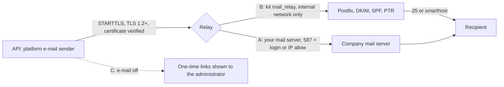

# How to send platform e-mail without an online provider

OpenCTEM needs one SMTP server (Console > Settings > E-mail, `internal/app/platformemail`).
It need not be an online service. The user-facing guide is
[Send mail without an online provider](https://docs.openctem.io/configuration/mail-without-online-smtp/);
this page is the operator and developer view: what is enforced, where, and
what to check when it fails.

## The three ways

| | Setting | What enforces safety |
|---|---|---|
| A. Company mail server | Console: host, 587, STARTTLS, login or IP allow; CA certificate when the server's certificate is from an internal CA | The API verifies the server's certificate against the system roots, or only the stored CA bundle; no skip-verify switch exists |
| B. Kit relay | `openctem-ansible` role `mail_relay` (off by default) | Internal-only network, `mynetworks` = that /24, `reject` for the rest, sender-domain allow list, TLS required, own CA, optional DKIM |
| C. No e-mail | Send e-mail off | Nothing is sent; links are shown once to the acting administrator |

## What the platform enforces

- The SMTP host is resolved through `httpsec.ResolveSafeHost`; a private address
  needs `OPENCTEM_HTTPSEC_ALLOW_PRIVATE_CIDRS` (the kit sets exactly the relay's
  /32 when `openctem_mail_relay` is true).
- TLS 1.2 or later. The roots are the system roots, or only the stored internal
  CA bundle (`ca_pem`): certificates only, at most 16 and 64 KB, write-only,
  returned as `ca_set` + `ca_fingerprint`, part of the relay approval target
  (second super administrator), audited by fingerprint. A stored bundle that
  does not parse turns e-mail off (fail closed).
- The test e-mail goes to the acting administrator only and returns
  `EMAIL_TEST_FAILED` with `details.reason` from `email.ClassifySendError`.

## Troubleshooting

| Reason (`details.reason`) | Meaning | Fix |
|---|---|---|
| `unknown_authority` | Certificate signed by an unknown authority | Store the CA bundle |
| `hostname_mismatch` | Certificate not for the configured name | Use the certificate's name (`mail-relay` for the kit relay) |
| `certificate_invalid` | Expired or not yet valid | Renew; check clocks |
| `tls_failed` | Handshake or STARTTLS failed | Port 587 with STARTTLS; TLS 1.2+ |
| `auth_failed` | 535 or similar | Check the login |
| `auth_required` | 530 at MAIL FROM | Add a login, or allow the API's address on the server |
| `relay_denied` | Recipient refused at RCPT TO | Relay rules on the server; authenticate |
| `sender_rejected` | Sender address refused | Send-as right; change the sender |
| `host_rejected` | SSRF guard refused the address | `OPENCTEM_HTTPSEC_ALLOW_PRIVATE_CIDRS` |
| `connect_failed`, `timeout` | Network | Name, port, firewall, egress policy |

Delivery problems after acceptance (SPF fail, DKIM or DMARC reject, port 25
blocked, PTR missing) are in the relay's log: `docker compose -p openctem-mail
-f /opt/openctem-mail-relay/compose.yml logs mail-relay`.

## Kit relay

See the kit's `docs/MAIL-RELAY.md`. The relay is a separate compose project
(`openctem-mail`) with a submission network that is `internal: true` and an
egress network nothing else joins. Nothing is published on the host.
