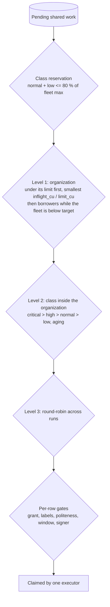

# RFC-129: Shared fleet scheduling

| | |
|---|---|
| Status | Accepted (2026-10-27); P0-F5 (bounded shared claim, #3202) and P0-F3 (cross-organization politeness, #3203) in review, the rest designed |
| Scope | api (admission, shared claim, politeness, limits, usage records, metrics, console settings), web (usage card, console settings, wait reasons), sdk-go (per-host rate from the signed limits, exists), sensor (proxy egress, exists), docs |
| Architecture | [sensors.md](../architecture/sensors.md#the-shared-claim-path), [job-dispatch.md](../architecture/job-dispatch.md), [limits.md](../architecture/limits.md), [sensor-proxies.md](../architecture/sensor-proxies.md) |
| Amends | RFC-100 §8 (shared claim order) and §10 (limits), RFC-030 §5 (signed limits carry a per-host rate share), RFC-090 (claim of shared items) |
| Related | RFC-040 (mutual distrust, signed jobs), RFC-064 (entitlements and limits), RFC-088 (host keys), RFC-100 (shared sensors) |

## 1. Summary

The shared fleet (RFC-100) runs scanning jobs of many organizations on
sensors that the instance operates. In the hosted edition it will serve a
large and growing volume of jobs. This RFC fixes how that fleet is shared:

- **Admission** at trigger: proof, deny list, scope gate, daily scan budget,
  monthly compute budget. Refused work never enters the queue.
- **Plan quotas in compute units (CU)**: a concurrency limit per plan that is
  also the organization's fair-share weight, a burst ceiling used only while
  the fleet has idle capacity, and a monthly CU-minute budget.
- **Priority classes**: verification, interactive and on-demand, scheduled,
  background; aging lifts waiting work, never into the verification class.
- **Fair share inside the Postgres claim**, with no broker: organization
  first (weighted by plan), then class, then round-robin across runs.
- **Class reservation**: scheduled and background work may hold at most
  80 % of the fleet, so a scheduled storm never blocks a click.
- **Cross-organization politeness**: on the shared fleet a target host is
  protected across organizations, because the load and the complaints land on
  the platform's egress, whoever asked.
- **Usage records**: one row per finished shared job, the basis of the usage
  page, budgets and billing.
- **Egress through proxy pools**: shared executors reach targets through the
  organization's own proxy when it routes through one, otherwise through the
  platform's proxy pools, separated by plan.

It also sets five phases, P0 to P4, each with a measured entry criterion.

## 2. Decisions

| ID | Decision |
|---|---|
| D1 | One scheduler, in the claim. The cell's Postgres queue stays the only queue; every fairness rule is part of the claim transaction. No message broker for dispatch. |
| D2 | The compute unit is `CU = max(vCPU, GiB / 2)`. Resource classes are `small` (0.5 CU), `medium` (2 CU) and `large` (4 CU). Quotas, fair share and metering all count CU. |
| D3 | Placeholder plan numbers until pricing is set: concurrency limit Free 2 CU, Team 20, Enterprise 100 (contract up to 500); burst none, 40, 200; included CU-minutes per month 1,000, 30,000, contract (default 150,000); Free 10 shared scans a day. Self-managed installs stay unlimited unless the operator sets limits. |
| D4 | Burst is lending idle capacity, not a credit balance. An organization above its limit gets new work only while the fleet is below its target utilisation (75 % of its maximum), at the lowest rank. Lent capacity returns within one task (tasks are 5-15 minutes by construction). Running work is never preempted to take it back. |
| D5 | The concurrency limit is a weight, not a reservation. Under saturation each organization receives a share in proportion to its limit and never above it. |
| D6 | Priority classes: `critical` = verification and retest, `high` = interactive and on-demand, `normal` = scheduled, `low` = background. Aging: one class up per 30 minutes waited, never into `critical`. |
| D7 | Class reservation: `normal` and `low` together hold at most 80 % of the fleet's maximum. |
| D8 | On the shared fleet, per-host politeness is keyed on the target, across organizations: at most `K` shared tasks hold a conflicting host key at once, `K = 2` by default and `K = 1` for intrusive work. `K` is an instance setting in the console. Organization sensors keep per-organization keys. |
| D9 | A waiting task shows one generic reason (its organization's limit, target politeness, scan window, fleet busy with an estimate, no shared sensor with the tool or region) and never another organization's data. |
| D10 | Egress of shared executors goes through proxy pools: the organization's own proxy when it routes through one, otherwise the platform's pools, separate for Free and paid plans, with an optional dedicated pool (stable addresses a customer can allowlist). Health scores pull burned endpoints out. Residential proxies are never used for active scanning. Each proxy provider's terms must allow security scanning (written clearance, an operator action before the fleet goes live). Rotating addresses to get past a block is refused. |
| D11 | Proxies do not replace abuse controls: domain proof for active work on platform sensors under the managed profile, the deny list, cross-organization politeness, a per-organization kill switch for shared scanning, a per-lane kill switch, and a public target opt-out that feeds the deny list all stay mandatory. |
| D12 | One usage record per finished shared job, written in the job's terminal transition. Per-organization usage is a database record, never a metric label. |
| D13 | Queue expiry of shared jobs depends on the class: `critical`/interactive 15 minutes, on-demand 6 hours, scheduled at its window's end (or 24 hours), background 72 hours. Expired work is reported with its reason. |
| D14 | Scheduled work names a window, not a minute. The platform places each start inside the window by least forecast load, with deterministic per-organization jitter. |
| D15 | Shared executors (one job, then exit) replace the long-lived shared sensor on the hosted fleet at P1. One organization per executor lifetime, always. A microVM runtime is required for the high-risk lanes (headless browser, organization templates, authenticated scans, organization repositories, credentialed cloud reads) before they run on the shared fleet, and for every shared lane before P3 ends. |
| D16 | A live/history split of `commands` waits for its trigger (P2): live queue above 1M rows or claim p95 above 100 ms. |

## 3. Admission

Admission runs at trigger time, before anything is queued:

1. **Who may scan what**: scope gate, guardrails (public-suffix and shared
   provider checks, CIDR caps), deny list, and domain proof where the
   instance requires it (the managed profile turns it on for active work on
   shared sensors).
2. **Budgets**: `platform_scans_per_day` (exists) and, from P2, the monthly
   CU-minute budget. Over budget: Free stops (verification and retests still
   run); Team drops to the background class until the period resets; Enterprise
   follows its contract.
3. **Estimate**: from P2, an organization whose work will wait gets an
   estimated start from its queue position and the learned cost of its tools.

Admission records its decision on the run, so a refused or delayed run always
says why.

## 4. Fair share in the claim

### 4.1 Levels

- **Level 1.** Weighted fair share with the plan limit as the weight. With
  fixed class shapes, the dominant share of an organization is
  `inflight_cu / limit_cu`. A verification job of an organization under its
  limit may jump its round (exists).
- **Level 2.** As today (`claimClassSQL`), with the class mapping of D6.
- **Level 3.** As today (`fairPendingQuery`).
- **Egress is not a fair-share resource.** Packets per second are governed by
  politeness budgets per target (§5), not by organization shares; mixing them
  would let an organization with many targets crowd out one with few.

### 4.2 Bounded claim (shipped in P0)

The shared poll used to rank every eligible pending shared job of every
organization before cutting a window of 1,000, and counted in-flight jobs
through an index that also held every finished shared job. Its cost grew with
the queue and the history, not with the poll. Now:

- `idx_commands_shared_pending (tenant_id, priority, created_at, id) WHERE
  is_platform_job AND status = 'pending'` and
  `idx_commands_shared_inflight (tenant_id) WHERE is_platform_job AND status
  IN ('acknowledged','running')`.
- The poll lists organizations with pending shared work by a skip scan of
  the pending index, orders them (a pending verification job first, then
  fewest in flight), keeps the first 200 that have a job the sensor may claim,
  and reads each one's first round (five jobs) per priority value straight
  from the index. An organization with a full first round reads further whole
  rounds only when the poll has room left. The gates run on the rows read.
- The order is the same as ranking every job within the window; the work is
  bounded by the organizations with pending shared work.

### 4.3 Tenant-first claim (P2)

At larger scale the organization list itself is the cost. P2 adds
`fleet_tenant_state` (one row per organization, lane and class: pending
count, in-flight CU, limit, burst), updated in the claim and settle
transactions under the per-organization advisory lock that exists today.
The claim then picks organizations from that table (O(active organizations))
and takes their oldest items through the pending index with `FOR UPDATE SKIP
LOCKED`. No global counter row exists; fleet totals are sums computed by the
demand calculator.

## 5. Cross-organization politeness

The harm of a scan lands on the target and on the platform's egress, whoever
asked. On the shared fleet:

- **Concurrency.** A shared task starts only while fewer than `K` shared tasks
  of any organization hold a conflicting host key (same name or address, or an
  address and a range of the same /24 or IPv6 /120 bucket). The host-free
  check and the advisory lock key drop the organization for shared jobs
  (`'shost|' || key`). A shared job and an organization sensor's job of the
  same organization still never take one host at once.
- **Rate.** At claim the platform gives each holder a per-host rate share,
  `floor(host_budget / holders)`, in the signed limits (RFC-030 §5); the sdk
  forwarder enforces `PerHostRate` (exists).
- **No leak.** A waiting task shows "waiting: target politeness" only. The
  residual timing signal (someone else scans this host now) is low value and
  bounded by `K >= 2`; it is accepted here (T6).
- **Opt-out wins.** A target that opted out is on the deny list: refused at
  trigger and at claim, on any sensor.

Organization sensors keep per-organization keys: they use the organization's
own egress, and their politeness is the organization's business.

## 6. Egress through proxy pools

| Case | Egress | Reputation and allowlisting |
|---|---|---|
| Organization routes through its own proxy (per sensor, CIDR or asset routes) | the organization's proxy | carried by the organization; platform addresses never touch the target |
| Free plan on the shared fleet | platform Free pool | separate from paid pools, so Free abuse cannot burn paid customers' allowlisted addresses |
| Paid plan on the shared fleet | platform paid pool | published egress list per region |
| Enterprise dedicated egress (add-on) | dedicated pool with stable addresses | the customer allowlists them |

The pool is chosen at claim from plan and organization settings and bound in
the signed envelope. Health scores retire burned endpoints automatically. A
burned Free pool is retired and replaced, never rotated per scan. The
platform publishes a scanner information page with the abuse contact and the
opt-out form. Per-connection egress evidence (which exit address reached which
target, when, for which job) is kept 90 days hot so an abuse report can be
traced to a job and an organization.

## 7. Usage records

`fleet_job_usage` (monthly partitions, 13 months retention through the
retention registry): organization, command, tool, lane, class, queue wait,
run time, CPU time, output bytes, egress bytes, exit or failure class, pool,
CU-seconds. Written in the terminal transition of a shared job. It feeds the
organization's usage page (CU-minutes against the budget, by lane), billing
through the outbox, and the platform's cost model. An organization reads only
its own aggregates.

## 8. Saturation

Saturated = demand above the fleet's maximum for more than 2 minutes. Each
step is automatic and visible on the status page and the run timeline:

1. stop lending (burst off);
2. hold new background starts (aging still lifts them);
3. delay scheduled starts inside their windows ("fleet busy", with an estimate);
4. admit new Free on-demand scans with an estimate;
5. interactive work keeps its reservation and warm executors;
6. claims pause per lane when the database's primary CPU or replica lag
   passes its threshold (sensors get `429` with `Retry-After`, exists);
7. queue age p95 above the SLO for 30 minutes pages on-call.

## 9. Observability

Metrics carry no organization label: `fleet_time_to_start_seconds{class,
plan_tier}`, `fleet_queue_depth{lane, class}`, `fleet_waiting_total{reason}`,
executor start-latency parts, preemptions, exit reasons, utilisation, active
overcommit (sum of active limits over fleet maximum) and deliverable share
(each organization's received share over its weighted fair share; alert when
it stays below 0.8 for 15 minutes).

## 10. Threat model

| # | Threat | Control |
|---|---|---|
| T1 | A Free organization scans third parties from platform egress | proof under the managed profile, Free caps, deny list, politeness, separate Free pool, anomaly signals, kill switch, opt-out |
| T2 | A hostile target exploits a tool, then the kernel, to reach other organizations | one organization per executor lifetime, per-task sandbox inside it, microVM for high-risk lanes and then all lanes, no secrets on the node |
| T3 | Cost denial of service: an organization floods jobs to scale the fleet | concurrency limit, CU budget, burst only when idle, ticket mint cap, fleet maximum |
| T4 | One organization's abuse burns paid customers' allowlisted addresses | proxy pools by plan; dedicated pools for Enterprise |
| T5 | Preemption used to force re-runs or duplicates | idempotent ingest by command and lease epoch; preemption counter |
| T6 | Cross-organization inference through politeness waits | generic wait reason; `K >= 2`; the claim never returns another organization's rows |
| T7 | Claim cost as a denial of service (deep queues, long history) | bounded claim (§4.2): work bounded by organizations with pending work, partial indexes without finished jobs |
| T8 | An abuse report cannot be traced to an organization | per-connection egress evidence, address to pool to job lookup, 90 days hot |

Tenant isolation of the bounded claim: the claim reads shared jobs of every
organization by design (RFC-100 §8); every row it returns is re-gated at claim
time, signed for its own organization and bound to it on results. The new
indexes and the organization ordering return no row of an organization that
the old query would not have returned.

## 11. Phases

A phase starts only when its entry criterion has been measured for two weeks,
except P0, which removes known scale bugs.

| Phase | Entry criterion | Deliverables | Not yet |
|---|---|---|---|
| **P0 foundations** | now | F1-F7 below, plus labels as hard selectors, learned tool budget in deadline admission, structured failure codes | executors, cluster, CU quotas, billing |
| **P1 executors** | hosted-edition launch, or shared slots above 70 % at p95, or more than 50 organizations on shared sensors | shared executors and controller on one cluster in one region; pod isolation with the per-task sandbox; default-deny network policy; one platform proxy pool; on-demand nodes; static warm capacity; usage rows from the executor's final report; runbooks for saturation, bad releases and ticket anomalies | spot capacity, microVMs, learned warm sizing, multi-region, billing |
| **P2 quotas and metering** | paid plans, or 200 active shared organizations, or one organization's start SLO broken by others | `fleet_tenant_state` and tenant-first claim; CU limits and burst; class reservation; admission estimates; saturation ladder; CU-minute budgets and the usage page; billing outbox; Free and paid proxy pools; kill switches; sealed per-job secrets; microVM for high-risk lanes; live/history split at its trigger | spot, learned warm pools, multi-region |
| **P3 elasticity and hardening** | fleet compute above budget, or idle warm cost above 30 %, or start SLO broken by cold nodes, or before Enterprise relies on the shared fleet | node autoscaling with spot for scheduled and background work and on-demand fallback; free re-queue on preemption (at most two); learned warm executors per class and hour; scheduled-start levelling; image and content mirrors; microVM for all shared lanes; dedicated egress pools; reputation monitoring | multi-region fleet |
| **P4 multi-cell, multi-region** | a second cell or region | one executor cluster per region with a namespace and quota per cell; regional proxy pools; usage to global billing; opt-in cross-region scanning (off by default, refused for residency-bound organizations) | cross-cell capacity broker |

### 11.1 P0 batches

| Batch | Work | Acceptance |
|---|---|---|
| F5 | Bounded shared claim (§4.2): pending and in-flight partial indexes, organization-first candidate read | existing fairness tests pass unchanged; poll work does not grow with queue depth or finished jobs; one organization with 10,000 pending jobs gets one round while a hundred others are offered |
| F1 | Usage record (§7) for shared jobs; aggregate read for the organization; usage card | a row per finished shared job; organization B cannot read A's usage; no row for organization sensors' jobs yet |
| F3 | Cross-organization politeness (§5): holders counted across organizations for shared jobs, lock key without the organization, console setting `K` | two organizations hitting one host from the shared fleet are coordinated; organization sensors unchanged; the waiting organization sees no other organization's data |
| F2 | Class-based queue expiry (D13) | a scheduled shared job queued for two hours no longer expires; an interactive one does at 15 minutes, with a reason |
| F4 | Fleet SLIs (§9) | metrics emitted; no organization label |
| F6 | Managed-profile defaults for self-service organizations (Free 2 concurrent, 10 shared scans a day; Free CIDR cap /24) | a new self-service organization under the managed profile gets the limits; self-managed installs unchanged |
| F7 | Deny list entries in the console (operator and opt-out sources, reason, expiry, audit, live apply) | an entry blocks a trigger and a claim without a restart; expiry lifts it |

## 12. Implementation

| Change | Pull request | State |
|---|---|---|
| F5 bounded shared claim, migrations `003447_commands_shared_inflight_index`, `003448_commands_shared_pending_index` | #3202 | in review |
| F3 cross-organization politeness on the shared fleet (limit 2, intrusive 1, as constants; the console setting follows) | #3203 | in review |
