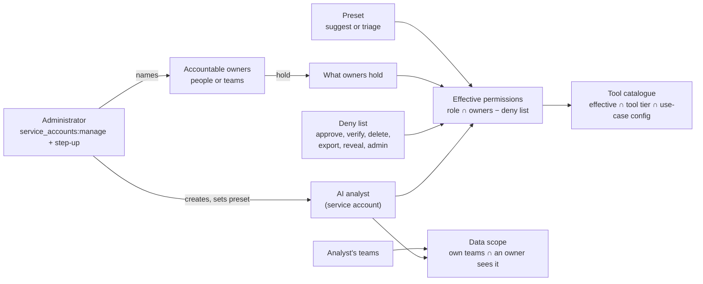
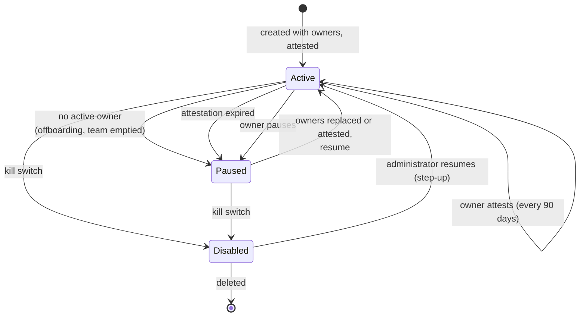
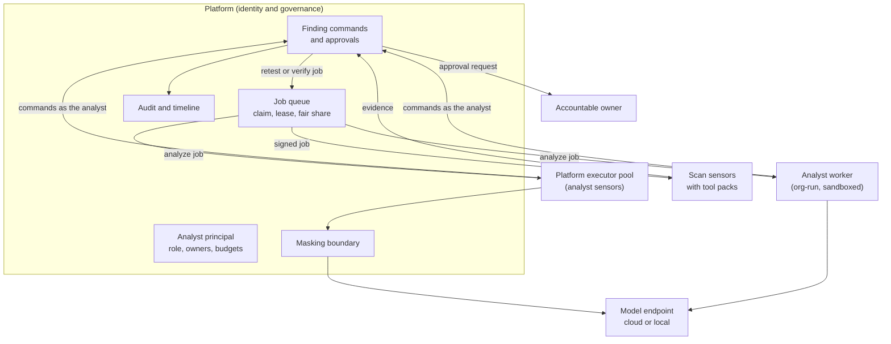
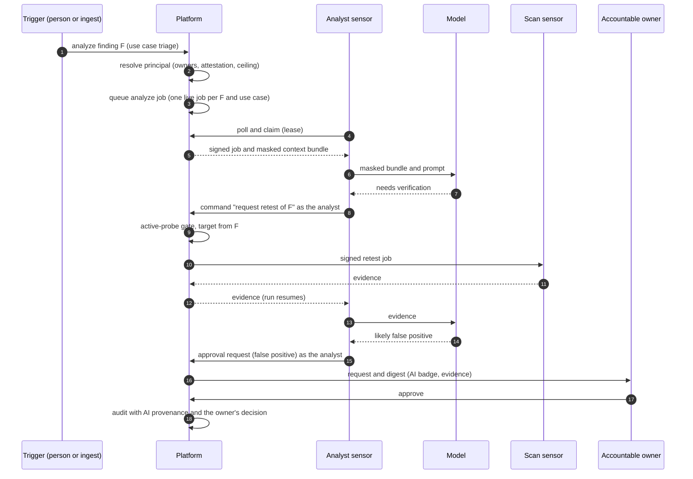
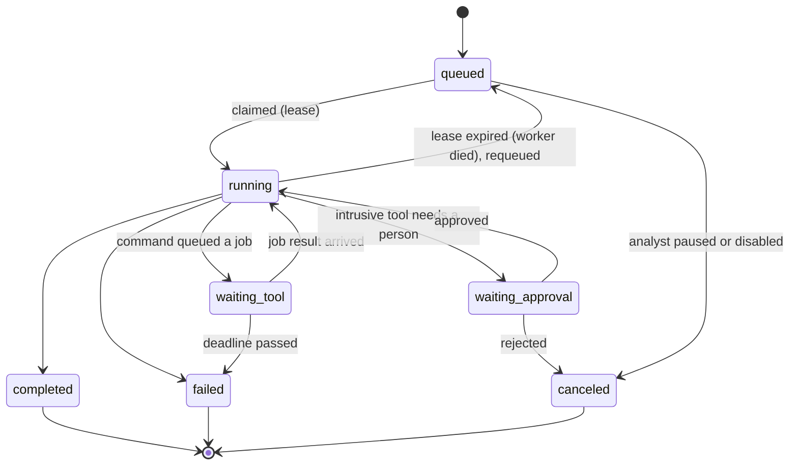

# RFC-132: AI analysts as service accounts with accountable owners

| | |
|---|---|
| Status | Accepted (2026-10-28). In review: the analyst principal, accountable owners, provenance and the run ledger. Designed: runs as `analyze` jobs on analyst sensors, the tool loop through sensor commands, owner digests and alerts, override-rate downgrade |
| Scope | api (analysts, owners, ledger, provenance, executor), web (Settings > AI > AI analysts, one AI badge), sdk-go and sensor (analyst role, later), docs |
| Architecture | [ai-analysis.md](../architecture/ai-analysis.md), [ai-triage.md](../architecture/ai-triage.md), [job-dispatch.md](../architecture/job-dispatch.md) |
| Amends | RFC-131 (AI results are no longer stored as suggestions: the analyst acts through the normal commands) |
| Related | RFC-030 (work distribution), RFC-040 (mutual distrust, signed jobs), RFC-050 (asset access model), RFC-100 (shared sensors), RFC-129 (shared fleet scheduling), RFC-131 (AI analysis, analyze contract, masking) |

## 1. Summary

An AI analyst takes part in triage **exactly like a person**: same steps, same commands, same
permissions, approvals, data scope, SLA, rate limits, audit and notifications. The only difference
is the AI label and the provenance on what it does.

- **Identity.** An analyst is its own **service account** (`users.kind = 'service'`), with a role and
  a data scope an administrator sets. It is not delegated from the person who clicked. It never signs
  in, never approves, never holds full data access and is not a seat.
- **Accountability.** Every analyst has **accountable owners**: people or teams who answer for its
  results. Without an active owner, or with an attestation older than 90 days, it pauses.
- **Bounded power.** What it may do = its role ∩ what its accountable people hold − a fixed deny list
  (approve, verify, delete, export, reveal, bulk, administration). Risk-lowering changes always become
  approval requests decided by a person.
- **Placement.** Identity and governance always live in the platform. The reasoning loop runs in the
  platform executor pool or an analyst worker; both are **analyst sensors** that pull and claim
  `analyze` jobs through the same distribution as scan jobs. Network actions are never taken by the
  AI: it calls a platform command (for example "retest this finding") and a scan sensor runs the
  signed job under the scope gate.

## 2. Identity and permission model

- The presets live in code, not in an editable role; the person who sets a preset must hold its
  permissions. An analyst holds no database role, API key or MCP grant (the schema refuses them), so
  nothing outside the platform's executor can act as it.
- The ceiling is checked when the role or the owners change (refused, naming the permission) and again
  at every run start (the analyst loses what its owners lost).
- The service-account triggers keep their guarantees: one organization, never owner or administrator,
  never full data access, never a sign-in identity.

### Use cases mapped to commands

| Use case | Command | Permission | Result for an analyst |
|---|---|---|---|
| Analysis, summary, remediation plan | add comment | `findings:comment` | comment by the analyst |
| True positive, in progress | status change (lifecycle engine) | `findings:status` | direct (triage preset) or a comment (suggest preset) |
| Severity up | severity change | `findings:severity` | direct or a comment |
| Severity down | severity change, requester cannot approve | `findings:severity` | always a severity request |
| False positive, risk acceptance | approval request | `findings:write` | always an approval request |
| Duplicate | mark duplicate | `findings:triage` | a request kind is added (hiding a row lowers risk); a comment until then |
| Assignment | assign | `findings:assign` | direct or a comment |
| Retest or verify | retest request (target from the finding) | `findings:retest` (new) | a job on a scan sensor through the scope gate |

Where a command has no request form (duplicate, and any change in the suggest preset) the analyst
writes a structured comment saying what it proposes and why; a typed proposal with an Apply button
that runs the command **as the person who clicks** follows.

## 3. Accountable owners

- **Accountable people** = person owners who are active members, plus active person members of active
  owner teams (membership end dates honoured).
- **Duties.** Owners are the first audience of the analyst's requests and digest (they decide only if
  they are eligible approvers anyway; no new right), get alerts on unusual behavior (spike in false
  positive requests, override rate, cost), and attest every 90 days.
- **Lifecycle.** The pause is checked at every run start (fail closed) and by an hourly sweep.
  Changing owners or the preset needs `service_accounts:manage` and a recent sign-in, is audited and
  is notified to old and new owners.
- **Display.** "AI analyst {name} (accountable: {owners})" wherever the actor shows; the accountable
  snapshot is stored with each run and each change, so history does not move when owners change.

## 4. Where the AI runs, and how it uses tools

1. **Identity and governance always live in the platform**: principal, role, owners, commands,
   approvals, audit.
2. **The brain has two placements behind one contract** (`openctem.analyze/v1`, RFC-131): the
   platform executor pool (default, SaaS and self-hosted; model calls through masking, platform data
   only) and the analyst worker (an organization's own or local model, data that must not leave its
   network, or sandboxed parsing of evidence). Both are analyst sensors.
3. **The hands are always the scan sensors.** The analyst never runs a network tool and never names a
   target. It calls the platform command as itself ("retest finding Y"); the platform derives the
   target from the finding, runs the active-probe gate (scope exclusions, private ranges, attribution,
   zones) and signs a job to a scan sensor. The result comes back as evidence the next step reads.
4. **A run is asynchronous and checkpointed**: it waits on jobs without holding a process.
5. **Tool catalogue** = effective permissions ∩ the tool's tier (passive, active, intrusive) ∩ the
   analyst's use-case configuration. **Intrusive tools always need a person**: the request becomes a
   scan approval and the run waits.

### Sequence: a triage run that needs a tool

### Run states

A lease that expires means the worker died: the job goes back to the queue (the command system's
requeue), so there is no separate reaper. Until runs are jobs, a live run past its deadline gives up
the subject's slot when the next run starts.

### Deployment matrix

| Deployment | Brain | Model | Hands | Notes |
|---|---|---|---|---|
| SaaS | platform executor pool; analyst workers in sandboxed pods for code execution | platform provider or the organization's key | platform or organization scan sensors | masking on; data class ceiling `internal` by default |
| Self-hosted, cloud model | platform executor pool | the organization's provider key | organization scan sensors | masking on |
| Self-hosted, local model | executor pool with an `openai_compatible` endpoint on a private address (console only), or an analyst worker next to the model | local | organization scan sensors | masking per class |
| Air-gapped | analyst worker or executor pool with a local model; no outbound traffic | local | organization scan sensors | content delivered offline |

## 5. Scale: many analysts at once

The principal is the identity and the accountability; any number of stateless workers execute runs
under it. Runs are platform jobs of type `analyze`, and analyst sensors pull and claim them through
the same mechanism as scan sensors. No new queue or lock.

| Need | Mechanism | State |
|---|---|---|
| Many workers, one identity | an `analyze` command carries the analyst id; any analyst sensor runs it; audit and metrics stay per analyst | new command type (one constant in `pkg/domain/command`) |
| Pull and claim | organization claim (`ClaimManyForSensor`, `FOR UPDATE SKIP LOCKED`) and the shared claim for platform-owned sensors (`ClaimManyShared`, RFC-100) | exists |
| Gating to analyst sensors | the tool and feature gates (`toolClaimPredicate`, `featureClaimPredicate`): the job names the analyst tool and requires the analyst feature | exists; no new sensor type needed |
| Fair share and priority | priority classes with aging, round-robin by run, per-organization burst on the shared claim | exists; the run key is the scan run id today, `analyze` jobs need an equivalent grouping key |
| Queue expiry | `MaxQueueMinutes` on platform jobs | exists |
| Crash recovery | leases renewed on heartbeat, expired leases requeued with backoff, late writes fenced by lease epoch | exists; the offline-sensor release requeues only routed scan work today and must include `analyze` |
| One live run per finding and use case | a synthetic host key `ai:<use case>:<finding>` blocks a second claim, plus the ledger's partial unique index at enqueue | host keys exist; an enqueue-time idempotency key is a gap |
| Concurrent edits by people and other analysts | every command checks the finding's row version; on conflict the run re-reads and re-plans, never overwrites | exists (`ExpectedRowVersion`) |
| Analyse an issue once, apply per asset | one `analyze` job per issue group (same-issue grouping), one command per finding | claim-time chunking (RFC-030 phase 2) is not built: group at enqueue until it is |
| Placement | analyst sensors report capabilities and load (`LoadReport`, `reported_capabilities`) | exists |
| Results | `CompleteCommand` / `FailCommand` with the result JSON; the run ledger links `command_id` | exists |
| Quotas | per analyst: runs per hour, tokens per month (built); per organization: AI token budget; limit keys such as AI runs per day checked at enqueue | per-organization AI limit keys are a gap (RFC-129 compute units are designed only) |
| Built-in pool | platform-owned analyst sensors (`scope = 'instance'`) in the same tables, so dispatch, metrics and fair share are identical | design |

**Flood control for owners.** Batch approve and reject, a daily digest, a per-owner cap on new requests
per hour, and when an analyst's pending requests exceed a threshold it drops to comments only until
the queue is worked down.

## 6. Provenance, audit and the AI badge

- One provenance value travels in the request context (analyst, run, executor, provider, model,
  prompt template id and digest, accountable owners at that moment, who triggered the run). The
  finding timeline writer and the audit logger stamp it; commands need no AI-specific code.
- A database trigger labels every timeline row whose actor is an analyst `actor_type = 'ai'`.
- One shared AI badge in the web console: "AI analyst {name}" with the accountable owners, on the
  timeline, lists, approvals, exports, tickets and notifications.
- Undo per action and per run, the override rate (rejected requests, undone changes, values a person
  set back) and per-owner metrics are queries over this history. Above 20 % overrides in the last 50
  decided actions a triage analyst moves to the suggest preset until an administrator moves it back.

## 7. Decisions

| # | Decision |
|---|---|
| D1 | The analyst is an existing service account plus an `ai_analysts` profile; no new user kind |
| D2 | Code name `analyst`; "AI analyst" in the console |
| D3 | Several analysts per organization; one suggested when AI is turned on |
| D4 | Presets `suggest` (default) and `triage`, defined in code; custom presets later, bounded by the same ceiling and deny list |
| D5 | Analysts are not seats |
| D6 | Analysts never approve |
| D7 | The person who triggered a run cannot approve that run's requests |
| D8 | Risk-lowering changes are always requests: an analyst's request is evaluated at the strictest level whatever the organization's settings |
| D9 | Owners are people or teams in `ai_analyst_owners` |
| D10 | Ceiling = role ∩ union of what the accountable people hold − deny list, at assignment and at run start |
| D11 | Missing request forms: structured comment now, typed proposal with Apply as the person next, a `duplicate` request kind |
| D12 | New `findings:retest` permission to request a retest, separate from `findings:verify` (resolve) |
| D13 | Provenance stamped by the timeline writer and the audit logger; no suggestion store |
| D14 | The suggestion store and per-use-case modes of RFC-131 are not built |
| D15 | `ai_runs` stays as the ledger; liveness belongs to the job lease |
| D16 | `ai_triage_results` is folded into `ai_runs` as read-only history and dropped when the built-in executor replaces the in-process triage |
| D17 | Override-rate downgrade from history: 20 % over the last 50 decided actions |
| D18 | Attestation every 90 days; pause on expiry |
| D19 | Brain in the executor pool or an analyst worker, both analyst sensors |
| D20 | Hands are scan sensors through platform commands; the analyst never names a target |
| D21 | Intrusive tools always need a person |
| D22 | An outside AI program later gets its own credential path that runs the same principal checks; until then an analyst has no key, grant or role of its own |
| D23 | Runs are `analyze` jobs on the existing distribution (leases, fair share, chunking, placement) |
| D24 | Flood control: batch decisions, digest, per-owner request cap, comment-only above a pending-request threshold |

## 8. Threat model

| Asset | Threat | Control | Test |
|---|---|---|---|
| Finding state | analyst exceeds its role | effective permissions checked before every command | analyst with the suggest preset holds no status permission |
| Four-eyes | analyst approves or decides alone | people-only approver directory; deny list strips approve; requester cannot approve | analyst absent from the approver directory; analyst requests always need a person |
| Four-eyes | a person launders a self-approval through the AI | the triggering person is excluded from that run's requests | planned |
| Privileges | escalation by proxy | ceiling at assignment and at run start | role above the owners refused; owner loses a permission, analyst loses it |
| Governance | orphaned AI | pause without an active owner (run start, sweep) | offboarded owner pauses the analyst; emptied team pauses it |
| Governance | stale configuration | 90-day attestation | expired attestation pauses; a non-owner cannot attest |
| Isolation | cross-organization use | service-account triggers, owner trigger, tenant-checked services | foreign owner and team refused; foreign finding not found |
| Scope | subject out of scope | own scope and an owner's scope | finding outside the analyst's scope, or no owner sees it: not found |
| Targets | AI reaches an out-of-scope target | the AI names a finding, never a target; active-probe gate before any job | retest of a finding whose asset is excluded is refused |
| Concurrency | two workers on one finding | one live run per subject and use case; row-version checks | eight workers race, exactly one run wins |
| Audit | unclear actor | provenance and database label | timeline row labeled and carrying the run |
| Spend | runaway loop | budgets per analyst and organization | planned |
| Injection | text in a finding steers the AI | the blast radius is the effective permissions: no approve, resolve, delete, reveal, export or targets | covered by the tests above |

## 9. Implementation

| Step | State |
|---|---|
| Analyst principal, owners, provenance, ledger, sweep, API | in review (openctem #3239) |
| Built-in executor acting as the analyst through the commands | in review (openctem #3249) |
| Settings > AI > AI analysts and the AI badge | in review (openctem #3242) |
| `analyze` jobs on analyst sensors, tool loop, owner digest and alerts, override downgrade, proposals with Apply, `findings:retest`, triggerer exclusion | designed |
