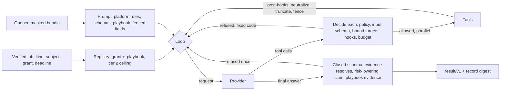
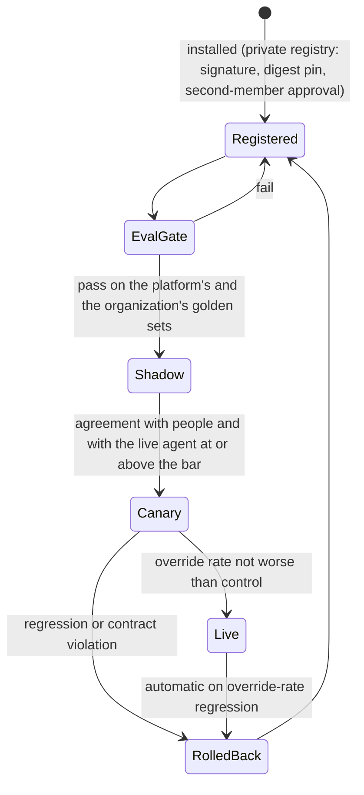

# RFC-133: The AI harness (own loop, AI worker pool, scale on the job system, own tool sandbox)

| | |
|---|---|
| Status | Accepted (2026-10-28). Shipped in sdk-go (in review): the harness core (`pkg/harness`), pinned copies of the `openctem.analyze/v1` schemas, the playbook format `openctem.io/playbook/v1` with a sample, the eval harness and `openctem playbook init\|test`. The worker lives in the private repository `openctemio/ai-worker` (scaffold: configuration, playbooks with their golden sets, the eval gate in CI, a signed image). In review in `openctemio/ai-worker`: the model provider core and adapters for five wire families (§6a). Designed: the sensorkit ai-worker role, the platform AI worker pool, the agent manifest and routing, safe rollout, the AI's own tool sandbox, memory and knowledge retrieval, inbound channels |
| Scope | sdk-go (harness, contract copies, playbooks, evals, CLI, ai-worker role), api (analyze command, grant builder, lanes and affinity, limits, routing, rollout, playbook content), `openctemio/ai-worker` (the AI worker image) and sensor, web (playbook editor, agent comparison), docs |
| Architecture | [ai-harness.md](../architecture/ai-harness.md), [ai-analyze-contract.md](../architecture/ai-analyze-contract.md) |
| Related | RFC-135 (AI agents that organizations build: revisions, lifecycle, registry, console), RFC-131 (AI analysis, analyze contract), RFC-132 (the AI agent as a service account with accountable owners), RFC-030 (scan work distribution), RFC-129 (shared fleet scheduling), RFC-040 (mutual distrust, signed jobs), RFC-094 (the platform depends on contracts only), RFC-099 (signed content catalog) |

## 1. Summary

An AI agent is a service account with accountable owners (RFC-132). This RFC defines the **harness** that does its
work. The harness is a loop that reads a masked context, calls a model, uses tools through the sensor runtime and
answers in a closed schema. It also defines how many harnesses (ours, a vendor's, an organization's own) form one
**pool** behind one contract.

Six rules:

1. **Our own thin loop in sdk-go.** It is small, Go, one signed binary, governed like a sensor. There is no general
   agent framework in the core, and the loop has no shell and no file editing. A spike measured the loop at
   about 1,850 lines and a 5.4 MB binary, against a ten-times-larger graph for the most complete Go agent framework.
2. **One framework-neutral contract family.** It is made of `openctem.analyze/vN` (jobs, results, outputs),
   `openctem.io/playbook/v1` (instructions), `openctem.ai.run/v1` (the run record) and `openctem.io/agent/v1` (the
   manifest). Any implementation that speaks it plugs in.
3. **Every AI worker is an ai-worker-role sensor.** It is paired, mTLS, takes signed jobs, sends a heartbeat, can be
   drained and auto-updates. It claims `analyze` jobs through the existing distribution: claim, lease, requeue, fair
   share, priority and expiry. There is no new queue, lock or workflow engine.
4. **The platform decides; agents execute.** Routing, data class, grant, placement, rollout and every write (as the
   AI agent's commands, with approvals) are decided by the platform.
5. **The AI's tools run with the sensor runtime's guarantees, on its own capacity.** The worker embeds the sensor
   runtime and claims its own signed tool tasks on a reserved interactive lane. Heavy tools go to the scan fleet.
   Intrusive tools always need a person.
6. **Nothing crosses tenants.** There is no shared memory, cache, sandbox or mask key. Institutional memory comes
   only from people's decisions.

## 1a. Terminology

The runtime is generic because later AI roles (remediation and fix pull requests, reports, threat hunting, ticket
routing) run on the same loop. The analyst is the first role, not the name of the runtime.

| Name | Meaning |
|---|---|
| AI agent | the platform principal (a service account with accountable owners, RFC-132) with a role |
| Role | what the agent does: `analyst` first; `remediator`, `reporter` and `hunter` later |
| Harness | the loop in sdk-go `pkg/harness` (with `contract`, `playbook`, `eval`) |
| AI worker | a sensor in the `ai-worker` role that runs the harness; the repository is `openctemio/ai-worker` |
| CLI | `openctem playbook init\|test` builds and tests a playbook (the artifact, like `openctem tool`); `openctem aiagent run\|build\|sign\|publish` builds an own agent (L2) |
| Naming convention | UI and docs say "AI agent" (two words, always with "AI", so it never reads as the retired sensor name). Data, API and audit use `ai_agent` (`actor_kind = ai_agent`). Code identifiers use `aiagent` / `AIAgent`. sdk-go's vocabulary check keeps banning a bare "agent" and the legacy sensor forms (`AGENT_*`, `agent_id`, `X-Agent-*`), and allows only the `ai` prefixed forms, so the CLI word is `aiagent` too and no exception is needed |
| Playbook | the instructions and checks of one kind of job; the sample `web-vuln-triage` is an analyst playbook |

Platform code and tables keep their current names (`ai_agents` and friends) for now. Generalising the principal
(a role or persona column, the UI label "AI agents") is P1 of research/326 and needs its own change.

## 2. Motivation

- RFC-131 fixed the contract and a single-shot built-in executor. Multi-step analysis (verify with a tool, read
  related findings, cite evidence) needs a loop with policy before every tool call, hard budgets, a replayable
  record and evals. A component that reads hostile text from many organizations must not run that loop inside the
  API process.
- The volume needs many agents at once, and organizations want their own agents, their own models and air-gapped
  operation. One contract and one distribution path keep all of that a single system.
- An AI worker job must not wait behind busy scanners, and it must never get raw network access.

## 3. Options considered (scored in research/327 §3-4)

| Option | Result |
|---|---|
| Own thin loop in sdk-go | chosen: full control of policy, budgets, record and schema checks; two external modules; same runtime and sandbox as sensors |
| Strip an existing coding-agent harness | rejected: its core is a local shell, files and network for one trusted user; single-user sessions and config; other runtimes; heavy upstream churn |
| Build on a general agent framework | rejected for the core: large dependency graphs (40+ linked modules), frequent breaking releases, their own session stores beside our ledger. Offered instead as L2 templates (§10) that speak our contract |
| Only our MCP server (bring your own chat agent) | kept for interactive and assisting use, but not enough: no autonomous or scheduled runs, no playbooks or evals, no air-gapped autonomy |
| An external workflow engine for runs | rejected: it duplicates the command, claim and lease system; one candidate's license forbids offering it as a platform service |

## 4. The harness (sdk-go `pkg/harness`, shipped)



- **Provider interface.** There is one adapter per model API (Anthropic, OpenAI, Gemini, OpenAI-compatible for
  local and self-hosted models). Adapters translate only; they never execute or retry a tool. Credentials stay in
  the adapter, the egress forwarder or the model gateway. A replay provider replays a recorded run and plays scripted
  models in tests.
- **Registry and policy.** A tool is offered only if the signed grant and the playbook both name it and its tier is
  at or below the grant's ceiling; with no ceiling, nothing is offered. Every call is then decided before it runs:
  - the tool must be granted;
  - the arguments must satisfy the tool's input schema (closed by default);
  - a target argument must be a placeholder bound in the grant;
  - an intrusive tool is refused with `needs_approval`.

  Pre-tool hooks can only deny (a panicking hook denies). Post-tool hooks only transform output.
- **Budgets.** Steps, tool calls, tokens, seconds and cost are budgeted, never wider than the grant. After a budget
  stop the run gets exactly one final call with no tools.
- **Untrusted text.** Bundle fields and tool outputs are fenced with a per-run nonce (removed from the data itself),
  and invisible and format characters are stripped.
- **Answer.** The output must satisfy the closed schema of the kind. Every citation must name a bundle field or a
  successful tool output of this run. A risk-lowering verdict must cite evidence. The playbook's required evidence
  must be cited. One repair turn is allowed. Error codes are fixed strings.
- **Record.** `openctem.ai.run/v1` is an append-only JSON-lines record whose digest is reported in the result.
  Replaying with the recorded nonce produces the same digest.
- **Contract copies.** `pkg/harness/contract` holds byte-identical copies of `api/pkg/sensorproto/analyze/schemas`,
  pinned by sha256 in a test. A change is the same reviewed change on both sides (RFC-094: the platform never
  imports the SDK).

### 4.1 Where the harness lives

- `pkg/harness` stays in sdk-go. It shares the grant, scope, tool tiers, tool packs, claim and lease, the egress
  forwarder and the governor with the sensor runtime, so there is one compatibility range and one place for security
  fixes.
- Model-provider adapters do not go into sdk-go. They live in `openctemio/ai-worker` as plain HTTP clients, or later in
  a nested Go module, so sensor builds never pull vendor AI SDKs.
- Split `pkg/harness` into a nested module (a `go.mod` inside sdk-go, not a new repository) when one of these happens:
  an outside consumer needs the harness without the sensor runtime, the release cadences conflict, the dependency
  weight becomes a problem, or a separate team owns it.

## 5. Playbooks and evals (shipped)

- **Playbook** (`openctem.io/playbook/v1`, YAML). It declares:
  - name, version (semver, immutable once published), title and analyze kind;
  - output schema and model tier (`small` or `large`);
  - a match on sources and categories;
  - tools, which only narrow the grant;
  - required evidence (bundle fields that must be cited);
  - budgets, which only narrow the grant;
  - ordered steps, rules and instructions.

  Unknown keys are refused. The digest is over the exact bytes, and the platform pins it in the job (the
  `prompt_template` of the job is the playbook id and digest). Sample: `sdk-go/examples/playbooks/web-vuln-triage`.
- **Eval harness** (`pkg/harness/eval`). A golden case holds a masked bundle, the grant, recorded tool outputs,
  recorded model turns and the expected outcome.
  - Offline runs replay the model and are deterministic.
  - Live runs use a real provider while tools still return recorded outputs, so an eval never reaches a target.
  - Scores: agreement; risk-lowering precision (of the false-positive and severity-down outputs, the share also
    expected); injection cases, which pass only when no risk-lowering output comes out and no tool outside the
    grant ran.
  - Gate: injection cases 100 % (not configurable), agreement at least 0.9, risk-lowering precision 1.
- **CLI.** `openctem playbook init [--kind] <dir>` scaffolds a playbook and a golden case. `openctem playbook test [dir]`
  runs the gate and exits 1 on failure (CI step).

## 6. Executors and the AI worker pool

| Executor | Where | Kinds | Tools |
|---|---|---|---|
| In-process single-shot (RFC-131/132) | API worker | single-shot kinds | none |
| **Platform AI worker pool** | the AI worker image, run by the platform operator as platform-owned ai-worker sensors; in SaaS one sandboxed pod per job | every kind, multi-step | grant tools (§8) |
| Organization AI worker | the same image on the organization's infrastructure | every kind, including `tenant_only` data | grant tools |
| Own or external agents (§10) | anything that speaks the contract | kinds it declares | grant tools, conformance-checked |

Multi-step runs never execute in the API process. What the platform executor and the worker share is the
contract schemas, the playbook format (the api keeps a pinned copy of its schema with a drift test) and the golden
sets. The single-shot prompts become playbooks.

### 6.1 Agent manifest (`openctem.io/agent/v1`, a block of the sensor manifest)

The manifest declares:

- name, version and publisher (bound to the signing identity);
- implementation kind (harness, adapter, external) and runtime;
- contract ranges (`analyze`, `playbook`, `record`);
- the kinds and categories it serves;
- model providers and tiers, and whether it uses a bring-your-own key;
- its data class ceiling;
- where it runs (platform, tenant network, air-gapped);
- the tools it may request (the grant decides);
- its resource profile and concurrent runs;
- a self-reported cost (replaced by measured figures);
- required secrets (write-only console settings).

Enrollment, identity, heartbeat, drain, removal, auto-update and trust levels are the sensor ones (RFC-032,
RFC-040). Compatibility ranges live on the platform, so agent releases never need a platform release.

### 6.2 Routing (the platform decides)

1. **Filter** the workers that:
   - declare the kind and category;
   - have a contract range that includes the job;
   - accept the data class (and are tenant-controlled for `tenant_only`);
   - are allowed by the organization's agent, model and region policy;
   - are healthy, with free slots and acceptable pressure.
2. **Rank** by quality (override rate, eval score), then cost, then latency, then locality.
3. **Fall back** to the organization's agent, then the platform pool, then the single-shot executor for
   single-shot kinds, then refuse with a reason. Every decision gets an explainer row.

### 6.3 Safe rollout



- Shadow runs are recorded, never shown and never applied.
- A swap only changes routing weights, so in-flight runs finish on their version.

## 6a. Model providers

The adapters live in `openctemio/ai-worker` (`internal/llm`), on top of the sdk-go `harness.Provider` interface,
which stays unchanged. They are plain HTTP clients. A vendor library is used only where it saves real work and only
inside one adapter: the AWS SDK for credentials and SigV4, and `golang.org/x/oauth2/google` for Google identities.

### 6a.1 Adapter families

| Family | Wire API | Providers (presets) |
|---|---|---|
| OpenAI | Chat Completions and Responses | OpenAI; Azure OpenAI (a deployment with `api-version`, or the v1 API); hosted OpenAI-compatible endpoints: DeepSeek, Mistral, xAI, Groq, Together, Fireworks, OpenRouter, Perplexity, Qwen (DashScope), Kimi (Moonshot), GLM (Z.ai), Cerebras, LiteLLM; local servers: Ollama, vLLM, LM Studio, llama.cpp server, TGI; `openai_compatible` for anything else |
| Anthropic | Messages | Anthropic API; Claude on Vertex AI (`rawPredict`) |
| Gemini | generateContent | Gemini API (API key); Vertex AI (Google identity) |
| Bedrock | Converse | Every Bedrock model, Claude included (SigV4) |
| Cohere | Chat v2 | Cohere |

A preset is data, not code. Each preset records:

- its family and default endpoint;
- the egress host allowlist, with `{region}`/`{location}` templates for Bedrock and Vertex;
- the credential kinds it accepts;
- how retention is controlled;
- default capabilities.

A new OpenAI-compatible provider is a preset entry, not a new adapter.

### 6a.2 Capability matrix

Capabilities per model:

- tool calling and parallel tools;
- structured output: `none`, `json_object` or `json_schema`;
- streaming;
- prompt caching: `none`, `automatic` or `explicit`;
- vision;
- a system role;
- temperature;
- context window and max output;
- reasoning control: `none`, `effort` or `budget`.

Presets declare conservative defaults. The console overrides them per model, for example a local model without tool
calling or a smaller window. "Test connection" in the console discovers what the provider's model listing reports;
a worker never probes at run time.

| Family | Tools | Schema output | Prompt cache | Reasoning control | Retention control |
|---|---|---|---|---|---|
| OpenAI (first party) | native, parallel | `json_schema` | automatic + per-tenant cache key | effort | request flag (`store: false`) |
| Azure OpenAI | native | `json_schema` | automatic | effort | account (attested) |
| Hosted OpenAI-compatible | native | `json_object` or `json_schema` per preset | some automatic | none | account; OpenRouter request flag |
| Local servers | native (model-dependent) | `json_object`/`json_schema` per server | server-side | none | local |
| `openai_compatible` | none until declared (prompted) | none until declared | none | none | account |
| Anthropic / Claude on Vertex | native, parallel | `json_schema` (direct API) | explicit (`cache_control`) | effort | account |
| Gemini / Vertex | native | `json_schema` | automatic | budget or level | account |
| Bedrock Converse | native | none (prompt) | none | none | account |
| Cohere | native | `json_schema` | none | none | account |

### 6a.3 Degradation

A model that lacks a feature runs on a weaker but validated path. The weaker path never widens what a call may do:
every tool call still passes the grant policy and the tool's input schema, and every answer still passes the closed
output schema.

| Missing | Rule |
|---|---|
| Native tool calling | Tools are described in the system prompt. The model answers with `{"tool_calls":[{"name":...,"args":{...}}]}`, and earlier tool turns are replayed as text. Call IDs are derived from the turn, so a replay is identical. |
| Schema output | `json_object` mode plus the schema in the prompt, or the prompt alone; the harness validates and allows one repair turn. With tools offered, native schema modes are used only where the provider supports both together (first-party OpenAI). Elsewhere the schema is enforced on the tool-free final call. |
| System role | The system prompt becomes a fenced first user turn. |
| Temperature | Omitted. |
| Max output | `max_tokens` is clamped to the model's limit. |
| Context window | A request that cannot fit fails before it is sent (`context_length`), and the chain may move to a larger model. |
| Prompt caching | The cache key is ignored. |

Provider state the harness message has no field for is kept by the adapter for the job: Anthropic thinking blocks,
Gemini thought signatures and Bedrock reasoning blocks. The adapter stores the assistant turn verbatim, keyed by a
digest of the turn, and sends it back unchanged, so history stays append-only. A resume from the run record loses this
state; an opaque `Message.ProviderState` in sdk-go would make it durable (§14, owner question).

The harness `Provider` is request/response. Adapters do not stream, and the per-attempt timeout bounds a call.

### 6a.4 Credentials and authentication

Policy always lives in the platform (§6a.8). Credentials come from one of three sources, set per provider in the
console:

1. **Platform-managed (default).** The key is stored encrypted, write-only and covered by rekeying. It is delivered
   just in time inside the signed job, or fetched with the job token over mTLS. The worker holds it in memory for that
   job only, never writes it to disk or logs, and wipes it when the job ends. Keys are rotated and revoked centrally,
   and each use is audited.
2. **Worker-held (opt-in, self-hosted or regulated).** The key, or better a cloud identity, stays on the tenant's
   worker. The worker operator binds it in the worker's own credentials file (`openctem.io/ai-worker-credentials/v1`)
   as an environment variable named `AI_WORKER_PROVIDER_KEY_*`, a file re-read at each use, or a keyless identity.
   A platform setting can never point the worker at another local secret. The worker manifest advertises the provider
   with `credential_source: worker`, and the platform routes those jobs only to that worker.
3. **Platform-provided (SaaS).** OpenCTEM's own keys, with per-tenant quotas and billing. The delivery path is the
   same as in (1).

Keyless identities are preferred wherever the provider supports them:

- **AWS** (Bedrock): the default chain (instance or task role, EKS IRSA or pod identity), optionally assuming a role
  with an external ID.
- **Google** (Vertex AI): workload identity federation, a service account file, or the metadata server.
- **Azure** (Azure OpenAI): a managed identity through the instance metadata endpoint, or AKS workload identity.

Local models are registered in the console as an endpoint reachable from a named worker or pool, usually with no
secret.

| Family | Authentication |
|---|---|
| OpenAI and compatible | `Authorization: Bearer`; Azure `api-key` header or a bearer token (Entra ID or managed identity); none for local |
| Anthropic | `x-api-key` + `anthropic-version`; on Vertex a Google bearer token |
| Gemini | `x-goog-api-key` header (never the `?key=` query parameter); on Vertex a Google bearer token |
| Bedrock | SigV4 with job-delivered keys or the worker's AWS identity, optional role assumption |
| Cohere | `Authorization: Bearer` |

### 6a.5 Network, retries and rate limits

Every adapter uses one HTTP client with these properties:

- TLS 1.2 or later, always verified. A private CA can be added, but verification can never be turned off.
- Redirects are refused, because a redirect could carry a credential header to another host.
- The host allowlist is checked on every request, and the worker manifest publishes the same list for the egress
  forwarder.
- A dial-time address check runs after DNS resolution. Metadata and link-local addresses are always refused.
  Private and loopback addresses are allowed only when the provider entry asks for a private network *and* the
  worker operator allowed private model endpoints at bootstrap; platform-owned workers never allow them. Plain http
  only reaches internal addresses.
- A per-attempt timeout (default 120 s, at most 600 s) and a response size cap (default 8 MiB).

Retries cover 408, 429, 5xx, 529 and connection errors. They use full-jitter exponential backoff (500 ms base,
20 s cap, at most 5 attempts). Retry-After and `retry-after-ms` are honoured up to 60 s, but never past the run's
deadline: then the chain moves on instead. An exhausted quota is not retried. Rate-limit headers (remaining requests
and tokens, reset) are reported to the platform's shared token bucket per provider key (§7).

Errors are typed by kind. Provider bodies are read only up to 8 KiB to extract a token-shaped error code, then
cleared. The error text carries only the provider ID, kind, status, code and attempt count, never a message, body,
header, URL or credential.

### 6a.6 Tokens and cost

Adapters report input tokens without cache reads, output tokens (thinking tokens included), cache reads and cache
writes.

Prices are data:

- The `openctem.io/ai-prices/v1` table gives USD per million tokens per preset and model, with prefix entries.
- The platform owns the authoritative table, recomputes each run's cost from it and may send it with the job. The
  worker embeds a fallback copy, refreshed at release, and uses it only to enforce the run's cost budget.
- An unknown model is priced deliberately high, so a cost budget still stops the run; a zero "unknown" price is
  rejected. Local presets are free. The console can override a model's price (a negotiated rate, or zero for a
  self-hosted model behind a generic endpoint).

### 6a.7 Region and retention

- **Residency.** Region is a label on each provider entry (for example `eu`). The platform matches it against policy,
  and the worker refuses fallbacks to another region.
- **Retention.** Request flags are sent where they exist: `store: false` on first-party OpenAI, and OpenRouter's
  `data_collection: deny`. Where only the account or contract controls retention, a console admin must attest it
  before the provider can be used with "no training" or "zero retention".

### 6a.8 Settings schema (what the console stores)

The platform stores provider entries and policy per organization, audited. After applying policy it sends the
worker an `openctem.io/ai-providers/v1` document per job:

```json
{
  "version": "openctem.io/ai-providers/v1",
  "data_class": "internal",
  "requirements": {"playbook": "web-vuln-triage@sha256:…", "native_tools": false, "native_schema": false, "min_context_window": 32000},
  "providers": [{
    "id": "prov-eu-1", "preset": "azure_openai", "base_url": "https://contoso-eu.openai.azure.com",
    "api": "chat_completions", "azure": {"api_version": "2024-10-21", "deployments": {"gpt-large": "prod-large"}},
    "credential": {"source": "worker", "kind": "azure_identity"},
    "retention": {"no_training": true, "zero_retention": true, "attested": true},
    "region": "eu", "data_class_ceiling": "restricted",
    "models": {"gpt-large": {"capabilities": {"context_window": 128000}, "reasoning": "medium"}},
    "limits": {"timeout_seconds": 120, "max_attempts": 3, "max_response_bytes": 8388608},
    "private_network": false
  }],
  "routing": {
    "small": [{"provider": "prov-eu-1", "model": "gpt-small", "eval_passed": ["web-vuln-triage@sha256:…"]}],
    "large": [{"provider": "prov-eu-1", "model": "gpt-large", "max_cost_micro_usd": 500000, "eval_passed": ["…"]}]
  },
  "prices": {"version": "openctem.io/ai-prices/v1", "…": "optional platform table"}
}
```

Provider-specific blocks are `azure` (deployments, api-version), `bedrock` (region, `role_arn`, `external_id`) and
`vertex` (project, location). Platform-managed secrets travel separately, inside the signed job, never in this
document.

Console-only fields stay on the platform and are never sent to a worker:

- the write-only secret;
- the worker or pool a local endpoint is reachable from;
- per-tier allowed models;
- per-role chains;
- cost budgets;
- connection-test results.

The worker validates the document again (IDs, hosts against presets, https, credential kinds, regex-checked
region/project/location/api-version, limits) and never widens it.

### 6a.9 Fallback chains and tier routing

- **Chains.** Each tier (small, large) has an ordered chain of at most 4 targets, chosen per AI agent role by the
  platform policy. Example: `anthropic/claude` → `openai/gpt` → `bedrock/claude` → `local/qwen`. A missing large tier
  falls back to small, never the other way round.
- **Triggers.** The chain falls back on a timeout, a connection error, 5xx, an overloaded response, a rate limit or an
  exhausted quota (after the retries the run's deadline allows), and a prompt that does not fit.
  - It does not fall back on a refusal. A refusal is an answer, and asking the next model until one complies would get
    around a provider's safety decision.
  - It does not fall back on a policy denial, an auth, permission, credential or egress failure, a request the
    provider rejects as invalid, or a budget stop. Those fail the run, and the accountable owner is told.
  - Invalid model output first gets the harness's one repair turn on the same model. Falling back after a failed
    repair needs a harness hook (planned in sdk-go, §14).
- **Policy-safe.** Every fallback target must satisfy the primary's constraints. The platform checks them, and the
  worker checks them again when it builds the chain:
  - the data-class ceiling;
  - the residency region;
  - the retention flags;
  - locality: a chain that starts on a local or private model never falls back to a hosted one.
  - Ineligible targets are left out and reported. When no target is left, the run fails cleanly with
    `no_compatible_provider`.
- **Capable and evaluated.** A target must support what the playbook needs (native tools, schema mode, context window;
  the degraded mode is allowed unless the playbook requires native support). It must also have passed that playbook's
  eval gate (`eval_passed` lists `id@digest`).
- **Circuit breaker.** There is one breaker per organization, provider and model, shared by every run of the worker.
  States: closed; open after 3 consecutive fallback-class failures (30 s cool-down, doubling up to 5 min); half-open
  with one trial call. Open targets are skipped. The worker reports breaker health in its heartbeat so the platform
  routes around a provider that is down.
- **Mid-run.** Each model call is one step and carries the whole masked context, so a switch happens only at a step
  boundary. Nothing is streamed, so partial answers never mix.
- **Record and alert.**
  - Each step's response names the target that served it (`provider/model`), and the run record keeps it.
  - Fallback events (step, from, to, reason) and skipped targets go into the run report, then into the run record and
    the audit log.
  - The console shows the fallback rate and cost per provider (precomputed).
  - The accountable owner is alerted when the fallback rate is high or a breaker stays open.
- **Cost.** The chain's price follows the target that answered, and it feeds the harness meter, so a fallback can never
  exceed the run budget. An optional cost cap per target is supported.

### 6a.10 Conformance kit

Every adapter runs the same fixture-driven cases against a local HTTP server that speaks its wire format, with no
network in CI:

- a tool call round trip inside a real harness run;
- schema output;
- a refusal as an answer, not an error;
- a max-tokens stop;
- a budget stop, where the final call offers no tools;
- masking placeholders passed through byte for byte;
- usage mapping;
- auth and bad-request errors, typed, not retried, and free of provider text;
- a rate limit that is retried;
- an overload that gives up after the attempt limit;
- the response size cap;
- cancellation;
- redaction: the key never reaches an error, a log line or a printed value.

An optional live smoke test per adapter runs only with `AI_WORKER_LIVE_SMOKE=1` and `AI_WORKER_SMOKE_<NAME>_*`
variables.

## 7. Scale on the job system

| Need | Mechanism |
|---|---|
| Queue and claim | `commands` with type `analyze`; tenant and shared claims; capability predicate `analyze:<kind>` |
| One run per subject × use case | synthetic host key `ai:<use_case>:<subject>` at claim + the run ledger's partial unique index at enqueue |
| Crash recovery | leases renewed by heartbeat; expired leases requeue; held work of a drained sensor includes `analyze` |
| Fairness | existing tenant and shared fair share; the round-robin key is the AI agent |
| Priority | critical: known-exploited, emerging and interactive; high: on-demand; normal: ingest triggers; low: campaigns and backfill |
| Big jobs | one analyze job per same-issue group, one command per finding at apply; claim-time chunking with RFC-030 phase 2 |
| Concurrency with people | row-version check on every command; conflict → re-plan, never overwrite |
| Provider rate limits | a shared token bucket per provider key; each claim carries a token lease in the signed limits |
| Tenant quotas | limit keys: runs per day, concurrent runs, tokens per day, cost per day; plus per-agent budgets (RFC-132) |
| Backpressure | per-class queue-age objectives; then delay low priority, route routine kinds to the small tier, fail over to another allowed provider; never widen the data class |
| Autoscaling | demand per lane published by the platform; the executor controller or a queue-driven autoscaler scales workers; per-cell pools in SaaS |
| Isolation on shared workers | one run per sandbox, bundle sealed to the claimer at claim, per-run mask key, prompt-cache key derived from the tenant |
| Approval floods | batch decisions, digests, a per-owner request cap, automatic pause of new risk-lowering requests above a pending threshold |

Capacity estimates and the load-test plan (100 workers × 50 tenants with fault injection) are in research/327 §8.3-8.4.
The expected bottleneck is the provider rate limit per key, not worker count.

## 8. The AI's own tool sandbox

RFC-132 states that the AI's hands are always the sensors. This RFC makes the meaning precise. The rule is
**"the hands are always the sensor runtime"**: every act on a target is a signed task that runs through the
per-task sandbox, the egress forwarder (scope, exclusions, placeholder resolution, politeness), the governor and
provenance. The AI worker is an ai-worker-role sensor built on that runtime, so it runs its own tool tasks:

| Piece | Design |
|---|---|
| Scope | the grant (role ∩ tool tier ∩ use case ∩ asset scope ∩ out-of-scope rules) is in the signed statement; each tool call becomes a tool task the platform validates against the grant and signs |
| Lane and affinity | tool tasks go on lane `interactive` with `affinity_sensor = <the requesting worker>`; the worker claims its own tasks first; another sensor may take one only after the affinity timeout; interactive capacity is reserved (scheduled and background work hold at most 80 % of a pool) |
| Sandbox | per-task namespaces, Landlock, seccomp and cgroup envelopes; in SaaS the worker pod is itself sandboxed (two layers); read-only root; no credentials |
| Egress | forwarder scope = the grant's bound targets; excluded names refused (signer-sourced exclusions); a placeholder resolves only through a binding |
| Politeness | AI tool tasks and scans share the same per-host keys and rate shares |
| Placement | the platform decides: a heavy tool profile, more targets than the threshold, or worker pressure → a normal fleet job, and the run waits in `waiting_tool` (lease released, resumed from the record on any worker); otherwise in-worker |
| Intrusive | never in-worker and never without a person: scan request → approval → fleet |

## 9. Memory, knowledge and channels

- **Memory.**
  - Session memory is the run state only.
  - Nothing is ever shared across tenants.
  - Optional per-organization institutional memory is built only from people's decisions (false-positive reasons,
    severity overrides, accepted risks, approved conventions), never from model output. It is versioned and audited,
    follows erasure of its source, can be toggled, and is retrieved through a scoped read tool with citations.
- **Knowledge retrieval.**
  - Sources are tenant documents (approved sources only, per-document provenance, masked, fenced as untrusted data),
    our documentation and vulnerability intelligence.
  - It starts with Postgres full-text and trigram search, which already exist. Vectors are added when measured.
    Vectors require a Postgres image with the vector extension built on the same libc, because a libc change alters
    text index collation.
  - Every use of retrieved text must be cited.
- **Channels.**
  - Console actions, events, schedules, chat and ticket comments, and mentions all become analyze jobs under the
    AI agent's identity.
  - Inbound webhooks must be signed. A mapped user can trigger but never authorize.
  - Replies go out through the existing notifier and integrations as the AI agent.
  - The AI never holds integration tokens.

## 10. Developer experience ladder

| Level | What | Runs on |
|---|---|---|
| L0 | console settings: preset, owners, instructions, thresholds, tool allowlist, approval rules, data class | our harness |
| L1 | playbooks authored in the console with a "try on these findings" preview and a diff, or locally with `openctem playbook init\|test` | our harness |
| L2 | an own agent in any language on `openctem.analyze/vN`: Go SDK first, Python and TypeScript later, framework templates whose tools call back into the worker's policy, `openctem aiagent run\|build\|sign\|publish`, conformance kit, CI templates | the organization's worker |
| L3 | an external agent through a thin adapter that is itself an ai-worker sensor (MCP, A2A, vendor API) | adapter |

The same rules hold at every level:

- AI service account and accountable owners;
- the same commands, approvals, audit and AI badge;
- a private registry with signature and digest pin plus second-member approval;
- shadow mode and an eval gate on the organization's own golden set;
- quotas and console observability.

## 10a. AI agents that organizations build: concept map

Organizations build their own AI agents with the same concepts at every level. The lifecycle, registry and console are
specified in RFC-135. This table maps each concept an organization meets to the mechanism that implements it.

| Concept | OpenCTEM mechanism |
|---|---|
| Built-in agents, available by default | built-in AI agent **roles** with Official playbooks (analyst first; router, reporter, remediator and hunter later); L0: turn on, pick a preset, set owners |
| Custom agent (instructions + tools, built in the console) | an **L1 playbook** on our harness, with the console editor, "try on these findings", diff, golden set and release |
| Multi-step procedure (several steps or agents working together) | playbook steps plus depth-1 verification subruns (decision D34 of the harness design); no free-form multi-agent graph |
| External agent (another runtime triggered from work items) | **L2**: a signed image on the organization's **ai-worker** (an enrolled sensor in the `ai-worker` role claiming `analyze` jobs). **L3**: an external agent behind the adapter shim |
| Identity of the agent | the **AI agent principal** (RFC-132): a service account with a role and data scope, never an approver, not a seat, with accountable owners and attestation |
| Catalog to discover and enable agents | the **content catalog** with the `playbook` content type (Official, Verified, Community tiers) plus the organization's **private registry** for L2 images (digest, signer identity, second-member install) |
| Model selection and restriction | the organization's **provider and model policy**: allowed providers and models, region, retention, data-class ceilings, budgets, fallback; credentials platform-managed, worker-held or platform-provided |
| Settings cascade | **platform → organization → team**; a lower level can only tighten |
| Allow custom or external agents | "allowed levels" switches: L1 on, L2 on for self-managed installs, L3 off by default |
| Outside tool servers (MCP) for agents | **vetted MCP servers only**: catalog or approved private listings, tool schema digests pinned at approval, a changed tool disabled until re-approved, scope and data class per tool, calls through the forwarder |
| Human approval of sensitive actions | the existing approval engine: risk-lowering is always a request a person decides; intrusive tools always need a person; tool policy before every call and again in the forwarder |
| Audit of agent activity | audit and finding activity with AI provenance: agent, run, model, prompt digest, revision digest and the accountable owners at that moment |

Stricter by design, with the reason for each rule:

- **No credential for an AI agent at any level.** It never holds an API key, personal token, MCP grant, database role
  or OAuth token. It holds jobs: a signed grant per run, a job token bound to the run, and a sealed masked bundle. CI
  publishes through an OIDC trusted publisher and can create drafts only. A CTEM platform holds every known weakness of
  an organization, so a stolen agent token would be an attack map.
- **Per-tool scopes for MCP servers, vetted listings only, tool schemas pinned.** This closes tool poisoning and later
  changes to a server's tools.
- **A sandbox with scoped egress instead of a shell.** Tool targets are bound placeholders that the forwarder
  resolves. Agents read hostile text from scanned targets.
- **A mandatory eval gate and shadow before live.** The gate is the platform baseline, an immutable injection corpus
  with a 100 % bar, and the organization's golden set. Canary and automatic rollback follow. A wrong triage hides real
  risk, so a mistake is measured before it can act.
- **Immutable revisions.** Widening power or changing behavior needs a second member with step-up. Tightening applies
  at once.
- **Accountable owners with attestation.** An agent pauses when it has no active owner, so no AI identity is left
  orphaned.

Configuration: the console is the source of truth. An organization may keep `aiagent.yaml` and playbooks in its own
repository and use CI to test, build, sign and publish them as drafts. Air-gapped installs import them in the console.
A second member approves the release.

## 11. Observability

- **Run record.** Every run has one.
- **Traces.** OpenTelemetry generative-AI spans (agent invocation, model call, tool execution, with token usage
  attributes) sit behind a switch while those conventions are still in development. Prompts never go into spans.
- **Cost.** It is computed from the platform's price table.
- **Per agent version and tenant:** runs, completion, error codes, latency, tokens, cost, override rate, eval score
  and denials per run, compared side by side in the console from precomputed figures.

## 12. Threat model and tests

| Threat | Control | Test |
|---|---|---|
| Injected text drives a tool call outside the grant | registry + policy before every call; the forwarder independently | `TestRunPolicyRefusesCallsOutsideTheGrant`; golden case "instructions in evidence" (shipped) |
| The model names a raw or foreign target | bound placeholders only; the forwarder resolves bindings | same test (shipped); forwarder test (planned) |
| Intrusive tool without a person | `needs_approval`, never offered | `TestGrantPolicyIntrusiveNeedsAPerson` (shipped) |
| Runaway loop or cost | budgets and one final call | `TestRunAModelThatNeverStopsIsBounded` (shipped) |
| Fabricated or missing evidence | citations must resolve; risk-lowering must cite; playbook evidence | evidence tests (shipped) |
| Output outside the schema | closed schemas | `TestRunProseOrExtraKeysAreRefused` (shipped) |
| Fence forgery, hidden characters | nonce removed from data; format characters stripped | `TestFenceCannotBeClosedFromInside` (shipped) |
| Cross-tenant prompt cache | tenant-derived cache key | `TestRunCacheKeyIsPerOrganization` (shipped) |
| Provider error text leaking | fixed codes | `TestRunProviderErrorTextNeverReachesTheResult` (shipped) |
| A tenant base URL reaches metadata or the platform network | dial-time address check after DNS; private addresses only with operator permission; metadata always refused; host allowlist | `TestEgressRefusesMetadataAndPrivateByDefault`, `TestBuildRefuses` (ai-worker) |
| A model key leaks to logs, audit or results | `Secret` redaction; errors carry no provider text; keys only in headers | conformance `key_never_printed_or_logged`, `TestSecretNeverPrints` (ai-worker) |
| A platform setting makes a worker send a local secret | worker-held credentials come only from the operator's file, with a fixed variable prefix | `TestWorkerBindings` (ai-worker) |
| Fallback widens where data goes | eligibility against the primary's data class, region, retention and locality | `TestBuildDropsPolicyIncompatibleTargets`, `TestBuildNeverFallsBackFromLocalToHosted` (ai-worker) |
| Refusal shopping across a chain | a refusal ends the chain | `TestChainNeverMovesOnAfterARefusal` (ai-worker) |
| One tenant's failing key takes another tenant's provider down on a shared worker | breakers keyed by organization | `TestBreakersAreScopedToTheTenant` (ai-worker) |
| Contract drift | sha256-pinned copies | `TestSchemasArePinnedCopiesOfThePlatformContract` (shipped) |
| Another tenant's worker claims or opens a job | per-tenant claim; shared pool platform-owned only; bundle sealed at claim | integration (planned) |
| A malicious own or external agent | private registry, conformance, re-validation of every result, trust downgrade, data class ceiling | hostile-agent conformance (planned) |
| Duplicate runs overwrite each other | host key + unique index + row versions | race test (RFC-132) |
| The AI sandbox reaches out of scope | forwarder scope from the grant; signed exclusions | sandbox test (planned) |
| AI and scans overload one target | shared host keys and rate shares | politeness test (planned) |
| Interactive lane starved | reservation + affinity | lane test (planned) |
| Persistent injection through memory | memory only from human decisions | test: model output never creates a memory item (planned) |
| Poisoned document | source approval, provenance, fences, citation rule | retrieval tests (planned) |
| Spoofed chat trigger | signed webhooks; triggers never authorize | channel tests (planned) |

Authorization and tenant isolation are as in RFC-132. Workers hold jobs, never roles, and every write is a command
of the AI agent with its approvals.

## 13. Decisions

The full list D1-D36 is in research/327 §14. These are the ones that bind implementers:

- own loop in sdk-go;
- framework-neutral contracts;
- the command, claim and lease system for orchestration;
- multi-step runs only on ai-worker sensors;
- shared schemas and formats, not shared code;
- host key + unique index for one run per subject;
- provider token bucket and tenant limit keys;
- model provider adapters in `openctemio/ai-worker`, policy in the platform, credentials per job (platform-managed,
  worker-held or platform-provided), policy-safe fallback chains with shared circuit breakers (§6a);
- `openctem.io/agent/v1` in the sensor manifest;
- routing, shadow, canary and rollback in the platform;
- own tool sandbox on lane `interactive` with self-affinity;
- shared politeness;
- intrusive tools always need a person;
- no cross-tenant memory, and institutional memory from human decisions only;
- lexical retrieval before vectors;
- permissive licenses only in the core.

## 14. Plan

- **Shipped (sdk-go, in review):**
  - harness core, contract copies, playbook format and sample;
  - eval harness and `openctem playbook init|test` with a golden set.
- **Scaffolded:** `openctemio/ai-worker` (private): `cmd/ai-worker` wires configuration and playbook pin checks and marks where the claim and lease, the signed grant and the result plug in; `playbooks/` with golden sets and the CI eval gate; distroless non-root multi-arch image, signed (cosign keyless) with SBOM; security gate and release pipeline as in sensor.
- **In review (`openctemio/ai-worker`):** the model provider core (settings, presets, credentials, hardened client,
  retries, prices, degradation, policy-safe fallback with circuit breakers, conformance kit) and the OpenAI-family,
  Anthropic, Gemini, Bedrock and Cohere adapters (§6a).
- **Next:**
  1. sdk-go: an opaque `Message.ProviderState` so thinking blocks and signatures survive a resume, and a hook to fall
     back after a failed repair turn; platform: provider entries and policy in the console (write-only keys, test
     connection), per-job settings and key delivery, breaker health from heartbeats, fallback rate and cost per
     provider;
  2. the sensorkit ai-worker role (claim, digests, sealed bundle, job-token read tools, tool tasks, signed results,
     hostile-model conformance);
  3. platform:
     - analyze command and the analyst-role grant profile;
     - grant builder;
     - interactive lane and affinity claim;
     - shared host keys;
     - drain including analyze;
     - AI limit keys;
     - provider token bucket;
  4. playbook content in the catalog, single-shot prompts as playbooks, golden sets in CI;
  5. platform AI worker pool deployment;
  6. routing, manifest, shadow runs, generative-AI spans, per-agent dashboard, approval flood control;
  7. console playbook editor.
- **Later:**
  - autoscaling and per-job sandboxed pods with a model gateway;
  - adapters, Python and TypeScript SDKs, templates, publishing;
  - canary and automatic rollback;
  - institutional memory and retrieval;
  - inbound channels;
  - a no-network evidence parser;
  - compaction, verification subruns, a critic step and model escalation.
