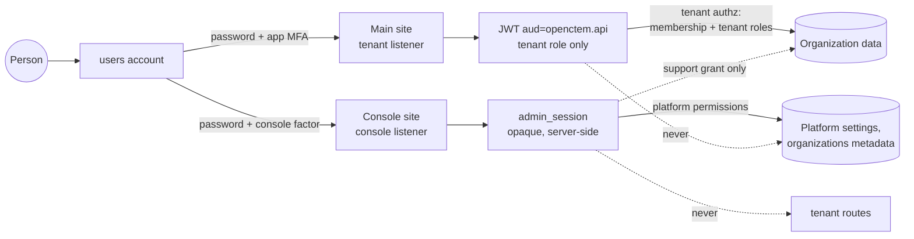
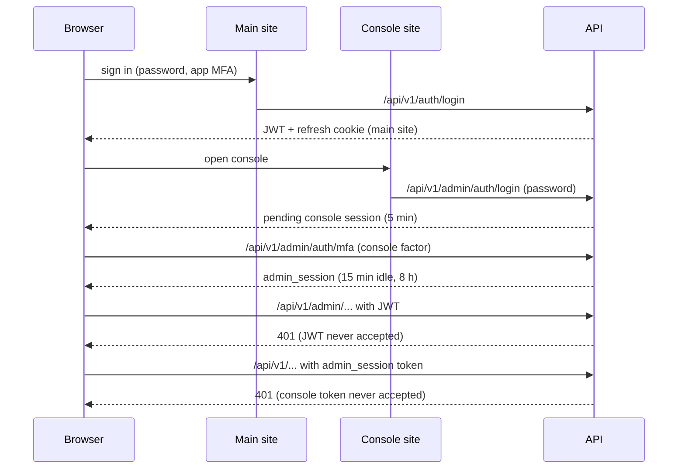

# RFC-134: Platform administration (one identity, platform roles, staff governance)

| | |
|---|---|
| Status | Accepted (2026-10-28). In review: one identity (an administrator's account signs in to the app as an ordinary member; break-glass accounts stay console-only). Designed: platform roles and permissions, role management in the console, staff governance for the hosted service |
| Scope | api (sign-in, console authorization, platform role tables), web/console (role management, hiding by permission), web (sign-in page), docs |
| Architecture | [platform-console.md](../architecture/platform-console.md), [authorization-matrix.md](../architecture/authorization-matrix.md) (Platform admin routes) |
| Related | RFC-022 (the console; this RFC is its revision 25), RFC-063 (support access), RFC-078 (security keys), RFC-050 (member lifecycle) |

## 1. Problem

1. **Two accounts for one person.** A platform administrator's account could not join an organization (a database
   trigger) and was refused on the main site. A person who runs the platform and also works in an organization
   needed two accounts, two passwords and two second factors.
2. **One all-powerful role.** Console authorization had three fixed tiers (`super_admin > ops_admin > readonly`)
   hard-coded at each route. There was no way to give a support engineer the support actions without the rest of
   `ops_admin`, an SRE the sensor fleet without `super_admin`, or an auditor the audit log and nothing else.
3. **The hosted service needs staff governance** beyond the self-managed console: staff sign-in through the
   operator's identity provider, no standing access, a second person for sensitive acts, scoping per region,
   evidence for audits.

## 2. Decisions

| # | Decision | Reason |
|---|---|---|
| D1 | **One account.** Being a platform administrator is an attribute of the one `users` account (its `admin_users` row and platform role assignments), effective **only on the console plane**. The account signs in to the app and is an ordinary member of the organizations that invited it, visible to them like any other member. | One person, one credential set to protect and offboard. The attribute cannot leak into the app because the app never reads it. |
| D2 | **Separate credentials per plane.** App: JWT access token (`aud=openctem.api`) and the main site's refresh cookie. Console: an opaque, server-side session token (`admin_session`, SHA-256 stored), never a JWT. The console accepts only its cookie; the tenant API parses only JWTs. | A stolen app token or an app-origin script cannot act on the console, and a stolen console token reads nothing in the app. |
| D3 | **Console entry always needs its own sign-in and second factor**, even while an app session is live: TOTP, security keys (RFC-078) or a recovery code; the platform identity provider's MFA is trusted only for an already-bound identity with configured `acr`/`amr`. An organization's SSO never opens the console. | The console controls every organization; a phished password or a session bug in the app must not yield platform power. |
| D4 | **Short console sessions**: 15 minutes idle, 8 hours absolute, step-up for protected actions, time-boxed elevation, at most three verified sessions (unchanged from RFC-022). | Bounds the window of a stolen console cookie. |
| D5 | **No implicit tenant access.** Platform permissions never authorize a tenant route. Console paths that create a membership never reuse an existing account; an administrator cannot approve an access request made with their own e-mail. Tenant data reaches the console only through a customer-created, time-boxed, read-only support grant (RFC-063). Never impersonation. | Customers of a multi-tenant service must see and control every staff access to their data. |
| D6 | **Break-glass accounts stay console-only**: the database refuses a membership for a break-glass administrator and refuses to mark an account that is a member as break-glass. The main site also refuses to sign a break-glass account in (password, refresh, exchange, social and SSO paths) with the generic wrong-credential answer, and logs a security event; the two triggers share one advisory lock per account, so a concurrent membership insert and flag change cannot both pass. | Break-glass credentials are sealed for emergencies; using them in an organization would unseal them. |
| D7 | **Platform roles in every edition**: a `platform.*` permission catalogue in code, built-in roles, separate tables owned by the console database role, deny by default at the route layer. | Least privilege is a security property, and security is never an edition feature. |
| D8 | **Platform and tenant authorization never meet**: disjoint namespaces (`platform.` prefix), no foreign key between the two sets of tables, no tenant database grant on the platform tables, no tenant response carrying a platform role. | A tenant administrator can neither read nor grant platform power, nor learn who holds it. |
| D9 | **No grant above one's own permissions**, no self-assignment; granting or revoking the platform owner role needs a second platform owner (four-eyes, RFC-022 revision 24); the console warns while fewer than two named platform owners exist. | One hijacked session cannot take over or lock out the platform. |
| D10 | **No account merge.** A person with two accounts today has the organization invite the administrator's account, then offboards the old one. | The same result with existing, audited operations; a merge would rewrite ownership and history. |

### Relation to the common single-identity administrator model

| Topic | Common model | Ours | Why we are stricter |
|---|---|---|---|
| Identity | Administrator is a flag on a normal user | Same (D1) | — |
| Using the product | Administrator uses the product as a normal user | Same (D1) | — |
| Entering administration | Re-authentication optional | Always its own sign-in and second factor (D3) | The console is a separate site with power over every organization |
| Access to customer data | Administrators see everything by default | Nothing implicit; only customer-visible support grants (D5) | Multi-tenant service: customers control staff access |
| Least-privilege administrator roles | Optional, in some editions | Built-in roles in every edition (D7) | Security is never an edition feature |
| Auditor | A separate kind of user | A read-only platform role | One identity model; a role is revocable without re-creating the person |

## 3. One identity

- The membership trigger of RFC-022 revision 2 and the main-site refusal of revision 23 are removed (migration
  `003539`). Break-glass accounts keep a narrower trigger (D6).
- `/users/me` no longer carries `is_platform_admin`; the main site's answers never mention a platform role.
- Existing administrator accounts keep working on the console unchanged; they can now be invited to organizations.
- Removing the platform attribute (deactivating or deleting the administrator, or removing every platform role)
  never deletes the account. Suspending or locking the account ends both planes: the console checks the linked
  account on every request, and a credential change ends console sessions (RFC-022 revision 22).
- Audit: console actions go to `admin_audit_logs` with the administrator as actor; app actions go to the
  organization's audit log as the user; console actions that touch an organization are written to its log with a
  console actor (`console:` or `support:`). The plane of every action is recoverable from the log it is in.

## 4. Platform roles and permissions

### 4.1 Model

- **Catalogue in code** (`pkg/domain/platformauthz`): permission keys `platform.<area>.<action>`, each marked
  *baseline* when an unelevated session may use it (the reads), with a description for the generated reference.
- **Tables** (console database role only; the tenant role has no grant):
  `platform_roles` (key, name, description, built-in, tier), `platform_role_permissions` (role, permission, with
  `CHECK (permission LIKE 'platform.%')`), `platform_role_assignments` (administrator, role, granted by, granted
  at, scope `*` reserved for per-cell scoping). No foreign key to or from `roles`, `role_permissions`,
  `permissions`, `user_roles` or `tenant_members`.
- **Built-in roles**, re-asserted from code at start:

| Role | Holds |
|---|---|
| `platform_owner` | every permission |
| `platform_admin` | reads, organizations create/lifecycle/first owner/limits, member lists, account support, announcements, feeds, AI clients, support access |
| `operator` | reads, sensor fleet, feeds, organization suspend/unsuspend |
| `support` | reads, member lists, account support, support access |
| `security_auditor` | every baseline read, administrator roster and approvals (read), no writes, no member personal data |
| `billing` | reads, organization limits and plans |

- **Resolution on every console request**: union of the assigned roles' permissions. With elevation required (the
  default), an unelevated session holds only the baseline part of that union; an elevated session acts as **one
  assigned role** (15 to 60 minutes, reason, fresh step-up) plus the baseline part.
- **Deny by default**: one route-to-permission inventory for the console API. The console route registration looks
  every route up; a route with no entry stops the server from starting (and fails the route tests). Entries are a
  permission, `self` (the caller's own session and factors) or `public` (sign-in steps). The check runs after
  authentication and before step-up.
- **Grants**: `platform.roles.assign`, step-up and reason; the role's permissions must be a subset of the caller's
  own; no self-assignment; owner grants and revocations need a second owner; every change audited at high severity
  and announced to the other administrators.
- **Console UI**: `GET /api/v1/admin/auth/validate` returns the acting permissions and the maximum; navigation and
  pages hide by permission. Hiding is a convenience: the API decides.
- **Reference page**: generated from the catalogue and the inventory, like the tenant permission reference.
- **Transition**: the three tiers map to `platform_owner`, `platform_admin` and `security_auditor`; the tier column
  stays, derived from the assignments, until the next contract migration removes it.

### 4.2 Separation tests

- No tenant permission starts with `platform.`, every platform permission does; each role service refuses the
  other namespace; database checks on both sides.
- No foreign key between the platform and tenant authorization tables; no tenant database grant on the platform
  tables.
- For an account that holds platform roles and is a member of an organization, no tenant endpoint (members, roles,
  permission reference, audit, MCP, exports) returns a platform role or flag; a tenant administrator cannot reach a
  console route with a tenant token.

## 5. Staff governance for the hosted service

The hosted service runs the same console with stricter policy:

- **Staff identity**: console sign-in only through the operator's identity provider (`require_idp`), security keys
  required for every administrator, optional device posture through the identity-aware proxy in front of the
  console; staff customer accounts kept separate by policy (memberships refused for accounts holding platform
  roles, except the operator's own organizations).
- **No standing access**: elevation required; elevating as an owner, administrator or support role needs a second
  staff member's approval; support grants name the operator rather than a staff e-mail, and the customer's audit
  shows the operator and a case reference while the staff identity stays in the platform audit.
- **Four-eyes** for destructive or global acts: owner grants, factor resets, identity provider changes, sign-up
  policy, audit rebaseline, immediate organization deletion (existing), plus security-loosening platform settings,
  plan overrides above the catalogue and key rotation; no single-owner fallback.
- **Break-glass**: two sealed local accounts, every sign-in alerted, tested every quarter, post-incident review.
- **Scope**: role assignments scoped to a cell or region; staff of one region never open support sessions for
  organizations of another.
- **Lifecycle**: create, suspend (abuse, non-payment, legal, security), export, delete with an erasure deadline.
- **Evidence**: the append-only, chained admin audit streamed off-box (required for the hosted service);
  quarterly access reviews (who holds which role, last use, elevations, support sessions) attested by an owner;
  alerts on anomalous staff behaviour (off-hours elevation, many support sessions, new networks, break-glass use).

## 6. Threat model

| Threat | Control | Test |
|---|---|---|
| Phished app password used on the console | Console second factor (D3) | console data refused after the password step |
| App-origin script or stolen JWT acting on the console | Separate origin; console accepts only its own cookie (D2) | JWT as Bearer and as the console cookie answer 401 |
| Stolen console token used on the tenant API | Tenant API parses only JWTs (D2) | console token as Bearer or cookie answers 401 on a tenant route |
| Platform role widening a member's tenant rights | App authz never reads platform data (D1) | a platform owner who is a `member` gets 403 on a member-administration route |
| Console minting tenant access for the administrator's own account | New accounts only; no self-approval (D5) | access-request self-approval refused, nothing created |
| Break-glass credentials used in an organization | Database rule (D6) | membership and marking refused with `break_glass_console_only` |
| Escalation inside the console | Deny by default, subset rule, four-eyes for owners (D7, D9) | per-role allow and deny matrix |
| Tenant learning who is staff | No platform data in tenant responses (D8) | leak tests over tenant endpoints |
| Tenant-side SQL injection reaching platform roles | Console database role owns the tables (D8) | grant test |

## 7. Delivery

1. One identity: migration `003539`, removal of the main-site refusal and the membership errors, `/users/me`,
   access-request self-approval, tests.
2. Platform roles: tables, catalogue, built-in roles, resolver, deny-by-default inventory, elevation by role,
   separation tests.
3. Role management in the console, hiding by permission, the generated reference, tenant leak tests.
4. Hosted-service governance (section 5), then custom roles and per-cell scope enforcement.
