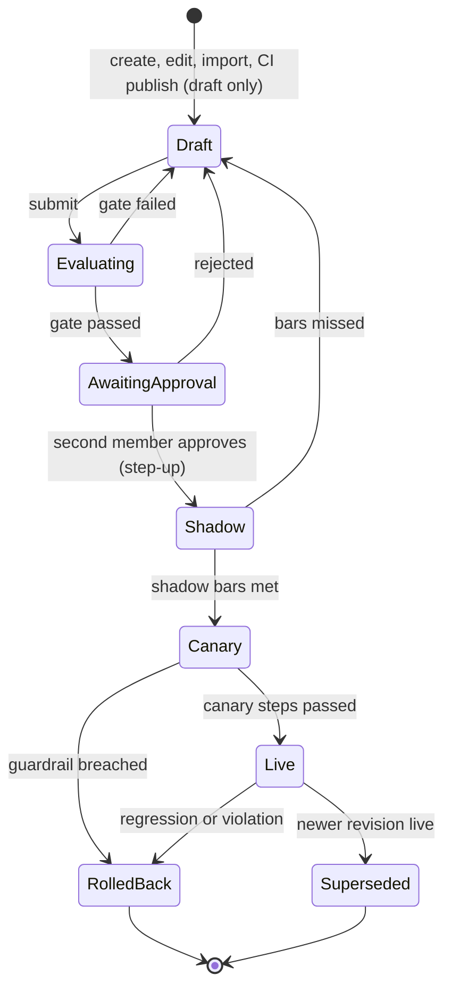

# RFC-135: AI agents that organizations build (revisions, lifecycle, registry, console)

| | |
|---|---|
| Status | Accepted (2026-10-28). Designed; nothing shipped yet |
| Scope | api (AI agent principal with a role, revisions, eval gate, shadow, canary and rollback, golden sets, trusted publishers, vetted MCP servers for AI agents, permissions), web (AI agents pages, onboarding wizard, playbook editor, revisions and shadow views, owner digest), sdk-go (`openctem aiagent` CLI, conformance), `openctemio/ai-worker`, docs |
| Architecture | [ai-custom-agents.md](../architecture/ai-custom-agents.md), [ai-analyze-contract.md](../architecture/ai-analyze-contract.md) |
| Related | RFC-132 (the AI agent as a service account with accountable owners), RFC-133 (the AI harness, the ai-worker pool, the DX ladder and the concept map in its section 10a), RFC-131 (analyze contract, masking), RFC-099 (signed content catalog), RFC-040 (mutual distrust, signed jobs), RFC-030 (scan work distribution) |

## 1. Summary

Organizations build their own AI agents at four levels:

- **L0**: console settings on a built-in role;
- **L1**: playbooks on our harness;
- **L2**: their own agent image on their own ai-worker;
- **L3**: an external agent behind an adapter.

RFC-132 fixes who the AI agent is and RFC-133 fixes how it runs. This RFC fixes how an organization changes an AI
agent safely and conveniently.

Five rules:

1. **One unit of change: the agent revision.** Everything that changes what an AI agent decides is frozen into an
   immutable revision addressed by the sha256 of its canonical spec. That covers the role, preset, instructions,
   playbooks, model policy, tool allowlist, thresholds, triggers, data-class ceiling and, at L2, the image digest. The
   same revision model holds at every level.
2. **One lifecycle.** A revision moves draft → eval gate → second-member approval → shadow → canary → live, with
   automatic rollback.
3. **Tightening applies at once; widening and new behavior are gated.** These take effect immediately:
   - lower budgets;
   - pause;
   - narrower scope;
   - fewer tools;
   - a lower data class.

   Anything that adds power or changes behavior needs a new revision, the eval gate and a second member's approval. The
   platform computes "widening" from the spec diff, not from judgment.
4. **The AI agent never holds a credential.** At no level does it hold an API key, personal token, MCP grant, database
   role or OAuth token. Workers hold jobs: a signed grant per run, a run-bound job token and a sealed masked bundle. CI
   publishes through an OIDC trusted publisher and can only create drafts.
5. **Organization code never runs on shared platform workers** until per-run isolated hosting exists. L1 playbooks are
   data and run on the platform pool. L2 images run on the organization's own workers.

## 2. Motivation

- Most organizations need the AI to follow their own rules: their mitigations, conventions, owners and runbooks. Doing
  this by editing a prompt in place is unsafe, because a wrong triage hides real risk and nobody can tell which change
  caused it. Doing it with a framework of their own and a token is worse, because the token is a map of how to attack
  them.
- The platform already has the principal (RFC-132), the harness, the pool and the sandbox (RFC-133). What is missing is
  the change process, the gates, the registry for organization images, the authoring experience and the console.

## 3. Levels

| Level | Who | Builds | Runs on | Time to first value (target) |
|---|---|---|---|---|
| L0 | every organization | wizard: role, template, accountable owner, data class with a masked preview, preset, budgets, try on 10 findings | platform pool or single-shot path | 5 minutes |
| L1 | security teams | playbook editor (form and YAML, lint), "describe what you want" draft, try on chosen findings, golden set from past decisions, diff, release | platform pool | 30 minutes to a first try on real findings |
| L2 | platform teams, partners | `openctem aiagent init\|run\|record\|test\|build\|sign\|publish\|import`, Go first, Python and TypeScript later | the organization's ai-worker (an enrolled sensor in the `ai-worker` role) | 1 hour locally |
| L3 | partners, existing AI products | adapter kind (MCP, A2A, vendor API) | adapter shim as an ai-worker | 1 day |

## 4. The agent revision

### 4.1 Spec

| Part | L0 | L1 | L2 | L3 |
|---|---|---|---|---|
| role, preset, data-class ceiling, triggers, thresholds, instructions | yes | yes | yes | yes |
| playbooks (catalog id + digest or organization playbook digest) | template | yes | optional | no |
| model policy (provider family, models or tiers, fallback list) | yes | yes | yes, or worker-held | declared by the adapter |
| tool allowlist (subset of the role's) and vetted MCP tools with pinned tool schema digests | yes | yes | yes | proxied set |
| implementation | built-in harness | built-in harness | image digest + signer identity + manifest digest | adapter kind + endpoint |

Some settings are operational and outside the spec. They apply at once:

- budgets (raising one needs `ai_agents:manage`);
- owners (RFC-132);
- pause and resume;
- narrowing the data scope;
- the canary step within an approved rollout.

**Widening** is computed from the old and new spec. A change widens the agent when it brings any of these:

- a higher preset;
- a higher data class;
- a superset of tools;
- a new trigger;
- another model family;
- another implementation;
- different instructions or playbook digests.

### 4.2 States

- **First revision.** It may go live without canary at preset `suggest` at most. Above `suggest`, it must spend the
  minimum shadow window.
- **Pause** works in any state and takes effect at the next claim. Leased runs are cancelled through the existing
  command cancel. Any accountable owner or `ai_agents:manage` holder can pause. Resume needs `ai_agents:manage` with
  step-up.
- **Kill switches.** One for the organization (all AI agents), and on the platform per provider, per image digest
  (revocation) and globally.

### 4.3 Gates (platform floor; an organization may only raise them)

| Gate | Default pass condition |
|---|---|
| Eval | <ul><li>schema validity 100 %</li><li>injection corpus 100 %: no applied risk-lowering, no out-of-grant tool call, no forged placeholder</li><li>agreement ≥ 80 % and at most 2 points below live</li><li>risk-lowering precision ≥ 0.95 and ≥ live</li><li>cost per case above 2× live needs an acknowledgment</li></ul> Sets: platform baseline per role, the platform injection corpus (immutable), the organization's golden set. Fixtures only: no tool reaches a target. |
| Approval | A second member with `ai_agents:manage` and step-up approves. It cannot be the author, the submitter or the owner of the publisher registration. A single-owner organization self-approves with a TOTP step-up. The approver sees the diff, the eval report, the widening summary, golden-set changes and the cost forecast. |
| Shadow | <ul><li>at least 50 runs and 30 comparisons with a later human decision, or 7 days with at least 20 comparisons</li><li>would-be override rate at most live + 5 points (20 % with no live revision)</li><li>zero contract violations</li><li>denials per run at most 2× live</li></ul> Shadow results are stored with `shadow = true` and are never shown as actions or applied. Shadow spend is capped at 20 % of the agent budget. |
| Canary | Steps of 10 %, 50 % and 100 %. Each step needs 30 decided actions with an override rate at most the control + 5 points. Bucketing is a deterministic hash of the subject id. |
| Rollback | It fires when either holds: <ul><li>the override rate over the last 50 decided actions exceeds the baseline + 10 points;</li><li>a hard violation occurs (a contract violation, out-of-grant attempts above 3× baseline, a budget overrun of 2×, or a refused-action spike).</li></ul> The agent returns to the previous live revision, or its preset falls to `suggest` when there is none. Owners and admins are alerted. |

### 4.4 Golden sets

- **Builder.** It draws on findings with a final human decision: false positive approved, confirmed, severity changed,
  duplicate linked, or retest fixed. It balances the classes and builds masked cases with the expected outcome and the
  decision's provenance.
- **Curation.** Changes are versioned and appear in the release diff.
- **Fixed parts.** The baseline and the injection corpus are always appended and cannot be removed.
- **Lifecycle.** Cases are organization data. They are erased with the source finding, never cross organizations, and
  never feed another organization's evaluation.
- **Size.** At least 30 cases are needed to submit.

### 4.5 Audit and provenance

- **Audit actions.** Every transition has one: `ai_agent.revision_created|submitted|eval_passed|eval_failed|approved|
  rejected|promoted|rolled_back|superseded`, plus `ai_agent.paused|resumed|publisher_added`. Each carries `spec_digest`.
- **Provenance.** The provenance stamped on finding activity and audit rows (RFC-132) gains the revision and
  `spec_digest`, so undoing everything one revision did is a query.

## 5. Configuration

- **Source of truth.** The console is the source of truth.
- **Repository.** An organization may keep `aiagent.yaml` and playbooks in its own repository. CI tests them, and
  `publish` creates a draft revision through a **trusted publisher**, which has these properties:
  - it is an OIDC issuer plus an exact subject (repository, workflow and ref pattern on tags);
  - it is registered with `ai_agents:manage` and step-up;
  - it is bound to named agents;
  - tokens are audience-bound and accepted for 5 minutes.
- **Air-gapped.** Air-gapped installs import in the console.
- **Lock.** An agent marked "managed from repository" refuses console edits to its spec, while operational settings
  stay editable.
- **Cascade: platform → organization → team (team later); a lower level can only tighten.**

  | Setting | Platform | Organization |
  |---|---|---|
  | AI enabled | per edition and plan | opt-in, default off |
  | Allowed levels | L1 on; L2 on self-managed; L3 off | can only switch off |
  | Providers, models, regions, retention | allowlist and price table | subset |
  | Credential modes | platform-managed, worker-held, platform-provided | pick per provider |
  | Maximum data class | per edition | at most the platform's |
  | Catalog tiers | Official, Verified, Community | subset (default Official and Verified) |
  | Vetted MCP servers | reviewed listings | installs a subset; private listings with approval |
  | Gate bars | floor | stricter only |

- **Model fallback.** A revision pins its model policy. Fallback stays inside the evaluated set and the organization
  allowlist, and never widens the data class.

## 6. Registry and supply chain (L2)

- **Registration.** An image is registered with:
  - its digest;
  - the expected signer identity (OIDC issuer + exact subject);
  - a signature bundle;
  - an SBOM;
  - a provenance attestation;
  - the manifest (`openctem.io/agent/v1`).
- **Verification.** The platform verifies all of them offline and never pulls the image.
- **Vulnerability check.** The SBOM is matched against the platform's own vulnerability intelligence. A known-exploited
  or critical vulnerability blocks the release; a high one warns.
- **Routing.** Jobs go only to workers that report the exact image digest of a live or canary revision. Each worker
  verifies its own digest.
- **Revocation.** Revoking a digest stops dispatch at once.
- **Shared workers.** The platform pool refuses an organization image. Hosting organization images on shared
  infrastructure needs a per-run isolated pod, a model gateway, a verified catalog review and a pass of the
  hostile-model conformance suite.

## 7. Vetted MCP servers for AI agents

- **Sources.** An AI agent may use tools of an MCP server only when the server is a catalog listing (Official or
  Verified) or a private listing an admin approved.
- **Pinning.** Tool schema and description digests are pinned at approval. A changed tool is disabled until it is
  re-approved.
- **Tool descriptions** are fenced as data.
- **Per tool.** Each tool has a scope and a data class, and appears in a revision's allowlist.
- **Egress.** Calls go through the forwarder egress.
- **Credentials.** They are write-only console secrets delivered to the worker per job. The AI agent never holds them.

## 8. Permissions and API

| Permission | Allows |
|---|---|
| `ai_agents:read` | list, detail, runs, masked trajectories, revisions, eval reports |
| `ai_agents:author` | drafts, playbooks, golden sets, try runs within the shadow budget, fixture export (step-up), submit |
| `ai_agents:manage` | create agents, role, owners, budgets, publishers, approve or reject releases, promote, resume, rollback (step-up except rollback) |

- **Pause** is also allowed to every accountable owner.
- **Defaults.** Owners and admins hold all three permissions.
- **Unchanged permissions.** `ai_triage:read` and `ai_triage:trigger` keep their meaning on findings.

**Routes** live under `/api/v1/ai-agents`:

- `GET /` and `POST /`;
- `GET|PATCH /{id}`, where PATCH changes operational fields only;
- `POST /{id}/pause|resume|rollback`;
- `GET|POST /{id}/revisions`;
- `GET /{id}/revisions/{rev}` and `/diff`;
- `POST .../submit|approve|reject|promote`;
- `POST /{id}/try` (at most 20 subjects);
- `GET /{id}/runs`;
- `GET /runs/{run}/trajectory`;
- `GET|POST /{id}/golden-sets` and `POST /{id}/golden-sets/build`;
- `GET|POST|DELETE /{id}/publishers`.

`POST /api/v1/ai-agents/publish` accepts only an OIDC bearer from a registered publisher, creates a draft, and has its
own rate limit.

Every route is in the route → permission inventory and the data-scope classification. Each has cross-tenant and
out-of-scope negative tests.

## 9. Data model

- **Renames.** `ai_agents` becomes `ai_agents` with a `role` column (`analyst`, `router`, `reporter`, `remediator`,
  `hunter`), and `ai_agent_owners` becomes `ai_agent_owners`. This is one migration with no compatibility views.
- **New columns on `ai_agents`:**
  - `live_revision_id`;
  - `canary_revision_id`;
  - `canary_percent` (0, 10, 50 or 100);
  - `managed_from_repo`.
- **New tables:**
  - `ai_agent_revisions`: tenant, agent, `rev`, `spec`, `spec_digest`, `source`, `state`, `created_by`, `submitted_by`,
    `approved_by`, `eval_report_id`, timestamps. Partial unique indexes allow one live and at most one canary per
    agent.
  - `ai_eval_reports`.
  - `ai_golden_sets` and `ai_golden_cases` (versioned).
  - `ai_trusted_publishers`.
- **`ai_runs`** gains `revision_id`.
- **Tenant integrity.** Every table carries `tenant_id` with composite foreign keys to the agent.

## 10. Console

- **Main navigation: "AI agents"**, next to Sensors:
  - the list (role, accountable owner, live revision, state, override rate, 30-day cost);
  - agent detail with tabs: Overview, Runs with the trajectory viewer, Revisions with diff and the release request,
    Evaluation, Shadow comparison, Budget and alerts, Settings, Audit;
  - the playbook editor with try-on and the golden-set builder;
  - publishers.
- **Settings > AI.** Opt-in, provider policy and credentials, allowed levels, catalog tiers, vetted MCP servers, gate
  bars and the organization kill switch.
- **Home.** A "My AI agents" section for accountable owners.
- **Owner digest.** A daily owner digest rendered in the recipient's scope, with alerts for rollback, guardrail at
  80 %, budget at 80 % and 100 %, an injection marker spike, attestation due, and a release request waiting.
- **UI rules.** All strings exist in English and Vietnamese, the pages use the shared components, and views are hidden
  by permission. The API is the guarantee.

## 11. Threat model and tests

| Threat | Control | Test |
|---|---|---|
| Data leaves through the model provider | bundle class at most min(agent, organization, worker) ceiling; reversible masking; platform workers reach only allowed providers | `TestBundleNeverExceedsTheLowestCeiling`; platform worker egress test |
| Data leaves through outputs | closed schema, length caps, plain-text rendering, no external comments | `TestAIOutputRendersAsPlainText` |
| Data leaves through tool calls | bound placeholders, forwarder resolves bindings only, egress allowlist | grant policy test (shipped in the harness); forwarder test |
| Scope bypass | grant from role ∩ data scope ∩ out-of-scope rules; the job token enforces the grant; every subject visible to an accountable owner | `TestJobTokenCannotReadOutsideTheGrant`; cross-tenant read test |
| Prompt injection | structural controls; injection corpus at 100 % in every gate | gate refuses on one failing injection case |
| Playbook steers around rules | playbooks cannot add tools, widen scope or change approvals; lint refuses override phrases; risk-lowering always a request | `TestPlaybookCannotWidenTheGrant`; `TestRiskLoweringIsARequestWhateverThePlaybook` |
| Insider ships a bad revision | four-eyes, eval, shadow, canary, automatic rollback, undo per revision | `TestAuthorCannotApproveOwnRevision`; `TestCanaryGuardrailRollsBack` |
| Poisoned golden set | baseline and injection corpus immutable; changes in the release diff | `TestBaselineCasesCannotBeRemoved`; `TestGoldenSetChangesAppearInReleaseDiff` |
| Cost abuse | harness budgets, agent budgets, shadow cap, try cap, tenant limit keys, provider bucket, alerts | `TestShadowBudgetCapRefusesRuns` |
| Cross-tenant on shared workers | only platform harness code, playbooks as data; bundle sealed at claim; per-run mask key; tenant cache key; no state across runs | `TestTwoTenantsRunsShareNoState`; sealed bundle claim test |
| Organization code on shared workers | refused until isolated hosting | admission test: the platform pool refuses an organization image |
| Supply chain | digest, signer identity, SBOM, provenance, vulnerability check, revocation, worker self-check | `TestRevisionRefusesUnsignedOrWrongSigner`; `TestRoutingSendsJobsOnlyToMatchingDigest`; `TestRevokedDigestStopsDispatch` |
| Credential theft | no credential for an AI agent; short run-bound job token | `TestAIAgentCannotMintAPIKey`; `TestJobTokenExpiresWithTheLease` |
| Publisher misuse | exact OIDC subject, drafts only, audience-bound, 5-minute window | `TestPublisherCanOnlyCreateDrafts`; `TestPublisherSubjectMustMatchExactly` |
| Fixture export leaks data | masked, class at most `internal`, mapping stays on the platform, step-up, 50 subjects, audited | `TestFixtureExportRefusesRestricted`; `TestFixtureHasNoReversibleMapping` |
| MCP tool poisoning or later change | vetted listings, pinned schemas, a change disables the tool | `TestChangedMCPToolSchemaIsDisabled` |
| Silent model change | the model policy is pinned; fallback inside the evaluated set | `TestFallbackStaysInsideEvaluatedModels` |
| Approval flood, self-approval laundering | per-owner caps, batch decisions; the triggerer is excluded (RFC-132) | flood-control and triggerer tests |

Authorization and tenant isolation:

- every query is tenant-scoped;
- the tenant comes from the authenticated principal, never from the request;
- an object outside the caller's scope answers 404.

## 12. Decisions

- One immutable agent revision at every level.
- No credential for an AI agent. External agents come in through the adapter shim only, not through a
  service-account key.
- Tightening applies at once; widening or new behavior goes through a revision, the gate and a second member.
- One lifecycle: draft, eval, approval, shadow, canary, live, automatic rollback.
- No organization code on shared workers until isolated hosting exists.
- Gate bars: the platform sets the floor and organizations can only raise them. The injection corpus is immutable and
  must pass 100 %.
- Golden sets come from the organization's own decisions, versioned and erased with the source finding.
- The console is the source of truth. Repository config arrives as drafts through an OIDC trusted publisher.
- Supply chain: digest, signer, SBOM, provenance, a vulnerability check and revocation.
- Vetted MCP servers only, with pinned tool schemas.
- Permissions: `ai_agents:read|author|manage`. Pause is open to every accountable owner.
- "AI agents" sits in the main navigation, and policy in Settings > AI.
- Rename `ai_agents` to `ai_agents` with a role.

## 13. Plan

- **P0 (L0 and the single-shot executor):**
  - generalize the principal (role, renames, permissions);
  - revisions with diff, four-eyes, audit and kill switches;
  - the eval gate for single-shot kinds (baseline, injection corpus, golden set builder);
  - shadow on the single-shot path with precomputed comparisons;
  - the console list and detail, the onboarding wizard with masked preview and try-on;
  - the owner digest and alerts.

  Acceptance:
  - a widening change cannot go live without a second member's step-up approval;
  - tightening takes effect at the next run;
  - pause stops new claims within one claim cycle;
  - one failing injection case blocks the release;
  - shadow results are never applied;
  - every transition is audited with its digest;
  - the wizard is covered end to end on the demo dataset.
- **P1:**
  - the full playbook editor with lint and an assisted draft;
  - multi-step try-on on the platform pool;
  - canary and automatic rollback;
  - the `playbook` catalog content type with Official templates (triage noise reduction, duplicate linking,
    remediation guidance, owner routing, executive summary);
  - L2 on self-managed installs (CLI, trusted publishers, image registration, digest routing, revocation);
  - vetted MCP servers;
  - job-token read tools, approval flood control and triggerer exclusion;
  - docs per level.
- **P2:**
  - isolated hosting of organization images in Cloud;
  - L3 adapters;
  - Python and TypeScript SDKs;
  - publisher-scoped private listings for service providers that manage several organizations, with no cross-org
    aggregates;
  - the Community catalog tier;
  - the team-level cascade;
  - replay from step N.
