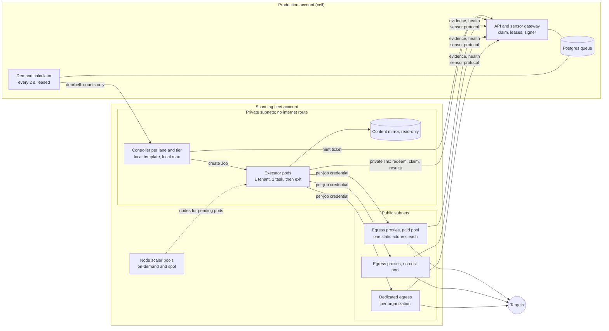

# RFC-145: Managed scanning fleet: demand scaling, owned egress proxies, proxy selection

| | |
|---|---|
| Status | Proposed (2026-11-02); nothing here is built unless a section says "shipped" |
| Scope | api (demand calculation, executor tickets, instance proxy pools, per-job proxy credentials, egress evidence, site-block memory, token lifecycle flags), sdk-go (executor and controller modes, `egress-proxy` role, proxy selection, collector gates), sensor (modes), helm-charts (controller mode, StatefulSet mode), deploy (fleet account network and node scaling), docs |
| Architecture | [sensor-proxies.md](../architecture/sensor-proxies.md#platform-owned-egress-and-selection-designed), [sensors.md](../architecture/sensors.md#the-shared-claim-path) |
| Amends | RFC-129 D10 and §6 (platform pools are platform-owned egress proxies; vendor endpoints only for regions without a cell) |
| Related | RFC-030 and RFC-090 (pull claim, claim-time chunks, leases), RFC-031 (managed updates), RFC-034 (sensor network egress, proxy pools), RFC-074 (adaptive control, no fixed knobs), RFC-129 (shared fleet scheduling), [sensor-platform-trust.md](../architecture/sensor-platform-trust.md) |

## 1. Summary

A managed deployment runs scans for many organizations on a fleet it operates. The fleet must grow
and shrink with demand without an operator, and every scan connection must leave through addresses the
operator owns, can publish and can attribute. RFC-129 decides who gets capacity (admission, quotas, fair
share, politeness); this RFC decides how capacity appears and how traffic leaves.

- **Demand scaling.** The platform computes demand per pool and class and publishes counts only. A small
  controller in the fleet's own network turns counts into one-task executor pods; a node scaler turns
  pods into nodes. The platform never creates pods.
- **Urgency scales out, backlog fills.** Interactive and deadline-threatened work adds capacity; scheduled
  and background work fills capacity that already exists.
- **Owned egress.** Executors have no internet route. The only way out is a small fleet of
  platform-owned egress proxies with static, published addresses. They are ordinary endpoints of an
  operator proxy pool, so the existing pool engine (health score, quarantine, sticky slots) selects among
  them.
- **Proxy selection.** Platform weight, then a per (job, target host) sticky slot, then a weighted
  power-of-two-choices first pick, a job-local breaker and bounded failover on proxy faults only. A
  target's answer never moves traffic to another exit.
- **Customer side.** Zero-touch enrollment at scale, replica sets for customer sensors, and a collector
  that stays gentle on fragile systems. The platform never upgrades a running sensor by itself.

## 2. Decisions

| # | Decision |
|---|---|
| D1 | Autoscaling is platform-computed demand plus a controller in the fleet network that owns the pod template and a local maximum. The platform publishes `{pool, class, desired}` and nothing about tenants. |
| D2 | The demand formula separates urgent, deadline-threatened and filler work (section 3.2). The warm pool is a term of the same formula, sized from the arrival rate, not a separate component. |
| D3 | Executors run in private subnets with no internet route. Reaching a target requires crossing a platform-owned egress proxy. |
| D4 | Platform pools are made of owned egress proxies, one static address each, per region and tier. Vendor proxies only for a region the operator does not host, with static dedicated addresses, written scanning clearance and addresses published on the scanner page. Residential, rotating-gateway, Tor and public-list proxies are never used. |
| D5 | The egress proxy is the sdk-go forwarder run as a server. Destination deny, per-exit ceilings and per-connection evidence come from code already trusted in the sensor. |
| D6 | Every connection through a platform pool is authenticated with a per-job credential bound to the command, the lease epoch and an expiry. |
| D7 | Proxy selection is the algorithm in section 5.2. Failover happens only on proxy faults. |
| D8 | A target that blocks the scanner causes back-off, a coverage gap and a platform-side site-block memory per (tenant, registrable domain), independent of the exit address. |
| D9 | Address reputation drives slow, pool-wide, audited actions only. It never routes one target differently. |
| D10 | Customer replicas, windowed and ephemeral enrollment tokens, and per-group update policy are small independent additions (section 7). The platform never pushes an upgrade to a running sensor. |
| D11 | Money-spending limits live outside the platform: controller local maximum, node scaler CPU limit, namespace quota, cloud budget alarms. |

D4 narrows RFC-129 D10 ("approved proxy providers"): the pool abstraction is unchanged, only the default
source of endpoints changes. Reasons: allowlistable static addresses, exact per-job attribution, abuse
reports reach the operator directly, no dependency on a vendor's acceptable-use changes.

## 3. Managed fleet autoscaling

### 3.1 Architecture



Safe by construction:

- **No internet route.** Private subnets have no NAT. Private endpoints serve the image registry, object
  store and node-scaling APIs; the cell API is reached over a private link. A tool that ignores the
  forwarder (raw sockets, UDP) has nowhere to go, which is stronger than a network policy alone.
- **Tier separation at three layers.** Separate controllers and lanes per tier (labels are hard
  selectors: an executor of one tier claims only that tier's work), a network policy per tier (executors
  reach only their tier's proxies), pool credentials per tier.
- **The platform never creates pods.** The controller owns the pod template (image digest, security
  context) and a local maximum. A compromised platform can at most ask for more pods, capped locally, by
  node limits and by cloud budgets.

### 3.2 Demand signal

The demand calculator runs every 2 s per pool `p` (lane image, isolation tier, capacity type, tier) and
class `c`, from the tenant fleet state (RFC-129 P2) or, before it exists, the bounded claim's candidate
read.

```
for each tenant t with claimable work in p:
    claimable_cu(t,c) = CU of pending items that pass every claim gate now
                        (scope, labels, window open, politeness free, signer ok)
    headroom(t)       = limit_cu(t) - inflight_cu(t)
                        or burst_cu(t) - inflight_cu(t) while fleet_util < 0.75
    take(t,c)         = min(claimable_cu(t,c), max(headroom(t), 0))

urgent(p)   = sum_t take(t, critical|high)
deferred(p) = sum_t take(t, normal|low) for items whose deadline is at risk:
              now >= window_end - 1.5 x predicted_runtime   (learned from tool_duration_stats)
filler(p)   = sum_t take(t, normal|low) - deferred(p)

desired_exec(p) = ceil((urgent + deferred) / cu_per_executor(p))
                + min(ceil(filler / cu_per_executor(p)), idle_slots(p))   // fill, never scale out
                + warm(p)                                                 // interactive lane only
                - starting(p)
desired_exec(p) = clamp(desired_exec(p), 0, fleet_max(p) - running(p))
```

- `idle_slots(p)` is capacity on nodes that already exist (from controller reports) minus running work.
  Scheduled and background work never adds nodes unless its deadline is at risk. This flattens the
  unlevelled peak without a separate levelling service; RFC-129 start placement still applies on top.
- `warm(interactive) = ceil(arrival_rate x replenish_time) + 1` (Little's law, learned per hour, no fixed
  knob per RFC-074; a static 2 at first). A warm executor waits at most 60 s in the claim long-poll, then
  exits and is replaced. It holds no tenant data before its claim.
- The doorbell carries `{pool, class, desired}` only. Plan deadlines enter through `predicted_runtime`
  and the class objectives, so a run with a closing window turns from filler into deferred earlier without
  any per-plan scaling rule.

### 3.3 Scaling loop

```mermaid
sequenceDiagram
  autonumber
  participant D as Demand calculator (cell)
  participant C as Controller (fleet)
  participant K as Kubernetes and node scaler
  participant E as Executor
  participant P as API (claim)
  loop every 2 s
    D->>C: desired per pool and class (counts only)
    C->>C: n = min(desired, local_max - running, create rate cap)
    C->>P: mint executor ticket x n (capped at desired plus slack)
    C->>K: create n Jobs from the LOCAL template
    K-->>K: pending pods lead to new nodes (on-demand or spot)
    E->>P: redeem ticket (in-memory key) for an executor identity
    E->>P: claim one task of my lane and tier (all gates, fair share)
    E->>P: results and final usage report
    E-->>C: exit with reason; controller reports lost executors for immediate release
  end
```

- Start latency targets: warm executor 2.5 s, cold pod on a warm node 3 to 6 s, cold node 45 to 120 s.
- No scale-in thrash by design: a one-task executor is never scaled down mid-task; nodes leave only when
  empty or consolidatable (2 to 5 minutes).
- Controller create rate is capped per cell (soft 20 pods/s) and ticket minting has a hard cap (50/s).

### 3.4 Nodes, spot and preemption

| Node pool | Capacity | Used for |
|---|---|---|
| on-demand | on-demand | interactive, on-demand, tasks over an hour, intrusive work |
| spot | spot, at least 6 instance types across 3 zones, price-capacity-optimized | scheduled and background work; falls back to on-demand after 10 minutes without spot capacity |
| isolated lanes | metal or nested-virtualization types | microVM lanes (later) |
| system | on-demand, two small nodes | controller, node scaler, content mirror |

A spot interruption cordons the node on the two-minute notice; the pod receives SIGTERM and the executor
drains with the existing path: it stops taking items, settles finished items, and releases the rest. A new
failure class `infra.preempted` re-queues for free (no `failed_on`, at most twice, then on-demand only).
Tasks last 5 to 15 minutes by construction, so a preemption loses at most half a task.

### 3.5 Lanes, isolation and guardrails

One controller exists per (lane image, tier, capacity type). Recon and template lanes and the interactive
verify/retest lane start first; code, image and browser lanes open when sold, and the riskier ones only
on microVM (RFC-129 D15).

Isolation follows RFC-129: one tenant per executor lifetime, no shared disk (empty-dir scratch, read-only
content mirror by digest), restricted pod security, no service-account token, read-only root, all
capabilities dropped, seccomp. Tenant secrets are sealed to the executor key; until sealing ships, shared
lanes carry no tenant secrets and credentialed lanes stay closed.

| Guardrail | Where |
|---|---|
| Fleet maximum per pool | platform and controller `local_max` (the lower wins) |
| Node CPU limit | node scaler pool limit |
| Namespace quota | per-cell resource quota equal to the fleet maximum |
| Budget alarms | cloud budgets and anomaly detection on the fleet account at 80, 100 and 120 percent of forecast |
| Automatic brake | at 120 percent the platform turns burst off and halves the no-cost lane maximum (audited, reversible) |
| Per-tenant metering | usage records feed the usage page and billing outbox (RFC-129 section 7) |
| Target protection | forwarder per-host AIMD, RFC-129 cross-organization politeness, per-exit caps at the egress proxy |

Executors run in the organization's region (immutable per organization). Each region has its own egress
proxies and published address list. Scanning from another region stays opt-in per organization and is
refused for residency-bound organizations.

## 4. Egress policy

1. **Authorised scanning only.** Platform scanning runs against verified targets (domain proof re-checked
   every 90 days), behind the deny list and the public opt-out. The customer's scope decision is final
   for their assets; CDN and edge targets are labelled, not auto-refused; the platform abuse deny list
   stays.
2. **Be identifiable.** Static published addresses per region and tier, forward-confirmed reverse DNS, a
   public scanner page (purpose, address list as JSON and DNS TXT, abuse contact, opt-out), a stable
   `User-Agent` and program headers where configured, 30 days' notice before addresses change.
3. **Never evade a target's defences.** No rotation on a block, no CAPTCHA solving, no residential exits,
   no Tor or public lists, no rotating gateways. A block means back-off and a report telling the customer
   to allowlist the published addresses.
4. **Attribution always.** Every connection maps from (exit address, time) to job and tenant for at least
   90 days.
5. The cloud provider's written acceptance of outbound scanning under its abuse process, and counsel's
   review of the scanner page and opt-out text, are operator actions before the fleet goes live.

| Source | Use | Reason |
|---|---|---|
| Owned egress proxies (static address each, per region and tier) | default for every platform pool | allowlistable, attributable, abuse reports reach the operator, no per-GB NAT fee |
| Dedicated egress (addresses per organization) | add-on pool offered to one organization | customer allowlist, compliance |
| Organization's own proxies | on the organization's sensors (shipped); on shared executors later through a two-hop chain via the owned proxy | the organization carries the reputation |
| Datacenter vendor, static dedicated addresses, written clearance | only for a region the operator does not host, opt-in per organization | geo coverage without a region |
| Residential, rotating gateway, Tor, public lists | never | unknowing exit owners, no attribution, evasion |

## 5. Proxy selection

### 5.1 Where each decision runs

| Decision | Runs in | Inputs |
|---|---|---|
| Which pool for a job | platform at claim, signed into the payload with revision and endpoint digest | precedence (RFC-034 amendment plus routes), tier, region, dedicated add-on, "proxy required" |
| Endpoint weights and states | platform, aggregated across sensors and executors | endpoint reports, task verdicts, egress-proxy health |
| Endpoint per connection, breaker, failover, per-target rate | sdk-go forwarder in the executor or sensor | weights from the payload, local observations |
| Per-exit ceilings, destination deny, evidence | egress proxy | per-job credential |
| Site-block memory, reputation, pool actions | platform | blocks reported by forwarders, evidence |

The sensor or executor can only narrow: it never uses an endpoint the platform quarantined, and the
host-local egress policy (`SENSOR_SCAN_EGRESS`) wins on organization sensors.

### 5.2 Algorithm

Platform weight per endpoint (shipped scoring in `pkg/domain/proxypool/health.go`, plus a state factor):

```
success   = EWMA(ok / (ok + proxy_down)), half weight every 20 connections
latency   = clamp(1 - (handshake_p95_ms - 200) / 2000, 0, 1)
score     = clamp(0.8*success + 0.2*latency - 0.15*min(consecutive_failed_reports, 4), 0, 1)
            capped at the share of clean task verdicts
state     in {healthy, probation, quarantined}
            probation: 20 clean connections and score >= 0.6 gives healthy
            quarantine: score < 0.3, 3 failed reports, auth failure or task-verdict rule;
                        back-off 5 minutes doubling to 2 hours, then probation
factor    = 1 (healthy) | probation share 0.05 of the pool | 0 (quarantined)
weight    = admin_weight * factor * max(score^2, 0.01)
```

Per connection in the forwarder (shipped except the power-of-two-choices line):

```
func dial(job, host, addr):                   // addr already scope-checked and pinned
    rate.Wait(targetKey(host))                // AIMD per target; global across endpoints
    if s := slot[host]; s != nil && usable(s):
        return attempt(s)                     // sticky: same exit for a host for the whole job
    cands := [e in pool | e.weight > 0 && breaker[e] != open && allowedByHost(e)]
    if empty(cands): return ProxyUnavailable  // never direct; coverage gap "proxy_unavailable"
    for tries := 0; tries < min(3, len(cands)); tries++:
        a := weightedDraw(cands, e.weight * (0.1 + localScore[e]^2))
        b := weightedDraw(cands minus a, same)        // power of two choices
        e := argmin over a,b of (inflight[e] + 1) / e.weight
        switch r := tunnel(e, addr); r.class:
        case ok:         slot[host] = e; report(e, ok, r.handshake); return r.conn
        case proxy_down: breaker[e].fail(); report(e, down); cands -= e    // fail over
        case proxy_auth: disableForJob(e); report(e, auth); cands -= e     // configuration error
        case target_*:   report(e, target); return r.err                    // the target answered: no failover
    return ProxyUnavailable
```

Breaker (job-local, per endpoint): closed, then open after 3 consecutive `proxy_down` (or the hung-proxy
rule: CONNECT replies missing for several distinct addresses while the endpoint carried no tunnel); open for
30 s doubling to 10 minutes with 20 percent jitter; half-open lets the next real connection be the probe.
The platform never probes proxies itself (SSRF; internal proxies are unreachable from it).

Target answers (403 or 429 challenge pages, resets, refusals, `Retry-After`): the per-target AIMD halves
the rate and the per-host breaker opens; the job reports a `blocked` coverage gap with the exit address.
The platform records **site-block memory per (tenant, registrable domain)**: 1 hour, doubling to 24 hours.
While set, that tenant's platform-pool jobs to the site wait with the reason "target blocks our scanner:
allowlist these addresses", whichever exit would be used. A later address change cannot become a way around
a block.

Reputation (platform pools only): per exit address `r = 1 - blocked_sites_24h / distinct_sites_24h`
(minimum 50 sites) plus public blocklist hits. `r < 0.9` alerts; `r < 0.8` for 24 hours stops assigning the
address to new jobs, opens an abuse review of the tenants that used it and replaces the address by an
audited operator action. These are hours-to-days, pool-wide actions; they never route a given target to a
different exit.

Why this shape: stickiness keeps address-bound sessions and WAF state consistent and avoids many addresses
hitting one host, which looks like evasion; weighted first pick spreads hosts in proportion to health and
`score^2` avoids a single hot spot; power of two choices on in-flight load cuts the worst endpoint's excess
load from about log n / log log n to about log log n over the mean for a few lines of code (Mitzenmacher,
2001), which matters once owned proxies have connection caps, and is enabled by default only after
measurement on the fleet; failing over only on proxy faults makes the no-evasion invariant mechanical, and
the bounded try count prevents storms.

### 5.3 The egress-proxy role

A small binary (`egress-proxy` mode of the sensor, on the sdk-go forwarder's server side) on each egress
instance:

- serves HTTP CONNECT and SOCKS5 only to the fleet network ranges (security group) and authenticates the
  per-job credential;
- denies destinations loopback, private and unique-local ranges, link-local, instance metadata, the fleet
  and production network ranges and the deny list, so an executor can never use the proxy to reach the
  operator's own network;
- caps new connections per second and concurrent connections per exit address, and concurrent connections
  per destination /24 (a backstop for bugs, not politeness);
- aggregates evidence per (command, destination address, destination port) with first and last seen,
  connections and bytes, and ships it with the exit address over the sensor protocol (the platform talks
  only to its sensors);
- reports health like any sensor and enrolls as an instance sensor with role `egress-proxy`; it runs no
  tools and takes no jobs.

### 5.4 Per-job proxy credentials

```
user = "j." + command_id + "." + lease_epoch + "." + expiry_unix
pass = base64url(HMAC-SHA256(pool_secret[kid], user))   // kid rotates; proxies hold current and previous
```

Minted at claim for the leaseholder and delivered with the payload's credential fetch. The proxy verifies
HMAC and expiry without a database call and logs the `command_id` of every connection, so attribution is
exact with many tenants on one address. Expiry is lease end plus a grace; a revoked or expired lease kills
the credential. A leaked credential yields one job's egress (still scope-checked by the executor's
forwarder; the proxy enforces destination deny). Organization pools keep their static credentials.

### 5.5 Pools by tier

| Tier | Pool | Placement |
|---|---|---|
| No-cost | `free-<region>` | own subnet and security group, separate cloud account when no-cost scanning opens, so a provider action against those addresses cannot touch paid egress |
| Paid shared | `paid-<region>` | fleet account |
| Dedicated | `ded-<tenant>-<region>` (instance pool offered to one organization) | fleet account; stable addresses, "proxy required" on |

The pool is chosen at claim from entitlements, never from the job payload. The signed payload binds pool
id, revision and endpoint digest (already so for organization pools; extended to instance pools).

### 5.6 Abuse handling

Abuse mail or provider ticket, then (exit address, time window), then evidence, then command, then tenant,
then the per-tenant shared-scanning kill switch (step-up, reason, audit), a reply within 24 hours and an
opt-out entry when asked.

## 6. Observability and failure modes

SLIs (no tenant label; per-tenant numbers live in tables): the RFC-129 fleet SLIs (time to start, queue
depth, waiting reasons); desired and running executors per pool and scale-out latency by start type (warm,
warm node, cold node); ticket mint, redeem and refuse; controller exit reasons (out of memory, deadline,
preempted, image pull); node scaler errors, spot interruptions and on-demand fallbacks; proxy endpoint state
and quarantines by source (shipped); egress-proxy connections, bytes, refusals by reason and per-exit block
rate; cost per CU-minute.

Objectives: at least 99.5 percent of shared tasks end without an infrastructure failure; at least 99.5
percent of shared jobs finish without a `proxy_unavailable` gap; cold-node scale-out p95 within 3 minutes;
abuse reports answered within 24 hours.

| Failure | Detect | Automatic | Human |
|---|---|---|---|
| Demand calculator down or stale | doorbell age over 30 s | controller holds the last value 5 minutes, then decays to the warm floor | restart, check the database |
| Demand inflated | desired far above claimable; ticket refusals | local maximum, node limits, mint cap, budget brake | fix; rotate the controller key if needed |
| Egress pool exhausted | pool state metric | jobs hold with a reason; never direct | replace instance or address |
| Egress instance lost | health report gap | platform quarantines; the group replaces it and re-associates the same address | none |
| Exit reputation drop | `r < 0.8` for 24 hours | address stops getting new jobs | abuse review, audited replace |
| Provider abuse action | provider notice | none | kill switch for offending tenants; no-cost account separation limits blast radius |
| Cost overrun | budget at 100 / 120 percent | brake at 120 percent | capacity review |
| Spot storm | interruptions over 20 percent per hour | on-demand fallback after 10 minutes | none |

## 7. Customer-side sensors and collectors

**Zero-touch enrollment.** Organization enrollment tokens (hashed, 1 to 1000 uses, 1 hour to 30 days, CIDR
pins, presets, approve-each) already give one-command installs. Additions: `valid_from` (up to 14 days
ahead, for change-board delays) and an optional Standby on enroll (connected, no jobs until an admin puts it
in service after the fingerprint review); a StatefulSet mode in the Helm chart (one identity and outbox per
replica through `volumeClaimTemplates`; today the chart refuses more than one replica with persistence to
prevent cloned identities; all replicas enroll with one token whose `max_uses` covers replicas plus
headroom; scale-down drains); an `ephemeral` token flag (sensors enrolled by it retire after 24 hours
offline, audited, and never alert as offline). Ephemeral changes lifecycle only, never trust or grants.
Tokens remain organization-scoped by kind.

**Horizontal scaling.** Claim-based pull already splits a zone's queue across sensors with the same
labels; claim-time chunks size each claim to the sensor's learned speed; per-tenant host politeness keeps
target load constant as replicas grow. The console shows per-group utilisation and wait time and suggests a
replica count; the platform decides nothing on the customer's cluster. Customer-cluster autoscaling (the
controller mode with a tenant-scoped pool) comes on the third real request; it needs no new platform
concept because the controller is pool-generic.

**Updates without forcing.** Per group: `manual` (default), `notify` (console and email when a signed
release is available), `auto within window` (opt-in, one replica first, rollback on health regression). The
platform never pushes an upgrade to a running sensor; a sensor below the protocol floor gets a stated
"unsupported" reason and stops receiving jobs. Helm and GitOps users pin the chart; the console shows drift.

**Asset collector.** Shipped: change feeds (vCenter property-filter watch with version, full read every 24
hours or on session loss), an adaptive per-endpoint pace starting at half the ceiling, concurrency 1, a
per-run request budget, a breaker, backoff and schedule windows. Additions: move the endpoint gate, budget
and breaker into sdk-go `pkg/adapt` so every collector shares them; handle vendor busy signals uniformly
(429 and 503 with `Retry-After`, session-limit faults) as "vendor busy": halve and wait, never an
immediate retry; let the platform learn and suggest (never force) the full-sync interval and window from
what the collector reports per run (requests, latency p95, changes, vendor-busy count). Scale-out is
sharding by assigning endpoints to collectors in the console, not replicas.

## 8. Threat model

| # | Threat | Control |
|---|---|---|
| T1 | Executor reaches the operator's network or instance metadata through the egress proxy | proxy destination deny; executors have no internet route; metadata hop limit 1 |
| T2 | No-cost executor uses the paid pool | lanes per tier with label-bound claims, network policy per tier, pool credentials per tier, pool chosen from entitlements |
| T3 | Leaked proxy credential reused | per-job HMAC bound to command, lease epoch and expiry; logged per connection |
| T4 | Platform compromise inflates demand to burn money | controller local maximum, node limits, mint cap, budget brake outside the platform |
| T5 | Platform compromise points executors at an attacker proxy | executors reach only the proxy security group; pool digest in the signed payload; network policy fixed in version control |
| T6 | Evasion by address change after a block | site-block memory per (tenant, site) independent of the exit; no failover on target answers |
| T7 | Evidence used for cross-tenant inference | attribution query is operator-only (console, step-up) or tenant-scoped to its own commands |
| T8 | Customer replicas cloning one identity | per-replica volume; cloned-identity detection (shipped) |
| T9 | Enrollment token leak | hash at rest, CIDR pin, use cap, window, Standby, revoke |
| T10 | Forced-update compromise path | no platform-initiated upgrade; signed releases; opt-in windows only |

Tenant isolation: demand carries no tenant data; the attribution query and evidence rows are tenant-scoped
or operator-only; site-block memory is keyed per tenant; instance pools and offers are never stamped onto
another tier's tenant. Each implementation PR carries cross-tenant negative tests.

## 9. Alternatives considered

- **Scaler.** An off-the-shelf queue-driven job scaler on a "claimable work" metric would replace the
  controller's create loop. Rejected for now: pods need a reusable secret or keyless federation, and
  federation needs the platform to fetch cluster keys or call token review (outbound from the platform,
  against the zero-platform-egress rule); no exit events, so lost pods wait for lease expiry; no
  platform-capped minting. Flip condition: keyless joins with a sensor-side verifier land, then the create
  loop can be replaced and the ticket step kept as an init container. A horizontally scaled set of
  long-lived shared daemons violates one tenant per executor lifetime and stays only as a launch-day
  fallback (fixed replicas, per-task sandbox, owned egress proxies, no-cost scanning off). A cluster
  autoscaler replaces the node scaler on a non-AWS cell; the controller does not care.
- **Egress.** A NAT gateway with several addresses is simpler but picks the address per connection with no
  tier or tenant control, gives no per-job attribution and charges per GB; vendor proxies give geo but no
  stable allowlist and add a third party to every abuse case.
- **Selection.** Best-only creates a hot spot; round-robin and per-connection random spread break
  address-bound sessions and look like evasion; rendezvous alone ignores load. Sticky plus weighted
  power-of-two-choices keeps stickiness and adds load awareness.
- **Site blocks.** A global score penalty punishes a healthy proxy for one site's WAF; a per-(endpoint, site)
  memory invites trying the next endpoint; per-(tenant, site) memory stops the tenant's platform scanning of
  that site until it allowlists the published addresses.
- **Evidence store.** Per-connection rows reach about 10^9 a month at 1,000 organizations; per-(command,
  destination) aggregates answer every abuse question; move aggregates to object storage when volume demands.

## 10. Phases

Builds on RFC-129's phases. Each item states its threat model and ships cross-tenant negatives.

First, before paid shared scanning: RFC-129 usage records, SLIs and the console deny list; labels as hard
selectors; executor tickets and `executor` mode (claim one task of my lane, run, deliver, exit; 60 s idle
exit); demand per pool and class with the section 3.2 formula; `controller` mode with a Kubernetes launcher,
template validation and exit events, and the matching Helm mode with a network policy per tier; the
`egress-proxy` mode with per-job credentials, destination deny, per-exit caps, aggregated evidence and
health; instance pools and offers, pool choice at claim, evidence ingest and the abuse desk query; fleet
account infrastructure as code (private subnets without NAT, private endpoints, private link, node scaler,
egress group with static addresses, reverse DNS, budgets, scanner page); the `infra.preempted` class.

Later, each at a trigger measured over two weeks: no-cost scanning opens (no-cost pool in a separate
account, no-cost lanes); fleet compute spend or idle warm share above its threshold (spot pool, learned
warm sizing); owned endpoints hit their connection caps (power of two choices on by default); abuse-relevant
blocks per day above a threshold or the first abuse report (site-block automation, reputation, address
drain); riskier lanes or enterprise reliance (microVM pools, sealed secrets); the first dedicated-address
request (dedicated pools, "proxy required"); a customer asks for replicas (StatefulSet mode, `valid_from`,
Standby, `ephemeral`); collector fleet growth (gates into sdk-go, suggested schedule); a geo request
without a region (vendor static endpoints, opt-in); a second region (per-region proxies and address lists).

## 11. Open items

The cloud provider's written acceptance of outbound scanning for the fleet account, and counsel's review
of the public scanner page and opt-out text, are the two external clearances. Instance sizes, node pool
limits and budget thresholds are set from measurement on the first fleet.
