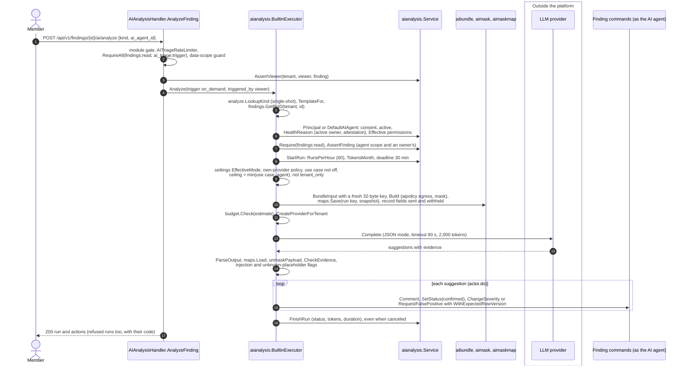

# AI agents

Design: [RFC-132](../rfcs/RFC-132-ai-agent-principal.md). Code: `pkg/domain/aianalysis`,
`internal/app/aianalysis`, `internal/infra/postgres/aianalysis_repository.go`,
`internal/infra/http/handler/ai_analysis_handler.go`, migration `ai_agents`.

An **AI agent** takes part in triage like a person. It calls the same commands, with its own preset
and data scope, and its changes go through the same approvals, audit and notifications. The only
differences are the AI label and the provenance on everything it does.

## Flow: analyze a finding

Checked against the code of v0.19.1 and develop on 2026-11-05. On-demand
runs only; the built-in path is drawn below (an AI agent that runs on AI
workers takes the same checks, then queues an analysis job: "Runs on an AI
worker"). `POST
/api/v1/findings/{id}/ai/analyze` is the one caller of
`BuiltinExecutor.Analyze` (no console button, no event or schedule trigger
yet, though `aidom.Trigger` names them).



`actor.do` decides per suggestion: a change needs no review reasons,
confidence at least 0.5, no conflict seen, and `UseCaseSetting.MayApply`
(auto_apply at its minimum confidence); otherwise it is a comment with the
hold reason. A severity raise is always a comment; a downgrade and a
likely false positive become requests a person decides, and stay comments
when a person triggered the run (`reasonTriggeredByUser`, RFC-132 D7). A
true-positive verdict confirms a `new` finding with `findings:status`. A
row-version change since the agent read the finding turns the change into a
comment (`finding_changed`).

## Identity

- An AI agent is a **service account** (`users.kind = 'service'`) plus one row in `ai_agents`.
  The service-account triggers apply unchanged: one organization only, never owner or administrator,
  never full data access, never a sign-in identity (no password, no MFA, no session).
- It is **not a seat**: the seat count skips service accounts that have an `ai_agents` row
  (`LimitsRepository.Usage`).
- It is **never an approver**: the approver directory lists people only
  (`ScopeActorRepository.FindingApprovers`), and an AI agent never holds an approve permission
  (deny list below).
- It has a **role** (`ai_agents.role`: `analyst` by default, `remediator`, `reporter`, `hunter`, `router`) that
  says what it is for. The role grants nothing; the preset below sets what it may do. Only the analyst role
  has a built-in executor today.
- It has **no credential and no database role of its own**: triggers refuse an API key, an MCP grant or a
  `user_roles` row for an AI agent, and a service account that has any of those cannot become one.
  The service-account screens refuse to mint its keys or delete it. It acts only through the
  platform's executor, which resolves it at every run (owners, attestation, preset, deny list).
- Several AI agents per organization are allowed, for example one per team with that team's asset
  scope.

## What an AI agent may do

Effective permissions are computed at every run start (`Service.Principal`), fail closed:

```
effective = preset permissions
            ∩ union of what the accountable people hold (an owner or administrator holds everything)
            − deny list
```

- **Preset** (in code, `aianalysis.Preset.Permissions`; no editable role, so nobody widens an AI agent
  by editing a role). The person who sets a preset must hold its permissions:
  - `suggest`: read, comment, open approval requests.
  - `triage`: also status, triage (duplicates), severity, assignment.
- **Deny list** (`aianalysis.Denied`): every `*:approve`, `*:delete`, `*:export` and `*:reveal`,
  `findings:verify`, `findings:fix_apply`, `findings:bulk_update`, lifecycle and retest-check
  writes, and everything under `settings:`, `team:`, `integrations:`, `audit:`, `sensors:`,
  `service_accounts:`, `findings:suppressions:` and `scans:` (except `scans:read`).
- **Ceiling**: setting a preset or changing owners is refused when the preset carries a
  permission no accountable person holds (the error names it). At run start the AI agent gets
  the intersection, so it loses a permission the moment its owners do.
- **Data scope**: the AI agent's own team memberships. A subject must also be visible to at least one
  accountable person (`Principal.AssertFinding`); out of scope reads as not found.

Risk-lowering changes always become requests. When the requester is an AI agent, the finding service
evaluates the request at the strictest false-positive and acceptance level and treats the requester
as unable to approve, whatever the organization's settings (`VulnerabilityService.isAIAgent` in
`finding/approval_policy.go`), so a person always decides.

## Read-only assistance

Help that changes nothing (explain a finding, summarize a timeline, translate, answer a question) runs
under the viewer's own permissions and has no AI agent principal. It runs in an assistance context
(`aianalysis.WithAssist`), set only in process (no token or header sets it). In that context:

- every finding write path refuses with `ErrAssistReadOnly` (`aianalysis.RefuseAssist`: finding
  create and update, status batches, severity decisions, comments, approval and severity requests,
  retest requests, timeline rows);
- `postgres.DB` refuses `ExecContext`, a non-read-only `BeginTx` and any writing statement through
  `QueryContext`/`QueryRowContext`;
- `Service.Principal` and `Service.StartRun` refuse, so assistance can never act as an AI agent.

A comment drafted with AI is posted by the viewer, as themselves, outside the assistance context.
Every change to state is made by an AI agent.

## Accountable owners

`ai_agent_owners` holds people and teams (at least one). The **accountable people** are the person
owners who are active members and the active person members of active owner teams, with membership
end dates honoured (`AgentRepository.PeopleOf`).

| Event | Effect |
|---|---|
| No accountable person left (offboarding, suspension, team emptied or deactivated) | the AI agent pauses with `no_active_owner` at the next run start and at the hourly sweep (`AIAgentSweepController`) |
| Attestation older than 90 days (`attest_due_at`) | pauses with `attestation_expired`; an owner (or an administrator) attests to resume |
| Nothing effective left | pauses with `no_permissions` |
| Owners replaced | needs `service_accounts:manage` and a recent sign-in; the preset must fit the new owners; a `no_active_owner` pause lifts |

Owners may pause their AI agent. `service_accounts:manage` disables it (kill switch) and, with a recent
sign-in, resumes, deletes or changes it. Every change is a critical or high audit row
(`ai_agent.*`).

## Provenance

The executor puts an `aianalysis.Provenance` in the context before it calls any command: AI agent,
run, executor, provider, model, prompt template id and digest, the accountable owners at that moment,
and who triggered the run.

- The finding activity writer stamps `source = 'ai_agent'` and `source_metadata.ai` on rows the
  AI agent writes; a database trigger labels **every** row whose actor is an AI agent
  `actor_type = 'ai'`, whatever code path wrote it.
- The audit logger stamps `metadata.ai` and `auth_method = 'ai_agent'`.
- Rows whose actor is someone else in the same context are not stamped.
- An expression index on `source_metadata->'ai'->>'run_id'` serves per-run queries (undo, metrics).

## Runs

`ai_runs` is the ledger: one row per run with the AI agent, the accountable snapshot, the trigger and
who triggered it, model and prompt, bundle digest, fields sent and withheld, usage and cost. Status is
the run's logical state: `queued`, `running`, `waiting_tool`, `waiting_approval`, then `completed`,
`failed`, `canceled` or `refused`.

- One live run per subject and use case (partial unique index). A live run past its deadline
  (`RunDeadline`) gives the slot up when the next run starts (failed with `timeout`).
- Budgets per AI agent: runs per hour, tokens per month (inside the organization's AI token budget).
- A run is readable only by someone who can see its subject (finding subjects only for now).
- The per-run index on `finding_activities` is built concurrently by its own migration.

## The built-in executor

`BuiltinExecutor.Analyze` (`internal/app/aianalysis/builtin.go`) runs one single-shot kind as an AI agent:

1. reads the finding (another organization's id is not found and records nothing), resolves the
   principal (`Principal` or, without an agent id, the first active AI agent that may read the
   finding), and checks `findings:read` and the AI agent's scope;
2. starts a run (budgets, one live run per subject and use case);
3. builds the masked bundle under the AI agent's data class ceiling, calls the model, validates the
   output against the kind's schema and maps placeholders back through the stored mapping;
4. turns each item into the AI agent's own command (`finding.AIAgentCommands`), with the provenance
   in the context, within the organization's setting of the run's use case
   ([AI use cases](ai-use-cases.md)): `off` refuses the run (`use_case_off`) before any model call,
   `suggest` (the default) writes every item as a comment, and the data class sent is the lower of
   the use case's ceiling and the AI agent's. In `auto_apply`, at or above the use case's minimum
   confidence:

| Output | Command | Needs | Result |
|---|---|---|---|
| summary, remediation steps, needs-info | internal comment | `findings:comment` | comment |
| true positive on a new finding | status `confirmed` | `findings:status` | applied, else a comment |
| severity | severity change | `findings:severity` | downgrade a severity request; a raise stays a comment (a severity never changes without a person) |
| likely false positive | false-positive approval request | `findings:write` | request a person decides |

Output that cites nothing real, carries a placeholder the run did not issue, comes from a bundle with
injection markers or has a confidence under 0.5 is written as a comment only. Before each change the
finding is read again: if someone else changed it since the AI agent last saw it, the change is
written as a comment instead, and every command carries the expected row version. AI agent comments
are internal (never sent to tickets or integrations).

## Runs on an AI worker

An AI agent runs **built in** (the default: the platform calls the model) or **on the
organization's AI workers** (`executor = tenant_worker`): sensors on the `ai-worker` grant profile
([sensor-pairing.md](sensor-pairing.md), "The AI worker profile") that hold their own model keys.
`PUT /api/v1/ai/agents/{id}/executor` with `{"executor":"builtin"|"tenant_worker"}` sets it
(`service_accounts:manage` and a recent sign-in; audited `ai_agent.executor_changed` with the
executor before and after). `platform_worker` and `external` are refused (400).

`BuiltinExecutor.Analyze` resolves the principal and checks `findings:read` and the data scope as
for a built-in run, then hands a worker agent to `WorkerExecutor`
(`internal/app/aianalysis/worker.go`):

1. `StartRun` records the run as `queued` (no sensor yet), executor `tenant_worker`, deadline the job
   deadline plus one minute.
2. `prepare` runs the same steps as a built-in run (AI off for the organization refuses with
   `not_configured`, use case off, data class ceiling, masked bundle with the mapping saved on the
   platform, fields sent and withheld, budget pre-check). `tenant_only` data is allowed here, since it
   stays on a worker the organization runs. The bundle is fitted to the job's size limit by its
   **encoded** size (`aibundle.Bundle.Fit`): knowledge excerpts go first, then the longest field
   values are shortened (ending in `[shortened by the platform]`) or withheld; every change is stated
   in the bundle text and the shortened fields are in the audit row. A job is never sent over the
   limit (`bundle_too_large` when even the smallest bundle does not fit).
3. The job is an `openctem.analyze/v1` document validated by `analyze.MarshalJob`: `job_id` = the run
   id, the subject, the masked `bundle.text`, the prompt template id and digest, `budgets` (tokens:
   40,000 or what is left of the AI agent's monthly tokens; seconds: 900), `model_policy` (the
   provider and model the organization chose for its own key, nothing otherwise; never the key) and
   `deadline` (now + 15 minutes). The command payload is `{"job": <the job>,
   "required_capabilities": ["analyze.<kind>"]}`: the job schema is closed, so the routing key sits
   next to it.
4. The run is updated with what it sends (including `injection_suspected`, so a result applied later
   is held to the same comment-only rule), bound to the command id (`ai_runs.command_id`), and the
   `analyze` command is created with that id, priority `high` when a person asked, expiring at the
   job deadline. Audit `ai_agent.analysis_job_queued` names the run, job, finding, kind, data class,
   fields and bundle digest, never the text. The answer is `202` with the queued run.

Only the platform creates `analyze` commands: the commands API does not accept the type. The claim
hands one only to a sensor of the same organization whose grant is an explicit AI worker grant (job
types exactly `[analyze]`, `Grant.ServesAnalysis`) and that advertises `analyze.<kind>`; a legacy-broad
grant, a scanning profile, a poll without a sensor identity or a claim that reads no grant gets
nothing (fail closed). Shared sensors never see one (it is not a shared job). Signing at claim is the
same as for every command type.

**Every worker run ends.** `Service.EndStaleWorkerRuns`, run every minute by the `ai-worker-run-sweep`
controller (index `idx_ai_runs_worker_live`; a job of the core `findings` module, so it runs whether `ai_triage` is on or off), ends live worker runs that can no longer get a result:

| Cause | Run |
|---|---|
| past its deadline | `failed`, `deadline_exceeded`; its job, if still open, is canceled |
| its job expired (command expiry) | `failed`, `deadline_exceeded` |
| its job failed | `failed`, `worker_error` |
| its job was canceled | `canceled`, `job_canceled` |
| its job is gone | `failed`, `worker_unavailable` |

A worker run moves past `queued` only together with its sensor (`chk_ai_runs_worker`). Applying a
worker's result (completion of the job) is designed, not built: until then a worker run ends by the
sweep.

## API

| Route | Gate |
|---|---|
| `GET /api/v1/ai/agents`, `GET /api/v1/ai/agents/{id}` | `ai_triage:read` |
| `POST /api/v1/ai/agents`, `DELETE /{id}`, `PUT /{id}/owners`, `PUT /{id}/preset`, `PUT /{id}/executor`, `POST /{id}/reactivate` | `service_accounts:manage` + recent sign-in |
| `POST /api/v1/ai/agents/{id}/disable` | `service_accounts:manage` |
| `POST /api/v1/ai/agents/{id}/suspend` | `ai_triage:read`; an accountable person or `service_accounts:manage` |
| `POST /api/v1/ai/agents/{id}/attest` | `ai_triage:read` + recent sign-in; an accountable person or an administrator |
| `GET /api/v1/ai/runs/{id}`, `GET /api/v1/findings/{id}/ai/runs` | `findings:read` + `ai_triage:read`; the subject in the caller's scope |
| `POST /api/v1/findings/{id}/ai/analyze` | `findings:read` + `ai_triage:trigger`, rate-limited; the finding in the caller's scope; the AI agent acts within its own principal |

## Tests

`internal/infra/http/routes/ai_agent_db_test.go` (real Postgres): no API key, MCP grant, role,
identity or password for an AI agent; risk-lowering waits for a person with the organization's
approval levels off; service account within its preset,
ceiling at create and at run start, never an approver, cross-tenant refusals, own plus owner data
scope, pause when the owner leaves and when a team empties (sweep), attestation expiry, kill switch,
one live run under a race of eight workers, activity label and provenance, not a seat.
`internal/infra/http/routes/ai_executor_db_test.go`: a suggest AI agent comments and opens a pending
false-positive request but changes nothing; a triage AI agent confirms and raises severity, and a
downgrade becomes a request; unsafe output only comments; scope, cross-tenant and owner-left refusals
record no run; a concurrent change is never overwritten. `internal/app/retest/agent_scope_db_test.go`:
an AI agent's retest of an out-of-scope target is refused before any job exists.
`internal/infra/http/routes/ai_worker_executor_db_test.go`: a worker agent queues exactly one
schema-valid `analyze` job with the masked text only (no host, address or secret), bound to a queued
run, audited without the text; scope, cross-tenant, AI off and kill switch queue nothing; an oversize
bundle is fitted under the document limit; overdue, expired and failed jobs end their runs and a new
run can start. `sensor_analyze_claim_db_test.go`: a legacy-broad sensor advertising the kind, a
scanner, another organization and a claim without a grant read get no analysis job.
`TestAIAssist_CannotWrite_DB`: in an assistance context comment, status, severity and approval
request are refused and nothing is written; no principal is resolved.
`pkg/domain/aianalysis/agent_test.go`: deny list, ceiling, presets, health, provenance stamping,
AI agent requests always need a person.
