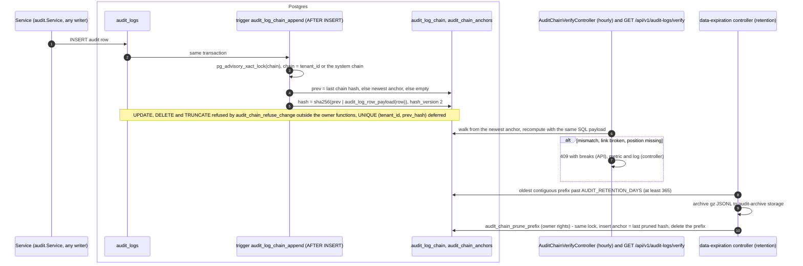

# Audit Hash Chain

Every `audit_logs` row is pinned into a per-tenant SHA-256 chain in
`audit_log_chain`. The database writes the chain row in the transaction that
inserts the audit row, so no write path can leave a row unchained, and it
refuses to update audit rows at all. Editing or deleting an audit row after the
fact breaks the chain from that point on, and the break is detectable.

## Flow



## How it works

| Piece | Where |
|---|---|
| Version 2 hash (every row since migration `audit_log_db_chain`): `SHA-256(prev_hash \| "\|" \| audit_log_row_payload(row))` | SQL `audit_log_row_hash`; Go `crypto.ComputeAuditRowHash` |
| Version 1 hash (older rows): `SHA-256(prev_hash \| audit_log_id \| payload \| timestamp)` | `pkg/crypto/audit_chain.go` (`ComputeAuditChainHash`) |
| Append: `AFTER INSERT` trigger `audit_log_chain_append` on `audit_logs`, under the per-chain advisory lock | migration `audit_log_db_chain` |
| Append-only: `UPDATE`/`DELETE`/`TRUNCATE` of `audit_logs`, `audit_log_chain` and the anchor/rebaseline tables raise `insufficient_privilege` outside the two owner functions; the API role holds no such grant | trigger `audit_chain_refuse_change`, migration `audit_chain_owner_only` |
| Retention and rebaseline: the only delete and rewrite paths, `SECURITY DEFINER` functions owned by the schema owner | `audit_chain_prune_prefix`, `audit_chain_rebaseline_apply` |
| Tenant-less events (logins, failed logins) go to the system chain `ffffffff-…` | `auditdom.SystemChainTenantID` |
| Verify: `GET /api/v1/audit-logs/verify` (admin), 409 + `breaks[]` on a break | `AuditService.VerifyChain` |
| Hourly verification of every tenant | `internal/infra/controller/audit_chain_verify.go` |
| Classify breaks (one implementation, shared by the CLI and the server) | `internal/app/audit/chainclassify` |
| Classify breaks offline, every tenant | `cmd/chainaudit` |
| Classify and rebaseline one organization from the admin console | `GET`/`POST /api/v1/admin/tenants/{tenantId}/audit-chain[/rebaseline]` (`AuditService.ClassifyChain`, `RebaselineChainIfExplained`) |
| There is no tenant rebaseline route: the organization's owner is the insider the chain guards against, so a rebaseline is a platform-operator action (admin console, above) | |
| Retention: archive and prune the oldest prefix past `AUDIT_RETENTION_DAYS` | `AuditService.PruneExpiredChains`, `internal/infra/controller/data_expiration.go`, migration 001010 |

`audit_log_chain.hash_version` says which hash a row carries.

**Version 2** (written by the database). `audit_log_row_payload(row)` is the
JSON array text of a version tag `2`, `id`, `tenant_id`, `actor_id`, `action`,
`resource_type`, `resource_id`, `resource_name`, `changes`, `result`,
`severity`, `message`, `metadata`, `request_id`, `session_id` and `logged_at`
in whole microseconds since the epoch. The serialization has one definition, in
SQL; verify, classify and rebaseline read the payload text with the chain row
(`ListChainEntries`, joined within the chain's own tenant) and hash it in Go.
The actor's e-mail, IP address and user agent are not covered: they are
personal data an erasure may have to remove, and `actor_id` identifies the
actor. Changing any covered column is refused by the database and, past that,
detected.

**Version 1** (rows chained by the application before that migration):
`payload` is `action|resource_type|resource_id|result`, and the timestamp is
rounded to microseconds, as PostgreSQL stores it. These rows stay version 1;
a rebaseline re-signs each row in its own version.

### Append-only

- `INSERT` and `SELECT` are all the API role may do on `audit_logs` and
  `audit_log_chain`. It holds no `UPDATE`, `DELETE` or `TRUNCATE` on them, and
  no write at all on `audit_chain_anchors`, `audit_chain_rebaselines` and
  `audit_chain_rebaseline_entries` (migration `audit_chain_owner_only` and
  `deploy/postgres/least-privilege-roles.sql`, which also checks it).
- Two functions owned by the schema owner are the only way to delete or
  rewrite. Both are `SECURITY DEFINER` with a pinned `search_path`; `EXECUTE`
  is revoked from `PUBLIC`, granted to the API role, and not to the console
  role:
  - `audit_chain_prune_prefix` (retention, below) deletes only the oldest
    prefix of one chain, only rows older than 365 days by the database's own
    clock, and always records an anchor in the same transaction;
  - `audit_chain_rebaseline_apply` (rebaseline, below) records the
    rebaseline, archives every hash it overwrites, rewrites only `prev_hash`
    and `hash` (id, tenant, position and version never change), gives a
    version 2 row only the hash the database computes for it, and checks that
    every rewritten entry links to the one before it.
- The trigger `audit_chain_refuse_change` refuses every `UPDATE`, `DELETE` and
  `TRUNCATE` on the five tables unless it runs as the table's owner (inside
  the functions, `current_user` is the owner) and the function declared the
  operation (`openctem.audit_chain_op`). The setting alone opens nothing: the
  API role is not the owner. The setting `openctem.audit_rebaseline` of
  earlier releases no longer opens anything.
- `UNIQUE (tenant_id, prev_hash)`, checked at commit, refuses a fork: two rows
  of one chain linking to the same predecessor.
- None of the five tables has a foreign key to `users` or `tenants`: deleting
  an account or an organization (`TenantRepository.Delete`, the organization
  deletion worker, the console purge) does not touch them and is not blocked
  by the guard. The organization's audit rows, chain and evidence stay as
  recorded, keep verifying, and age out through retention like any other
  chain (retention prunes the chains of organizations that no longer exist).
  No path erases audit rows today, so no function can erase or shorten the
  chain of an organization that still exists; the hash leaves out the actor's
  e-mail, IP address and user agent so that a future erasure function can
  clear them without breaking the chain.
- The chain row's foreign key (`ON DELETE RESTRICT`) means an audit row cannot
  go without its chain row going first, which verification reports.

#### What this protects, and against whom

| Who | Can delete or rewrite audit history? |
|---|---|
| The API and anything using its credentials (an injection, a stolen `DB_PASSWORD`), with the least-privilege roles | No. Retention removes only rows over 365 days old, as the oldest prefix, with an anchor; a rebaseline is archived and checked. |
| The same, when the API connects as the schema owner (one role for migrations and the API) | Yes: an owner may change its own tables and drop triggers. The triggers still refuse a change that does not go through the functions, and the API logs `audit log preflight: the API connects as the owner of the audit tables` at start-up. Use the least-privilege roles (`docs/deployment/database-roles.md`). |
| The same, within the two functions | Only what retention and rebaseline may do, and always with evidence: prune the oldest prefix of any chain whose rows are all over 365 days old, earlier than a longer `AUDIT_RETENTION_DAYS` would (an anchor row records it, with the archive path the caller gave); re-sign a chain whose entries already hash and link correctly (a rebaseline record archives every overwritten hash). It can also append new rows, with any `logged_at`, as the API does; appends never remove or reorder history. |
| The schema owner or a superuser | Yes. Verification finds a removed or changed row (a broken link or hash), but no off-database copy of an organization chain's head is exported today (the head export and the forwarding sink exist for the administrators' log only, below), so a complete re-hash by the owner is not detected. |

## Retention

Tenant audit logs stay online for `AUDIT_RETENTION_DAYS` (default and minimum
365). The hourly data-expiration controller then prunes the **oldest
contiguous prefix** of each chain (tenant chains and the system chain), never
rows in the middle:

1. read up to 1000 of the chain's oldest entries logged before the cutoff,
   stopping at the first newer one;
2. write them, chain entry plus the audit row as stored, to
   `<tenant>-audit-<first>-<last>-<time>.jsonl.gz` in the server storage
   provider (`STORAGE_PROVIDER`: the local filesystem or the S3-compatible
   bucket, namespace `audit-archive`, which an organization's storage erase
   never touches) and hash the file;
3. call `audit_chain_prune_prefix`, which in one transaction, under the same
   advisory lock appends take, checks that the entries are still exactly the
   chain's oldest ones, that the last still has the hash that was read and
   that every row is older than 365 days (by the database clock, whatever the
   caller asks), inserts an `audit_chain_anchors` row (anchor hash = the last
   pruned entry's hash, positions, counts and times computed by the database,
   archive path and SHA-256), and deletes the entries, their rebaseline
   archive rows and their audit rows.

A chain that changed in between (a rebaseline, a racing append) is skipped and
retried next run; its archive file is removed. Retention is on by default;
`AUDIT_RETENTION_ENABLED=false` holds all audit history. The chain of an
organization that is suspended (how a legal hold is applied) or pending deletion
is skipped until it is active again; the system chain and the chains of
organizations that no longer exist are pruned. Nothing is deleted when the
archive cannot be written (the run fails and retries). Back up the storage
provider like the database: the archive is the only copy of pruned entries.

Every walk starts from the newest anchor instead of `""`: verify, classify and
rebaseline expect the first remaining entry to link to it, and an append to a
chain with no entries left links to it too. To check a pruned prefix, recompute
its hashes from the archive lines (oldest first, `prev_hash` of the first line
= the previous anchor or `""`); the last line's hash must equal the anchor.
A version 2 line carries `hash_version: 2` and `row_payload`, the exact text
that was hashed: `hash = hex(SHA-256(prev_hash + "|" + row_payload))`, and
`row_payload` must match the archived `row`.

The old rule "keep high and critical rows forever" no longer applies online:
it deleted rows from the middle of the chain (which the foreign key refused, so
retention never ran). Every pruned row, whatever its severity, is in the
archive.

## Rebaselining

A rebaseline re-signs a tenant's whole chain from the current `audit_logs`
rows. It treats the current data as correct, so it removes evidence of
tampering just as easily as it removes harmless breaks. It exists for one
case only: breaks left by the old timestamp-precision bug, where the stored
hash used a timestamp value PostgreSQL never kept (see the package comment of
`internal/app/audit/chainclassify`).

### When to use it

Only after `chainaudit` explains every break:

```bash
DATABASE_URL=postgres://… go run ./cmd/chainaudit
```

Rebaseline only when it reports `UNEXPLAINED : 0`. Each unexplained row is
either a defect nobody has characterized yet or a real tamper. Investigate it
first: a rebaseline would erase the difference.

Classes (`chainclassify.Class`):

| Class | Meaning | Blocks a rebaseline |
|---|---|---|
| `verifies` | recomputes to the stored hash with the current code | no |
| `legacy_truncate` | matches at `stored_ts - 1µs`: the #79..#361 truncate/round defect | no |
| `pre_79_nanosecond` | matches once the lost sub-microsecond remainder is brute forced back: the original nanosecond hash | no |
| `unexplained` | matches none of the above | **yes** |
| `source_missing` | the `audit_logs` row behind the chain row is gone (server walk only) | **yes** |
| `link_broken` | `prev_hash` is not the previous row's stored hash, so a chain row was removed or re-ordered (server walk only) | **yes** |

### From the platform admin console

Organizations → an organization → **Audit chain** shows the classification
(any admin role) and, for a **super admin**, a **Rebaseline** action:

1. `GET /api/v1/admin/tenants/{tenantId}/audit-chain` classifies the whole
   chain and returns the counts per class, the blocking rows (and a few
   examples of each explained class) and a `fingerprint`: a SHA-256 over every
   row's position, ids, hashes, hashed fields and class.
2. The administrator types the organization's name and a **fresh** code from
   the console authenticator (step-up: the session's own sign-in code is spent,
   a wrong code counts toward the console lockout and is audited as
   `console.step_up_failed`).
3. `POST …/audit-chain/rebaseline` `{"fingerprint", "totp_code"}` re-runs the
   classification inside the same locked walk that computes the new hashes and
   refuses with **409**, rewriting nothing, when any row is blocking
   (`AUDIT_CHAIN_UNEXPLAINED`, with the classification in `details`) or the
   fingerprint differs from the reviewed one (`AUDIT_CHAIN_CHANGED`: the
   organization kept working, so review again). On success it verifies the
   chain and returns the result.

The archive row's `actor_id` is the administrator's `users` account; the
organization's `audit.chain_rebaselined` event is attributed to
`platform-admin:<email>` and carries `classification_fingerprint`; the platform
log gets a high-severity `organization.audit_chain_rebaseline` row (refusals
included, never the code).

### Not from the tenant API

The tenant API has no rebaseline route. The chain exists to make changes by a
privileged insider evident, and the organization's owner is the most
privileged insider, so letting them re-sign it would defeat its purpose, even
behind step-up. The organization owner reads the chain state (`GET /api/v1/audit-logs/verify`)
and asks the platform operator, who rebaselines from the admin console after
reviewing the classification. `tests/unit/admin_only_actions_test.go` fails
if a tenant-plane route reaches a rebaseline.

The rebaseline refuses with **409** and changes nothing when:

- a chain entry points at an `audit_logs` row that no longer exists. That is a
  tamper signal, and a rebaseline must not cover it up;
- the chain changed while the rebaseline ran (an entry was appended, or an
  entry no longer holds the hashes that were read).

### What is kept

One transaction does all of the following. If any step fails, the chain keeps
its old hashes and nothing is archived.

| Table (migration 000244) | Contents |
|---|---|
| `audit_chain_rebaselines` | One row per rebaseline: `id`, `tenant_id`, `actor_id`, `entries_total`, `entries_rewritten`, `created_at` |
| `audit_chain_rebaseline_entries` | One row per rewritten entry: `audit_log_id`, `chain_position`, `old_prev_hash`, `old_hash`, `new_prev_hash`, `new_hash` |

Only entries whose hashes actually change are archived. Neither table has a
foreign key to `tenants` or `users`. Like `audit_log_chain`, they are evidence:
they outlive the organization and the admin who ran the rebaseline.

After the commit, the rebaseline writes a **critical** `audit.chain_rebaselined`
event (resource type `audit_chain`, resource id = the rebaseline id). Its
metadata holds `rebaseline_id`, `entries_total`, `entries_rewritten` and
`actor_id`. The event is added to the newly signed chain. A refused or failed
attempt writes the same action with result `failure`.

### Reviewing archived hashes

```sql
-- Every rebaseline of a tenant
SELECT id, actor_id, entries_total, entries_rewritten, created_at
  FROM audit_chain_rebaselines
 WHERE tenant_id = $1
 ORDER BY created_at DESC;

-- What one rebaseline overwrote, next to the audit row each hash covered
SELECT e.chain_position, e.audit_log_id, l.action, l.logged_at,
       e.old_prev_hash, e.old_hash, e.new_prev_hash, e.new_hash
  FROM audit_chain_rebaseline_entries e
  JOIN audit_logs l ON l.id = e.audit_log_id
 WHERE e.tenant_id = $1 AND e.rebaseline_id = $2
 ORDER BY e.chain_position;
```

To check that an archived `old_hash` was a legacy-precision hash and not a
tamper, recompute it from the `audit_logs` row and `old_prev_hash` the way
`chainclassify` does: try the stored timestamp minus 1µs (`LegacyMatch`), then the
brute-forced nanosecond remainder (pre-#79 rows). If one of them matches, the
break was the known bug. If none does, the audit row changed after it was
signed.

The rebaseline also appears in the audit log itself: filter on action
`audit.chain_rebaselined`.

## The administrators' audit log

`admin_audit_logs` (platform administrators' actions) has its own, single
chain, built differently from the tenant chain: the database computes it
(migration 002545), so every writer is covered, the API, the console service
and the `bootstrap-admin` CLI alike (it writes its `admin.created`,
`admin.replaced` and `admin.relinked` entries in the same transaction as the
change, with `postgres.CreateAdminAuditLogTx`).

| Piece | Where |
|---|---|
| Chain columns on the row: `chain_position`, `prev_hash`, `hash` | `admin_audit_logs` |
| `hash = SHA-256(prev_hash \| payload)`, payload = every other column as a fixed-order JSON array, the timestamp as epoch microseconds | `admin_audit_row_payload`, `admin_audit_row_hash` (SQL) |
| Append: a `BEFORE INSERT` trigger takes a transaction-scoped advisory lock, reads the tail and overwrites whatever chain values the writer sent | `admin_audit_chain_append` |
| Append-only: `UPDATE`, `DELETE` and `TRUNCATE` are refused by triggers, and the API role holds no `UPDATE`/`DELETE`/`TRUNCATE` grant on the table (the migration and `deploy/postgres/least-privilege-roles.sql` revoke them) | `admin_audit_refuse_change` |
| Retention: `admin_audit_prune(cutoff, max_rows)` (`SECURITY DEFINER`, runs as the table owner) deletes only the oldest prefix older than `max(cutoff, now - 365 days)` and records an anchor | `admin_audit_chain_anchors`; the admin audit retention controller calls it |
| Verify: recompute each online row with the same SQL function, check links from the newest anchor and that no position is missing | `AuditLogRepository.VerifyChain`; `GET /api/v1/admin/audit-logs/chain` (any admin, Security > Activity); `bootstrap-admin verify-audit [-json]` (exit 1 on a break). The report carries the chain `head` (position and hash of the newest row, or of the newest anchor when no row is online) in every build, so a copy of the rows can be verified offline and compared with the head of an earlier copy, with or without a forwarding sink |

Off-box copy. The chain cannot stop the table owner from re-signing it, so
a copy at a destination the database operator cannot write is the stronger
guarantee. Streaming the log to such a destination continuously is provided
by an optional module and is not included in this build
([extensions](../development/extensions.md)); its table
`admin_audit_forward_cursor` stays in the schema. Every build keeps the chain,
its verification (`GET /api/v1/admin/audit-logs/chain`, `bootstrap-admin
verify-audit`), the hourly chain verification controller and the audit log
views and exports. A server of the default build refuses to start when `ADMIN_AUDIT_SINK`
is set, so an operator never loses an off-box copy unnoticed.

The administrator a row names is history: the foreign key from `admin_id` to
`admin_users` is dropped, so deleting an administrator never rewrites a row.

Threat model. The chain detects a row edited or removed by anyone who can
bypass the triggers (the table owner disabling them, a restore from an edited
dump); it cannot stop the owner from re-signing the whole chain: that is what
an off-box copy is for. With the single-role database
setup the API role is the owner, so the guarantee then rests on the triggers
alone; the least-privilege roles make it a database permission.

