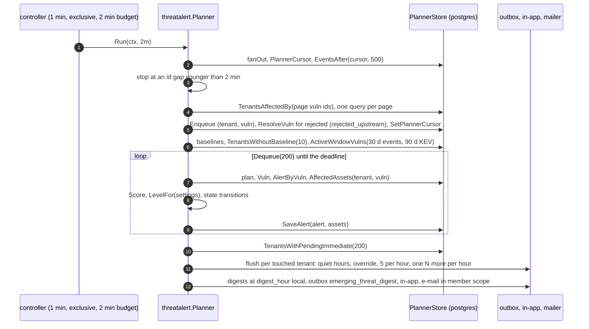
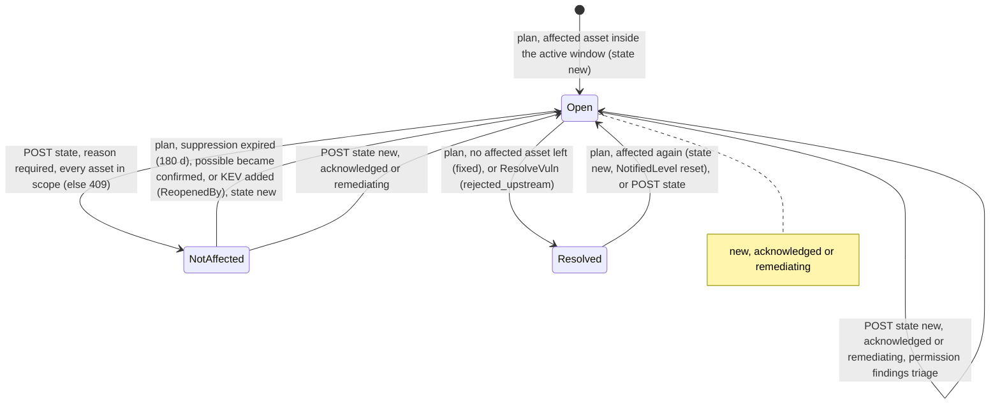
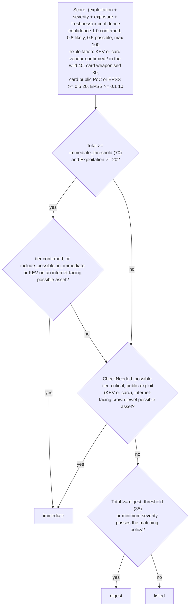
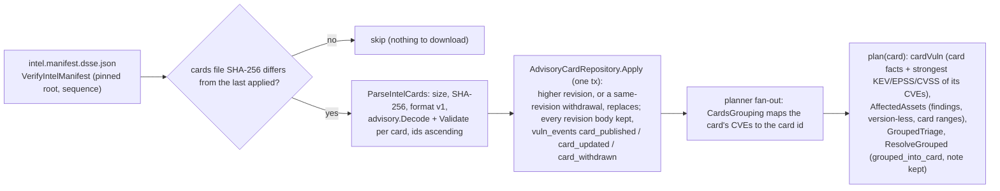

# Emerging-threat alerts

Design: [RFC-117](../rfcs/RFC-117-emerging-threat-alerts.md).

"Does this new vulnerability hit us?" answered per organization, with one
alert per vulnerability (never one message per asset) and a transparent
score that decides whether to interrupt someone.

## Pipeline

```
vulnerability bundle import (20 min) ─┐
KEV refresh (hourly, conditional)     ├─► vuln_events (global, public facts)
EPSS refresh (daily)                 ─┘          │ planner cursor (gap-safe)
                                                  ▼
matcher creates findings ──────────────► threat_alert_queue (tenant, vuln)
                                                  │ threat-alert-planner (1 min, exclusive)
                                                  ▼
                       threat_alerts + threat_alert_assets (per organization)
                                                  │ ETS, level, cap, quiet hours
              ┌───────────────────────────────────┼─────────────────────────┐
              ▼                                   ▼                         ▼
   immediate: outbox emerging_threat      daily digest 08:00 local     listed only
   + in-app (administrators)              outbox, in-app, e-mail       (the page)
```

## Flow

Verified against `develop` (2026-11-05); unchanged since v0.19.1.

### Planner pass (`threatalert.Planner.Run`, controller `threat-alert-planner`)



- A plan that fails is re-queued after the loop (not inside it), so a persistent failure cannot spin
  until the deadline. Items left when the budget ends are put back.
- `plan` skips a tenant whose module `threat_intel` is off or whose alerts are disabled, and a
  tenant not yet baselined (the baseline covers it).

### Alert lifecycle (`plan`, triage routes)



- `ValidateTransition` accepts `new`, `acknowledged`, `remediating` and `not_affected` from any
  state (no source-state check); `resolved` is set only by the planner. A `not_affected` decision
  on a KEV vulnerability is audited at high severity. The planner's `SaveAlert` refuses to
  overwrite a triage decision made after it read the alert (`ErrStale`) and plans it again.

### Level (`threatalert.LevelFor`)



## Advisory cards (shipped)

Cards arrive as the `cards` stream of the signed intel side manifest
(`intel-cards.jsonl.gz`, format `openctem.advisory-card/v1`), next to KEV and
EPSS. RFC-117 §3.5 has the rules; the path:



Tables (platform-wide, public facts, no tenant column): `advisory_cards`
(current revision, `body` is the validated card), `advisory_card_revisions`,
`advisory_card_vulns` (grouped ids), `advisory_card_products` (catalog keys,
joined to `software_products` at read time), `advisory_card_stream` (the last
cards file applied: SHA-256, sequence, data date). `threat_alerts.grouped_into_card`
holds the card a vulnerability's alert was grouped into. A `reported` card
(fast lane) alerts only: no exploitation score, no grouping (RFC-117 §3.5).

The importer's status metadata reports a refused cards stream in
`intel_error` (`cards: ...`); a platform without a card store lists it in
`intel_skipped`.

## Vulnerability event log (shipped)

- Table `vuln_events`; emitter state `vuln_event_state`; cursors
  `vuln_event_cursors` (`corpus`, `kev`, `epss`, `planner`). No tenant column
  in any of them.
- `internal/app/vulnevent.Emitter`:
  - `EmitCorpus` after every import, in the import controller's run. It
    reads the CVE records whose `synced_at` passed the cursor (keyset
    `(synced_at, cve_id)`, pages of 1000), compares each with its stored
    state (`vulnevent.Diff`) and writes events, states and the cursor in one
    transaction. The first run only records the state.
  - `EmitKEV` after every KEV refresh: catalog CVEs not marked `in_kev` emit
    `kev_added`; removals are recorded without an event.
  - `EmitEPSS` after every EPSS refresh: tracked CVEs whose band (0.1, 0.5)
    rose emit `epss_crossed`.
  - `Prune`: events older than two years.
- The emitter compares stored state, so a sync an operator runs by hand is
  picked up by the next scheduled run, and a replay emits nothing.

## KEV refresh (shipped)

- `kev-refresh` controller, hourly, exclusive. The request repeats the last
  response's `ETag` / `Last-Modified` (kept per URL in the `kev` sync status
  metadata under `validators`). A 304 marks the sync successful and skips the
  upsert, the prune, the priority recompute and the escalation.
- `threat-intel-refresh` keeps the daily EPSS refresh.

## Alerts (shipped)

Tables (migration `threat_alerts`): `threat_alerts` (unique per organization
and vulnerability), `threat_alert_assets` (composite foreign keys to the
organization's alert and asset), `threat_alert_queue`,
`threat_alert_tenant_state` (baseline, last digest, last overflow message).

Planner (`internal/app/threatalert.Planner`, controller
`threat-alert-planner`, every minute, exclusive, 2-minute budget):

1. **Fan-out.** Events after the planner cursor, in id order; an id gap
   younger than two minutes is waited for (a transaction may still commit).
   Each event queues the organizations with an open finding for the
   vulnerability or a possibly affected asset (`asset_software` whose
   version did not parse or is unknown, on a product the CVE names). The
   organizations of a whole page of events (500) come from one query, so a
   large feed import costs one lookup per page, not one per event. A
   `rejected` event resolves every open alert of the CVE
   (`rejected_upstream`), after the events before it are queued.
2. **Baseline.** Organizations never planned (all of them when the feature
   ships, every new one later) get the alerts of the active window (an event
   in the last 30 days, a KEV addition in the last 90) with nothing sent at
   once, and one baseline digest. Organizations with alerts off are
   re-checked hourly.
3. **Plan** each queued (organization, vulnerability): the alert opens only
   inside the active window; affected assets are the open findings
   (confirmed, or likely below 80% match confidence) and the possibly
   affected assets; the score and the level follow RFC-117 §3.2; no
   affected asset left resolves the alert (`fixed`); a suppression is lifted
   when it expires, by a stronger match, or by a KEV addition when the
   reason allows it. An alert already announced goes into the next digest
   again only when it reaches further: a host it did not hold, or a host in
   a stronger tier (`threatalert.HostsGrew`, see "Counting hosts").
4. **Send** pending immediate alerts: quiet hours hold all but the override
   score and bundle at the end of the window; at most five messages an hour,
   then one "N more" message (at most one an hour).
5. **Digest** at the organization's digest hour in its time zone, once a
   day, when something is pending (or the baseline is due): outbox
   `emerging_threat_digest`, in-app to administrators, e-mail to members
   whose `email_digest` preference is `daily` (or `weekly`, Mondays, seven
   days), counted within each member's data scope (fail closed).

Matched findings: `vulnmatch.Service` queues the vulnerabilities of the
findings it inserts (`SetAlertQueue`); they are announced by the alert.
The per-finding priority-escalation message is skipped when an open,
announced alert of a CVE in KEV covers the finding
(`OutboxPriorityChangePublisher.SetAlertCoverage`).

Messages carry the vulnerability id, the catalog product (control
characters and channel markup stripped, length capped), why now (KEV,
ransomware use, EPSS, severity) and the host counts in the console's words
("3 hosts confirmed, 1 likely, 2 possibly affected, 2 internet-facing", zero
parts left out; `HostCounts.Sentence`). Host names only with
`asset_names_in_messages` (at most five, each host once). The outbox metadata
carries `confirmed`, `likely`, `possible` and `internet_facing` as host
counts. Each outbox entry lists the affected asset ids for the delivery
resolver (private program routing).

## API (shipped)

| Route | Gate | Data scope |
|---|---|---|
| `GET /api/v1/emerging-threats` | `findings:vulnerabilities:read` | alerts with an asset in scope; host counts (`confirmed_hosts`, `likely_hosts`, `possible_hosts`, `internet_facing_hosts`), crown jewels (`critical_hosts`), the best product (`product`, `product_count`) all over in-scope assets |
| `GET /api/v1/emerging-threats/{id}` | `findings:vulnerabilities:read` | 404 without an asset in scope; the same host counts; assets in scope (`assets`, one entry per asset) and the same assets as one row per host by tier (`asset_groups`, see below); `can_suppress` |
| `POST /api/v1/emerging-threats/{id}/state` | `findings:triage` | not affected needs every asset in scope (409) |
| `GET, PUT /api/v1/organization/settings/emerging-threats` | administrator | organization settings, audited |

List filters: `level`, `state` (open by default), `tier`, `exposure=internet`,
`kev=true` (known exploited), `search` (CVE id or title). Each row carries the
score breakdown (`ets_breakdown`); the summary counts the open alerts by
level, `new` (not triaged yet), `kev` and `internet_facing`. The stored
`title` names the first product over every asset of the organization, so the
console shows `product` instead: a member with a data scope never reads the
product of an asset outside it.

Routes are behind the `threat_intel` module; the planner skips organizations
with the module off or alerts disabled. A remediation task from an alert
uses `POST /api/v1/remediation/tasks` with the alert's open findings that
are not in an active task (the one-active-task rule stays in the task
service).

Settings (`settings.emerging_threats`): `disabled`, `immediate_threshold`
(60-90, 70), `digest_threshold` (20-60, 35), `digest_hour` (0-23, 8),
`quiet_hours` (`enabled`, `start_hour`, `end_hour`), `quiet_override`
(70-100, 90), `include_possible_in_immediate`, `asset_names_in_messages`.
Audit: `tenant.emerging_threats_updated`, `emerging_threat.state_changed`
(high when a KEV CVE is marked not affected).

## Counting hosts (shipped)

Every number an alert shows counts hosts, and "confirmed" means confirmed
only: likely (a version match below 80% confidence) is its own number.

- **One definition.** `threatalert.HostKey` names the host row of an affected
  asset: the host of an asset named by a URL (scheme and default port ignored,
  case-insensitive, a trailing slash and a trailing dot ignored, an IPv6
  literal in brackets), or the asset itself for any other asset. The rows of
  the alert page (`GroupByHost`), the counts (`CountHosts`), the growth rule
  (`HostsGrew`) and the sentence of a message (`HostCounts.Sentence`) all use
  it.
- **What is counted.** Confirmed, likely and possible are the host rows of
  each tier, exactly the rows of the alert page (a host with services in two
  tiers is a row in each). Internet-facing and crown jewels count each host
  once: hosts with a service that is internet-facing, hosts with a service of
  criticality "critical".
- **Where.** The planner stores the organization-wide counts on the alert
  (`threat_alerts.confirmed_assets`, `likely_assets`, `possible_assets`,
  `internet_facing_assets`: the column names are older than the rule, their
  comments say hosts) and the key of each asset (`threat_alert_assets.host_key`).
  The list, the detail and the digest count distinct keys over the caller's
  in-scope assets (`viewerCountsSQL`), so a member with a data scope counts
  only hosts they can see and organizations never mix. Immediate messages read
  the stored counts; the e-mail digest is counted within each recipient's
  scope.
- **Growth.** An announced alert is announced again only for a host it did
  not hold when it was last planned, or a host whose strongest tier got
  stronger. One more port of a known host is not growth.
- **The score does not count.** Exposure points are the best single affected
  asset (internet-facing, crown jewel), never a sum, so several services of
  one host never raised a score. They stay per service: folding a host's
  services would raise the score of a host whose services differ in exposure
  or criticality, and so page people for a change of counting.
- **Alerts planned before** (migration `threat_alert_host_counts`): at start
  the API fills the host key of every alert asset without one and recomputes
  the stored counts of those alerts (`postgres.BackfillThreatAlertHosts`:
  batches of 100 alerts, one short transaction each with a 30 s statement
  limit, one replica at a time, idempotent). Nothing else of an alert changes
  and nothing is sent again; the next message for an alert says its numbers
  in the new words. Until a row is filled it counts as a host of its own.
  The key follows the asset's name at plan time: a renamed service is
  regrouped when its alert is planned next.

## Console (shipped)

- **Prioritization > Emerging threats** (`/emerging-threats`): a triage
  queue. Levels read as priorities: immediate is **Act now**, digest **This
  week**, listed **Watch** (the tooltip names the notification cadence; API
  values are unchanged). Five filter tiles (Act now, Untriaged, This week,
  Known exploited, Internet-facing); one toolbar with the state token, search,
  the filter panel (priority, match, known exploited, internet-facing) and
  Display; one compact row per threat: CVE and in-scope product, priority,
  score (breakdown on hover), exploit (KEV and ransomware; the EPSS figure as
  "Exploit chance" only without KEV), affected hosts in words ("3 hosts
  confirmed", "+1 likely", "+2 possibly affected", then internet-facing and
  crown jewels; zeros left out), state, last change, and a
  row menu (view, open page, acknowledge, remediating, reopen).
- A row opens a drawer: recommended action, score, hosts confirmed (likely
  and possibly affected beside it), internet-facing and crown-jewel hosts,
  why it is ranked (score parts), exploit status with the disclosure date,
  affected products by version (hosts per version), the most important hosts
  (one row per host with its services), what changed, and every action,
  including **Scan affected assets**
  (`scans:write` and `scans:execute`: the quick-scan dialog over the
  affected domains, subdomains and IP addresses, scope-checked before it
  starts). The alert page keeps the full asset table and timeline.
- The alert page lists the affected hosts in one table grouped by tier, each
  group shown only when it has a row: **Confirmed affected**, **Likely
  affected**, **Possibly affected (version unknown)**. A group's count is its
  rows. A row is a host: a host that serves several ports has one service
  asset per port, each named by its URL (`http://host`, `https://host`), and
  those assets share the host's row. The row shows internet-facing when any
  service is, the highest criticality, the distinct products and versions, and
  each service as a link to its own asset with its own finding and task
  links. An asset that is not named by a URL is a row of its own. On a phone
  the rows are cards under the same group headers.
- The rows come from the API (`asset_groups`), computed by
  `threatalert.GroupByHost` from the in-scope assets of the detail read: same
  organization, same tier, same host of the name (scheme and default port
  ignored, case-insensitive, trailing slash ignored; an explicit non-default
  port and a path stay in the service's label, for example `https:8443`).
  The host is read from the asset's name because a stored relationship from a
  service to the asset that exposes it exists only when a report carried one,
  and several assets can expose one service.
- Triage (`findings:triage`): acknowledge, remediating, reopen, not affected
  (reason required; hidden with a hint when assets are outside the viewer's
  scope). **Create remediation task** (`findings:remediation:write`) from the
  open findings not yet in a task; findings in a task are listed, not moved.
- **Settings > Emerging threats** (administrators): every setting above.
- Code: `web/src/features/emerging-threats/`, strings in
  `web/src/lib/i18n/dictionaries/{en,vi}/emergingThreats.json`.

## Key files

| File | What |
|---|---|
| `pkg/domain/vulnevent/event.go` | kinds, `Diff`, `EPSSBand`, the store interface |
| `internal/app/vulnevent/emitter.go` | the emitter |
| `internal/infra/postgres/vuln_event_repository.go` | persistence, KEV and EPSS comparison in SQL |
| `internal/infra/controller/threat_intel_refresh.go` | hourly KEV, daily EPSS |
| `internal/infra/controller/vuln_feed_import.go` | import, then corpus events |
| `pkg/domain/threatalert/` | alert, score, level, store interfaces |
| `internal/app/threatalert/planner.go`, `notify.go` | planner, delivery, digest |
| `internal/app/threatalert/service.go` | list, detail, triage |
| `internal/infra/postgres/threat_alert_repository.go`, `threat_alert_read.go` | persistence, scope-filtered reads |
| `internal/infra/http/handler/emerging_threat_handler.go`, `routes/emerging_threats.go` | API |
| `pkg/domain/tenant/emerging_threat_settings.go` | settings |
| `pkg/domain/advisory/card.go` | advisory card format, validation, version placement, `Exploitation` |
| `pkg/vulnbundle/cards.go`, `internal/app/vulnfeed/intel.go` | cards stream parsing and import |
| `internal/infra/postgres/advisory_card_repository.go`, `threat_alert_cards.go` | card storage, card-keyed alert reads |
