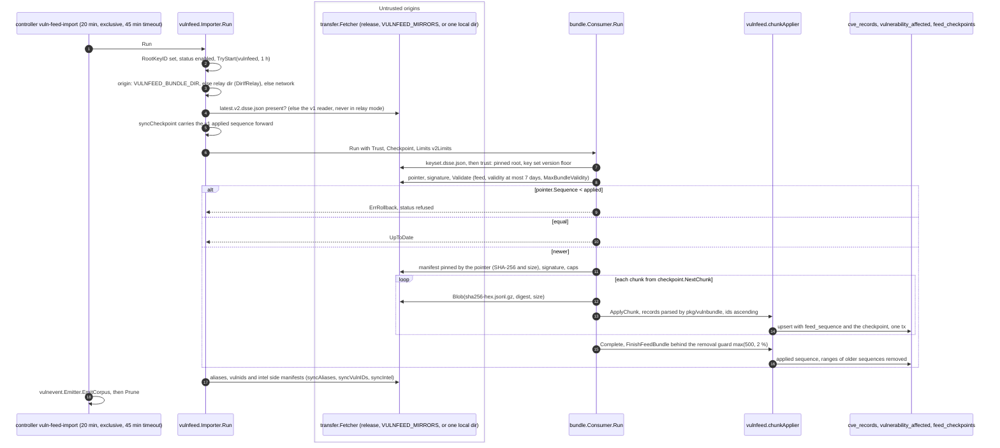

# Feed transfer

Design: [RFC-072](../rfcs/RFC-072-chunked-feed-transfer.md). Code: contract
`transfer` (fetcher) and `transfer/bundle` (format, writer, consumer), one Go
module of their own, `github.com/openctemio/contract/transfer` (tags
`transfer/vX.Y.Z`). It is a contract: the feed publishers and the api share
it, and the api depends on no sensor SDK module at all
([RFC-094](../rfcs/RFC-094-platform-contracts-only.md)). It moved unchanged
from `github.com/openctemio/sdk-go/pkg/transfer` v0.1.0; a golden test in ctis
pins the published bytes to that version.
The fetcher has no default HTTP client: the api passes `httpsec.SafeHTTPClient`.

Large data crosses the platform boundary in two directions, each through one
code path:

```
 feed collectors                          platform                         sensors / collectors
 (programfeed, vulnfeed)                                                   
  bundle.Writer ──► release / mirrors ──► bundle.Consumer ──► Applier       client.PushResultsV2
                    / local directory     (transfer.Fetcher)  (per-chunk tx,  + outbox (spool)
                                          feed_checkpoints     seq-guarded)        │
                                                                ▲                   │
                                          RFC-026 segments ◄────┴───────────────────┘
                                          RFC-005 async ingest
```

## Pull: signed chunked bundles

A release holds `keyset.dsse.json`, `latest.v2.dsse.json` (signed pointer:
sequence, the snapshot and delta manifest names, sizes and sha256),
`snapshot.v2.manifest.dsse.json` / `delta.v2.manifest.dsse.json` (signed:
streams of chunks with sha256, size, uncompressed size, record count, id
range) and `sha256-<hex>.jsonl.gz` chunks. Chunk boundaries come from record
ids, so unchanged chunks keep their name across releases and are fetched
once.

The importer (one per feed, scheduled, one run at a time) calls
`bundle.Consumer.Run`:

| Step | Check or effect |
|---|---|
| key set | the feed's `Trust` (pinned offline root, key-set version) |
| pointer | signature, feed, validity (contract default ≤ 8 days; the vulnerability feed sets 7, `vulnbundle.MaxBundleValidity`), sequence > applied (older: refused, equal: up to date) |
| choose | the bundle in progress (resume), else the delta on exactly its base, else the snapshot |
| manifest | matches the pointer's pin, signature, caps (chunks, sizes, total) — before any chunk |
| each chunk | fetched (hash and size verified), records streamed and validated by the feed parser, upserted in one transaction guarded by `feed_sequence`, checkpoint saved |
| complete | snapshot: rows of older sequences removed; sequence saved as applied |

`feed_checkpoints` (one row per feed, platform-wide: feed data is catalog
data, never tenant data) holds the applied sequence and the bundle in
progress with its next chunk. A crash or a failed chunk resumes at that
chunk on the next run; a partial bundle is never reported as applied.

The fetcher tries origins in order (release URL, `*_FEED_MIRRORS`, the
uploaded bundle directory) through the SSRF-guarded client: retries with
back-off and jitter, Retry-After, per-attempt deadline, stall guard, Range
resume, ETag, a circuit breaker per origin. Mirrors cannot change content:
everything is pinned by the signed pointer and manifests.

### Flow of one vulnerability feed import

Verified against `develop` (2026-11-05) and contract `transfer` v1.0.1; unchanged since v0.19.1.



- A refused chunk or a crash leaves `feed_checkpoints.next_chunk`; the next run resumes there. A
  newer pointer while a bundle is in progress abandons it (logged) and starts the new one.
- The import writes catalog tables only (no tenant column). Tenants see the result only through
  their own `asset_software` links and findings.

### The vulnerability feed (CVE corpus)

`internal/app/vulnfeed` reads streams `products`, `vulns`, `ranges` (in that
order); a range's record id is `<CVE>#<digest>`, so one CVE's ranges may span
chunks. Each record is validated by `pkg/vulnbundle` (`ParseProduct`,
`ParseVuln`, `ParseRange`), and ids must ascend inside the chunk's declared
range. Per chunk, in one transaction with the checkpoint:

- products resolve to global catalog products and are recorded in
  `cve_feed_products` (bundle key, product, sequence);
- CVE records are upserted with `feed_sequence`;
- ranges are upserted by `range_key` with `feed_sequence`, and must name a
  CVE record and products of the same bundle (written by its earlier chunks,
  so a resumed run needs nothing in memory); ranges of a rejected CVE are
  not kept.

Finishing the bundle (`FinishFeedBundle`, one transaction with the applied
sequence) removes the ranges of an older sequence the bundle replaced: a
snapshot removes every one it no longer holds and withdraws the CVEs it does
not hold; a delta only touches the CVEs it holds. Until then a CVE keeps its
old ranges next to its new ones, so no CVE ever loses ranges mid-bundle. The
removal guard runs here: at most max(500, 2 % of the stored ranges) may be
removed from non-rejected CVEs left without any range; over it the finish is
refused and repeated on each run until a newer release arrives.

The matcher's feed cursor (`cve_records.synced_at`) moves only for CVEs
whose record content changed, that gained a range, or that lost one at
finish, so a release re-evaluates the changed CVEs only.

The v1 reader stays the fallback for one release: when neither the bundle
directory nor the release serves `latest.v2.dsse.json`. Both readers share
the applied sequence (the v1 reader never goes below the checkpoint and
moves it forward; a v2 run first carries the v1 sequence into the
checkpoint) and the key-set version. Origins: the release
(the release base URL in force + `/latest/download`), then the mirrors in
force; with `VULNFEED_BUNDLE_DIR` only that directory is read. The release
base URL and the mirrors are a console setting
([Feed sources in the console](#feed-sources-in-the-console)).

### KEV and EPSS (signed side manifest)

The collector publishes the CISA KEV catalog and the EPSS scores next to
each release as a signed side manifest, `intel.manifest.dsse.json`
(`pkg/vulnbundle/intel.go`; format in the collector's README, "KEV and EPSS
side manifest"). The corpus format is untouched, so an older platform ignores
the files. After the corpus, in the same run (also when the corpus is
already up to date), `internal/app/vulnfeed/intel.go`:

1. verifies the manifest against the pinned root's key set and the applied
   sequence (an old manifest cannot be replayed with a new release), then
   each stream: a safe name, its own entries file, a data date not in the
   future, a fetch time inside the release's window;
2. skips (and lists in the status row's `intel_skipped`) a stream name it
   does not know: the manifest is signed, so skipping is safe and later
   signals add streams without a lockstep release;
3. per known stream, asks the intel service whether the stream is **newer
   than the data held**. If not, nothing is downloaded: only the stream's
   freshness (`bundle_fetched_at`, when the collector last read the source)
   is recorded. If so, the entries file is checked against the signed size
   and SHA-256 and every line is parsed strictly (ids ascending and unique,
   scores between 0 and 1, the record count as the manifest states);
4. applies it through `threat.IntelService.ApplyBundleKEV` /
   `ApplyBundleEPSS`: the data date must be newer than the date of the data
   held **from either path** (KEV by time, EPSS by day), so a replayed,
   resent or carried-forward older copy never rolls the catalog back and a
   bundle copy never overwrites a newer direct fetch; a snapshot under 90 %
   of the stored record count is refused as truncated; KEV removals stay
   behind the 25 entries / 2 % prune guard shared with the direct sync.

Then the same post-sync work as after a direct sync runs through one
function, `controller.IntelSweeper.Run` (queue the open findings whose intel
moved, refresh stored EPSS, reconcile KEV flags, report material changes to
the vulnerability event log). A refused stream is recorded as
`bundle_error` in that source's status row and never undoes the corpus
import; the other stream and the next run are unaffected.

Per source, the sync status row's metadata says which path supplied the data
held and how current the bundle's copy is: `delivered_via` (`bundle`; rows
from before the platform stopped fetching itself may say `direct`),
`intel_as_of` (data date), `bundle_fetched_at`,
`bundle_sequence`, `bundle_error`.

#### No direct fetch

Upgrade note: an installation without the bundle import (`VULNFEED_ROOT_KEY_ID`
empty) no longer receives KEV or EPSS.

The platform never calls CISA or FIRST: KEV and EPSS arrive only in the signed
release, fetched from the feed origin (direct mode) or through a relay sensor
(relay mode). Each release that carries a stream is a check of that feed: a
copy the collector read within the feed's stale limit (the feed status's
threshold, `feedstatus.StaleAfter`) marks the feed's last success even when the data did not change; an
older copy fails the check with `source_stale`, and a refused stream with its
refusal code, so the console and the freshness watch
([intelligence feeds](intelligence-feeds.md)) show a stale or blocked collector
instead of a quiet success. The hourly KEV and daily EPSS controllers fetch
nothing: they compare open findings with the catalogs at least daily. "Sync
now" for KEV or EPSS imports the newest release. Rows written before this
change may still say `delivered_via = direct`; the next newer release
replaces them.

## Relay: feeds through a platform sensor (no outbound access)

Design: [RFC-142](../rfcs/RFC-142-feed-relay.md). Code: `internal/app/feedrelay`
(rounds, spool, controller `feed-relay`, status), `internal/app/vulnfeed/relay.go`
(the planner), `internal/infra/postgres/feed_relay_round_repository.go`, sdk-go
`pkg/feedrelay` (the sensor side).

In relay mode (`GET/PUT /api/v1/admin/settings/feed-relay`; setting
`egress.mode.feeds` = `{mode, sensor_ids}`, the mode and one to three designated
relay sensors saved in one write; super admin, step-up, audited) the platform
makes no outbound feed request:

| Feed | In relay mode |
|---|---|
| vulnerability feed (corpus, KEV/EPSS side manifest, aliases, vulnerability ids) | relayed from the release base URL in force (the console setting, else `VULNFEED_BASE_URL`; not the direct-mode mirrors), read when each round is created; the importer reads the relay working directory as its only origin |
| KEV / EPSS | carried by the vulnerability feed's side manifest (the platform never fetches them itself, in either mode) |
| version check (release feed) | relayed; applied with origin `relay` (the same file again each day is not an error); the online check does not run |
| program feed URLs | not fetched (a `PROGRAMFEED_DIR` still is); listed as `not_relayed` in the status |

Relay sensors: any active shared sensor that reports `feed.relay@1` can be
designated. A sensor that should relay and never scan runs the sensor's relay
profile image (`ghcr.io/openctemio/sensor:<version>-relay`, sensor repository
`docs/PROFILES.md`): no tool, `feed.relay@1` as its only capability (no
`shared.isolation@1`, so no shared job is ever offered to it). The compose
install adds one with `deploy/docker-compose.relay-sensor.yml` (its own
enrollment token, `-feed-relay` on its enrollment job); the Helm chart runs
its bundled sensor from that image with `sensor.profile=relay`. Run one to
three for redundancy.

Defaults: a new compose install with the bundled sensor starts in relay mode
(`bootstrap-admin sensor-token -feed-relay` stores relay mode only when the
setting was never written, and the sensor that enrolls with that token is
designated once it reports `feed.relay@1`). Existing installations stay
`direct`: the feed relay migration records `direct` for a database that already
has users. There is never an automatic fallback to direct: a setting that
cannot be read counts as relay.

How a cycle runs (the replica holding the `feed-relay` controller lease, every
30 s):

1. **head**: a round asks for the key set, the pointer and the side manifests
   (unpinned, capped).
2. **plan**: after a round is delivered, the lease holder copies the spool into
   its working directory and the planner verifies the key set against the
   pinned root and its floor, the pointer and the manifests, and asks for what
   the import will need and the spool lacks: the manifest the pointer pins, the
   chunks (delta on its base, else snapshot), the side data files, each
   **pinned** by SHA-256 and size, at most 64 files or 192 MiB a round.
3. **import**: nothing missing, the importer runs on the working directory with
   every check of a bundle directory; spool rows and local files the current
   release no longer names are removed.
4. The next cycle starts after the feed's interval (20 min, release feed 24 h);
   a failed, refused or expired round backs off (at most 10 min).

Import is single-runner: the controller is exclusive (Postgres lease) and the
importer takes its own run guard; no other lock is needed. The controller's
timeout is the direct import's (45 min) so a first relayed snapshot is not
cancelled.

**Rounds and claims.** A round is a platform-wide row `feed_relay_rounds` (no
tenant), created unclaimed. `GET /api/v2/sensor/feed-relay-rounds/next` claims the
oldest open round for the calling sensor (`FOR UPDATE SKIP LOCKED`) and signs
it with the job signer as a `feed_relay` statement (platform tenant id,
instance scope, the feed origins as targets, which the signer checks against
`SIGNER_FEED_ORIGINS`). A claim with nothing uploaded for 10 minutes, or held
by a sensor no longer designated, may be claimed by another designated sensor:
two or three relays give failover. The claimer asking again gets its own round
back (a restarted relay resumes it). Uploads and `done` bind to the claimer.
A round the signer refuses is closed `failed` with `signer_refused` and the
signer's reason. With no round the answer is 204 with `Retry-After`: 15 s
while a cycle waits for its next plan, 60 s otherwise, 10 min for an eligible
sensor that is not designated (or direct mode). Only active instance-scope
sensors reporting `feed.relay@1` reach the routes; an organization's sensor
gets 403.

**Spool.** `PUT .../{round}/files/{name}` needs Content-Length and a sha-256
Content-Digest. The body is read under the file's cap (at most 32 MiB),
hashed, checked against the declaration and the round's pin, then stored in
`feed_relay_files` (one row per feed and name, shared by every API replica) in
one transaction that also checks the round is open and claimed by the
uploader, one upload per name per round (the same bytes again is a no-op), the
round's budget (256 MiB) and the spool quota (512 MiB; `spool_full` is
recorded on the round). A tampered file never enters the spool. The lease
holder copies rows into `<FEED_CACHE_DIR>/relay/<feed>` (pod-local, rebuilt
from the table after a restart, every row's digest re-checked) before it plans
or imports. Steady state is about 70 MB; the spool is emptied after seven days
in direct mode. Backups may skip the table's data (re-fetchable).
`POST .../{round}/done` keeps only rows for the round's own files, with
bounded codes.

**Status** (`GET /api/v1/admin/settings/feed-relay`, any administrator): the
mode, the designated sensors (online, can relay, last served, bytes today) and
per feed the applied sequence, the release's creation time and its age, the
round in progress (files and bytes delivered of wanted, claimer), and a
stale reason from a fixed list: `no_relay_designated`, `relay_offline` (no
designated sensor seen for 10 min), `signer_refused`, `sensor_refused`,
`upstream_missing` (the relay got 404), `nothing_delivered`, `pin_mismatch`,
`verify_failed`, `rollback_refused`, `plan_failed`, `import_failed`,
`round_expired`, `spool_full`. It also lists the platform's shared sensors
that may be designated (`candidates`: eligible when active and reporting
`feed.relay@1`, else a reason read from the sensor's own report:
`inactive`, `version_too_old` with `min_version` (v0.36.0, the first release
with the relay), `no_signing_key` (its signed-job posture is off),
`relay_off` (a recent sensor with a pinned key that does not relay:
`SENSOR_FEED_RELAY=0` on its host) or `no_capability` (it reports too little
to tell); the reason only explains and never makes a sensor eligible; never
an organization's sensor; a designated sensor that cannot relay carries the
same `reason`) and the open alerts.

**Alerts** (RFC-142 §2.5): in relay mode the controller tells the platform
administrators (e-mail and the alert webhook, as the system checks) when no
designated relay is seen for 1 hour (`relay_offline`), or the newest failed
round since the last import has `verify_failed`, `pin_mismatch`,
`rollback_refused` (critical) or `signer_refused`
(`round_failed:<feed>:<code>`). Open alerts are stored in the platform setting
`feed_relay.alerts` (one per condition across restarts and lease moves); a
cleared condition gets one "resolved" notice. Every alert also logs a WARN
line with `alert=feed_relay_<condition>`. The age of the data itself is
watched in every mode by the freshness watch
([intelligence feeds](intelligence-feeds.md#freshness-alarms-in-every-mode-and-the-all-user-banner)),
which replaced the relay's own 48-hour `feed_stale` alert.

A bundle directory (`VULNFEED_BUNDLE_DIR`) or a missing job signer locks relay
mode off.

## Feed sources in the console

Where the vulnerability feed is fetched from is the platform setting
`vulnfeed.sources` (`internal/app/vulnfeedsources`; console System > Threat
intelligence > Vulnerability feed address, next to Feed delivery):

| Value | Who changes it | Where it applies |
|---|---|---|
| Release base URL | platform owner in the console, unless the server pins it | direct mode: the importer's first origin; relay mode: the origin of every relay round |
| Mirrors (at most 5) | the same | direct mode only, tried after the release |
| Pinned root key id (`VULNFEED_ROOT_KEY_ID`) | server only | shown as "Official root" or "Custom root (set on the server)" with its fingerprint |
| Bundle directory (`VULNFEED_BUNDLE_DIR`) | server only | shown as set or not; the path is never sent |

- **Environment = default and lock.** Nothing stored: the server's
  `VULNFEED_BASE_URL` / `VULNFEED_MIRRORS` (or the built-in release). When
  either variable is set the address is pinned: the console shows it locked
  and `PUT` answers 409 `SETTING_LOCKED_BY_ENVIRONMENT`, as for the other
  settings that moved from the environment (RFC-079).
- **Validation.** https only; no user information, query or fragment; at most
  512 characters; not an internal address (`httpsec.ValidateFeedURL`, and the
  guarded feed client refuses one again at connect time); no duplicate, the
  mirror list at most 5. There is no private-mirror switch: a mirror on a
  private network is reached through the feed proxy, or the bundle directory
  is used. A stored value that no longer validates is ignored (the server's
  value applies, logged).
- **Applies without a restart.** The importer reads the address at the start of
  every run (`Importer.WithSources`; a change rebuilds the network fetcher; its
  transfer counters keep the first fetcher's until restart). The relay feed
  reads it whenever it creates a round (`feedrelay.VulnFeed.Origin`); the job
  signer still refuses an origin outside `SIGNER_FEED_ORIGINS` and the relay
  sensor one outside its `SENSOR_FEED_RELAY_ORIGINS`, so in relay mode the
  egress allowlists stay the boundary.
- **Change.** `PUT /api/v1/admin/settings/vulnfeed-sources`: permission
  `platform.settings.feed_sources` (platform owner only, migration
  `20261125035231`), a fresh step-up and a reason. A critical admin audit row
  `platform.vulnfeed_sources_changed` records the previous and new release URL
  and mirrors in full (a feed address carries no credential) and every
  administrator is told.
- **Test fetch.** `POST /api/v1/admin/settings/vulnfeed-sources/test` (same
  permission, a few per minute per administrator) fetches only the key set and
  the newest signed pointer (`latest.v2.dsse.json`, or `latest.dsse.json` from
  a v1 release) from each address with the guarded feed client, verifies the
  key set against the pinned root and the accepted key set version and the
  pointer against that key set, and answers per address: verified (sequence,
  and whether it is older than the applied one) or a code
  (`blocked_address`, `unreachable`, `not_found`, `http_error`,
  `root_mismatch`, `pointer_invalid`). Nothing is imported or stored. In
  relay mode or with a bundle directory the platform makes no outbound request,
  so the test answers 409 `FEED_TEST_UNAVAILABLE`.

Why the root stays on the server: every file from every origin is verified
against the pinned root before anything is applied, so an address only decides
whether the feed arrives, never what it says. A root changeable in the console
would let one console session (or a stolen one) make the platform accept a
feed signed by anyone, for every organization. The bundle directory is a path
on the server's file system, which the console never names.

## Push: segments and the outbox

Sensors and collectors send results with protocol v2 (RFC-026): segments
within the advertised limits, a stable `report_id` and a digest per segment
as the idempotency key, resumable progress. Every report is first written to
the encrypted outbox (0600, byte and age caps, oldest-first eviction), so an
unreachable platform loses nothing within the caps. The platform takes the
tenant from the authenticated sensor, never from the payload.

## Metrics

`*_transfer_*_total{feed}` (files, bytes, cache hits, 304s, retries,
resumes, fall-backs, failures, circuit skips), `*_bundle_*_total{feed}`
(runs, completed, resumes, chunks applied and failed, records, refusals),
and the sensor outbox metrics. Logs carry names, sizes, sequences and
errors, never record content.
