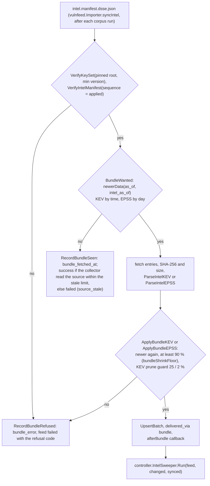
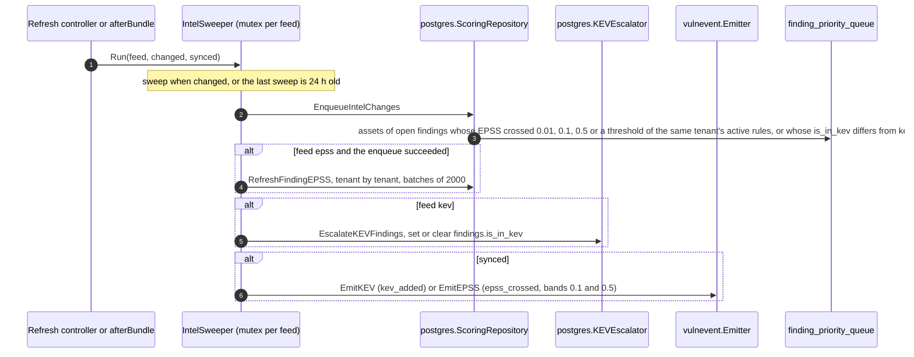

# Intelligence feeds: status model

The platform keeps three platform-wide feeds that every organization's prioritization reads: EPSS scores,
the CISA KEV catalog, and the signed vulnerability bundles. Each has one row in `threat_intel_sync_status`.
This page describes what the platform admin console and the organization routes report about them.

## Flow

Verified against `develop` (2026-11-05); unchanged since v0.19.1.

### Where KEV and EPSS come from

The platform makes no outbound call for them: they arrive only in the signed vulnerability release, fetched from the
feed origin or through a relay sensor. The controllers `kev-refresh` (hourly) and `threat-intel-refresh` (daily) fetch
nothing; they run the findings sweep below when it is due.

### After a change: `IntelSweeper.Run`

- `finding-priority` (every 10 s) drains the queue and reclassifies the open findings of each asset
  (`reclassify.Reclassifier`); the exploitation floor carries KEV into the class
  ([priority-explainability.md](priority-explainability.md)). Severity is never rewritten.
- `EnqueueIntelChanges` and `RefreshFindingEPSS` join `findings` and `assets` on `tenant_id`; the rule
  thresholds are matched `th.tenant_id IS NULL OR th.tenant_id = f.tenant_id`, so one tenant's rules
  never queue another tenant's findings. `EscalateKEVFindings` is a platform-wide `UPDATE findings`
  keyed on `cve_id` (a public fact, every tenant's matching findings change the same way).
- A failed enqueue keeps the stored EPSS values (the next run still sees the crossings) and does not
  move `lastSweep`.

## What the server computes

`internal/app/feedstatus` turns a status row into one `View`:

| Field | Meaning |
|---|---|
| `state` | `up_to_date`, `waiting_for_publisher`, `stale`, `failing`, `refused`, `running`, `off` |
| `error_code`, `error_params` | the last failure, classified (below); the console translates it |
| `last_attempt_at`, `last_success_at`, `failing_since` | a failed attempt does not move the success time; `failing_since` is the start of an unbroken run of failures |
| `next_run_at` | last attempt plus the scheduler's own interval, never in the past |
| `catalog_records`, `records_changed` | size of the stored catalog, and what the last run wrote |
| `data_as_of` | EPSS: the score date; vulnfeed: when the applied bundle was created; KEV: the last successful check |
| `detail` (vulnfeed) | applied sequence, key set version, root key id, bundle age, and per-source freshness |

The success time, the failure start and the error code live in the row's `metadata` (no schema change).

### Monitoring a feed that stops

The success time above is also exported for alerting: `openctem_feed_last_success_timestamp_seconds{source}` and
`openctem_feed_failing{source}` (enabled feeds only, read from the status rows by the operator metrics collector, `internal/infra/opsmetrics`).
The `FeedStale` Prometheus rule fires when a feed's last success is older than its window (bundle 36 hours, KEV 12 hours, EPSS 72 hours: these track the import itself; the age of the data is the freshness watch's, below); see
[monitoring](../operations/monitoring.md#feedstale). The bundle import controller judges staleness by the last successful import, not by whether the
current run was clean, and returns an import failure so the controller error counter counts it. Shipped.

### Freshness: alarms in every mode and the all-user banner

The freshness watch (`internal/app/feedwatch`, controller `feed-freshness`, every 10 minutes, one replica) checks the
platform's vulnerability data whatever the delivery mode (direct or relay):

| Condition | When | Banner |
|---|---|---|
| `data_stale:<feed>` | the data a feed holds is older than its limit: bundle 12 hours (the applied bundle's creation time), KEV 6 hours and EPSS 36 hours (the last successful check); or a feed never loaded data 2 hours after the watch first ran | yes |
| `import_refused:<feed>` | the last import was refused (expired, bad signature, rollback, guard): at once, even while the data is still current | no |
| `import_failing:<feed>` | imports have failed for two runs (at least 30 minutes) | no |
| `newest_record_old` | the newest published CVE in the corpus is older than 12 hours (about 280 CVEs are published a day) | yes |
| `volume_low` | the CVEs published in the last 24 hours are under 30% of the daily average of the 30 days before (only on a corpus averaging 50 a day or more) | no |

The two corpus checks run only once a bundle was applied, and catch an import that "succeeds" on old data. A feed an
administrator switched off is not checked. The open conditions are stored in the platform setting `feed_freshness.state`
(one alert per condition across restarts and lease moves). The platform administrators get one message when conditions
open and one when they clear (e-mail and the alert webhook); the operator metrics export
`openctem_feed_freshness_alerts{code}` and the `FeedFreshness` Prometheus rule fires on it
([monitoring](../operations/monitoring.md#feedfreshness)).

While a banner condition holds, every signed-in user sees a banner under the header that cannot be dismissed:
vulnerability data is out of date, new vulnerabilities may not be shown, the administrators have been told. It reads
`GET /api/v1/threat-intel/freshness` (any signed-in user, no permission: platform-wide state only, no organization data,
answered from the stored state with no feed or corpus query per request). The emerging-threat list and detail pages show
"Data as of <time>" from the same answer. The platform console shows its own banner with each condition's explanation
and a link to this status (`GET /api/v1/admin/threat-intel/freshness`, any admin). If the watch itself has not run for 30
minutes, the banner says so (`check_not_running`) rather than staying quiet.

In relay mode the relay alerts only on what is its own (no relay sensor online, a failed round); the age of the data is
the watch's. Shipped.

### States

| State | Rule |
|---|---|
| `off` | scheduled sync is switched off |
| `running` | the row says running and was updated within the hour (a longer "running" is an interrupted run) |
| `waiting_for_publisher` | the key set or pointer answered 404 and no bundle was ever applied; turns `stale` after 12 hours |
| `refused` | a signature, key set, sequence, expiry or size guard refused what was offered |
| `failing` | the last attempt failed and the data is not yet stale |
| `stale` | data older than the threshold: bundle 12 hours, KEV 6 hours, EPSS 36 hours |
| `up_to_date` | none of the above |

### Error codes

`publisher_empty`, `unreachable`, `http_status`, `signature_invalid`, `keyset_rollback`, `sequence_rollback`,
`expired`, `bundle_invalid`, `guard_refused`, `empty_feed`, `not_configured`, `disabled`, `interrupted`, `failed`.
Fetchers return typed errors (`feedstatus.HTTPError`, `GuardError`, `Tag`); the bundle verifier reports by
message and is classified by `TagVerify`.

## Who sees what

- `GET /api/v1/admin/threat-intel/sync` (any platform admin): the full view, including the raw `last_error`.
- `GET /api/v1/threat-intel/sync`, `/sync/{source}` and `/stats` (organizations): state and freshness only. No
  error text, host, status code or bundle internals: a failed fetch can name hosts and paths.
- `POST /api/v1/admin/threat-intel/sync` (ops_admin+, audited): queues a background sync of `epss`, `kev`,
  `vulnfeed` or `all` and answers 202 with one result per feed (`queued`, `already_running` or `skipped` with a
  reason: `disabled`, `not_configured`, `rate_limited`). No download or import runs inside the request. A
  single feed that cannot be started answers 409; a feed started less than 15 seconds ago answers 429 with
  `Retry-After`. The outcome shows in the feed's state, which the console polls every 2 seconds while a feed runs.

## One run per feed

A run claims its feed with one conditional update of the status row (`TryStart`): it succeeds only when the
row is not `running`, or has been `running` for more than an hour (an interrupted run). The scheduled
controller and the background job of "Sync now" call the same code, so they never overlap, on one replica or
across replicas; the loser skips quietly. The background job runs the feed's controller pass (fetch, store,
queue the priority recompute, reconcile the KEV flags, emit events), not only the fetch.

## Fetch rules

- KEV and EPSS refuse a snapshot under 90% of the stored catalog.
- A release's copy the collector read longer ago than the feed's stale limit is a failed check (`source_stale`).

Shipped: KEV and EPSS only from the signed release (see the flow above and [feed-transfer.md](feed-transfer.md), "KEV and EPSS"); the platform no longer fetches them itself.
