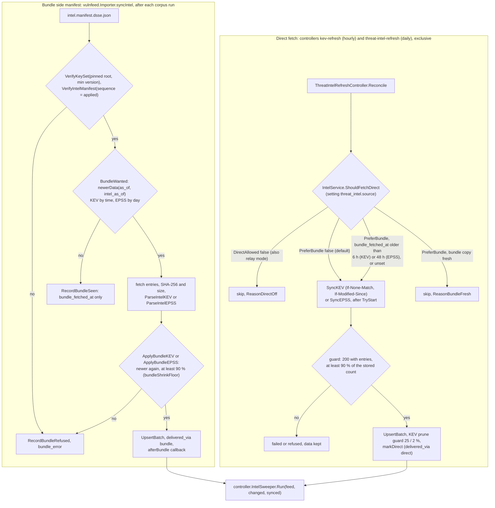
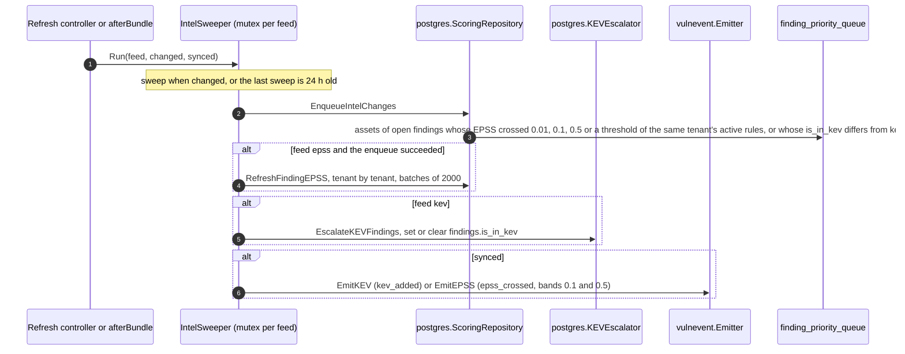

# Intelligence feeds: status model

The platform keeps three platform-wide feeds that every organization's prioritization reads: EPSS scores,
the CISA KEV catalog, and the signed vulnerability bundles. Each has one row in `threat_intel_sync_status`.
This page describes what the platform admin console and the organization routes report about them.

## Flow

Verified against `develop` (2026-11-05); unchanged since v0.19.1.

### Which path supplies KEV and EPSS

### After a change: `IntelSweeper.Run`

- `finding-priority` (every 10 s) drains the queue and reclassifies the open findings of each asset
  (`reclassify.Reclassifier`); the exploitation floor carries KEV into the class
  ([priority-explainability.md](priority-explainability.md)). Severity is never rewritten.
- `EnqueueIntelChanges` and `RefreshFindingEPSS` join `findings` and `assets` on `tenant_id`; the rule
  thresholds are matched `th.tenant_id IS NULL OR th.tenant_id = f.tenant_id`, so one tenant's rules
  never queue another tenant's findings. `EscalateKEVFindings` is a platform-wide `UPDATE findings`
  keyed on `cve_id` (a public fact, every tenant's matching findings change the same way).
- A failed enqueue keeps the stored EPSS values (the next run still sees the crossings) and does not
  move `lastSweep`.

## What the server computes

`internal/app/feedstatus` turns a status row into one `View`:

| Field | Meaning |
|---|---|
| `state` | `up_to_date`, `waiting_for_publisher`, `stale`, `failing`, `refused`, `running`, `off` |
| `error_code`, `error_params` | the last failure, classified (below); the console translates it |
| `last_attempt_at`, `last_success_at`, `failing_since` | a failed attempt does not move the success time; `failing_since` is the start of an unbroken run of failures |
| `next_run_at` | last attempt plus the scheduler's own interval, never in the past |
| `catalog_records`, `records_changed` | size of the stored catalog, and what the last run wrote |
| `data_as_of` | EPSS: the score date; vulnfeed: when the applied bundle was created; KEV: the last successful check |
| `detail` (vulnfeed) | applied sequence, key set version, root key id, bundle age, and per-source freshness |

The success time, the failure start and the error code live in the row's `metadata` (no schema change).

### Monitoring a feed that stops

The success time above is also exported for alerting: `openctem_feed_last_success_timestamp_seconds{source}` and
`openctem_feed_failing{source}` (enabled feeds only, read from the status rows by the operator metrics collector, `internal/infra/opsmetrics`).
The `FeedStale` Prometheus rule fires when a feed's last success is older than its window (bundle 36 hours, KEV 12 hours, EPSS 72 hours); see
[monitoring](../operations/monitoring.md#feedstale). The bundle import controller judges staleness by the last successful import, not by whether the
current run was clean, and returns an import failure so the controller error counter counts it. Shipped.

### States

| State | Rule |
|---|---|
| `off` | scheduled sync is switched off |
| `running` | the row says running and was updated within the hour (a longer "running" is an interrupted run) |
| `waiting_for_publisher` | the key set or pointer answered 404 and no bundle was ever applied; turns `stale` after 3 days |
| `refused` | a signature, key set, sequence, expiry or size guard refused what was offered |
| `failing` | the last attempt failed and the data is not yet stale |
| `stale` | data older than the threshold: bundle 3 days, KEV 6 hours, EPSS 48 hours |
| `up_to_date` | none of the above |

### Error codes

`publisher_empty`, `unreachable`, `http_status`, `signature_invalid`, `keyset_rollback`, `sequence_rollback`,
`expired`, `bundle_invalid`, `guard_refused`, `empty_feed`, `not_configured`, `disabled`, `interrupted`, `failed`.
Fetchers return typed errors (`feedstatus.HTTPError`, `GuardError`, `Tag`); the bundle verifier reports by
message and is classified by `TagVerify`.

## Who sees what

- `GET /api/v1/admin/threat-intel/sync` (any platform admin): the full view, including the raw `last_error`.
- `GET /api/v1/threat-intel/sync`, `/sync/{source}` and `/stats` (organizations): state and freshness only. No
  error text, host, status code or bundle internals: a failed fetch can name hosts and paths.
- `POST /api/v1/admin/threat-intel/sync` (ops_admin+, audited): queues a background sync of `epss`, `kev`,
  `vulnfeed` or `all` and answers 202 with one result per feed (`queued`, `already_running` or `skipped` with a
  reason: `disabled`, `not_configured`, `rate_limited`). No download or import runs inside the request. A
  single feed that cannot be started answers 409; a feed started less than 15 seconds ago answers 429 with
  `Retry-After`. The outcome shows in the feed's state, which the console polls every 2 seconds while a feed runs.

## One run per feed

A run claims its feed with one conditional update of the status row (`TryStart`): it succeeds only when the
row is not `running`, or has been `running` for more than an hour (an interrupted run). The scheduled
controller and the background job of "Sync now" call the same code, so they never overlap, on one replica or
across replicas; the loser skips quietly. The background job runs the feed's controller pass (fetch, store,
queue the priority recompute, reconcile the KEV flags, emit events), not only the fetch.

## Fetch rules

- A KEV 304 keeps the stored count (and fills a count an earlier run left at zero).
- A 200 with no entries (an empty or renamed `vulnerabilities` array, an empty EPSS file) is a failure and
  its cache validators are not stored.
- KEV and EPSS refuse a snapshot under 90% of the stored catalog.

Shipped: all of the above, including KEV and EPSS carried by the bundle with the direct fetch as a fallback (see the flow above and [feed-transfer.md](feed-transfer.md), "KEV and EPSS").
