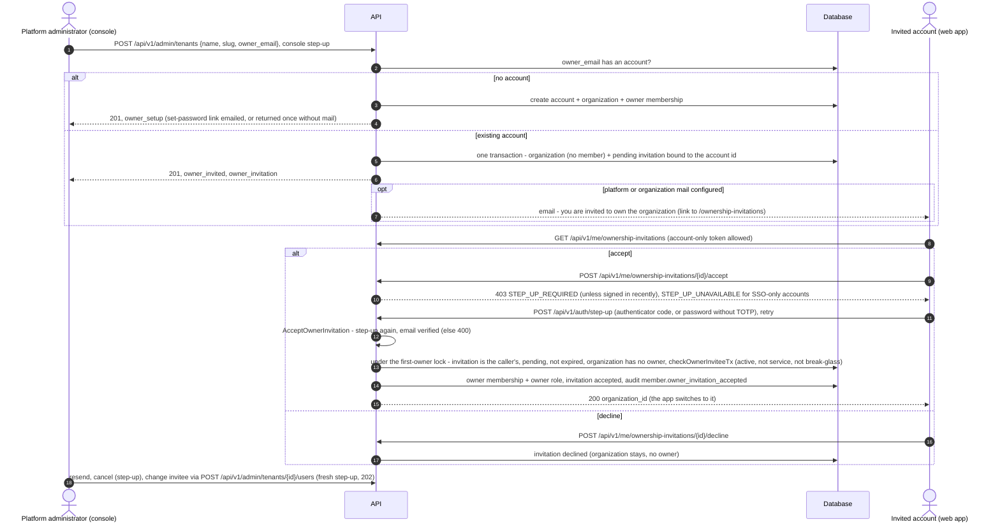

# Organization ownership invitations

Status: shipped (API, console, web app).

A platform administrator can create an organization for a person who already
has an account, for example to give one person several organizations on a
self-hosted installation where people cannot create organizations themselves.
That person is not made the owner on the administrator's word: the
organization is created **without an owner and without any member**, and the
account gets an **ownership invitation**. The person becomes the owner only by
accepting it in the app.

A new email (no account) works as before: an account is created for the owner
with a one-time set-password link (see
[user onboarding](user-onboarding.md#first-owner-platform-administrator)).

## Why an invitation, not a direct owner

Two rules hold for every path that makes someone an owner:

- **Nobody becomes an owner without their consent.** Someone may have
  registered a guessable address before the real person did; making that
  account the owner on an administrator's request would hand them the
  organization.
- **The platform administrator never places an account of its choosing into
  an organization that holds data.** An administrator's own account may be an
  ordinary member elsewhere; being able to add it to an organization would let
  the administrator read that organization's data.

The invitation keeps both: the invitee consents, and an invitation can only be
issued for an organization that was created waiting for its owner and that
nobody has entered.

## Flow

Without a mail server the invitation is not sent and is recorded that way
(see [Running without email](#running-without-email)).

States of an invitation: `pending` → `accepted` | `declined` | `canceled`. A
pending invitation past its expiry is shown as `expired`; a resend renews it.

## Rules

| Rule | Where |
|---|---|
| The invitation is bound to the account id (`invitee_user_id`), not the email string. Every invitee read and write filters on the caller's account id: another account's invitation answers 404, whatever it knows. | `internal/infra/postgres/owner_invitation_repository.go` |
| No bearer token: the invitee is identified by their own session, so there is no secret in the mailbox to steal or forward. | design |
| Accepting needs a recent re-authentication (`requireStepUp` on the route, checked again in the service) and a verified email address. | `internal/infra/http/routes/auth.go`, `internal/app/tenant/owner_invitation.go` |
| Single use: every transition is `WHERE status = 'pending'`. At most one pending invitation per organization (partial unique index). | migration `20261102094502_organization_owner_invitations` |
| Expires after 7 days. Resend: at most 5 sends per invitation, 10 minutes apart (429 when too soon); a resend renews the expiry. Without email a resend is refused (409 `EMAIL_UNAVAILABLE`) and an invitation is stored as never sent (`send_count` 0, `last_sent_at` NULL). | `pkg/domain/tenant/owner_invitation.go`, migration `20261111155507_owner_invitation_not_sent` |
| Accepting takes the organization's first-owner advisory lock (shared with the first-owner bootstrap) and refuses when the organization has any owner by then. A first-owner bootstrap cancels a pending invitation in its transaction. | `owner_invitation_repository.go`, `tenant_first_owner.go` |
| An invitation can be (re)issued only for an organization with an invitation history, none accepted, and no member at all. Once someone accepted, or anyone is in it, the console cannot invite an existing account into it. | `ReplaceOwnerInvitation` |
| The invitee must be an active person account, not erased, not a service account, not a break-glass administrator, checked when the invitation is issued and again when it is accepted. | `checkOwnerInviteeTx` |
| While it waits the organization has no member, so no tenant route admits anyone (membership is required); only the console's admin paths reach it. Its starting limits and feature denies are written with it, as for any new organization. | `CreateWithOwnerInvitation` |
| Every step is in the organization's audit log (`member.owner_invitation_sent`, `_resent`, `_canceled`, `_accepted` (critical), `_declined`); the console actions are also in the admin audit log (`organization.create`, `organization.user_create`, `organization.owner_invitation_resend`, `organization.owner_invitation_cancel`). | `owner_invitation.go`, `routes/admin.go` |
| The invitee is emailed when the invitation is sent, sent again, and canceled, when the installation can send email; the audit rows carry `invitee_emailed`. | `EmailService.SendOwnershipInvitation` |

Other paths are unchanged: the operator CLI (`bootstrap-admin -org-*`) and a
confirmed access request may still attach an existing account directly, and
any other caller of the organization creator still gets
`ErrOwnerAccountExists`. People still cannot create organizations themselves
where the sign-up policy forbids it.

## API

Console (platform administrator):

| Route | Gate |
|---|---|
| `POST /api/v1/admin/tenants` | ops_admin+, step-up. Existing account: `201` with `owner_invited: true` and `owner_invitation`. |
| `POST /api/v1/admin/tenants/{tenantId}/users` | ops_admin+, fresh step-up. For an organization waiting for its owner, an existing account replaces the pending invitation (`202` with `owner_invitation`); a new email creates the first owner and cancels the invitation. Any other organization: an existing account is refused (409) as before. |
| `POST /api/v1/admin/tenants/{tenantId}/owner-invitation/resend` | ops_admin+ (`platform.tenants.owner_bootstrap`), step-up |
| `DELETE /api/v1/admin/tenants/{tenantId}/owner-invitation` | ops_admin+ (`platform.tenants.owner_bootstrap`), step-up |
| `GET /api/v1/admin/tenants`, `GET /api/v1/admin/tenants/{tenantId}` | `owner_invitation` (status, counts, dates; the invitee's address for ops_admin+ only). Accepted invitations are not shown. The organization's own page also carries `email_delivery` and, for an open invitation, `owner_invitation.accept_url`. |
| `POST /api/v1/admin/platform-users/{user_id}/setup-link` | Without email only: a new one-time set-password link for the organization's new owner (see below). ops_admin+ (`platform.tenants.owner_bootstrap`), fresh step-up, reason, support rate limit. |

Invitee (any signed-in account, also one with no organization: the routes are
on the [account-space allow-list](tenantless-account-space.md)):

| Route | Gate |
|---|---|
| `GET /api/v1/me/ownership-invitations` | the caller's open invitations |
| `POST /api/v1/me/ownership-invitations/{id}/accept` | step-up; 404 for anyone but the invitee or a used invitation; 400 when expired or the email is unverified |
| `POST /api/v1/me/ownership-invitations/{id}/decline` | 404 for anyone but the invitee |

## User interface

- Console, **New organization**: with an existing account the dialog creates
  the organization and says "This person already has an account. They'll get an
  invitation to become the owner."
- Console, organization list and overview: "Waiting for owner to accept"
  (or expired / declined / canceled) in the owner column.
- Console, organization **Users** tab: the invitation (invitee, last sent,
  expiry, sends left) with **Send again**, **Change invitee** and **Cancel
  invitation**.
- Web app: **My account** shows "Organizations waiting for you" while there is
  one; the email links to `/ownership-invitations` (a signed-in page outside
  the organization layout). Accept asks for the step-up, then opens the
  organization.

## Running without email

Many self-hosted installations have no mail server. Every step still works;
the administrator hands things over instead of the mailbox.

**Existing account (ownership invitation).**

- The invitation is stored as never sent (`send_count` 0, no
  `last_sent_at`), and nothing claims a send that did not happen.
- The console says "Not sent: this server cannot send email" on the Owners
  card, in the create and change-invitee dialogs and on the Users tab. It
  hides Send again, Last sent and Sends left (the API refuses a resend with
  409 `EMAIL_UNAVAILABLE`).
- The console shows the accept address `{APP_URL}/ownership-invitations` with
  a Copy button. The address is not a secret: the invitation is bound to the
  account and the page shows it to that account only, after sign-in.
- In the web app, the invitee sees a banner with **Review invitation** wherever
  they land after signing in (the organization shell, or the account space of
  a person with no organization). In the organization shell the list rides in the session
  bootstrap (`ownership_invitations`), so the banner adds no request.
- An expired invitation is renewed with **Change invitee** and the same email
  address, which gives a new invitation with seven more days.

**New person (owner account created by the console).**

- The one-time set-password link (24 hours, single use, only its hash stored,
  `Cache-Control: no-store`) is shown once when the owner is created.
- The API returns it as the full web-app address `setup_url`. The console is
  another site, so it cannot build the link from its own address.
- If the link is lost or expires, the Users tab offers **New setup link** on
  the pending owner (`POST /api/v1/admin/platform-users/{user_id}/setup-link`
  with `organization_id` and a reason). The rules:

  | Rule | Detail |
  |---|---|
  | Only without email | With email it answers 409 `EMAIL_AVAILABLE`: the link is then only ever emailed. |
  | Only a new owner | The account must be an active owner of that organization (404 otherwise), never used and in no other organization (409). |
  | One live link | A new link revokes the old one. |
  | Audit | The admin audit log (`organization.owner_setup_link`: who, for which account, which organization in the request) and the organization's audit log record it, never the link. |

## Key files

- `server/migrations/20261102094502_organization_owner_invitations.up.sql`
- `server/pkg/domain/tenant/owner_invitation.go`
- `server/internal/app/tenant/owner_invitation.go`, `organization_creator.go`
- `server/internal/infra/postgres/owner_invitation_repository.go`
- `server/internal/infra/http/handler/owner_invitation_handler.go`, `admin_organization_handler.go`
- `web/console/src/features/admin-console/components/owner-invitation.tsx`
- `web/src/features/account/components/ownership-invitations-card.tsx`, `web/src/app/ownership-invitations/page.tsx`
