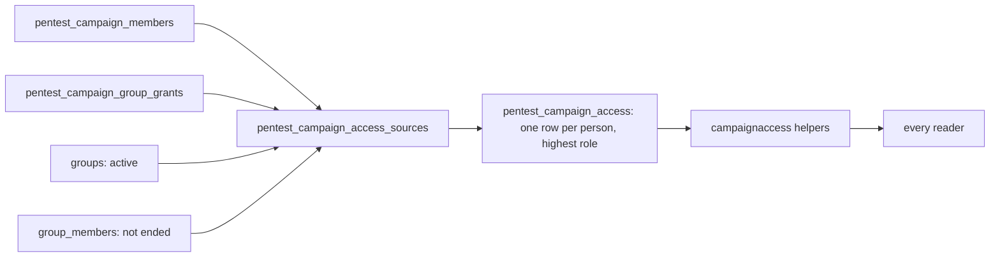

# Pentest campaign team: people and user groups

Who is on a pentest campaign team, with which role, and how that one answer
reaches every place that reads it. Roles and what each may do:
[authorization matrix, "Pentest campaign roles"](authorization-matrix.md#pentest-campaign-roles).

## Model

A campaign team has two kinds of entries:

- **People added by name** (`pentest_campaign_members`): one row per person,
  any role (`lead`, `tester`, `reviewer`, `observer`, `client`). Every campaign
  keeps at least one lead.
- **User groups** (`pentest_campaign_group_grants`): one row per group, with a
  role other than `lead` (a lead is a named person who answers for the
  campaign). The group's **current** members get that role: the group must be
  active, and a membership with an end date counts only until that date.

Group membership is read when access is checked, never copied. Adding someone
to the group gives them the campaign at once; removing them, deactivating the
group or reaching the end date of their membership ends it at once. Removing
the group from the campaign ends the access of every member who is not also
on the team by name or through another group.

When a person is on the team more than once, the **highest** role wins:
`lead` > `tester` > `reviewer` > `observer` > `client`
(`pentest.CampaignRole.Rank`, SQL `pentest_campaign_role_rank`, tested to
agree). A person added by name keeps their own role and their own row: the
lead changes or removes it as before; a group cannot change it, only add a
higher role on top while they are in the group.

## One resolution

- `pentest_campaign_access_sources`: one row per source of access (a direct
  membership, `group_id` NULL, or a current member of a granted active group).
  The rules of who counts live here only.
- `pentest_campaign_access`: one row per (tenant, campaign, user) with the
  highest role. Filters on the tenant, campaign and user reach both sources,
  so each lookup stays on indexes.
- `pkg/domain/campaignaccess` builds every reader's SQL:
  `MemberCampaignsSQL`, `MemberCampaignsWithRolesSQL`, `RoleSQL` and
  `FindingVisibleSQL` (a pentest finding is visible to a team member, and to a
  client only once published). `tests/unit/campaign_access_guard_test.go`
  fails when any other file queries the membership tables directly.

Readers on the effective team: the campaign role check on every
`/pentest/campaigns/{id}/*` route, the campaign list and "my campaigns", the
generic and pentest findings lists, their stats and exports (the registry's
member visibility rule), finding groups, the by-id finding gate, approvals,
dashboards (widgets, CTEM figures, the snapshot scope key), assignee checks,
team lists (campaign detail, MCP tools, the report's team section),
completion sign-offs, phase-change notifications and the member access report
in offboarding.

`FindingVisibleSQL` never refers to the finding inside its subqueries and
hands the planner the user's campaign ids as an array, so the team lookup
runs once per statement and a pentest list reads the
`(tenant_id, pentest_campaign_id)` index (measurements in the pull request
that added group grants).

## API

| Route | Gate | Notes |
|---|---|---|
| `GET /api/v1/pentest/campaigns/{id}/groups` | `pentest:campaigns:read` + any campaign role | groups with role and current member count |
| `GET /api/v1/pentest/campaigns/{id}/groups/options?search=` | `pentest:campaigns:write` + lead | the organization's active groups not yet on the team (name, member count), at most 50 |
| `POST /api/v1/pentest/campaigns/{id}/groups` `{group_id, role}` | `pentest:campaigns:write` + lead | role `tester`, `reviewer`, `observer` or `client`; 404 for a group of another organization or an inactive group; 409 when already on the team |
| `PATCH /api/v1/pentest/campaigns/{id}/groups/{group_id}` `{role}` | `pentest:campaigns:write` + lead | |
| `DELETE /api/v1/pentest/campaigns/{id}/groups/{group_id}` | `pentest:campaigns:write` + lead | |

The campaign detail carries `team_groups`, and each `team_members` entry
carries its effective `role`, its own `direct_role` (empty when only through
groups) and `via_groups`.

### Team size: bounded responses

A granted group can hold thousands of people, so no campaign response carries
the whole team:

| Response | Team data |
|---|---|
| `GET /pentest/campaigns` (list) | `team_count` (the whole team), `team_members` (the first 8: people added by name first, then by role) and `current_user_role` (the caller's own effective role, read from the access view) |
| `GET /pentest/campaigns/{id}` (detail) | `team_count` and the first 100 `team_members` (people added by name come first, so every lead is in it) |
| `GET /pentest/campaigns/{id}/members?page=&per_page=` | the team one page at a time (default 100, at most 200); the `X-Total-Count` header is the size of the whole team |

A campaign `client` sees names but never e-mail addresses, on any of these.
The page and the previews are cut in the database (window functions over the
access view), so the work does not grow with the group: a list of 6 campaigns
that each grant one 600-member group runs a constant number of queries and
returns a few KB.

When a person added by name as `client` is also in a granted group, the
highest role wins and they are lifted to the group's role (and then see
findings that are not yet published). The team screen marks that row with the
role the group gives, so the lead sees the lift.

`team:groups:members` holders can widen a campaign team indirectly, through
the groups they manage. That is the same power they already have over group
role bindings and asset scope; it adds no new class of access.

## Tenant isolation

The campaign and the group must belong to the caller's organization: the
service finds the campaign in the caller's tenant (404 otherwise), the insert
takes the group only when it is an active group of that tenant, and composite
foreign keys `(campaign_id, tenant_id)` and `(group_id, tenant_id)` refuse a
cross-tenant row whoever writes it. Every query filters on the tenant.

## Audit and notifications

`campaign.group_added`, `campaign.group_role_changed` and
`campaign.group_removed` record the group, its name, the roles and how many
people gained or lost access (and how many were notified). Adding a group
notifies, once, the members who were not on the team yet; removing it
notifies those left without access. The request notifies at most 50 people
one by one (a phase change likewise: people added by name first); the rest of
a large group see the change on the campaign list, and the audit event
carries the full count. Audit text names a group by its name, or "a group",
never by its id (the id is in the event's metadata).
Later changes to the group's membership send no campaign notification (the
group's own audit trail records them).
