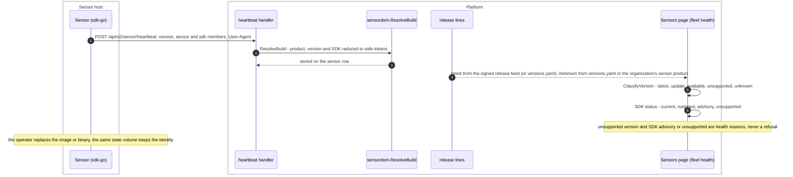

# Sensor compatibility and versions

Design: [RFC-037 §12 and §13](../rfcs/RFC-037-versioning-and-release-train.md).
This page is the contract for everyone who builds a sensor on sdk-go: the
first-party sensors and an organization's own.

## In short

- Releasing a sensor never needs a platform change or a platform release,
  whoever builds it.
- The platform judges a sensor by what the sensor declares, against ranges the
  platform owns. It never needs a list of products to accept one.
- "Update available" is information. It comes from the signed release feed
  for first-party products and from the organization itself for its own
  products.

## Flow

Code: `pkg/domain/sensor/build.go` (`ResolveBuild`, SDK status),
`pkg/domain/sensor/version.go:ClassifyVersion`,
`pkg/domain/sensor/fleet_health.go`. Nothing in this flow reaches the sensor:
the doorbell's `update` action is defined but never sent
(`pkg/domain/sensor/doorbell.go`), and sdk-go only logs it. A requirement a
sensor must meet is a capability or `required_features` that the claim
checks, so an older sensor is not offered that work.

## What a sensor declares

| Declared | Where | Used for |
|---|---|---|
| Protocol | the API version it calls (`/api/v2/sensor/*`, the v3 transport) | whether it can talk to the platform at all: a protocol the platform no longer serves has no endpoint |
| SDK name and version | heartbeat `sdk` member, else the User-Agent token `openctem-sdk-go/<version>` | the SDK compatibility verdict below |
| Product and version | heartbeat `sensor` member (`BaseSensorConfig.ProductName`), else the User-Agent product token (`useragent.SetProduct`) | the release line the sensor is shown against |
| Capabilities and tools | the manifest (RFC-033) and the tool descriptors (RFC-113) | which jobs it receives |

Everything a sensor declares is untrusted input: it is reduced to safe tokens
before it is stored (at most 64 characters, lower case, `vX.Y.Z` versions),
and it only changes what the organization sees. Authorization, grants, scope
and dispatch never read the product, the version or the SDK.

## What the platform owns

| Setting | Where | Effect |
|---|---|---|
| Protocols served | the API's routes | an unserved protocol is refused at the door |
| `sdk.min` | `versions.yaml` | a sensor built with an older sdk-go is degraded with the reason `sdk_unsupported` ("rebuild the sensor with sdk-go vX.Y.Z or later"), whatever its product. Empty today. It is raised only when a protocol change requires it, and announced in sdk-go's changelog first |
| `sdk.advisories` | `versions.yaml` | a sensor built with an SDK release that has a published security advisory is degraded with `sdk_advisory` |
| Newest SDK | signed release feed (fallback: `sdk.latest`) | an older SDK shows as `outdated`, with no health effect |

The SDK checks apply to sensors built with sdk-go (SDK name
`openctem-sdk-go`, or none for SDKs before names were reported). A sensor
built with another SDK is not judged against sdk-go's releases (`unknown`).

## Release lines

A sensor's version is compared with its product's release line (latest,
minimum):

| Product | Release line from | Verdicts |
|---|---|---|
| First-party (`openctemio-*`: the scanning sensor, the Tenable.sc connector) | latest: the signed release feed (fallback: the version the platform release was built with, shown as possibly outdated); minimum: `versions.yaml` | `latest`, `update_available`, `unsupported` |
| An operator's product (`SENSOR_PRODUCTS_FILE`) | the operator's file | the same |
| An organization's own product, with a release line recorded | the organization (Settings > Scanning > Sensor products, or `PUT /api/v1/sensors/custom-products/{product}`) | the same, for that organization only |
| An organization's own product, nothing recorded | none | `unknown`: only the SDK and protocol verdicts |

An organization records, per product, an optional latest and an optional
minimum release (owners and administrators, `sensors:write`; every member
reads them; audited; at most 50 products). The rules:

- The product is the token its sensors report. Names starting with
  `openctemio-` belong to first-party products and are refused, as is any
  product the platform catalog lists: an organization cannot change a
  first-party product's release line, not even for itself.
- The release line changes only that organization's verdicts. Another
  organization with a sensor of the same product name sees nothing of it.
- Nothing is fetched: the platform makes no outbound request for an
  organization's product.

## For sensor authors

1. Pick your own product name (not `openctemio-*`) and set it with
   `BaseSensorConfig.ProductName` or `useragent.SetProduct`.
2. Build with a current sdk-go. Watch sdk-go's changelog for an `sdk.min`
   announcement.
3. Release your sensor whenever you like. To get "update available" and
   "unsupported" verdicts, record the new latest (and, if you drop support
   for old releases, the minimum) in the console.

## Key files

- `versions.yaml`, `server/internal/versions/`: the built-in catalog, `sdk.min`,
  `sdk.advisories`, the learned releases
- `server/pkg/domain/sensor/build.go`, `fleet_health.go`: the SDK and version
  verdicts
- `server/pkg/domain/sensor/custom_product.go`,
  `server/internal/app/sensor/custom_products.go`,
  `server/internal/infra/postgres/tenant_sensor_products.go`,
  `server/internal/infra/http/handler/sensor_custom_products_handler.go`: an
  organization's own products (migration `002913_tenant_sensor_products`)
