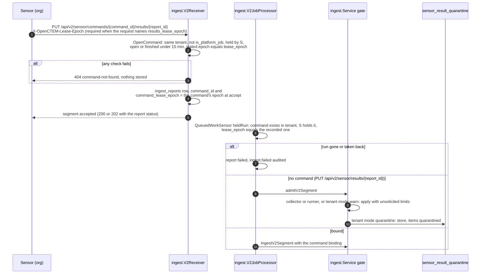

# Sensor result binding and the results quarantine

Part of the [sensor and platform workflow](sensor-platform-workflow.md).

> RFC: RFC-040 §5.3 and §6.1 group (C) (mutual distrust between the platform
> and sensors; decision Q6 (a)). Protocols:
> [RFC-026](../rfcs/RFC-026-sensor-results-ingest.md) (v2 results; the
> v1 results routes are closed, every sensor report arrives over protocol v2),
> [sensors.md](sensors.md). Migrations: `000287_sensor_result_quarantine`,
> `002081_collector_assets` (complete collector reports, RFC-040 §12).

A sensor key used to be enough to write and change any asset and finding of
its tenant, with no job behind it. Since RFC-040 group (C) every sensor report
is classified by the authority behind it, and only a report bound to a command
the sensor holds may change what already exists.

## Flow

## The rule

| Report | What it may do |
|---|---|
| **Bound**: names a command assigned to the submitting sensor and open (acknowledged or running, or finished less than 15 minutes ago) | Everything it did before, limited to the command: it changes existing assets the command's targets cover, reopens findings a person resolved on them, and auto-resolves only on those assets. Its tool must be the command's tool. |
| **Cross-sensor or stale command**: names a command of another sensor, one finished long ago, or one that does not exist | Refused: `404 command-not-found` (v2 problem). Nothing is stored. |
| **Unsolicited**: names no command, from a **collector** or **CI runner** (`type` `collector`, `runner`) | Applied with the unsolicited limits (below), whatever the tenant's mode. |
| **Unsolicited**, any other role (`worker`, `sensor`), tenant mode **warn** | Applied with the unsolicited limits; the ingest audit entry carries `unsolicited_warned: true`, the response `"unsolicited_warned": true`, and `sensor_unsolicited_results_total{outcome="warned"}` counts it. |
| **Unsolicited**, any other role, tenant mode **quarantine** | Stored in the quarantine, not applied. The receiver accepts the segments; the worker decides once per segment (`admitV2Segment`) and the report status counts every item under `quarantined`, with item error `quarantined_no_command`. Audited as `sensor.results_quarantined`. |
| Server-side ingest (tenant upload, DefectDojo, an accepted quarantine item) | Trusted: unchanged behavior. |

**Unsolicited limits.** An unsolicited report may create assets and findings
and update open findings. It never changes an existing asset: no exposure,
`is_internet_accessible`, compliance scope, data classification, PII/PHI,
owner reference, identifiers, name, tags or properties, and no reactivation
(an active asset only gets its last-seen time; an inactive, stale or archived
one is not touched). It never reopens a finding a person resolved (status
`resolved`/`verified` with any verification but `covered_scan`); a
finding the scanner auto-resolved still reopens when it is seen again. In a
tenant whose mode is **quarantine** it never auto-resolves anything; in
**warn** mode it auto-resolves as before. The response counts what was held
back: `assets_limited`, `reopens_withheld`
(`sensor_result_changes_withheld_total{kind}`).

**Complete reports from a trusted collector** (RFC-040 §12, migration
`002081_collector_assets`). One exception to the unsolicited limits, for the
inventory a collector owns:

- *Who.* A collector sensor of the tenant (stored row: type `collector`,
  active, never a platform sensor) whose grant is at trust level `trusted`
  with push ingest in effect (`ingest.trustedCollector`; fails closed when
  the row or the grant cannot be read). Its reports are an `integration`
  source for attribute reconciliation, named by the tool.
- *Collector source.* The sensor, the tool (collector type, lower-case) and
  `metadata.source_ref` (the collector instance, at most 255 characters).
  Every report of a trusted collector, complete or not, records in
  `collector_assets` which assets the source reported, when (never moving
  backwards), and whether that report created them (`created_asset`, which
  only ever turns on).
- *Changing existing assets.* A report with `coverage_type: full` may change
  the existing assets its own source created, like a bound report changes
  its command's targets, unless a person decided on the asset (a manual
  attribute lock in `asset_attribute_sources`, or a manual status override)
  or it is deleted. Every other existing asset, including one another
  source created, keeps the unsolicited limits. A finding a person resolved
  on an asset the source owns still stays resolved.
- *Not seen.* When a complete report is committed (protocol v2, at
  finalize), the assets its source created that the report does not list,
  that the source last reported before the report's time and that no source
  saw at or after it are marked missing (`missing_since`), and the active
  ones are demoted to `stale` (never a manual status override, never
  deleted), with a `disappeared` state-history row. Nothing is marked when
  the report is empty, when any segment refused, quarantined or failed an
  asset (an asset a scope exclusion of the organization kept out is not a
  refusal: it gets the item error `asset_excluded` and is counted neither
  as accepted nor as rejected), or when the share would blind the inventory (the auto-resolve
  `BlindingGuard`: more than 100 and more than half of the source's assets).
  A partial or incremental report never marks anything, and a report
  replayed with an older time neither overwrites newer values nor marks
  assets a newer report listed. Listed again, an asset is active again.
- *Merges.* An asset merge never hands a collector source the kept asset:
  the merged asset's rows are removed with it.
- Assets collectors created before the migration have no rows, so no
  collector changes or marks them until it creates them again.

**Hostname-scoped jobs** (RFC-040 §5.3.1, §5.3.2). A report bound to a
`scan` or `retest` command whose targets name a host is inside the job for a
located asset (domain, subdomain, address, host, service, web application)
at or under a target name, at a target address or range, or at an address
an in-bound asset of the same report states (its A or AAAA records,
`resolved_ips`, address properties, or an address asset whose host name is
in bounds); a service is judged by its host. An asset outside the job is
recorded, never dropped: a new one is created as a scan discovery (it grants
nothing; the active-scan gate decides what may be probed), an existing one
is only marked seen, and its findings are stored but run no new-finding
automations and the asset does not count as covered by the run. The
response counts `assets_outside_job` and `findings_outside_job`,
`sensor_results_outside_job_total{kind}` counts it, and
`sensor.results_outside_job` is audited (medium). One report records at most
1000 such assets; the rest are refused with their findings (`assets_over_cap`,
`findings_over_cap`, item error `too_many`, receipt item `over_cap`, audit
severity high). Commands whose targets are all addresses and ranges use the
address-chunk rule the same way (`assets_outside_chunk`); assets that name
no host are left to the output contract.

**Channel.** The channel a sensor's findings are filed under
(`findings.ingest_channel`) is `collector` for a collector sensor and
`scanner` for any other, bound or not, also after a person accepts a
quarantined report; the document names no channel (CTIS 2.0 has `channel` only as a producer hint; it is ignored). Only
server-side ingests without a sensor and CI runs keep their own value.

**Coverage.** A command covers an existing asset when one of its payload
targets (`targets`, `target`) names the asset's host (or one of its IPs), a
parent domain of it, a CIDR containing its IP, or, for assets with a path
(repositories), the same path or a parent path (`github.com/acme` covers
`github.com/acme/app`). A command with no targets covers nothing: its report
creates and updates findings but changes no existing asset.

Also part of group (C):

- Scan coverage auto-resolve (`INGEST_COVERAGE_AUTO_RESOLVE`) considers only
  the assets the command covers. A report still "touches" every existing
  asset it names (an uncovered one only gets its last-seen time), but the
  absence of a finding proves something only where the command was sent to
  scan.
- A sensor with no declared and no reported tools no longer auto-resolves
  (it could close any tool's findings with a "full" report).
- Validation evidence without the validate command assigned to the sensor
  (`command_id`) is refused with `403 COMMAND_REQUIRED`, unless the tenant
  turns on `allow_advisory_evidence`; it is then stored as advisory.
- A sensor reads only the reports it sent (`GET /api/v2/sensor/results/{report_id}`).
  The v1 ingest-job and scan-session routes were retired with protocol v1.

## Shared sensors

A shared sensor (scope `instance`, [RFC-100](../rfcs/RFC-100-shared-sensors.md)
§8) has no tenant. Its results are bound to the job, never to the sensor:

| Request | Outcome |
|---|---|
| `PUT`/commit on `/api/v2/sensor/commands/{command_id}/results/…` for a shared job (`is_platform_job`) the sensor holds (`commands.sensor_id`), open or finished within the grace window, with `X-OpenCTEM-Lease-Epoch` equal to the command's `lease_epoch` | Accepted and stored in the **command's** tenant (read from the command row). A tenant named anywhere in the request (query, header, body) is ignored. Written as a bound report (T1): it changes only what its command covers, is never a trusted collector, and evidence says `sensor:platform`. |
| The same for a job held by another sensor, a tenant job, an old or missing lease epoch, or an unknown id | `404 command-not-found`, nothing stored. |
| Any route that names no command (`/results/{report_id}` PUT, commit, status, abandon) | `403 scope-denied`: a shared sensor never pushes. |

The same rule holds below the handler:

- `ingest_reports` has no composite (tenant, sensor) key any more; the
  trigger `trigger_ingest_reports_sensor_binding` (migration
  `ingest_reports_shared_sensor`) keeps an organization sensor's report in its
  tenant and stores a shared sensor's report only with a shared job of the
  report's tenant that the sensor holds.
- The ingest worker processes a queued report of a shared sensor only while
  the sensor still holds that job (`QueuedWorkSensor`); otherwise the report
  fails and is audited as dropped.
- `Service.Ingest` refuses a shared sensor's report without a command
  binding.

An organization sensor never posts results for a shared job, even one of its
own tenant (`OpenCommand` refuses `is_platform_job`), and never receives one
(the tenant claim predicate).

## Late results

A run the platform took back (lease expired, released, stalled, re-routed)
and handed out again is a new run with a new lease epoch. Results of the old
run never bind to the new one when the sender states its epoch (a shared
sensor always must); for an organization sensor that sends none, see "No
epoch sent" below:

- **At accept.** An organization sensor that sends `X-OpenCTEM-Lease-Epoch`
  must send the command's current `lease_epoch`; an old epoch is
  `404 command-not-found` and nothing is stored (`OpenCommand`). A shared
  sensor must always send it (above). A request that names the
  `results_lease_epoch` feature in `X-OpenCTEM-Sensor-Features` (sdk-go that
  stores the epoch with each outbox report, and every protocol v3 result call
  that carries `lease_epoch`) commits the sensor to stating the epoch: the
  same request without one is `404 command-not-found`. An organization sensor
  that neither states an epoch nor names the feature (an older sdk-go, or a
  report an older sdk-go stored before an upgrade) is checked only for
  holding the command and the grace window.
- **At processing.** Each report records the lease epoch of its command when
  it was accepted (`ingest_reports.command_lease_epoch`, migration
  `ingest_reports_command_lease_epoch`). The ingest worker processes a queued
  report only while the command still exists in the tenant, the sensor still
  holds it, and its epoch is the recorded one (`QueuedWorkSensor`,
  `heldRun`); a finished command keeps its holder, so a report of a run that
  completed is still applied. Otherwise the report fails (the sensor sees it)
  and the drop is audited (`ingest.failed`, denied, with the reason). Reports
  accepted before the migration have no recorded epoch: only the holder is
  checked.
- **No epoch sent** (senders that do not name `results_lease_epoch`). The
  recorded epoch is the command's epoch when the
  report was accepted (`V2Receiver.createReport`), not the epoch of the run
  that produced the results. So for a sender with no epoch the worker only
  catches a take-back that happens between accept and processing. When the
  platform took the run back and handed it to the same sensor again before
  the late report arrived, the old run's results are accepted under the new
  run's epoch and applied as the new run's. A run handed to another sensor
  is refused at accept (holder check). A current sdk-go states the epoch the
  report was made under (kept in the outbox item), so its late report is
  refused at accept instead.
- **Protocol v3.** `PutResult` and `CommitResult` carry `lease_epoch`; the
  transport passes it to the v2 handler as `X-OpenCTEM-Lease-Epoch` together
  with the `results_lease_epoch` feature, so the rules above apply unchanged.

## How a report names its command

| Path | Carries the command id | Who sends it today |
|---|---|---|
| v2 `PUT /api/v2/sensor/commands/{command_id}/results/{report_id}` | yes, in the path | every sensor on sdk-go ≥ v0.10.0 (sensor ≥ v0.6.0, so all deployed v0.6.x and v0.7.0 sensors) for results produced while running a command (`core.WithCommandID` on the executor context, kept by the outbox) |
| v2 `PUT /api/v2/sensor/results/{report_id}` | no | sdk-go when the command is no longer open (it re-sends unbound after `command-not-found`), and pushes outside a command |

So scheduled scans, scan workflow steps and quick scans run by current sensors are
bound and apply as before.

## Modes and defaults

`sensor_result_policies` holds one row per tenant: `mode` (`warn` |
`quarantine`) and `allow_advisory_evidence` (default false). Migration 000317
gives every tenant that exists at upgrade time `warn`, because sensors on old
SDKs could not name their command at the time. A tenant without a row
(every tenant created later) is on `quarantine`. An administrator switches
with `PUT /api/v1/sensors/result-policy` (`sensors:write`, audited as
`sensor.result_policy_updated`). RFC-040 §7: the switch is forced to
quarantine at the bearer-key sunset.

## The quarantine

`sensor_result_quarantine` stores the CTIS report (one row per request or
v2 segment; a 1.x report held from before the CTIS 2.0 switch can no longer be accepted) as JSON, with the sensor, route, report id, tool and counts. At
most 1000 pending items per tenant, 200 per sensor, 16 MiB per item and 512 MiB
of pending payload per tenant; beyond that the report is refused (`422 RESULTS_QUARANTINE_FULL`, v2 item error
`quarantine_full`), so a stolen key cannot fill the database.

| Endpoint | Permission | |
|---|---|---|
| `GET /api/v1/sensors/quarantined-results?status=&sensor_id=&page=&per_page=` | `sensors:write` | newest first, no payload |
| `GET /api/v1/sensors/quarantined-results/{qid}` | `sensors:write` | with a preview: up to 100 assets and findings |
| `POST /api/v1/sensors/quarantined-results/{qid}/approve` | `sensors:write` | applies it as a person's decision: may change the existing assets it names and reopen findings, never auto-resolves; marked accepted only once the apply succeeded (a failed apply leaves it pending); once only: 409 after, and while another accept applies it |
| `POST /api/v1/sensors/quarantined-results/{qid}/reject` | `sensors:write` | drops the payload; once only; 409 while an accept applies it |
| `GET`/`PUT /api/v1/sensors/result-policy` | `sensors:read` / `sensors:write` | the mode and `allow_advisory_evidence` |

Reading the quarantine needs `sensors:write` too: the items hold raw asset
values and finding titles, which a viewer who can only read sensors must not
see (`routes/scanning.go`).

Accept and discard are audited (`sensor.results_accepted`,
`sensor.results_discarded`).

Reviewed items (accepted or discarded) are deleted 30 days after review by the
`sensor-result-quarantine-purge` controller (daily, one replica at a time);
pending items are never purged. `SENSOR_RESULT_QUARANTINE_RETENTION` (default
`720h`) and `SENSOR_RESULT_QUARANTINE_PURGE_INTERVAL` (default `24h`) change it.

### A verified first-party tool that lags its descriptor is ingested

A bound report may carry only the types its tool's descriptor declares
(`output_binding.go`); the rest used to be held for review. A descriptor that
lags its importer is a tool bug, not a risk, so findings the tool was asked to
produce are no longer parked (`app/ingest/contract_mismatch.go`). The part of
the report the platform catalog allows for the tool and the command's targets
cover is ingested normally and flagged, when ALL of these hold:

- the tool is one a released sensor compiles in and its contract claims origin
  `builtin` (`sensor.ToolTrust` is `builtin`);
- the sensor's grant is `trusted`;
- the sensor's current manifest was sent by the sensor, and its descriptor for
  the tool hashes to the contract digest;
- the asset has a located type (name, address, service, web application) and a
  target of the bound command covers it (the same target matching as the
  job-target binding above; a command with no targets covers nothing).

Flagged: the receipt gets an error entry `contract_mismatch` for each finding
of an undeclared-type asset, the audit gets `sensor_result.contract_mismatch`
(tool, tool version, types, descriptor digest), the platform administrators
get one notice per (tool, type, tool version) per 24 hours (in memory, the
coverage operator's notifier), and
`sensor_unsolicited_results_total{outcome="contract_mismatch_ingested"}` counts
it.

Still held (or refused), unchanged: a third-party, unsigned or untrusted
descriptor or tool; an unverified sensor; an asset outside the command's
targets or with no location to check; dependencies and endpoints; anything the
catalog does not allow for the tool; and every quarantine cap. Another tenant's
sensor never reaches this path.

Not done: held items already in the quarantine from a first-party tool are not
released by this rule, because a held item does not store its command's
targets, so the scope check cannot be repeated at release time. They are
released by the descriptor rule below once the tool's descriptor declares the
types. A signed-release check of the descriptor is a follow-up.

### Automatic release of out-of-contract holds

A report held as `out_of_contract` usually means the tool's descriptor lags
its importer (the importer emits a type the descriptor does not declare yet).
When the sensor's next release declares it, nobody should have to approve each
item. The platform re-checks held items against the tool's CURRENT descriptor
(`app/ingest/quarantine_release.go`):

- When: every 5 minutes (`sensor-result-auto-release`, one replica at a time,
  at most 100 items examined per run), and right after the sensor registers a
  manifest that differs from its current one (only that tenant and sensor).
- Which items: same tenant, same active sensor, same tool; reason
  `out_of_contract`; pending; younger than `SENSOR_RESULT_QUARANTINE_RETENTION`;
  not being applied.
- Which descriptor counts: the sensor's current manifest, sent by the sensor
  itself (a manifest the platform derived from a heartbeat declares nothing),
  with a full descriptor kept for the tool (kept only when it hashes to the
  contract digest). The descriptor can only narrow; the catalog stages still
  apply as for a fresh report.
- Release: the payload is split again by the same function a fresh report goes
  through; only an item with nothing left out of contract is applied, by the
  same path as a person's accept (the same scope and protections, nothing
  auto-resolved). A failed apply leaves it pending.
- Audit: `sensor_result.auto_accepted`, actor `system`, message "the tool's
  signed descriptor now declares <types>"; the item's `result` carries
  `auto_accepted` and the reason, `reviewed_by` is empty.
- Everything else (other reasons, still-undeclared types, an unverified
  descriptor, another tenant's or sensor's items) stays pending for a person.

Follow-up: the descriptor is trusted as the sensor sent it (digest-checked, over
the sensor's authenticated channel). A signed-release check of the descriptor
is not part of it yet.

## Code

| What | Where |
|---|---|
| Binding, coverage, roles | `server/internal/app/ingest/binding.go` |
| Hostname-scoped jobs (location binding) | `server/internal/app/ingest/job_bound.go` |
| Channel of a sensor's findings | `server/internal/app/ingest/channel.go` |
| Gate, quarantine, review, `OpenCommand` and `OpenSharedCommand` (shared with the v2 receiver) | `server/internal/app/ingest/quarantine.go` |
| Shared-sensor binding of v2 writes (`bind`) | `server/internal/app/ingest/v2_receiver.go` |
| Limited asset merge | `server/internal/app/ingest/processor_assets.go` (`mergeInto`) |
| Trusted collectors, complete reports | `server/internal/app/ingest/collector_trust.go`, `collector_reports.go`, `server/internal/infra/postgres/collector_asset_repository.go` |
| Human-resolved reopen guard | `server/internal/app/ingest/processor_findings.go` (`withoutHumanResolved`), `server/internal/infra/postgres/finding_human_resolved.go` |
| Auto-resolve gating | `server/internal/app/ingest/service.go` (in-process ingests), `v2.go` (`CommitV2Report`, `coveredByCommand`) |
| v2 segment gate | `server/internal/app/ingest/v2_jobs.go` (`processSegment`), `quarantine.go` (`admitV2Segment`) |
| Lease epoch at accept and at processing | `server/internal/app/ingest/v2_receiver.go` (`createReport`), `queued_sensor.go` (`heldRun`) |
| v2 results routes | `server/internal/infra/http/handler/sensor_results_v2_handler.go` |
| Review API | `server/internal/infra/http/handler/sensor_result_handler.go` |
| Store | `server/internal/infra/postgres/sensor_result_repository.go`, `server/pkg/domain/sensorresult` |

## Not yet

- A review page in the console (the API above is complete).
- `Service.AdmitQueued` and the `RESULTS_QUARANTINED` code are left from the
  closed v1 routes and have no caller.
- A target name's addresses are taken as the sensor states them; the
  platform does not resolve the name itself (RFC-040 §5.3.1).
- `simulation_run_id` and `target.asset_id` on validation evidence, telemetry
  `correlation_id` and credential ingest are not yet bound (RFC-040 S3e, S3f).

## What a step run shows

A step run's `findings_count` is what its sensor reported (the findings of
every report it pushed). Ingest does not store all of them, so each
command-bound segment also tells the step run what became of the rest:
`findings_held` (the findings of out-of-contract assets, kept in the results
quarantine for review; a full quarantine keeps nothing and counts them as
refused), `findings_refused` (the finding's asset was not stored: outside the
command's targets, excluded, invalid, or the store failed; the segment's item
errors say which) and, for template scanners, `info_observations`
(exposures, see [exposure-taxonomy.md](exposure-taxonomy.md)). The run map
shows each next to the findings count, so a step never reads "N findings"
while the findings list shows none of them. Columns:
`scan_run_steps.findings_held` and `findings_refused`.
