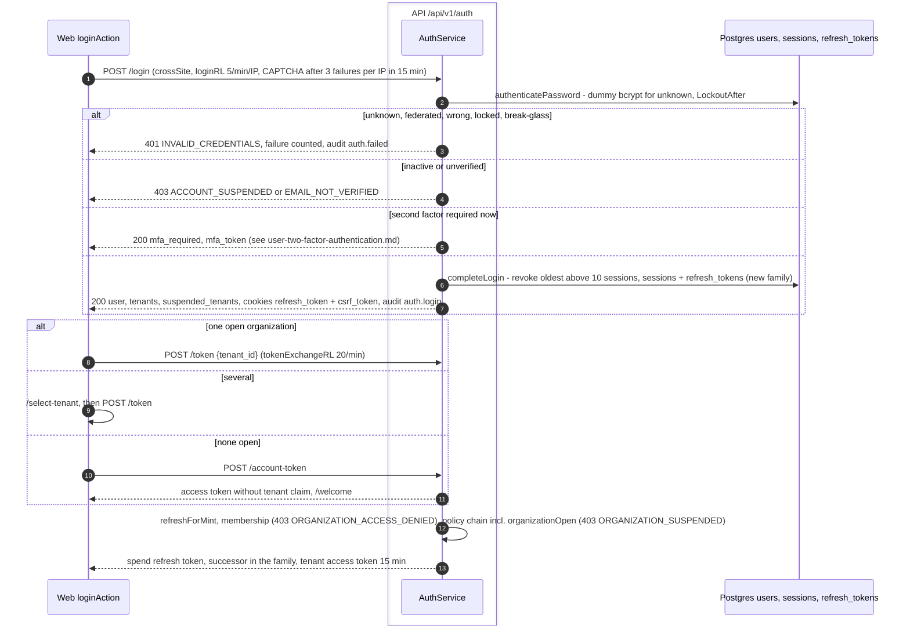

# Account space for a person with no organization

Design: [RFC-141](../rfcs/RFC-141-tenantless-account-space.md).

## Flow

Password sign-in and the choice between an organization token and an
account-only token (`internal/app/auth/service.go`, web
`features/auth/actions/local-auth-actions.ts`):

Lockout (`user.LockoutAfter`, `user_repository.go`): the Nth consecutive
failure (`AUTH_MAX_LOGIN_ATTEMPTS`, 5) locks for `AUTH_LOCKOUT_DURATION`
(15 min); each further run of N failures doubles the lock, capped at 24 h.
Wrong TOTP, step-up and password-change attempts share the counter, which is
reset only by a complete sign-in. A locked account still answers
`INVALID_CREDENTIALS` on `/login`.

## States

| Session | Token | Reaches |
|---|---|---|
| In an organization | Access token with `tenant`, `role`, permissions | Every route its permissions allow |
| Account only | Access token without `tenant` | The account allow-list only |
| Signed out / refused sign-up | None | Public routes |

## Getting an account-only token

`POST /api/v1/auth/account-token` with the refresh token (httpOnly cookie plus the CSRF pair, or
`refresh_token` in the body). It answers:

- `200 {access_token, token_type, expires_in}` and a rotated refresh cookie, for any signed-in
  account: one with no organization, and a member as well (since 2026-11-18). A member whose
  organization does not admit the session yet (two-factor authentication not set up, its own
  identity provider required, suspended) keeps a usable token for their account and the step that
  admits them, instead of being signed out. The token reaches only the allow-list, so it skips none
  of an organization's rules: those apply when the session asks `POST /auth/token` for that
  organization's token;
- `401` for a refresh token that is unknown, spent (the family is revoked), expired, or for a
  blocked account.

The access token carries the session id: signing out, or revoking the session, ends the account
token and every organization token of that session together.

Social and SSO sign-in return a token without a tenant at sign-in; the allow-list applies to it the
same way.

## The allow-list

`internal/infra/http/middleware/tenantless.go` lists every route an account-only token may call,
as `METHOD /path` with `{name}` for one segment. `UnifiedAuth` refuses any other route with
`401 TENANT_REQUIRED` before the handler runs. 401 keeps the web client's behaviour for a member's
social sign-in token (it exchanges on 401); the code tells an account-only client that exchanging
will not help.

To add a route: it must hold no tenant data and act only on the caller's own account. Add it to the
list in the same pull request; `routes/tenantless_allowlist_test.go` fails until the list and the
router agree.

## Memberships

`GET /users/me/tenants` (account and organization tokens) lists the caller's organizations. Each
row carries `admission`: what that organization answers the caller's current session, worked out
by the same rules as the token request (`AuthService.admitSession`: SSO required, identity
provider binding, two-factor authentication, verified e-mail, personal-account policy, outside
privilege, organization open), without minting or spending anything:

| `admission` | Next step the account space shows |
|---|---|
| `open` | Open the organization |
| `MFA_ENROLLMENT_REQUIRED` | Set up two-step verification (`/two-factor-setup?org=`) |
| `MFA_IDP_EVIDENCE_REQUIRED`, `SSO_REQUIRED` | Sign in through the organization's identity provider |
| `OWN_SIGN_IN_REQUIRED` | Sign in with the account's own sign-in |
| `EMAIL_NOT_VERIFIED` | Verify the e-mail address |
| `ORGANIZATION_SUSPENDED` | Nothing to do; the organization is suspended |

Each row also carries `requires`, what the organization asks of every sign-in of this member
whatever the session, from its settings and the member's role: `two_factor` (two-factor
authentication required) and `identity_provider` (its own SSO enforced; the owner keeps a
password break-glass). The account space shows it before the person opens the organization.

The organizations evaluated are the active memberships of the token's user; the session is the
token's own session (another person's or an unknown session gets no `admission`). Pending
invitations are listed by `POST /auth/onboarding/options`.

`POST /api/v1/me/memberships/{id}/leave` (account route, step-up) leaves one of the
caller's organizations by id: the way out of one that does not admit the session, where
`POST /organization/leave` (which needs that organization's token) is out of reach. It runs the
same offboarding and audit (`member.left`, in that organization), refuses the only owner and a
member who still owns work (409), and answers 404 for any organization the caller is not a member
of.

## Invitations

| Route | Auth | Notes |
|---|---|---|
| `POST /auth/onboarding/options` | refresh token | Invitations for the verified address only; references are HMAC-bound to the account and expire |
| `POST /auth/onboarding/accept` | refresh token | Re-checks the reference, verified address, pending state, the organization's policies; audited `invitation.accepted` |
| `POST /auth/onboarding/decline` | refresh token | Invitation references only; verified address; pending; deletes the invitation; audited `invitation.deleted` with `declined: true` |
| `GET /me/ownership-invitations`, `POST /me/ownership-invitations/{id}/accept`, `.../decline` | access token (account-only allowed) | [Ownership invitations](organization-ownership-invitations.md) bound to the caller's account id; accept needs step-up and a verified address |

## Creating an organization

`POST /tenants` is on the allow-list, so the creation policy is the only gate, and it is enforced in
the handler: an organization is created only when the sign-up policy admits an organization
(`SIGNUP_MODE=open` ceiling and a console policy of `self_service`, and the person's email domain
does not block new organizations). The defaults:

| Installation | `SIGNUP_MODE` | Console policy | Person may create |
|---|---|---|---|
| Self-hosted (default) | `disabled` | `admin_only` | No: only a platform administrator creates organizations |
| Self-hosted with domain sign-up | `domain` | `admin_only` | No |
| Hosted self-service | `open` | `self_service` | Yes, unless the domain blocks it |

A policy that cannot be read is `admin_only`. `/auth/onboarding/options` reports the answer for the
signed-in person as `can_create_organization`; the web hub shows "Create an organization" only when
it is true, and says to ask an administrator otherwise. A test sends `POST /tenants` with an
account-only token under each self-hosted setting and expects 403.

## Web

- Password sign-in with no organization calls `POST /auth/account-token` and lands on `/welcome`.
  A social sign-in lands on `/auth/continue` (web `features/auth/lib/sign-in-landing.ts`), which
  decides from the memberships, never from a refusal: it takes the account token, reads
  `GET /users/me/tenants` with it, then
  - no organization the person can open: `/welcome`, or the invitation page they came from;
  - one: that organization's token, and the page they asked for; when the organization requires
    two-factor authentication this session has not proven, `/two-factor-setup?org=…` (the session
    step, then the organization);
  - several: `/select-tenant`.
  The web keeps an `app_account_only` cookie as a routing hint (the API trusts only the token).
- `/welcome` lists invitations (accept, decline), the organization of a verified domain, "Create an
  organization" when allowed, and links to profile, security, sessions, sign-in methods and
  preferences. Joining an organization that requires two-factor authentication goes to its setup.
- The proxy sends every page of an account-only session except `/welcome`, `/account`,
  `/account/security`, `/account/preferences` and `/two-factor-setup` to `/welcome`. The account
  pages render in a slim shell with no tenant providers.
- The browser's refresh renews the account-only token whenever no organization cookie exists.
- When the browser ends a session (`web/src/lib/auth/refresh-failure.ts`): only when the refresh
  is refused with 401 (unknown, spent, revoked or expired refresh token, ended session) or the
  session came from another organization's identity provider. An organization that requires
  two-factor authentication opens `/two-factor-setup`; a suspended organization or one that
  requires its own sign-in opens `/welcome`; a server or network failure changes nothing. A route's
  401 alone never signs anybody out: the client refreshes first, and `401 TENANT_REQUIRED` after
  that sends the person to `/welcome` once.

## What does not change

Step-up for sensitive account changes (password change needs the current password, two-factor off
needs password and code, account deletion needs step-up, sign-in method changes need a proof typed
for the request), CSRF for cookie sessions, rate limits, session lifetimes and sign-out.
