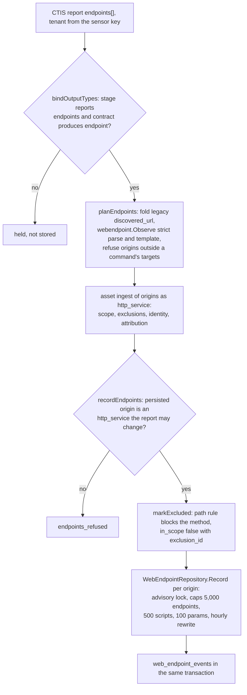

# Web surface: origins, endpoints and parameters

Design: [RFC-056](../rfcs/RFC-056-web-attack-surface.md).

## Model

```
asset service/http (origin: https://api.example.com)
  └─ web_endpoints        method + path template  (GET /api/v1/users/{int})
       └─ web_endpoint_params   location + name      (query "page", json "/note")
```

- The origin is an ordinary `http_service` asset: scope, ownership, data
  scope, criticality and attribution all live there.
- `web_endpoints` and `web_endpoint_params` are a sub-inventory under it,
  like `asset_services` under a host. Every row carries `tenant_id`; composite
  foreign keys tie an endpoint to an asset of the same tenant and a parameter
  to an endpoint of the same tenant.
- An endpoint is visible exactly when its origin asset is visible to the
  caller (data scope joins `user_accessible_assets` on `origin_asset_id`).
- No column holds a value: parameter names only; one `example_path` with
  token-like segments masked.

## Ingest (`internal/app/ingest/processor_endpoints.go`)



1. `bindOutputTypes` holds a report's `endpoints[]` unless the tool's stage
   reports endpoints (`stage.Stage.Endpoints`: `crawl.web`, `dast.web`) and,
   when the sensor declares a tool contract, its `produces` names `endpoint`.
2. `planEndpoints` folds legacy `discovered_url` assets into endpoints (they
   are no longer created; a finding on one moves to the origin; migration
   001288 converted the stored ones the same way and deleted them), normalises
   every endpoint with `webendpoint.Observe` (ctis/weburl: strict parse,
   template, query names only, masked example), refuses origins a
   command-bound report's targets do not cover, counts static files without
   storing them, and makes each origin an `http_service` asset of the report.
3. Asset ingest persists the origins (scope, exclusions, identity,
   attribution apply).
4. `recordEndpoints` writes each origin's endpoints only when the persisted
   origin is an `http_service` the report may change
   (`alterScope.allowedAsset`), marking endpoints under a path exclusion
   `in_scope = false`.
5. `WebEndpointRepository.Record` upserts per origin in one transaction under
   an advisory lock, applying the caps (5,000 active endpoints and 500 scripts
   per origin, 100 parameters per endpoint) and rewriting a re-sighted row at
   most hourly unless it changed.

The ingest output reports `endpoints_created`, `endpoints_updated`,
`endpoints_refused`, `endpoints_no_evidence`, `endpoints_static`,
`endpoints_over_cap` and `legacy_url_assets_folded`.

### Source and response evidence (RFC-056 §9)

| Bound capability | Stored source |
|---|---|
| `enumerate.web_paths`, `enumerate.web_params` | `guess`, whatever the report says; refused (`endpoints_no_evidence`) without valid evidence |
| `crawl.web` | the claimed `crawl`, `js`, `sitemap` or `robots`, else `crawl` |
| anything else, or no capability | the claimed CTIS source, never `guess` |

Evidence travels as `extensions["io.openctem"].response = {"size": int,
"hash": "16 lowercase hex"}` (the size of the response body and the first 16
hex characters of the sha-256 of its normalised form; the body itself never
leaves the sensor). It is stored in `web_endpoints.resp_size` and
`resp_hash` (migration `20261105051408`), kept on later sightings by other
sources, and returned by the API as `resp_size` and `resp_hash`. It is not
part of `response_sig`.

## Chaining

A crawl step's outputs are its origin assets, so a chained template scan
runs per origin, not once per crawled URL.

## Path exclusions

An exclusion of type `path` (RFC-054 §6.2) is a web rule: a host pattern, a
segment-aware path prefix, the methods it blocks, and a testing mode
(`blocked`, `read_only`, `allowed` until a deadline) a scope approver sets
with step-up. It is enforced in three places:

| Where | What |
|---|---|
| Dispatch (`scope.Service.ExcludedTargets`) | a URL target under a blocking rule (for GET) is excluded; a host target never is |
| Job (`scope.WebJobGuard`, the command repository's create guard) | every job whose tool requests web paths (crawl, template or web application tool, or a step whose capability names one), whatever path created it (quick scan, workflow step, scheduled or retried scan, zone batch, automation, `POST /api/v1/commands`), carries `web_scope` of its own tenant's rules: `deny_paths` for rules that block GET or HEAD (a `*` segment is cut to the path before it, `/tenants/*/admin` as `/tenants/`, which every sensor holds; a sensor that reads `*` segments, v0.38.2 or v0.37.2 and later, is sent the written form at claim, from the platform-only `deny_paths_wildcard` that never leaves the platform), `methods: [GET, HEAD]` when a rule there blocks only other methods; nothing when no rule applies. A caller's own `web_scope` is replaced. A failed lookup refuses the job; a nuclei validation or retest with a rule on its host carries it and requires `net.confined@1` (refused with `NO_CONFINED_SENSOR` when no sensor of the organization reports it); a validation or retest of another web tool there is refused (`WEB_SCOPE_UNSUPPORTED`) |
| Ingest (`markExcluded`) | an endpoint whose method a rule blocks is stored `in_scope = false` with `exclusion_id`: excluded-untested, visible, never targeted |

`GET /web-endpoints/stats` counts `excluded_untested`, so "0 findings" on an
origin with excluded paths is not read as "safe".

## API

| Route | Permission | Notes |
|---|---|---|
| `GET /api/v1/web-endpoints` | `assets:read` | list query contract (RFC-048, strict: an unknown param is 400); filters `origin_asset_id`, `method`, `kind`, `auth_state`, `state`, `in_scope`, `source` (including `guess`), `label`, `catalog_key`, `path_hash`, `path_template_contains`, `last_status`, `param_count`, seen and changed times; `q` searches the template |
| `GET /api/v1/web-endpoints/stats` | `assets:read` | the same WHERE: counts by method, kind, auth state and state, and `excluded_untested` |
| `GET /api/v1/web-endpoints/{id}` | `assets:read` | 404 for another tenant's id and for an origin outside the caller's data scope |
| `GET /api/v1/web-endpoints/{id}/parameters` | `assets:read` | names, locations, risk hints; never a value |
| `PATCH /api/v1/web-endpoints/{id}` | `assets:write` | `state` (active, ignored) and `labels`; audit-logged on the origin asset |
| `GET /api/v1/assets/{id}/web-endpoints` | `assets:read` | one origin's endpoints; the `/assets/{id}` data-scope guard applies |
| `GET /api/v1/assets/{id}/web-paths` | `assets:read` | one level of the origin's path tree (below); 404 for another tenant's asset and one outside the caller's data scope |

The list compiles through `pkg/filterspec` with the caller as the actor, so
the tenant predicate and the caller's data scope (on `origin_asset_id`) are
always in the WHERE, for the list and the stats alike.

## Path tree

`GET /api/v1/assets/{id}/web-paths?path=` serves the console's Paths tab: the
origin's endpoints folded by path segment, one level per request.

- **Nodes.** `path` is a node: `/` or a path template without a trailing
  slash. A node holds the endpoints of its own template and of every template
  below it, so `/api/users` is both an endpoint and the parent of
  `/api/users/{int}`. A variable segment (`{int}`, `{uuid}`, ...) is a node
  marked `param`. A level lists at most 500 child nodes, sorted by name with
  variable segments last (`folders_truncated` says when more exist).
- **Counts per node:** endpoints, out-of-scope endpoints (under a path
  exclusion: shown, never hidden), open findings and the worst severity among
  them. `endpoints` is one page (`per_page` 0 to 100; 0 returns the nodes only)
  of everything under `path`, or only the node's own template with `here`.
  `totals.recorded` counts the origin's rows before any filter (0: never
  crawled), `totals.hidden` what the filters hide, so nothing disappears
  silently.
- **Filters:** `hide_static` (style sheets, images, fonts, media and archives,
  by content type or extension; scripts and source maps stay, they are attack
  surface), `hide_4xx`, `with_findings`, `include_gone` (gone rows are hidden
  by default), `scope=in|out`, `method` (comma list) and `q` (the template
  contains it, any case). The query is strict: an unknown or repeated
  parameter is 400.
- **Findings per path.** The origin asset's open findings are grouped by
  `location_key` and by the endpoint they are linked to
  ([Findings on a path](#findings-on-a-path)). A finding **linked to an
  endpoint** counts at that endpoint, its template **and method**: exact. A
  finding with no link falls back to its key `url:<origin><path>` (ctis
  `LocationKey`: scheme, host, port and escaped path, no query), templated with
  the same `weburl` templating the endpoints use, so `/api/users/42` lands on
  `/api/users/{int}`: exact on the path template, **method-blind**, so it
  shows at every method of the template. A finding at a path no endpoint
  records keeps a node of its own (`unrecorded_findings`; a scanner can hit a
  path a crawl never listed). A finding with no URL, or with a URL of another
  origin, counts as `origin_findings` at the root. A finding stored on another
  asset (a host) is not part of this origin's tree. A node's own findings
  (`findings=true`) carry the `method` of their endpoint when linked.
- **Cost.** One request reads the origin's rows (at most 20,000, the active
  cap with room for gone and ignored rows; `totals.capped` says when more
  exist) on `idx_web_endpoints_origin` and the open findings on
  `idx_findings_tenant_asset_status`, and builds the level in memory: about
  5 ms for 20,000 rows. The response carries one level and one page, not the
  endpoint list.
- **Access.** `assets:read`; the service checks that the asset is a live asset
  of the caller's tenant and in the caller's data scope (`AssertAssetRef`)
  before any read, and answers 404 otherwise. Every statement carries the
  tenant. Parameter values are never stored, so none can be returned.

## Findings on a path

A CTIS finding's `web` location (`url`, `method`, `endpoint_ref`, `parameter`,
`status_code`) is kept in `finding_web_locations`, one row per finding
(`tenant_id`, `finding_id`; row-level security like the finding):

| Column | From | Notes |
| --- | --- | --- |
| `method` | `web.method` | an HTTP method; anything else is not stored |
| `param_location`, `param_name` | `web.parameter` | the name only, cut at `=`, at most 128 characters; **never a value** |
| `status_code` | `web.status_code` | 100 to 599 |
| `endpoint_id` | `web.endpoint_ref`, else method and URL | the `web_endpoints` row the finding belongs to, `NULL` when none matches |

The method and the parameter name already take part in the DAST identity, so
storing them changes no fingerprint. Written by ingest after the findings and
endpoints of the report are stored (step 7e of `ProcessBatch`, best effort: a
failure is logged and never fails the ingest).

**Linking.** `planEndpoints` remembers each report endpoint's `id`, its origin
ref and its dedup key (`weburl.PathHash` of method and template). After
`recordEndpoints` has persisted the origin assets, a finding's `endpoint_ref`
resolves to *(origin asset id, key)*; the ids the report carries are never
used. With no resolvable ref, the finding's method and the template of its URL
name the key, on the origin this report stored for that URL's origin, else on
the finding's own asset; an endpoint under method `ANY` matches when none
exists for the method. The statement reads `web_endpoints` with the ingest's
tenant id and a foreign key `(tenant_id, endpoint_id)` guards the row, so a ref
or a key never links across tenants. A re-sighting keeps a stored method,
parameter and link where the new report brings none; the status is the latest.

**Path tree.** `OriginOpenFindings` joins the link and returns the endpoint's
template and method with each group; the join also requires the endpoint's
origin to be the finding's asset. Findings stored before this table existed
have no row and keep the approximate mapping until their next sighting.

**Importers.** Which tools fill `web.method` and `web.endpoint_ref` is a
property of the producer (the sensor tool parsers, the CTIS importers); the
platform stores whatever the report says. A producer that sends only a URL is
still linked by method and template when it names the method.

## Sensitive paths, patterns, origins and the change feed

- **Catalog** (`pkg/domain/webendpoint/catalog.json`, `GET /web-path-catalog`):
  platform-curated sensitive paths (VCS and configuration files, backups,
  debug and actuator endpoints, admin consoles, infrastructure APIs, API
  descriptions). Ingest stamps `catalog_key` with the most specific entry
  matching the template. Never learned from tenant data.
- **Path patterns** (`GET /web-path-patterns`): the endpoint filter grouped by
  `path_hash` (the template without host or method): how many origins serve
  it, how many answer 2xx, without authentication, or are excluded-untested.
  Within the tenant and the caller's data scope only.
- **Origins** (`GET /web-origins`): per origin asset, endpoints, active,
  excluded-untested, the sensitive ones among those (`excluded_sensitive`),
  sensitive endpoints answering 2xx without authentication
  (`unauth_sensitive`) and new in the last 7 days: the coverage-gap read.
- **Change feed** (`web_endpoint_events`, `GET /web-endpoint-events`):
  appeared, returned, gone, status_changed, auth_changed, param_added,
  written in the same transaction as the change; `detail` holds status codes
  and auth states only.
- **Retention** (`WebSurfaceRetentionController`, hourly): unseen 30 days ->
  gone (with an event), gone 365 days -> deleted with its parameters and
  events, events older than 90 days deleted. Findings are never touched.
- **Incremental scanning:** a template step chained after a crawl with the
  step setting `endpoint_selector: new | changed` takes the URLs of the
  endpoints the crawl found new (or new or changed) in this run instead of
  each origin; an origin with none is skipped as `unchanged`. URLs are built
  from the example path with typed placeholders, never recorded values, and
  pass the same per-hop gate (path exclusions included). The setting is the
  platform's and never reaches the sensor.

## API descriptions and drift

- `POST /api/v1/assets/{id}/api-specs` (multipart `file`, at most 10 MB,
  `assets:write`, an origin asset the caller may see) reads an OpenAPI 3 or
  Swagger 2 document (JSON or YAML), a Postman 2.1 collection, a HAR 1.2
  capture or a GraphQL introspection result (`pkg/domain/apispec`).
- Only the declared operations (method, path, parameter names, deprecated) and
  the document's sha256 are stored (`api_specs`, `api_spec_operations`,
  migration 001299). The document, its examples and a capture's values
  (tokens, cookies, headers) are never stored. No remote `$ref` is fetched;
  YAML alias bombs are refused; operations are capped at 5,000.
- `GET /api/v1/api-specs/{id}/drift` compares the declaration with the
  origin's observed endpoints (spec variables match scan variables,
  `/users/{userId}` = `/users/{int}`): `shadow` (observed, not declared),
  `orphan` (declared, never observed), `zombie` (deprecated, still 2xx) and
  `param_drift` (parameters seen but not declared).
- The parsers live in the platform for now: YAML needs a dependency the ctis
  schema module does not take. A sensor-side `import.api_spec` can move the
  JSON formats to `ctis/importer` later without changing this API.

## Console

The web surface is a tab of Discovery › Attack surface (`/attack-surface/web`):
origins, endpoints, the same path across origins, and the endpoint events. It
reads the endpoints above, so it needs `assets:read` and the `assets` module
(the route guard says so), not the attack surface module.


Posture, labels, verification of sensitive paths and change alerts are in
[web-content-pipeline.md](web-content-pipeline.md).
