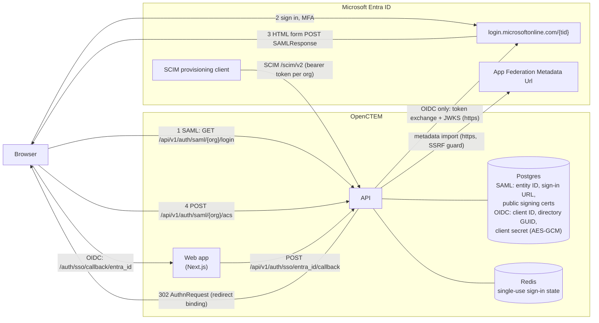

# How to configure Microsoft Entra ID (Azure AD) SSO

> Operator how-to for wiring OpenCTEM to Microsoft Entra ID. Covers the two
> distinct Microsoft login paths, the Azure app-registration steps, the exact
> OpenCTEM env vars / admin-UI fields, the post-hardening requirements
> (`xms_edov` claim, redirect-URI allow-list, DNS-verified domains), the login
> flow, and troubleshooting — including the common **404 "Not Found"** on the
> login button.
>
> For the design/architecture reference (why each control exists), see
> [`sso-authentication.md`](../architecture/sso-authentication.md).

---

## How it fits together

Organization SSO with Entra ID has two variants. **SAML is the default**: the
platform holds only Entra's public signing certificate(s), no Entra secret.
**OIDC** (Path B) needs a client secret, stored encrypted. Both admit people
into one organization; neither can open the platform admin console.

### Setup: who does what, where (SAML)

```mermaid
sequenceDiagram
    autonumber
    actor PA as Platform admin<br/>(admin console)
    actor EA as Entra admin<br/>(Entra admin center)
    actor OO as Organization owner<br/>(OpenCTEM, Settings)
    participant API as OpenCTEM API
    participant ENTRA as Microsoft Entra ID

    PA->>API: Organization > Single sign-on > SAML > Download SP metadata (XML)
    API-->>PA: SP metadata (entity ID, ACS URL, built on APP_URL)
    PA->>EA: hand over the SP metadata file
    EA->>ENTRA: Enterprise applications > New > Create your own (non-gallery)<br/>Single sign-on > SAML > Upload metadata file
    EA->>ENTRA: Attributes & Claims: Name ID = user.objectid (Persistent),<br/>keep emailaddress + name; assign users and groups
    ENTRA-->>EA: App Federation Metadata Url
    EA->>PA: hand over the App Federation Metadata Url
    PA->>API: SAML > Import from metadata (paste the URL)
    API->>ENTRA: GET federation metadata (https only, SSRF guard, 1 MiB, 10 s)
    ENTRA-->>API: entity ID, sign-in URL, signing certificate(s)
    API-->>PA: form filled in (nothing saved yet)
    PA->>API: Enable SAML login + Save
    alt organization has an owner
        API-->>OO: pending change (in-app + email)
        OO->>API: Settings > Access & security > SSO approvals > Approve (step-up)
    end
    PA->>API: Verified domains: add domain, publish TXT, Verify now
    API->>API: DNS TXT lookup (_openctem-verify.domain)
    PA->>API: test: https://app/login?org=slug signs in through Entra
    PA->>API: optional: Require single sign-on (preconditions checked)
```

The OIDC variant replaces steps 1 to 9: the Entra admin registers an app
(App registrations), adds the redirect URI `https://<app>/auth/sso/callback/entra_id`
and the optional ID token claims `xms_edov` (required) and `auth_time`, creates
a client secret, and hands over the client ID, the **Directory (tenant) ID
GUID** and the secret, which the platform admin enters on the Entra ID form.

### Connections: what talks to what, and who holds what



- The browser carries every SAML message (SP-initiated redirect out, form POST
  back to the ACS). The API calls Microsoft only to import metadata (SAML) or
  to redeem the code and fetch signing keys (OIDC).
- **No logout channel.** Entra sends no back-channel logout and does not tell
  OpenCTEM when a user is disabled or deleted. Access ends through SCIM
  (unassigning or deleting the user offboards the membership, effective on the
  next request), by removing the member, or when the session expires.
- SAML holds no Entra secret. The OIDC client secret is write-only in every API
  response and never logged.

### Sign-in sequence and refusals

```mermaid
sequenceDiagram
    autonumber
    actor U as Person
    participant B as Browser
    participant API as OpenCTEM API
    participant E as Entra ID

    U->>B: https://app/login?org=slug, choose the organization's sign-in
    B->>API: start (SAML login, or OIDC authorize)
    API->>API: state: single use, bound to this browser,<br/>nonce + PKCE (OIDC), request id (SAML)
    API-->>B: redirect to Entra
    B->>E: authenticate (password, MFA by Conditional Access)
    E-->>B: SAMLResponse (form POST) or code (redirect)
    B->>API: ACS POST, or callback with code + state + binding
    alt SAML
        API->>API: one signed assertion, configured cert(s), no SHA-1,<br/>audience, destination, InResponseTo, replay cache
    else OIDC
        API->>E: redeem code (secret + PKCE verifier), JWKS
        API->>API: id_token signature, aud, exp/nbf/iat, nonce,<br/>iss == login.microsoftonline.com/{tid}/v2.0
    end
    break issuer/tid differs from the configured directory, bad signature, replayed state
        API-->>B: refused (SSO_INVALID_ID_TOKEN / SSO_INVALID_STATE / saml_failed)
    end
    API->>API: identity: Entra oid (+ tid), never the email<br/>OIDC: email trusted only with xms_edov
    break xms_edov missing (OIDC)
        API-->>B: refused (EMAIL_UNVERIFIED_AT_IDP)
    end
    API->>API: account: bound oid, else email under proof-before-link
    break password account, or another Entra user bound to the email
        API-->>B: refused (ACCOUNT_LINK_REQUIRED / SSO_DIFFERENT_METHOD)
    end
    API->>API: membership: member, or just-in-time when auto-provision is on<br/>and the email domain is DNS-verified for the organization
    break domain not verified, not allowed, or JIT off
        API-->>B: refused (SSO_NOT_A_MEMBER / SSO_DOMAIN_NOT_ALLOWED)
    end
    API->>API: session for this organization, MFA evidence recorded<br/>(OIDC amr contains mfa; SAML AuthnContext multipleauthn)
    API-->>B: signed in
    B->>API: enter the organization
    break organization requires IdP MFA evidence and the session has none
        API-->>B: refused (MFA_IDP_EVIDENCE_REQUIRED): sign in again with MFA
    end
```

---

## 15-minute checklist (per-organization Entra SSO over OIDC)

For SAML (the default, no secret), follow [Entra ID via SAML in 5 steps](#entra-id-via-saml-in-5-steps).

Let `FRONTEND` be your OpenCTEM web origin (the `APP_URL` origin) and `API` the
address the API is published on (often the same origin).

In the Azure portal (Microsoft Entra ID, App registrations):

1. New registration, **single tenant** (this directory only).
2. Redirect URI, type **Web**: `FRONTEND/auth/sso/callback/entra_id`.
3. Certificates & secrets: new client secret. Copy the **Value** and note the
   expiry date; the secret stops working then.
4. Token configuration, add optional **ID** claims:
   - `xms_edov` (required: sign-in is refused without it),
   - `auth_time` (needed for step-up re-authentication).
5. Overview: copy the Application (client) ID and the **Directory (tenant) ID**
   (a GUID; `common`, `organizations` and domain names are refused).

In OpenCTEM:

1. API has `APP_ENCRYPTION_KEY` set (it encrypts the stored client secret).
2. The frontend origin is trusted: set `SSO_ALLOWED_REDIRECT_URIS`, or make sure
   `APP_URL` (which seeds CORS, `SMTP_BASE_URL` and the allow-list) is correct.
3. Platform admin console, Organizations, the organization, **Single sign-on**
   tab: open **Microsoft Entra ID**. The "Set up in Microsoft Entra ID" block
   lists the redirect URI and the claims with copy buttons. Enter the display
   name, Directory (tenant) ID, Client ID and the secret, then save.
4. If the organization already has an owner, the save waits: an owner approves
   it under **Settings, SSO approvals** in the organization's own app (§3).
5. Same tab, **Verified domains**: add the email domain, publish the DNS TXT
   record, choose Verify now.
6. Test: open `FRONTEND/login`, type an email at that domain; the page offers
   the organization's SSO button (§6).
7. Optional: switch on **Require single sign-on** (it needs a verified domain
   and a usable provider; the owner can always sign in with a password).

---

## 1. Which path do you want?

OpenCTEM has **two independent Microsoft/Entra login paths**. They do not share
config and are wired separately. Pick based on your goal.

| | **Path A — "Sign in with Microsoft" (social)** | **Path B — per-tenant Entra SSO** |
|---|---|---|
| Purpose | A generic social button on the login/onboarding page. Good for self-service onboarding of new users/orgs. | Enterprise SSO into **one specific organization (tenant)** using **that customer's own** Azure app registration. |
| Code | `internal/app/auth/oauth.go` | `internal/app/auth/sso.go` |
| Config source | Platform env: `OAUTH_MICROSOFT_*` | Per-tenant DB record (admin UI) **or** platform env fallback `SSO_ENTRA_*` |
| Authority | Multi-tenant `/common` (any Entra tenant can complete it) | The customer's directory (single-tenant GUID, required) |
| Org binding | None — identity is the domain-verified email | Login is scoped to an org slug via `?org=<slug>` |
| JIT / auto-provision | N/A (creates a global user; onboarding assigns tenant) | Yes, gated by DNS-verified domains |
| Endpoints | `GET/POST /api/v1/auth/oauth/microsoft/{authorize,callback}` | `GET/POST /api/v1/auth/sso/entra_id/{authorize,callback}` |

Most enterprise deployments want **Path B**. Path A is optional and only needed
if you want a public "Sign in with Microsoft" button.

You can enable **both** at once — they don't conflict.

Prefer SAML for organization SSO? See [Entra ID via SAML in 5 steps](#entra-id-via-saml-in-5-steps).

---

## 2. Azure portal: register the application

This is the same on the Azure side for both paths; the difference is only which
**redirect (reply) URI** you register and which OpenCTEM config you paste the
values into.

Let `FRONTEND` be your OpenCTEM UI origin (e.g. `https://app.example.com`; in
dev, `http://localhost:3000`).

1. **Azure portal → Microsoft Entra ID → App registrations → New registration.**
   - Name: e.g. `OpenCTEM SSO`.
   - Supported account types:
     - **Path B (recommended):** *Accounts in this organizational directory only*
       (single tenant). This pins logins to your directory.
     - **Path A** (or a multi-tenant Path B): *Accounts in any organizational
       directory*.
2. **Add a Redirect URI** (type **Web**). The URI the browser is sent back to is
   the **frontend callback**, not the API — the UI then POSTs the code to the API.
   Register the exact URL(s) for the path(s) you use:

   | Path | Redirect (reply) URI to register in Azure |
   |------|--------------------------------------------|
   | **Path B** — per-tenant Entra SSO | `FRONTEND/auth/sso/callback/entra_id` |
   | **Path A** — social Microsoft | `FRONTEND/auth/callback` |

   Example (prod): `https://app.example.com/auth/sso/callback/entra_id`.
   These must match **exactly** (scheme, host, port, path). A mismatch causes
   Azure error `AADSTS50011` (redirect URI mismatch).

3. **Certificates & secrets → New client secret.** Copy the secret **Value**
   (not the Secret ID) immediately — it is shown only once. Note its expiry and
   set a rotation reminder.
4. **Overview** — copy:
   - **Application (client) ID** → OpenCTEM `client_id` / `SSO_ENTRA_CLIENT_ID`.
   - **Directory (tenant) ID** → OpenCTEM `tenant_identifier` / `SSO_ENTRA_TENANT_ID`.
5. **API permissions** — the delegated **Microsoft Graph** scopes `openid`,
   `email`, `profile` (and `User.Read`) are sufficient. Grant admin consent if
   your directory requires it. No application (app-only) permissions are needed.
6. **REQUIRED — add the `xms_edov` optional ID-token claim.**
   **Token configuration → Add optional claim → Token type: ID → select
   `xms_edov` → Add.** If prompted to "turn on the Microsoft Graph email
   permission," accept.

   **Why this is mandatory:** `xms_edov` = "email domain owner verified."
   OpenCTEM trusts the `email` claim **only when `xms_edov == true`**. This is the
   fix for the **nOAuth** account-takeover class: on a multi-tenant authority a
   rogue directory can set a user's `mail`/`email` to a victim's address without
   owning the domain. A domain can be verified in exactly one Entra tenant, so a
   domain-owner-verified email is a reliable identifier. **If the claim is absent
   or false, OpenCTEM refuses the login (fail-closed)** — this applies to Path A
   always, and to Path B for Entra logins.

   > Expected, by-design refusals once `xms_edov` is required: **personal
   > Microsoft accounts** (outlook.com / live.com / hotmail.com) and **B2B guest
   > users** whose email domain isn't verified in the signing directory will be
   > refused. Work/school accounts on a domain the tenant owns get
   > `xms_edov == true` and sign in normally. To admit specific external
   > identities, use **Path B** with an explicit domain allow-list.

---

## 3. Configure OpenCTEM

### Path A — "Sign in with Microsoft" (env)

Set on the API service and restart:

```bash
OAUTH_ENABLED=true                 # top-level social OAuth switch (default true)
OAUTH_MICROSOFT_ENABLED=true
OAUTH_MICROSOFT_CLIENT_ID=<application-client-id>
OAUTH_MICROSOFT_CLIENT_SECRET=<client-secret-value>
# Scopes default to: openid email profile User.Read
OAUTH_MICROSOFT_SCOPES=openid,email,profile,User.Read

# The frontend callback the browser returns to (must match the Azure reply URI
# for Path A and be a trusted origin). Default: http://localhost:3000/auth/callback
OAUTH_FRONTEND_CALLBACK_URL=https://app.example.com/auth/callback
```

The social button appears when `OAUTH_MICROSOFT_CLIENT_ID` **and**
`OAUTH_MICROSOFT_CLIENT_SECRET` are both set (`IsConfigured()`), OAuth is enabled,
and the OAuth handler is wired. `GET /api/v1/auth/providers` reports which
social providers are enabled.

### Path B — per-tenant Entra SSO (admin console, recommended)

A **platform administrator** configures each organization's identity provider in
the admin console (it is no longer a tenant-admin setting; the former tenant
routes `/api/v1/settings/identity-providers` and `/api/v1/settings/verified-domains`
were removed). Open **Organizations**, choose the organization, then the
**Single sign-on** tab. The provider is backed by
`POST /api/v1/admin/tenants/{tenantId}/sso/identity-providers` and stored encrypted
in `tenant_identity_providers`. Writes need a super-admin session with step-up.

The **Microsoft Entra ID** entry opens with a read-only "Set up in Microsoft
Entra ID" block: the redirect URI (`APP_URL` origin plus
`/auth/sso/callback/entra_id`) with a copy button and the claims to add. It
offers no logout URL: Entra sends no back-channel logout (§9). Okta and Google Workspace show their redirect
URI the same way (`/auth/sso/callback/<provider>`).

Fields:

| Field | Value |
|-------|-------|
| `provider` | `entra_id` |
| `display_name` | Button label, e.g. `Sign in with Company SSO` |
| `client_id` | Application (client) ID |
| `client_secret` | Client secret **Value** (stored AES-256-GCM encrypted, never shown again; leave empty on edit to keep it) |
| `tenant_identifier` | **Directory (tenant) ID** (GUID, required). `common`, `organizations`, `consumers`, empty values and domain names are refused. |
| `allowed_domains` | Email domains permitted, e.g. `["example.com"]`. Empty = any domain allowed to **log in**, but see JIT rules below. |
| `auto_provision` | `true` to create tenant membership on first login (still gated, see §4) |
| `default_role` | `member` or `viewer` (role granted to auto-provisioned users) |

**Owner approval.** The platform administrator cannot change who can sign in to
an organization that already has an owner. Creating or updating an identity
provider (and saving a SAML config) is then stored as a pending change (HTTP 202,
`sso_pending_changes`), every active owner is notified (in-app, plus email when
SMTP is configured), and nothing is applied until an owner approves it under
**Settings, SSO approvals** in the organization's own app. Changes expire after 7
days and a newer submission replaces an older one. An organization with no owner
yet (first-time setup) is applied directly, and so are deletes, SSO enforcement
and verified domains. Code: `internal/app/auth/sso_change.go`.

The tenant's own active `entra_id` provider always wins over the env fallback.

### Path B — platform env fallback (optional, opt-in)

Instead of per-tenant DB config you can run **one shared** Entra app across
selected tenants via env. **This is opt-in and fail-closed** — post-P0 it does
nothing until you list the tenant slugs that may use it.

```bash
SSO_ENTRA_ENABLED=true
SSO_ENTRA_CLIENT_ID=<application-client-id>
SSO_ENTRA_CLIENT_SECRET=<client-secret-value>     # plaintext; env is the trust boundary
SSO_ENTRA_TENANT_ID=<directory-guid>              # default "common"
SSO_ENTRA_ALLOWED_DOMAINS=example.com,acme.com    # CSV; REQUIRED when TENANT_ID is common/organizations/consumers
SSO_ENTRA_DEFAULT_ROLE=member                     # default member
SSO_ENTRA_AUTO_PROVISION=true                     # default true
SSO_ENTRA_DISPLAY_NAME=Microsoft Entra ID

# P0 opt-in — CSV of tenant SLUGS allowed to use this shared fallback.
# EMPTY ⇒ the fallback is DISABLED for everyone (no button, no login).
SSO_ENTRA_ALLOWED_TENANTS=acme,globex
```

Fail-closed rules enforced by `envProvider()`:

- **`SSO_ENTRA_ALLOWED_TENANTS` is the master opt-in.** A tenant whose slug is
  not on the list sees no env button and cannot log in via the fallback. Empty
  list ⇒ disabled entirely.
- **A non-specific directory** (`common`, `organizations`, `consumers`, or empty)
  accepts any Microsoft directory, so:
  - `SSO_ENTRA_ALLOWED_DOMAINS` is **required** — if empty, the fallback is
    **refused** (logged: *"non-specific directory requires SSO_ENTRA_ALLOWED_DOMAINS"*).
  - **auto-provisioning is forced off** (users must be pre-invited).
- A **pinned** config (real directory GUID + a non-empty `AllowedDomains`) may
  auto-provision.

> `EntraSSOConfig.IsConfigured()` requires `SSO_ENTRA_ENABLED=true` + a client id
> + a client secret. `APP_ENCRYPTION_KEY` must be set in production so per-tenant
> secrets (and the PKCE verifier carried in `state`) are encrypted — see §8.

---

## 4. JIT auto-provisioning & DNS-verified domains (P1)

Letting a valid Entra login **create a new membership** in your org (JIT) is
gated so an authenticated stranger can't self-join. Existing members are never
affected.

The **primary gate is a DNS-verified domain.** A platform administrator proves
that the organization owns the email domain with a DNS TXT record; only then are
that domain's users auto-provisioned, and only then does email-first sign-in
(§6) find the organization.

Admin console, organization, **Single sign-on** tab, **Verified domains**
(`/api/v1/admin/tenants/{tenantId}/sso/verified-domains`; applied directly, no
owner approval):

1. **Add domain** returns a TXT record to publish:

   | Field | Value |
   |-------|-------|
   | Host | `_openctem-verify.<domain>` (e.g. `_openctem-verify.example.com`) |
   | Type | `TXT` |
   | Value | `openctem-domain-verification=<token>` |

2. Publish that TXT record at your DNS provider.
3. **Verify now**: OpenCTEM does a live `LookupTXT` and marks the domain verified
   when the exact token is present.

A domain is claimed by one organization at a time; when two organizations claim
the same domain, email-first sign-in treats it as unclaimed.

Auto-provisioning decision (`jitProvisioningAllowed`), all branches fail-closed:

- The provider must have `auto_provision = true`.
- The email domain **must be DNS-verified** for the organization. If no
  verified-domain checker is wired, or the lookup errors, JIT is refused. (There
  is no fallback to `allowed_domains` alone.)
- The verified domain's own JIT switch (per-domain, in the Verified domains list)
  must be on.
- If the provider also set `allowed_domains`, the domain must be on that list too.
- The organization's email-domain security setting must allow the address.

If JIT isn't permitted, the login is refused with "not a member of this
organization": the user must be **invited** first (Settings, Team,
Invitations, in the organization's app). Also: with the sign-up policy at
`admin_only`, a federated login can only bind to an existing/pre-invited
account; it will never create a brand-new user.

---

## 5. PKCE & the redirect-URI allow-list (P1)

- **PKCE (RFC 7636, S256) is always on** for Path B. The verifier is encrypted
  (AES-256-GCM) inside the signed `state` and recovered at callback — so it works
  across replicas with no server-side store. A callback with a missing verifier
  is refused. (This is why `APP_ENCRYPTION_KEY` matters in production; in dev
  without it the encryptor is a no-op.)
- **`redirect_uri` is validated against an exact-match allow-list**
  (`SSO_ALLOWED_REDIRECT_URIS`) — OAuth 2.1 / RFC 9700 open-redirect defense.
  Origin (scheme+host+port) must match exactly; no wildcards, no suffix match;
  embedded credentials (`user:pass@host`) are rejected.

  ```bash
  # CSV of allowed frontend callback URLs/origins.
  SSO_ALLOWED_REDIRECT_URIS=https://app.example.com/auth/sso/callback/entra_id
  ```

  **If unset, it is derived** from origins already trusted elsewhere: your CORS
  allowed origins, `OAUTH_FRONTEND_CALLBACK_URL`, and `SMTP_BASE_URL` (each
  reduced to its exact origin). So the shipped UI callback works out of the box
  when those are set correctly; set `SSO_ALLOWED_REDIRECT_URIS` explicitly to
  tighten or when your callback origin isn't otherwise trusted.

---

## 6. The login flow

Path B is **org-scoped**. A user reaches their organization's SSO in one of two
ways.

**Email-first (default once the domain is verified).** On `/login` the user types
their email. When it looks complete the page calls `POST /api/v1/auth/discover`
(public, rate-limited). If the email's domain is verified for exactly one
organization that has an **active** identity provider, the answer is `sso` with an
opaque, 30-minute organization reference (never the slug) and the page shows that
organization's SSO buttons. Any other email, or any error, answers `password`;
the answer says nothing about whether the email has an account. Code:
`internal/app/auth/discovery.go`, web hook `use-email-discovery`.

**By slug.** `https://app.example.com/login?org=<slug>` works without a verified
domain. The organization's SSO page and the console show this URL.

From there:

1. The UI calls `GET /api/v1/auth/sso/providers?org=<slug-or-reference>` to render
   the org's SSO buttons (the tenant's own providers, plus the env-fallback button
   **only** if that tenant opted in).
2. Clicking a button hits `GET /api/v1/auth/sso/entra_id/authorize?org=<slug-or-reference>&redirect_uri=<FRONTEND>/auth/sso/callback/entra_id`,
   which returns the Microsoft authorization URL (with signed `state`, `nonce`,
   PKCE `code_challenge`).
3. After Microsoft auth, the browser returns to
   `FRONTEND/auth/sso/callback/entra_id`; the UI POSTs the code to
   `POST /api/v1/auth/sso/entra_id/callback`. The API validates `state` + PKCE,
   exchanges the code, verifies the `id_token` (signature/issuer/audience/nonce +
   `xms_edov`), enforces the domain allow-list, provisions per §4, and issues an
   OpenCTEM session.

**To enable it for an organization:** a platform administrator (1) adds the Entra
provider in the admin console and an owner approves it (§3), and (2) verifies the
email domain (§4) so email-first sign-in and first-time auto-join work. Then tell
people to sign in at `FRONTEND/login`. To make SSO mandatory, switch on **Require
single sign-on** on the same tab: it is refused without a usable provider and at
least one verified SSO domain, needs step-up, and the organization owner can
always sign in with a password (break-glass).

---

## 7. Troubleshooting

### Clicking Microsoft / Entra login → **404 "Not Found"**

This is the #1 symptom and almost always means **the provider isn't configured
for that path/org**. `ErrSSOProviderNotFound` → HTTP 404 *"SSO provider not
configured"*; `ErrSSOTenantNotFound` → 404 *"Organization not found"*. Checklist:

1. **Org slug** — is `?org=<slug>` present and correct? A wrong/missing slug →
   404 "Organization not found."
2. **Path B, tenant config** — does the tenant have an **active** `entra_id`
   provider in the admin console (organization, Single sign-on tab)? Inactive/absent + no env fallback
   ⇒ 404.
3. **Path B, env fallback** — if you rely on the env fallback, confirm **all** of:
   `SSO_ENTRA_ENABLED=true`, `SSO_ENTRA_CLIENT_ID`/`SSO_ENTRA_CLIENT_SECRET` set,
   **and the tenant's slug is on `SSO_ENTRA_ALLOWED_TENANTS`** (the P0 opt-in —
   empty list disables it for everyone). If `SSO_ENTRA_TENANT_ID` is
   `common`/empty, `SSO_ENTRA_ALLOWED_DOMAINS` must also be non-empty or the
   fallback is refused (check logs for the "non-specific directory requires…"
   warning).
4. **Path A social button** — the button only shows when
   `OAUTH_MICROSOFT_CLIENT_ID` **and** `OAUTH_MICROSOFT_CLIENT_SECRET` are set and
   `OAUTH_ENABLED=true`. If the OAuth handler isn't wired the `/auth/oauth/*`
   routes aren't registered → 404; a configured-but-disabled provider returns
   403 *"This OAuth provider is not configured"* instead.
5. **Restart** — env changes require an API restart to take effect.

### Login is refused after Microsoft auth ("id_token failed validation")

- **`xms_edov` missing/false** — the optional claim isn't on the app
  registration, so the email isn't domain-owner-verified and the login
  **fails closed**. Add it (Token configuration → optional claim → ID →
  `xms_edov`). Remember personal accounts / unverified-domain guests are refused
  by design.
- **No `openid` scope** — Entra returned no verifiable `id_token`; add `openid`
  to the provider scopes.
- **Issuer/audience/nonce mismatch** — the token's `tid`/issuer doesn't match the
  configured directory, or the flow was replayed. For a single-tenant config the
  token `tid` must equal `tenant_identifier`.

### `redirect_uri` rejected ("invalid redirect URI … not in allow-list")

The frontend callback isn't on the exact-match allow-list. Add it to
`SSO_ALLOWED_REDIRECT_URIS` (or ensure the origin is covered by your CORS
origins / `OAUTH_FRONTEND_CALLBACK_URL` / `SMTP_BASE_URL`, which seed the derived
list). It must match the URL the UI sends: `FRONTEND/auth/sso/callback/entra_id`.

### User authenticates but can't get in ("not a member of this organization")

JIT provisioning was refused (§4). Either **verify the email domain** (admin
console, organization, Single sign-on, Verified domains) with `auto_provision=true`
and the domain's JIT switch on, or **invite** the user (Settings, Team,
Invitations). Confirm the email's domain matches a verified/allowed domain.

### "SSO provider not configured" although the organization has an Entra provider

The provider has no Directory (tenant) ID GUID: an empty value, `common`,
`organizations`, `consumers` or a domain name was saved before the GUID became
required. Such a provider is not offered and refuses sign-in; enter the GUID
(the owner approves the change).

### "An account with this email already exists" (`ACCOUNT_LINK_REQUIRED`)

The address belongs to an account with a password. SSO never takes it over:
the person signs in with the password and second factor and links the
organization's sign-in from their account, with a fresh proof.

### "Your identity provider must confirm a second factor" (`MFA_IDP_EVIDENCE_REQUIRED`)

The organization requires IdP MFA evidence and the sign-in carried none. OIDC:
the id_token `amr` must contain `mfa`; SAML: the assertion's
AuthnContextClassRef must be a multi-factor context (Entra sends
`http://schemas.microsoft.com/claims/multipleauthn` after MFA). Enforce MFA for
the application with Conditional Access and sign in again.

### SAML: back on the sign-in page with `error=saml_failed`

The assertion was refused; the API log has the reason. Usual causes: the
signing certificate in OpenCTEM is not Entra's current one (import the
metadata again after a rollover), the Identifier (entity ID) or Reply URL in
Entra does not match the SP metadata (upload it again after changing `APP_URL`
or the organization slug), a SHA-1 signature (set SHA-256 in Entra), clock
skew, or a replayed or IdP-initiated response (start from OpenCTEM's sign-in
page). An assertion without an email address is refused too (keep the
`emailaddress` claim).

### Azure `AADSTS50105` (user not assigned) / `AADSTS700016` (application not found)

Assign the user or a group under the enterprise application's Users and groups;
for `AADSTS700016` the Identifier in Entra differs from the SP metadata entity
ID.

### A person disabled in Entra can still use OpenCTEM

Expected without SCIM: Entra sends no logout (§9). Turn on SCIM provisioning or
remove the member.

### Azure `AADSTS50011` (redirect URI mismatch)

The reply URI in Azure doesn't exactly match what the UI sends. Register the
exact `FRONTEND/auth/sso/callback/entra_id` (Path B) or `FRONTEND/auth/callback`
(Path A), including scheme, host, port, and path.

### "email is registered with a different login method / identity provider"

The account is bound to another auth provider or Entra directory (issuer). This
is the account-takeover guard, not a bug — the email already has a different,
verified identity binding.

---

## 8. Working example (docker-compose env)

Placeholder values — replace with your own. `APP_ENCRYPTION_KEY` is **required in
production**: it encrypts stored client secrets and the PKCE verifier carried in
the SSO `state`. Generate one with `openssl rand -hex 32`.

```yaml
services:
  api:
    image: ghcr.io/openctemio/openctem-server:vX.Y.Z   # v0.9.0 to v0.22.x: ghcr.io/openctemio/openctem-api
    environment:
      APP_ENV: production
      # Required — encrypts per-tenant client secrets + PKCE verifier
      APP_ENCRYPTION_KEY: "b1c2...<64-hex-chars>..."   # openssl rand -hex 32

      # Frontend origins the SSO/OAuth callback may return to
      OAUTH_FRONTEND_CALLBACK_URL: "https://app.example.com/auth/callback"
      SSO_ALLOWED_REDIRECT_URIS: "https://app.example.com/auth/sso/callback/entra_id"

      # ---- Path A: "Sign in with Microsoft" (optional) ----
      OAUTH_ENABLED: "true"
      OAUTH_MICROSOFT_ENABLED: "true"
      OAUTH_MICROSOFT_CLIENT_ID: "00000000-0000-0000-0000-000000000000"
      OAUTH_MICROSOFT_CLIENT_SECRET: "<client-secret-value>"

      # ---- Path B: platform env fallback (optional; per-tenant admin UI preferred) ----
      SSO_ENTRA_ENABLED: "true"
      SSO_ENTRA_CLIENT_ID: "11111111-1111-1111-1111-111111111111"
      SSO_ENTRA_CLIENT_SECRET: "<client-secret-value>"
      SSO_ENTRA_TENANT_ID: "22222222-2222-2222-2222-222222222222"  # your directory GUID
      SSO_ENTRA_ALLOWED_DOMAINS: "example.com"
      SSO_ENTRA_DEFAULT_ROLE: "member"
      SSO_ENTRA_AUTO_PROVISION: "true"
      SSO_ENTRA_DISPLAY_NAME: "Company SSO"
      SSO_ENTRA_ALLOWED_TENANTS: "acme"        # P0 opt-in: tenant slug(s) allowed to use this fallback

      # In production, disable open registration — add users via invitations
```

For per-tenant setup (recommended), leave the `SSO_ENTRA_*` block out and have
the platform administrator add the provider in the admin console (organization,
Single sign-on tab).

---

## 9. When someone leaves: revocation

Microsoft Entra ID does **not** send OpenID Connect Back-Channel Logout, and it
does not notify OpenCTEM when a user signs out, is disabled or is deleted. Its
"Front-channel logout URL" is a browser GET in a hidden frame, which OpenCTEM
does not support; do not register an OpenCTEM address there. Disabling a user
in Entra therefore does **not** end their OpenCTEM sessions by itself.

Ways to end access promptly:

- **SCIM provisioning** (recommended, [configure-scim-provisioning.md](configure-scim-provisioning.md)):
  unassigning or deleting the user in Entra offboards their membership, which
  every request re-checks, so access ends on the next request.
- Remove the member in the organization (Settings, Members) or revoke their
  sessions.
- Otherwise the session ends at `AUTH_SESSION_DURATION` (30 days by default),
  or when its refresh token is unused for `AUTH_REFRESH_TOKEN_DURATION` (7 days).

OpenCTEM still serves `POST /api/v1/auth/backchannel-logout` (OIDC Back-Channel
Logout 1.0, signed `logout_token` checked against the issuer's JWKS, `aud`,
`iss`, `events`, `iat`, no `nonce`, `sid` and/or `sub`) for identity providers
that send it; Entra is not one of them.

> Related hardening: OpenCTEM also re-checks **enforce-SSO on every request**
> (not only at token mint), so switching on **Require single sign-on** (admin
> console, organization, Single sign-on tab) takes effect for already-issued
> password tokens within ~60s, without waiting for them to expire. Federated
> sessions are unaffected. The tenant owner can still enter with a password
> **and their second factor** (break-glass); a password alone is refused, and each
> break-glass sign-in is written to the audit log as `sso.break_glass_used` and announced to the
> organization's other owners and admins.
>
> Requiring SSO can be switched on only after an owner or admin has signed in
> through the organization's identity provider once and an owner has
> two-factor authentication turned on. Switching it on also revokes, by
> default, the user API keys and AI connections that exist at that moment
> (untick the box in the console to keep them); keys and connections made
> afterwards from an SSO sign-in keep working.
>
> The sign-in state is single use and bound to the browser that started the
> sign-in: the API returns a one-time `browser_binding` secret with the
> authorize URL, the web app keeps it in an HttpOnly cookie, and the callback
> is refused without it.

---

## Step-up re-authentication needs `auth_time`

Sensitive actions ask an SSO user without an authenticator to sign in again
at Entra ID (docs/architecture/step-up-reauth.md). The API checks the
id_token's `auth_time`, which Entra adds only as an optional claim: in the app
registration, **Token configuration → Add optional claim → ID → `auth_time`**.
Without it the re-sign-in is refused and the user cannot run those actions
(an authenticator code always works).

## Entra ID via SAML in 5 steps

SAML is an alternative to Path B (OIDC) for organization SSO. Setup is an
exchange of two metadata files; nothing is typed by hand.

1. **Download our metadata.** Admin console > Customers > Organizations > the
   organization > Single sign-on > SAML > **Download SP metadata (XML)**. The
   file is built on `APP_URL` (set it on the API first).
2. **Create the Entra application.** Microsoft Entra admin center > Enterprise
   applications > New application > Create your own application > "Integrate
   any other application you don't find in the gallery (Non-gallery)". Open it >
   Single sign-on > SAML > **Upload metadata file**, pick the file from step 1,
   and save (Entra fills Identifier and Reply URL). Under Users and groups,
   assign who may sign in.
3. **Claims.** Attributes & Claims > Unique User Identifier (Name ID): source
   attribute `user.objectid`, name identifier format **Persistent**. Keep the
   `emailaddress` (`user.mail`) and `name` claims, and keep the default
   `tenantid` and `objectidentifier` claims. OpenCTEM binds the account to
   Entra's object id (`tenantid` + `objectidentifier`), never to the email or
   the UPN, which can be renamed and reused in the directory; the binding is
   scoped to the organization. For MFA evidence (an organization that requires
   its IdP to prove a second factor), enforce MFA with Conditional Access: Entra
   then sends the `multipleauthn` authentication context.
4. **Import Entra's metadata.** In the Entra application, SAML Certificates >
   copy **App Federation Metadata Url**. In the OpenCTEM SAML form > Import from
   metadata, paste it and select **Import** (or upload the Federation Metadata
   XML file). The entity ID, sign-in URL and signing certificate(s) are filled
   in; when Entra holds a current and a next certificate, both are trusted, so a
   rollover does not stop sign-in. Turn on **Enable SAML login** and save. An
   organization with an owner gets a pending change that an owner approves.
5. **Verify the domain and test.** Under Verified domains, publish the TXT
   record and verify the organization's email domain (JIT and the claim of
   invited accounts need it). Test with `https://<app>/login?org=<slug>`.

The import fetches the URL over https only, through the outbound SSRF guard,
and refuses a document with a DOCTYPE or entity declaration; certificates come
only from the signing keys of the SAML identity provider descriptor
([`saml-sso.md`](../architecture/saml-sso.md#importing-the-idps-federation-metadata)).
The certificate is not refreshed from the URL automatically: when Entra rolls
its key, import again and save (an owner approves); the expiry alerts warn 30,
7 and 1 day(s) ahead.

## Reference

- Architecture / rationale: [`architecture/sso-authentication.md`](../architecture/sso-authentication.md)
- SAML / SCIM (enterprise, separate): [`architecture/saml-sso.md`](../architecture/saml-sso.md),
  [`architecture/scim-provisioning.md`](../architecture/scim-provisioning.md)
- Code: `internal/app/auth/{sso.go,oauth.go,backchannel_logout.go}`, `pkg/oidc/{verify.go,issuers.go}`,
  `internal/app/auth/domainverify/service.go`, `internal/config/config.go`,
  `internal/infra/http/routes/auth.go`,
  per-request enforce-SSO: `internal/infra/http/middleware/sso_enforcement.go`
</content>
</invoke>
