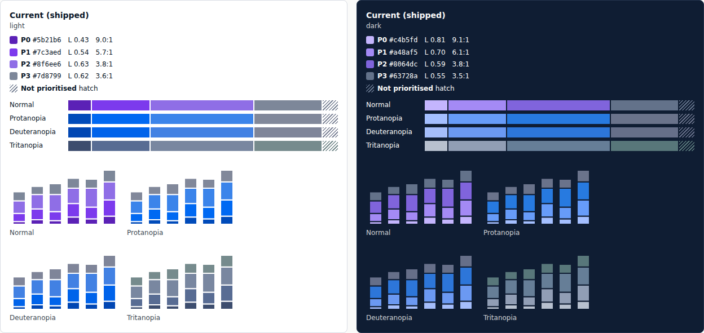
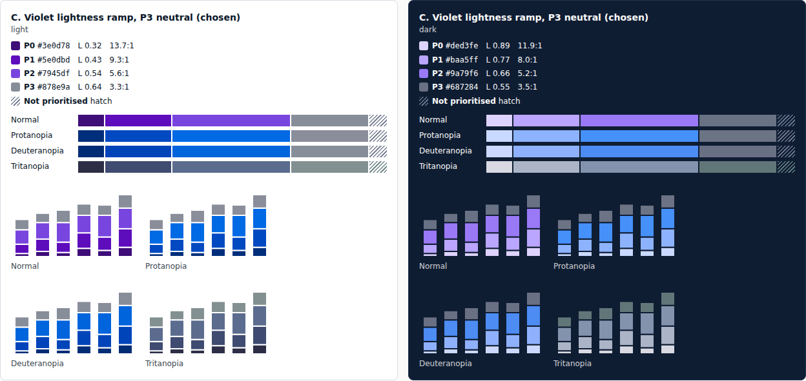
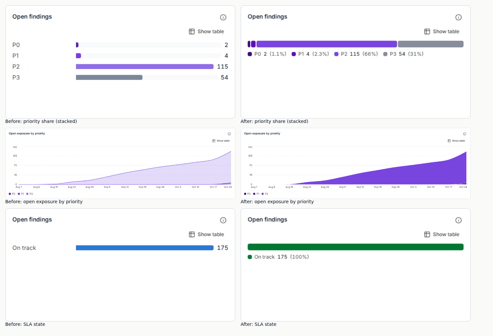
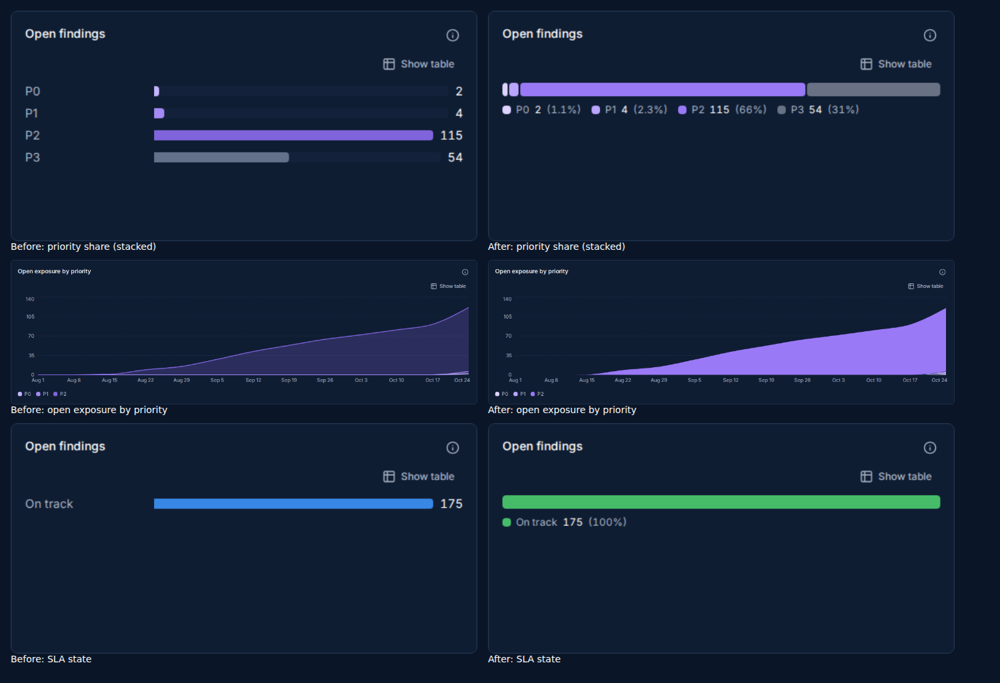

# Label colours

Every colour that carries meaning (priority, severity, criticality, workflow status, machine
health, SLA, tags, chart series) comes from one token layer: `src/styles/theme.css`, with the
chart steps sourced from `src/lib/chart-palette.json`. Components read the tokens through
`src/lib/*-colors.ts` and `src/lib/chart-palette.ts`; nothing else picks a colour.

The numbers below are asserted in CI by `src/styles/__tests__/contrast.test.ts` and
`scripts/check-palette.mjs` (both themes), and new code is held to the rules by
`scripts/check-palette-drift.sh`.

## How each kind of value is encoded

| Kind                                                           | Encoding                                                                       | Tokens                                           | Rendered by                                            |
| -------------------------------------------------------------- | ------------------------------------------------------------------------------ | ------------------------------------------------ | ------------------------------------------------------ |
| Ordinal decision: priority P0-P3                               | one violet ramp stepped by lightness; P3 neutral; "not prioritised" is a hatch | `--viz-prio-0..3`, `--viz-prio-none`, `--prio-*` | `PriorityBadge`, charts via `seriesVar` / `seriesFill` |
| Ordinal level that is not a problem: asset criticality, impact | a neutral ink ramp stepped by lightness                                        | `--viz-lvl-critical..low`                        | `Tag` levels, `CRITICALITY_CHART_COLORS`, `levelVar`   |
| How bad: severity                                              | the five severity hues; marks and AA text                                      | `--viz-sev-*`, `--sev-*`, `--sev-*-text`         | `SeverityBadge`, `severityVar`                         |
| A work item's state                                            | a lozenge tint per category plus an icon                                       | `--st-*`                                         | `StatusLozenge`                                        |
| A machine's state (runs, sensors, sync, SLA in charts)         | an icon colour plus the word; ok, warn and down apart in lightness             | `--hl-*`                                         | `HealthStatus`; SLA chart series                       |
| A user-chosen colour                                           | an 8px dot from 10 names                                                       | `--tag-*`                                        | `Tag` swatch                                           |
| Categories with no order                                       | 8 fixed slots, never cycled, then "Other"                                      | `--viz-cat-*`                                    | `categoricalVar`                                       |

## Priority

| Step                    | Light     | Dark      |
| ----------------------- | --------- | --------- |
| P0                      | `#3e0d78` | `#ded3fe` |
| P1                      | `#5e0dbd` | `#baa5ff` |
| P2                      | `#7945df` | `#9a79f6` |
| P3                      | `#878e9a` | `#687284` |
| Not prioritised (hatch) | `#7d8799` | `#63728a` |

- The most urgent class has the most contrast with the surface: darkest on paper, lightest on ink.
- Each step is at least 0.10 OKLCH lightness from the next, so the order survives every
  colour-vision deficiency (lightness is the one channel they all keep); adjacent steps are at
  least 8 delta E apart under protanopia, deuteranopia and tritanopia, and every step is at least
  3:1 on the card, paper and raised surfaces.
- The badge uses the same steps: the P0 box is filled with the P0 mark, and every box edge is its
  class's mark. A P1 in a chart and a P1 in a row are one colour.
- Priority is never drawn in a severity hue or the teal accent; criticality never takes a severity
  hue either.

## Chart rules

1. Ordinal keys keep their order (P0 first, critical first); the legend lists them in the same
   order with the value and share, so each segment is labelled directly.
2. Stacked segments are separated by a 2px gap of the card itself (bars) or a card-coloured edge
   (columns, areas), so two neighbouring steps never touch. Stacked areas are solid.
3. "none" (no value) is a hatch of the neutral step, never a hue (`seriesFill`, and an SVG pattern
   in recharts series).
4. Part-to-whole is one stacked bar, never a donut.
5. Hover outlines a segment in the foreground colour; keyboard focus shows the focus ring.
6. Every chart has a table view; colour is never the only cue.

## Families that share a row

| Pair                                                              | Minimum delta E (both themes) |
| ----------------------------------------------------------------- | ----------------------------- |
| health down vs severity critical                                  | 7                             |
| health warn vs severity high                                      | 10                            |
| tag violet vs any priority step                                   | 7                             |
| health ok, warn, down (each pair, worst colour-vision deficiency) | 7                             |

State text never sits on its own 10% tint (`text-success` on `bg-success/10` is 4.38:1 in light
mode); use `StatusLozenge`, `HealthStatus` or `DueChip`.
